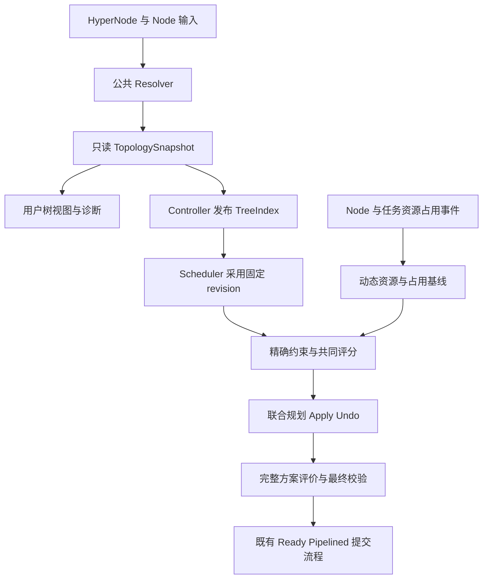

# 最终方案整合：树提供事实，统一规划决定放置

本稿合并解释 025 最后修订与仍适用的 015 详细合同，便于一次读完。它是设计归档，不是实现说明。新 SDK、CR、参数和接口名称均属拟议；具体字段与默认值需在实施阶段冻结。

## 1. 目标与联合范围

在固定调度快照、一个 PodGroup、本轮固定准入工作集及合法候选范围内，找到满足 hard 的物理节点映射，并在预算内改善全部启用偏好的共同收益。已有 Running peer 作为外部占用，不在本轮迁移；跨 Job 公平性及 preempt/reclaim 的联合优化不由此接管。

比较先遵守现有 Ready/Pipelined、资源与分片服务等级，再比较同等级方案的软收益。不能少放必须运行的 Pod 来抬高平均分，不能用高 soft 分抵消 required。有限预算下只对实际覆盖范围与已证明界作出保证。

## 2. 三种结构与三阶段交付

物理拓扑森林表达成员与祖先；工作负载关系图表达 affinity、anti-affinity 和收益依赖；搜索树表达部分放置如何扩展。三者分别维护。



| 阶段 | 责任 | 最关键的保证 |
| --- | --- | --- |
| P1 公共库 | 在 API module 提供纯数据 resolver、索引查询、详情组装与诊断 | 相同输入得到相同拓扑语义；API 库不反向依赖 scheduler。 |
| P2 controller | 发布身份、边、直接成员、tier、revision、hash 与诊断 | 内容等价不重写；分片全部就绪才切换 activeRevision。 |
| P3a scheduler 数据层 | 复用静态快照，增量维护资源与实际占用 | Session 使用拓扑与动态基线的一致组合。 |
| P3b planner | 精确候选、关系传播、共同评分、回退、缓存和预算 | hard 始终成立；前序选择可以撤销；完整目标不丢评分来源。 |
| P3c 受限算法 | matching／flow／tree DP 实验 | 证明适用范围或安全界后接入同一 planner。 |

## 3. 用户所见即所得，需要算法一致，也需要版本可见

展示区分 declared、resolved、scheduler-adopted。第一阶段只能保证相同输入的解析一致；scheduler 采用 revision、动态状态时间和详情 freshness 可见后，才能解释为何展示与实际调度暂时不同。

索引必须支持森林、缺失引用、环／多父诊断、tier 冲突及 Node 重叠 membership。HyperNode 单父不意味着物理 Node 只属于一个域。虚拟根服务展示或兼容遍历，不能充当真实 hard tier 证据；runtime synthetic root 仍需覆盖未归属真实 HyperNode 的节点。

保留旧 `status.nodeCount` 的来源含义，另展示直接子域、直接物理 Node、唯一后代 Node 数。tier3 下两个 tier2、合计四个物理节点时，`nodeCount=2` 不能简单判为错误。

## 4. 偏静态 CR 与动态资源分离

TreeIndex 只保存结构与 resolved membership，不塞入每层完整后代集合、Pod 列表和动态资源。Node 增删、影响 membership 的标签、HyperNode spec/UID 改变触发有效版本变化；Pod churn 和无关 status 更新不应造成结构重写。

小规模单对象原子更新，大规模使用同 revision 不可变分片和 manifest 切换。设置序列化字节门槛，缺片、混合版本、未知格式不得被采用。详情通过 lister／批量 List 组装，避免每节点一个 GET；UID/spec hash 不匹配明确标 stale。

多资源 informer 没有跨类型全局事务。revision 代表 controller 已验证的输入组合，不能把它表述为 API server 的全局瞬时快照。last-known-good 可用于解释，但不允许忽略已知删除、冲突或失效后继续放宽 required。

## 5. 静态快照、动态基线、事务 overlay

| 状态 | 内容 | 生命周期 |
| --- | --- | --- |
| TopologySnapshot | 边、成员、祖先、LCA、反向归属、revision | 跨 Session 只读复用。 |
| Resource/Occupancy Base | Node 资源与域聚合、实际主体占用 | 缓存事件驱动；Session 固定一致视图。 |
| Placement Overlay | 本次 Allocate/Pipeline、组域关系、计数和版本变化 | journal 记录，Apply/Undo 成对。 |

拓扑变化后，重建受影响聚合并重放窗口内资源／占用事件，再原子采用新元组；不能新树配旧资源。提交前还需检查已观察到的删除与失效。最终仍遵守现有 Reserve、缓存和 Bind 失败处理，不承诺跨 Pod 原子 Bind。

资源增量通过 `Node → allContainingDomains` 更新。严格树接近祖先链 O(depth)，有重叠时按实际包含域数计费，同一 Node 在同域只计一次。此索引不自动改变 GTA 的历史占用语义；改变 overlap peer 计分或硬过滤需要独立语义版本和验收。

域聚合只能作必要条件。两个各剩 4 GPU 的 Node，合计 8 GPU，并不保证能放一个 8 GPU Pod。B+C 的合法集合也不能使用含 A 的 LCA 总资源判定可行；叶节点 Predicate、设备／NUMA、存储、DRA 和 Gang 校验仍保留。

## 6. 硬约束：精确集合加动态关系

无约束、合法空集、显式允许集合应区分。静态硬范围以精确物理 NodeSet 组合，不能用共同祖先 envelope 替代。

但集合不足以表达“组内同域”或“两个组不同域”：还需要组的共同域变量、每个 tier 的实际占用集合、peer 关系和未放置 peer 的支持集合。LCA 只是一项查询，不能替代多域主体的占用集合。

SubGroup required/preferred affinity/anti-affinity 全部纳入 P3 核心：

- required 控制合法性；未放置 peer 保留联合求解状态，不能直接拒绝或忽略。
- preferred 以约定的有限收益进入共同评价；peer 多于域不自动变成 hard 失败。
- term 的方向、any/all 量词、selector 范围和计数单位保留 API 语义，不假设天然对称。
- count-aware 模式按 peer SubGroup／域去重，多个 Pod 以引用计数支撑域占用；peer 跨域时在各域出现。
- 仅当语义可证明为同 tier 等价关系时才收缩亲和组件；原有资源和 Predicate 仍需检查。

同一对单域 SubGroup，tier2 required affinity + tier1 required anti-affinity 可以放在同 pair 的不同叶域；反过来 tier1 亲和 + tier2 反亲和在严格嵌套树上冲突。正亲和成环本身不等于无解。

## 7. 统一评分必须一直延续到最终方案比较

节点候选在同一资源／分片类别及同一前缀下，用共同候选集合（cohort）执行启用评分，包括 NodeOrder 的逐节点、map/reduce、batch 与拓扑来源。保留 PreScore、Normalize、Weight、Skip/Error 等合同，权重只乘一次。单候选可跳过排序，但不能让完整方案漏记其贡献。

完整方案 evaluator 固定工作集、服务等级、评价顺序和来源表。对原生可加收益直接求值；有状态评分按约定基线与规范顺序重放。不能把不同 scope、不同前缀、不同归一化下留下的试放分数直接相加。外层也不能最后再按 HyperNodeOrder 覆盖统一目标。

结果应能解释 NTA/GTA、NodeAffinity、Binpack 及其他来源各自贡献。“全部评分共同作用”不保证某一个偏好总是胜出；权重、硬约束与已搜索候选共同决定结果。旧自定义评分也不能未经依据统一裁成 Kubernetes helper 的 0–100。

完整生命周期与算例保留在 [015 上游方案](sources/issues/features/015-unified-topology-planning-framework-IP/VOLCANO_UPSTREAM_TOPOLOGY_REFACTOR_DESIGN_CN.md)。

## 8. 一份可撤销状态，同时处理可行性和质量

```text
固定快照、工作集、策略、服务等级与预算
  → 编译 hard 范围和关系
  → 树摘要剪枝，惰性生成精确候选
  → Predicate 与共同评分
  → 按首选选择，Apply 并传播关系
  → 后续失败：Undo 到选择点，尝试替代
  → 完整合法：记录当前最好方案
  → 有质量预算：继续探索并按共同目标比较
  → 恢复胜者、最终校验、交给既有提交过程
```

保留一份活动状态、选择栈和紧凑最好方案，不按每个域克隆 Session。LDS／ILDS 借鉴的是首选优先的访问次序；安全传播、费用界和小规模精确算法帮助减少工作。一般联合放置最坏仍是组合搜索。

例：s1 可去 A/B，s2 只能去 A，A 只够一个组。先 s1→A 后 s2 失败，允许撤销成 s1→B、s2→A。这适用于纯资源竞争，也适用于 required 反亲和。若已有合法方案，还可以在质量预算内调整前序选择，使整体软收益改善。

Undo 必须恢复资源、组占用、共同域、peer 计数、CycleState、Reserve/Unreserve 和 rejection scope。恢复失败不能携带半份方案继续比较。不可撤销插件限制额外探索能力，不能被假设为支持任意次数重放。

## 9. SubGroup 缓存是可重验的提示，不是被冻结的结果

缓存区分静态解析／编译结果、前缀相关中间结果、紧凑 placement 模板。后者保存 Task→Node 与依赖签名，不保存可直接再次 Commit 的 Statement。

依赖包括 Job/Task UID、工作集、拓扑 revision、hard scope、策略与配置、资源、peer 集合和占用、prefix、cohort/评分版本。peer 位置变了，即使本组节点资源没变，关系和分数也可能失效。跨 Session 模板默认 warm start，需要重新 Predicate、Reserve 和整体校验。

父域扩展可以继承仍合法的子组前缀，但必须能撤销；子域失败不证明父域失败；原 scope 的归一化总分不能直接作为新 scope 的最终分。缓存条目数与字节双限额，miss 后仍进入同一个 planner。

## 10. 域级比例、绝对预算与性能对账

固定比例 p 仍有 O(pH) 随 HyperNode 数增长。设计采用首批比例、最少候选、绝对工作量和渐进扩展：跨合法子树惰性覆盖，历史成功可作提示，稳定轮转避免长期偏置。不能先展开并排序全量域，再宣称比例选优省掉遍历。

预算计入域访问、Node Predicate、Score、传播、回退、状态恢复、内存与时间；计数和结果必须记录截断原因与覆盖范围。未访问唯一可行域时只能说预算耗尽／覆盖不足，不能永久缓存“全局无解”。发现首解后，质量探索使用独立预算。

成本分开核算：

1. 同语义下减少的重复构图、集合复制、资源聚合和重复试放。
2. 候选扩大、完整评分与状态维护所增加的首解成本。
3. 额外质量探索、回退、恢复和最终评价的成本。

静态快照复用不消除全部 Node/Job snapshot 成本；重叠 membership 更新按实际包含域数计算；稠密 SubGroup 关系可有 O(S²) 条边，不能把整次更新都承诺成 O(depth)。目标方案没有真实实现加速比，旧原型和论文数字仅保留原范围。

## 11. 网络流和树 DP 的使用边界

Quincy/Firmament 提供费用图、聚合、增量求解的参考。若任务同构、不可拆 slot、资格边固定、代价可加，可以对受限子问题用 min-cost flow；相同大小的单域组和一对一反亲和可用匹配。流中的单位需是任务 slot，不能把一个 8 GPU Pod 拆成可跨机器的 8 单位流。

任意多维资源、Gang 全有或全无、未决 peer 关系、候选归一化、有状态插件，不直接等价于普通单商品流。树 DP 的状态维度也会被资源与跨子树关系放大。它们可提供初始解、必要条件或乐观界；必须证明界方向和适用条件，再由真实语义复核。[一手参考与边界](REFERENCES_CN.md)

## 12. 兼容与验收边界

P1/P2 可独立落地；P3a 先做同语义差分；P3b 的新评分与关系行为显式启用。soft→hard 转换的删除需覆盖 preempt/reclaim 等消费者。提名、idle/futureIdle、soft sharding、准入工作集与现有插件生命周期必须保持明确合同。

实施前尚需冻结 overlap 兼容、invalid/stale index 行为、分片范围、soft 默认 tier／收益版本、未来 SubGroup API 适配、缓存依赖、默认预算与性能门槛。完整用例保存在 [025 验证计划](sources/issues/features/025-hypernode-tree-index-planning-OPEN/PROPOSAL_COMMIT.md)，当前均未执行。本次归档不替代任何原有审批或验收。
