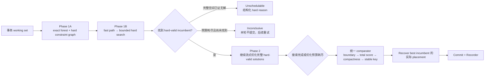
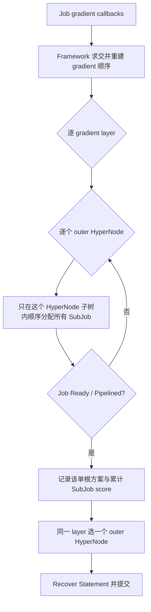
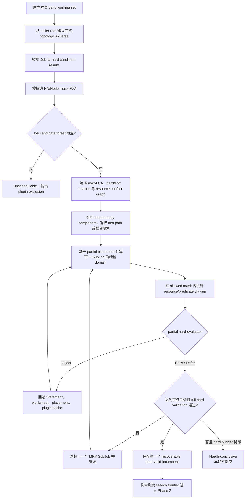
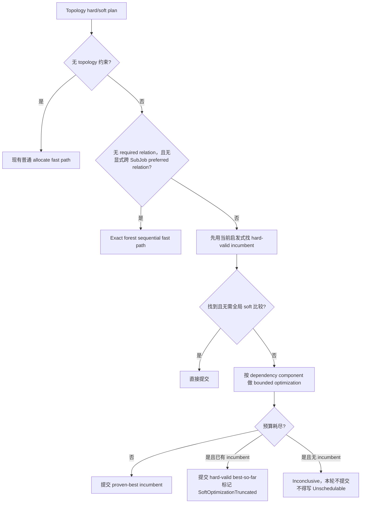
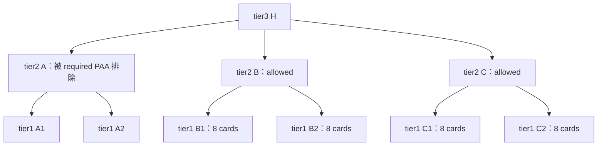

> 归档快照（2026-11-05）。本文保留原有阶段、基线和历史结论；其中的“当前”“完成”仅适用于原文对象。最终设计入口及证据边界见[归档说明](../../../../README.md)。本次仅迁移链接并添加此提示，未重新执行文中的命令。

# 011：Topology-aware Allocate 两阶段重构提案

## 审批状态

- 当前阶段：可行性分析与 proposal
- 实现状态：未开始
- 源码基线：`ec7141e5d`
- 基线分支：`fix/008-hypernode-job-soft-affinity-across-subjobs`
- 工作分支：`fix/011-topology-two-phase-allocation`
- 与 009 的关系：011 是同一问题的独立架构方案，不包含
  `fix/009-podgroup-antiaffinity-multi-domain-allocation` 的局部修复提交。

本文件中的实现范围和验证用例需要用户明确批准后才能成为实现门禁。在批准前不修改
Volcano 实现代码。

## 结论摘要

该方案可行，但需要对最初的“两阶段”表述做两点必要修正。

1. 第一阶段不能只构造“一棵可选子树”，而要构造**精确候选森林**：
   - required PodGroup anti-affinity 可能产生不连通的 `{B,C}`；
   - `{B,C}` 的 LCA 是 H，但 H 的完整子树是 `{A,B,C}`；
   - 因此 LCA、一个共同父节点或一个外层 HyperNode 都不能代替精确集合。
2. 第一阶段不能只执行一次静态 filter，还必须求出 hard-feasible placement：
   - Job/SubJob hard `highestTierName` 约束最终 placement 的 LCA；
   - required SubGroup affinity/anti-affinity 依赖同一事务内其他 SubJob 的
     placement；
   - predicate、资源和 gang ready 只有在 task dry-run 后才能最终判定。

进一步的复杂度分析表明，“先枚举全部 hard-feasible solutions，再统一打分”在大
SubGroup 场景不可接受。推荐模型仍然保持 hard/soft 两阶段语义，但 candidate
forest 和约束图必须是**完整的符号化表示**，solution search 必须是
fast-path-first、lazy 和 bounded 的：

```text
Phase 1A：编译 hard topology
  精确候选森林 + Job/SubJob hard 约束图 + bounded working set

Phase 1B：先求一个 hard-feasible incumbent
  先走顺序 fast path；失败或存在 hard relation 时做受控回溯
  每个候选都通过真实 predicate/resource dry-run

Phase 2：soft optimization
  沿 Phase 1 的剩余 search frontier 流式探索
  只给完整 hard-valid solution 打分，只保存当前 best solution
  达到预算时可提交 hard-valid best-so-far，不宣称 soft 全局最优
```



这里的“完整”指不因单根 Job 容器、gradient 顺序或 soft preference 提前丢失
topology domain；不是把所有完整 placement 同时保存在内存中。它也不承诺枚举通用
Kubernetes 调度中所有 task-to-node 组合；Node 级 predicate 和 NodeOrder 仍由
现有 task allocator 完成。否则问题会扩张为通用 NP-hard 节点放置穷举，不适合作为
本次 topology allocate 重构的范围。

## 现有代码问题

### 1. gradient 同时承担 hard set 和 soft order

当前 `HyperNodeGradientForJobFn` 和 `HyperNodeGradientForSubJobFn` 返回
`[][]*HyperNodeInfo`。同一个返回值同时被解释为：

- 所有 plugin hard 结果的候选成员集合；
- allocate 尝试候选的 gradient 先后顺序；
- 某些 preferred SubGroup 规则需要的 Job 外层容器顺序。

framework 的 `intersectHyperNodeGradients` 先按名称求交，又通过
`rebuildIntersectedGradients` 合并 plugin 顺序。结果是 hard feasibility 和 soft
preference 在进入 allocate 前已经耦合。没有 hard 约束的 plugin 也不能真正
abstain，只能返回完整子树以避免误过滤其他 plugin。

### 2. allocate 将同一 layer 的 HyperNode 当作互斥 Job 容器

当前主流程为：



在生产拓扑中，required PodGroup anti-affinity 正确过滤出 B、C 后，当前逻辑分别
尝试“整个 Job 放在 B”和“整个 Job 放在 C”，没有表达“整个 Job 可使用
`B ∪ C`”的状态。每个域只有两个 8 卡 Node，而四个 Pod 各请求 6 卡，所以两个
单根方案都只能放置两个 Pod。

### 3. hard network topology 是 placement 约束，不只是候选过滤

例如 Job hard `highestTier=tier2` 的语义是所有新旧 Job placement 的 LCA 不得高于
tier2。即使候选森林含 B、C，也不能让一个 solution 同时使用 B、C；否则最终 LCA
是 tier3。

因此以下两种情形必须由同一个模型区分：

```text
PAA 精确允许：{B,C}

无 Job hard network topology：
  一个 solution 可以联合使用 B 和 C

Job hard highestTier=tier2：
  一个 solution 必须选择 B 或 C 中的一个 tier2 envelope

Job hard highestTier=tier3：
  一个 solution 可以联合使用 B 和 C，但仍不得进入 A
```

单纯的 HyperNode 名称交集不能表达“允许集合”和“一个 solution 可以跨越到什么
层级”之间的区别。

### 4. required SubGroup 规则是动态关系约束

`group-topology-affinity` 当前在过滤某个 SubJob 时，从已分配 peer SubJob 的
task/`AllocatedHyperNode` 推导占用域：

- required affinity：候选必须与 peer 位于 term tier 的同一域；
- required anti-affinity：候选不得与 peer 位于 term tier 的同一域；
- peer 尚未放置时，当前过滤不能一次性得出最终集合。

所以 SubGroup hard 条件需要显式的 partial placement state 和关系图。按固定
SubJob 顺序贪心分配可能先选到一个局部可行域，导致后续 peer 无解，而另一个首选域
本来存在完整解。

### 5. soft score 目前分散且可能先过滤

soft topology 当前存在于多个位置：

- gradient layer 的特殊排序；
- `preferJobSoftTopologyCandidates` 的候选收窄；
- `preferJobSoftTopologyScoreCandidates` 的外层候选收窄；
- `HyperNodeOrderFn` 的 plugin score；
- `BatchNodeOrderFn` 的 Node score；
- Job 最终解中的 LCA/score 比较。

这使 preferred 规则是否真正影响最终解依赖它在流程中的位置。Bug 010/K7 已证明
preferred SubGroup anti-affinity 虽然计算出了分散方案的高分，仍可能被更早的 Job
紧凑性比较覆盖。

### 6. 事务状态与一个 outer HyperNode key 耦合

`Recorder` 当前以 `hyperNodeForJob` 为 SubJob decision 的第二级 key。候选森林
没有一个合法的合成 HyperNode 名称；`B+C` 不是资源对象，H 又会错误表示 A 也可用。

Phase 1 搜索还会反复 Recover/Discard `Statement`，并触发
`network-topology-aware` 的资源 cache Allocate/Deallocate event。任何新搜索模型
都必须保留严格的事务恢复，不能只复制 worksheet 而遗漏 Session、Task、
NodeInfo、plugin cache 和 Job/SubJob placement 状态。

## 历史实现可复用的经验

仓库历史中有三组独立证据说明该方向可以实现，但没有一个提交可直接解决 011。

| 历史工作 | 已证明的能力 | 不能直接解决 011 的原因 |
| --- | --- | --- |
| `dc7d5f17c` | 显式 `Abstain/Constrain`、hard/soft 分离、framework hard intersection | 不在 008 基线上，且范围包含 API/docs/CRD 等大量变化 |
| `edaaf83a7` | recoverable SubJob candidate、统一 Job solution、SubJob 联合搜索与 state pruning | 搜索仍从一个 outer Job HyperNode 开始，不能表达 `{B,C}` 精确并集 |
| `473c6538b`（009） | allocate 内 multi-root exact domain、联合资源检查、实际 placement recorder | 是针对当前故障的局部顺序式修复，没有重构 plugin contract 和通用 hard relation search |

011 应当复用这些工作验证过的**概念**和测试思路，但从 008 基线重新实现，不整体
cherry-pick 任何一个历史大提交。

## 模式有效性评估

### 1. hard feasibility 与 soft utility 分离是正确抽象

从问题性质看，topology-aware allocate 是一个 constraint optimization problem：

- required/hard、resource、predicate、gang 定义可行集合；
- preferred/soft 和 bin-packing 定义可行集合上的 utility；
- scheduler 的输出是一个满足全部 hard constraint 的 placement，并尽量优化
  utility。

当前 gradient 把 set membership 和 iteration order 放在同一个返回值中，相当于让
“搜索顺序”隐式改变“可行集合”。两阶段模型将它们分离，具有以下稳定性质：

1. 增加一个 soft plugin 不会使原 hard-feasible placement 消失；
2. hard plugin 的注册顺序不改变精确交集；
3. soft scorer 的注册顺序不改变 comparator 输入；
4. hard constraint 可以给出精确 rejection reason；
5. 最终 Job/SubJob LCA 从实际 task placement 推导，不反向扩大 search domain。

因此作为**语义模型**，两阶段模式比当前逐层选择更通用，也更容易验证。

### 2. 当前逐层选择并非所有场景都错误

当前算法在以下假设同时成立时是高效且通常正确的：

- Job 的合法范围能由一个单根 HyperNode 子树表达；
- 每个 SubJob 的 hard 条件只依赖自身和已提交 placement；
- 固定 SubJob 顺序的第一个可行选择不会破坏后续 SubJob；
- 所有 soft preference 都能表示成同一个 gradient 先后顺序；
- lower tier 的 first-feasible 与最终期望目标一致；
- 不需要比较不同 outer container 产生的完整跨 SubJob layout。

这类场景包括：

- 单个 Job/SubJob hard network topology；
- 没有 SubGroup relation 的普通 topology packing；
- exact candidate 只有一个 envelope；
- 无 topology plugin 的普通 Job。

011 不应删除这条路径，而应把它变成一个显式 fast path。新 planner 先判断上述条件；
条件满足时复用顺序式分配。只有 fast path 失败，或 hard/soft dependency 明确要求
完整 layout 比较时，才进入联合搜索。

### 3. 新模式能解决的新增场景

| 场景 | 当前逐层选择 | 011 模型 |
| --- | --- | --- |
| required PAA 后得到不连通 `{B,C}` | 把 B、C 当成互斥 Job 容器，可能 gang 不足 | exact forest 可联合使用 B、C |
| `{B,C}` 的 LCA H 包含 forbidden A | 只能选单根或冒着 LCA expansion 泄漏风险 | allowed HN/Node mask 保证 A 永不进入 |
| Job hard tier2 与 PAA `{B,C}` 组合 | 单根碰巧保证 hard，但无法说明联合边界 | hard envelope 明确禁止跨 B+C |
| required SubGroup 关系需要改变首个 SubJob placement | 固定顺序贪心，可能 order-dependent Pending | relation graph + backtracking 可找到另一个完整解 |
| preferred SubGroup 分数依赖 peer 最终位置 | score 在部分状态计算，可能被 outer comparator 覆盖 | complete solution scorer 统一比较 |
| 两个 topology plugin，一个无 hard 意见 | no-op plugin 必须返回 full subtree，存在耦合 | `Abstain` 不参与 hard intersection |
| Job minResource 由多个 allowed root 联合满足 | per-root 预过滤可能误删 | forest/envelope 聚合 lower-bound |
| 增量调度已有 Job/SubJob placement | 多处临时 LCA 与 gradient 顺序共同决定 | placement view + hard envelope 显式表达 |
| preferred domain 资源不足 | soft narrowing 依赖调用位置 | hard set不变，soft optimizer自然选择 fallback |
| 诊断一个 plugin 排除了哪些分支 | gradient stats 只能部分解释 | exact exclusion、constraint state、search result 分层输出 |

### 4. 新模式仍不能自动解决的场景

以下问题不应被宣传为 011 可以完整解决：

1. 同一个 HyperNode scope 内存在多个 task-to-node 排列，NodeOrder 的第一个选择导致
   后续失败，而另一个 Node 排列可行；
2. topology placement 需要与 preemption/reclaim 的多方案联合搜索；
3. 跨 scheduler session 保存并继续一个尚未完成的 search frontier；
4. 任意第三方 plugin 具有未声明的可变全局副作用；
5. 超大、稠密的 preferred relation graph 上保证 soft 全局最优；
6. 资源在 search 期间被另一个 scheduler/process 并发改变；最终 commit 仍需现有
   Session/Cache 一致性保障。

其中第 1 项是本 proposal 最重要的完备性边界：011 保证 topology candidate 不被
错误丢弃，但不保证 Node assignment 的数学完备性。

### 5. hard graph 与 soft graph 必须分开建模

只按 required relation 建 hard connected components 还不足以获得正确的 preferred
layout：

- preferred SubGroup affinity/anti-affinity 会连接原本 hard-independent 的
  SubJob；
- Job soft final LCA 是覆盖本事务所有 SubJob 的全局 hyper-edge；
- network bin-packing 通过剩余资源使候选 score 相互依赖。

推荐 planner 同时构造：

```text
HardDependencyGraph
  决定哪些变量必须联合求可行解

SoftDependencyGraph
  决定哪些 hard-feasible component 必须联合比较 utility

ResourceConflictGraph
  allowed Node mask 重叠时，决定哪些变量的资源状态相互影响
```

求 hard incumbent 时只允许 hard graph 删除 branch。顺序 fast path 可以在共享资源
上先尝试一个完整 placement；若成功，它至少是安全 incumbent。需要联合 search 或
Phase 2 改进时，再按 hard+soft graph 和 resource conflict 的并集划分 component；
没有跨 component edge 且 score 可分解时不需要做笛卡尔积。Job final-LCA 这类全局
树目标使用 envelope/tree evaluator，不能仅因为它覆盖所有 SubJob 就退化为全变量
通用 DFS。

### 6. 有效性结论

该模式满足以下条件时是有效的：

- Phase 1 保存的是精确、符号化 hard domain，不是单根或全部 solution 列表；
- max-LCA 和 SubGroup relation 作为 placement constraint，而不是伪装成静态树；
- Phase 2 只给已经通过 full hard validation 的 solution 打分；
- fast path 失败后能够进入更完整的 topology search；
- search budget 不被解释为“已证明无解”；
- soft budget 截断只降低 preferred optimality，不降低 hard correctness。

如果实现仍然“逐个 forest root 选一个 Job 容器”，或 Phase 1 物化全部 placement，
则不满足这个结论。

### 7. 与当前路径和 009 的工程决策

| 方案 | 改动/回归面 | 能力 | 性能风险 | 推荐用途 |
| --- | --- | --- | --- | --- |
| 008 当前逐层 | 最小 | 单根、局部 first-feasible | 已知、通常线性 | 现状基线 |
| 009 multi-root domain | allocate 内局部 | 解决 B+C exact union，保持顺序分配 | 低至中 | 生产问题的低风险直接修复 |
| 011 adaptive two-phase | allocate + framework + 两 plugin | exact forest、hard relation、统一 soft solution scoring、可解释诊断 | 中至高，必须有 fast path/budget | 长期 topology allocation framework |

因此：

- 如果唯一目标是尽快修复本次 4 Pod Pending，009 的风险收益比更好；
- 011 的价值在于同时消除 single-root、hard/soft coupling、required relation 贪心和
  preferred score 分层失效等一组结构性问题；
- 011 不应未经 P1/P2/K4 门禁直接替换生产逐层路径；
- 011 应保留 feature/action mode 或清晰回退开关，至少经过一轮对照验证后再成为
  默认 topology path；
- 回退到 legacy 只能由配置明确选择，运行时不能在新 hard solver 出错后静默回退到
  可能违反 exact forest 语义的旧路径。

## 目标与非目标

### 目标

1. hard 规则只缩小候选或拒绝 solution，soft 规则绝不删除 hard-feasible fallback。
2. 用精确 candidate forest 表达不连通的可用 topology domain。
3. 同时支持 Job/PodGroup 和 SubJob/SubGroup 两层 placement。
4. 正确组合：
   - Job/SubJob hard 与 soft network topology；
   - required/preferred PodGroup anti-affinity；
   - required/preferred SubGroup affinity/anti-affinity；
   - resource、predicate、gang、incremental allocation。
5. 让所有 topology soft preference 通过一个可解释的 solution ranking 路径生效。
6. 保留非 topology Job 的现有快速路径。
7. 保证搜索结果确定、可恢复、可诊断，并对组合复杂度进行结构化约束。

### 非目标

1. 不修改 PodGroup/Job CRD schema，不改变用户 API 字段。
2. 不重写普通 Node predicate、preemption、reclaim 或 queue 调度主流程。
3. 不穷举同一 topology scope 内所有 task-to-node 排列。
4. 不把 011 变成新的通用 SAT/ILP solver。
5. 不在搜索耗尽或达到保护条件时静默提交未证明满足 hard 规则的 placement。
6. 不以 LCA expansion、完整父子树或 soft-first shortcut 代替精确 hard 集合。

## 核心数据模型

以下类型名是 proposal 级名称，实施时可按现有包风格微调。

### 1. `TopologyCandidateSet`

```go
type TopologyCandidateSet struct {
    ScopeRoot        string
    AllowedHyperNodes HyperNodeMask
    AllowedNodes      NodeMask
    MaximalRoots      []string
    ExcludedByPlugin  map[string]TopologyExclusion
}
```

语义：

- `AllowedHyperNodes` 和 `AllowedNodes` 是权威精确集合；
- mask 由 Session 稳定 ID/immutable bitset 支撑，日志/API 边界再解析为名称；
- `MaximalRoots` 只是加速遍历和日志展示的 canonical forest roots；
- 从 root 遍历到 HyperNode 或 Node 时必须再次检查 allowed mask；
- 不能因为某个 root 的 `RealNodesSet` 包含一个 Node 就绕过 allowed mask；
- 求交只改变 allowed set，不改变 soft order；
- 全部 plugin abstain 时结果等于 caller universe；
- applied hard constraint 返回空集合时是 Unschedulable，不是 abstain。

生产案例：

```text
ScopeRoot: H
AllowedHyperNodes: B、B1、B2、C、C1、C2
AllowedNodes: node-B1、node-B2、node-C1、node-C2
MaximalRoots: [B,C]
Excluded: A、A1、A2，以及不能作为精确容器的 H
```

### 2. `HardTopologyPlan`

```go
type HardTopologyPlan struct {
    Universe          TopologyCandidateSet
    JobCandidates     TopologyCandidateSet
    WorkingSet        sets.Set[SubJobID]
    SubJobDomains     map[SubJobID]TopologyCandidateSet
    Constraints       []TopologyHardConstraint
    HardRelationGraph TopologyRelationGraph
    SoftRelationGraph TopologyRelationGraph
    ResourceGraph     TopologyRelationGraph
}
```

`Constraints` 至少表达：

- Job/SubJob max-LCA tier；
- 已有 `AllocatedHyperNode` 对增量调度的合法 envelope；
- required PodGroup anti-affinity；
- required SubGroup affinity/anti-affinity；
- 一个 solution 必须达到的 gang/working-set progress；
- resource lower-bound 与最终 predicate/dry-run 状态。

两个 relation graph 的节点都是本事务需要考虑的 SubJob：

- hard graph 的边来自 required SubGroup affinity/anti-affinity，决定 feasibility
  search component；
- soft graph 的边来自 preferred SubGroup 规则和其他跨 SubJob scorer，决定 Phase 2
  optimization component；
- resource graph 在两个 SubJob 的 allowed Node mask 有交集、会竞争同一资源时连边；
- Job final-LCA scorer 可作为覆盖 working set 的 soft hyper-edge。

进入联合 search 后，真正可独立求解的 component 必须在 hard、soft、resource
三类 graph 的并集上互不相连。Resource overlap 本身不取消
feasibility-first sequential fast path：fast path 若得到完整 hard-valid placement
可以直接作为 incumbent；只有失败或需要进一步优化时才按 resource graph 联合搜索。
Job final-LCA 这种全局但具有树结构的目标不应直接把所有变量送入通用 DFS，而应使用
tier/envelope 专用 evaluator。

### 3. `TopologyPlacementState`

```go
type TopologyPlacementState struct {
    JobLCA           string
    SubJobLCA        map[SubJobID]string
    TaskNodes        map[TaskID]string
    Processed        sets.Set[SubJobID]
    Statement        *framework.Statement
    JobWorksheet     *JobWorksheet
}
```

该对象是 plugin hard evaluator 和 soft scorer 的只读 placement view。它必须包含
本轮 dry-run 选择与调度前已存在的真实 placement，避免 plugin 只能从隐式可变全局
状态猜测 peer 位置。

### 4. `TopologyAllocationSolution`

```go
type TopologyAllocationSolution struct {
    Statement          *framework.Statement
    Worksheet          *JobWorksheet
    JobPlacement       string
    SubJobPlacements   map[SubJobID]string
    TaskPlacements     map[TaskID]string
    Progress           TopologyProgress
    SoftScore          TopologyScoreVector
    DeterministicKey   string
}
```

Phase 1 找到的第一个完整 hard-valid solution 成为 incumbent；Phase 2 对后续流式
产生的完整 solution 填充统一 `SoftScore` 并更新 incumbent。Phase 1 不用 soft
score 删除或合并 placement 不同的 solution，内存中也不保存全部 solution。

## Plugin contract

推荐将现有 gradient callback 拆成三类职责。概念接口如下：

### 1. hard candidate provider

```go
type TopologyCandidateResult struct {
    Applied bool
    Allowed HyperNodeMask
    Reasons map[string]string
}
```

- 用于能安全表达为精确集合交集的一元条件；
- `Applied=false` 表示 plugin abstain；
- `Applied=true && Allowed.empty()` 表示 Unschedulable；
- callback error 单独返回，不能转成 empty 或 abstain。

### 2. hard placement evaluator

```go
type TopologyConstraintState string

const (
    ConstraintPass   TopologyConstraintState = "Pass"
    ConstraintDefer  TopologyConstraintState = "Defer"
    ConstraintReject TopologyConstraintState = "Reject"
)
```

- `Pass`：当前 partial/full placement 满足该约束；
- `Defer`：当前没有足够 peer/任务 placement 作最终判断；
- `Reject`：该搜索分支不可能满足 hard 约束；
- evaluator 可以返回下一步 candidate narrowing 和结构化 reason；
- full solution 不允许残留未解释的 `Defer`，除非规则语义明确允许“无 peer 时
  vacuously pass”。

### 3. soft solution scorer

```go
type TopologySolutionScoreFn func(
    job *JobInfo,
    placement TopologyPlacementView,
) (TopologyPluginScore, error)
```

- 输入是完整 hard-feasible solution；
- scorer 不能修改 candidate set；
- 每个 plugin 返回分项、权重后总分和说明；
- scoring error 使该调度尝试失败并记录诊断，不能把错误当成 0 分继续；
- 为降低迁移风险，现有 task 级 `BatchNodeOrderFn` 暂时保留。它负责一个 topology
  scope 内的 Node 选择，不负责过滤 topology forest。

### 两个 topology plugin 的职责映射

| 组件 | Phase 1 hard candidate / constraint | Phase 2 soft score |
| --- | --- | --- |
| `network-topology-aware` Job | hard highest tier、已有 Job placement envelope、最终 Job LCA validator | Job soft preferred-tier satisfaction、最终 LCA/locality、Job 级 network preference |
| `network-topology-aware` SubJob | hard highest tier、已有 SubJob placement envelope、最终 SubJob LCA validator | SubJob locality、HyperNode bin-packing；task 内 Node score 暂保留 |
| `group-topology-affinity` Job | required PodGroup anti-affinity 的 exact allowed forest；最终 placement 防漏校验 | preferred PodGroup anti-affinity |
| `group-topology-affinity` SubJob | required SubGroup affinity/anti-affinity 的关系边、partial/full evaluator | 基于完整 solution 的 preferred SubGroup affinity/anti-affinity |
| allocate core | gang working set、resource lower bound、predicate/dry-run、事务恢复 | 非 topology progress 优先级和稳定 tie-break |

迁移完成后，`group-topology-affinity` 不再需要通过
`prioritizePreferredSubGroupJobGradients` 选择一个“能暴露 sibling 的外层容器”；
candidate forest 本身始终保留所有 hard-allowed sibling。Bug 008 的两个
`preferJobSoftTopology*Candidates` helper 也应在 solution scorer 验证等价行为后
删除，避免 soft 继续作为 filter。

## 运行时 Phase 1：hard feasibility

### 总流程



### 1. bounded gang working set

沿用并收紧 Bug 004 已验证的 working-set 思路：

1. 从使 Job 达到 `minMember` 和各 policy `minSubGroups` 所需的最小 SubJob 集开始；
2. minima 已满足或为 0 时，至少加入一个能产生非空进展的 pending SubJob；
3. 若 required relation 需要未放置 peer 作为 witness，只扩展相连 hard component
   中判定该事务所需的最小 peer 集；
4. 已 ready 的 SubJob 不因仍有多余 replica 就重复进入同一 transaction；
5. 本轮外的剩余 SubJob 在后续 allocate iteration 中使用已提交 placement 继续判断。

这避免为了证明四个必需 SubJob 的 placement 而搜索整个 Job 所有 pending replica。

### 2. static Job candidate forest

在 cluster-top/caller scope 下建立一次 universe，然后只对 applied hard candidate
provider 求交：

```text
Universe
  ∩ network-aware unary hard domain
  ∩ group-affinity required PodGroup anti-affinity
  ∩ 其他未来 topology hard providers
  = exact Job candidate forest
```

soft/no-op plugin abstain，不再返回 full subtree 参与 intersection。

Job `minResources` 不能继续按每个 root 独立预过滤。新的 lower-bound 检查应：

- 对 exact allowed Node mask 去重聚合 Idle/FutureIdle；
- 若 hard max-LCA 会把 forest 分成互斥 envelope，则按 envelope 聚合；
- 只作为安全剪枝，不代替 task dry-run；
- 不允许因 B、C 单独不满足而在联合检查前删除 B、C。

### 3. max-LCA envelope

hard network topology 编译为 solution constraint，并生成可用于剪枝的 envelope：

- Job 未有 placement：
  - hard tier T 下，一个 solution 只能使用同一个 tier-T ancestor 覆盖的 allowed
    Node；
  - forest 与每个 tier-T ancestor 求交后得到多个 envelope，逐个求解；
- Job 已有 placement：
  - 先求允许扩张到的最高 ancestor；
  - 再与 exact candidate forest 求交；
  - 不相交时立即 Unschedulable；
- SubJob 使用同样规则，但约束其自身最终 LCA；
- soft mode 不生成 hard envelope。

envelope 是 candidate forest 的一个精确切片，不是新的完整父树；每次 task Node
枚举仍检查 allowed mask。

### 4. dynamic SubJob domains

每个搜索状态下，下一 SubJob 的 domain 由以下结果求交：

```text
Job exact forest
  ∩ 当前 Job hard envelope
  ∩ SubJob hard network envelope
  ∩ required SubGroup relation 对 partial placement 的限制
  ∩ 已有 SubJob placement 的增量边界
```

当 peer 尚未放置时，关系 evaluator 返回 `Defer`，搜索器保留可选域并在 peer 放置
后 forward-check。它不能把“当前还看不到 peer”误当成永久无约束。

### 5. search strategy

推荐算法：

- 无 required SubGroup relation 且无跨 SubJob soft dependency 的 component 使用
  顺序 fast path；
- fast path 失败，或存在 required relation 时，使用 DFS/backtracking 求第一个
  hard-valid incumbent；
- 下一变量优先选择合法 domain 最小的 SubJob（MRV）；
- 每次放置后执行 forward checking，任何未处理 SubJob domain 为空即剪枝；
- candidate/envelope/Node 名称稳定排序；
- 对 task/SubJob placement、剩余资源、worksheet 和 processed 集都相同的状态使用
  canonical state key 去重；这种状态的未来 hard 可行域和最终 soft 输入也相同；
- placement 或资源状态不同的 branch 即使当前看起来较差，也不能在 Phase 1 因
  soft score 被删除；
- Phase 1 使用 MRV、资源 lower-bound 和稳定名称排序，不使用 soft score 决定
  剪枝；
- 记录 explored/pruned state 数和每个剪枝原因。

Phase 1 必须受 per-Job/action budget 约束，但预算耗尽不等于已证明无解：

- 搜索空间完整穷尽且无 solution：`ProvenUnschedulable`；
- 预算耗尽且尚无 solution：`HardInconclusive`，本轮不提交并允许后续重试；
- 已找到 solution：进入 Phase 2，incumbent 可安全提交。

具体默认预算必须经过本 proposal 性能 stop/go gate 后确定。

### 6. task dry-run 是最终资源/predicate 判定

topology plan 只确定可进入哪些 HN/Node domain。每个 placement candidate 仍调用
现有 task allocator：

- predicate；
- queue allocatable；
- NodeOrder；
- allocate/pipeline Statement；
- NodeInfo resource；
- network-aware resource cache event。

每条搜索分支必须以统一 snapshot/recover helper 包围：

```text
Job/SubJob AllocatedHyperNode
Task status/NodeName/JobAllocatedHyperNode
NodeInfo resource/task state
Job/SubJob worksheet
Statement operations
plugin Allocate/Deallocate side effects
fit errors
```

现有 `Statement.SaveOperations/RecoverOperations/Discard` 可继续作为底层事务机制，
但 solution 必须显式保存 placement 和 worksheet，不能依赖最后一次尝试残留的
Job/SubJob 字段。

## 运行时 Phase 2：soft optimization

### 1. 只比较完整 hard-feasible solution

Phase 2 输入必须满足：

- 所有 Phase 1 hard candidate constraint；
- Job/SubJob 最终 LCA hard validator；
- required PodGroup/SubGroup 规则；
- 本轮 working-set/gang progress；
- resource/predicate dry-run；
- 非空 Statement（零 minima 场景也必须产生真实进展）。

preferred 规则不参与这一轮的可行性删除。Phase 2 不要求 Phase 1 预先物化
solution list；optimizer 沿剩余 frontier 流式产生候选，每个候选完成 full hard
validation 后才评分。

### 2. solution 级 scoring

每个 topology scorer 观察同一个 final placement：

- Job 最终 LCA；
- 每个 SubJob 最终 LCA；
- 每个 task 的 Node；
- 本事务前已存在的 placement；
- exact candidate forest；
- 资源使用结果。

这样 preferred SubGroup score 与 SubJob 处理顺序无关，也不会出现“第二个 SubJob
算出正确分数，但 outer Job comparator 看不到这个完整 layout”的问题。

Phase 2 只保存 best incumbent。优化空间完整遍历或被安全 upper bound 剪完时，
结果为 `SoftOptimal`；预算耗尽时为 `SoftTruncated`，仍可提交 hard-valid
best-so-far。

### 3. 推荐 comparator

为保持 gang 和现有 soft network 边界语义，推荐统一比较顺序：

1. hard-valid 且达到事务目标；
2. 最大化本轮 required progress，禁止 soft 高分方案少分配必需成员；
3. 最大化 soft network preferred-tier satisfaction：
   - Job 是否位于 soft preferred maximum tier 内；
   - 参与事务的 SubJob 中满足各自 soft preferred tier 的数量；
   - 没有 in-bound solution 时保留 out-of-bound fallback；
4. 最大化所有 enabled topology `SolutionScoreFn` 的加权总分；
5. 仅在总分相同时，以更低的实际 Job/SubJob LCA tier 作为 compactness tie-break；
6. 以稳定的 `SubJobID=HyperNode,TaskID=Node` key 作最终 tie-break。

第 3 项沿用 soft `highestTierName` 作为 preferred boundary 的语义；第 4、5 项明确
修复 Bug 010/K7 的优先级问题：两个 solution 同在 boundary 内时，preferred
SubGroup/plugin score 必须先于隐式紧凑性。

如果希望未来让 network preferred boundary 与其他 plugin 完全按数值权重竞争，应
另立 API 语义任务，因为现有 `networkTopology` 没有用户可配置的 term weight。

### 4. network-aware 与 group-affinity score

`network-topology-aware`：

- Job/SubJob soft highest tier satisfaction；
- final LCA locality；
- HyperNode resource bin-packing；
- 保留现有 task 内 BatchNodeOrder 作为局部 Node 选择。

`group-topology-affinity`：

- preferred PodGroup anti-affinity 基于 final Job/task placement；
- preferred SubGroup affinity 对 term 中实际 peer pair 评分；
- preferred SubGroup anti-affinity 对实际 peer pair 评分；
- 同一 policy 多实例的 term 必须基于实例对评分，不依赖谁先调度；
- weight 继续使用 API term weight 与 plugin global weight。

## 复杂度模型与性能评估

### 1. 变量定义

为避免只用“大概更慢/更快”描述，定义：

- `H`：caller scope 内 HyperNode 总数；
- `N`：scope 内 Kubernetes Node 总数；
- `P`：enabled topology hard provider 数；
- `S`：本事务 working set 中的 SubJob 数；
- `D_i`：SubJob `i` 的 topology domain 数；
- `T_i`：SubJob `i` 本轮需要 dry-run 的 task 数；
- `C_pred(i,d)`：SubJob `i` 在 domain `d` 上运行 predicate/NodeOrder/dry-run 的
  成本；
- `R_h`：hard dependency graph 的 connected component 数；
- `F`：被实际访问的 search state 数；
- `Q`：找到的完整 hard-feasible solution 数。

### 2. 当前逐层算法复杂度

忽略 queue/job order 的公共成本，当前 topology path 大致为：

```text
Job gradient：
  O(P × H)

对每个实际尝试的 outer Job HyperNode j：
  对每个 SubJob i：
    O(P × H_j)                              // SubJob gradients
    + O(Σ candidate d 的 C_pred(i,d))       // task dry-run
    + O(D_i)                                // HyperNode score/selection
```

当前算法不会枚举 `D_1 × D_2 × ... × D_S`，因此组合复杂度通常近似线性于
`ΣD_i`。它的主要性能优势来自：

- first feasible gradient 后立即返回；
- 每个 SubJob 只提交当前最佳 candidate；
- 不回溯之前的 SubJob。

代价是不能发现被早期局部选择遮蔽的完整解。

### 3. 新模型的静态成本

如果使用 session 级 topology index 和 immutable bitset：

```text
建立/复用 topology structural index：
  O(H + N)

每个 Job 的 hard candidate composition：
  O(P × H / machine-word-size)

构造 forest roots、envelope、relation graph：
  O(H + S + relationTerms)
```

这部分不是主要风险，甚至可能比当前每个 plugin、每个 SubJob 重复 BFS full subtree
更低。必须避免：

- 为每个 Job 深拷贝 `RealNodesSet`；
- 为每个 candidate 展开一份完整 Node slice；
- 在 ancestor/descendant 间重复聚合同一 Node resource；
- 用 `map[string]struct{}` 做所有热路径交集而不建立稳定整数 ID。

推荐 Session 初始化时建立：

- `HyperNodeID`/`NodeID`；
- parent、ancestor-at-tier、descendant bitset；
- HN -> real Node bitset；
- tier domain ID；
- topology generation/version；
- 按 HN/tier 的只读结构索引。

Job plan 只保存 bitset view 和少量 delta/exclusion，不复制整棵树。

### 4. 联合搜索的最坏复杂度

没有剪枝时，完整 topology assignment 数是：

```text
Π(i=1..S) D_i
```

当每个 SubJob 都有 `D` 个 domain 时是 `D^S`。如果每个 domain 只能放一个
SubJob，forward checking 将其变成 all-different permutation search，但仍然是
指数/阶乘复杂度。

| SubJob S | Domain D | 当前顺序候选上界 `S×D` | 笛卡尔积 `D^S` | all-different 完整解 | all-different DFS 总状态 |
| ---: | ---: | ---: | ---: | ---: | ---: |
| 4 | 4 | 16 | 256 | 24 | 65 |
| 8 | 6 | 48 | 1,679,616 | 0 | 1,957 |
| 8 | 8 | 64 | 16,777,216 | 40,320 | 109,601 |
| 16 | 16 | 256 | 18,446,744,073,709,551,616 | 20,922,789,888,000 | 56,874,039,553,217 |

结论：

- 生产 4×4 案例可以精确搜索；
- 8×8 已不能无条件物化所有 solution；
- 16×16 通用精确搜索不可行；
- 任何设计若把 `Q` 个 Statement/worksheet 全部保存在内存，都会在远小于 16×16
  时产生严重内存问题。

这种最坏复杂度来自 required/preferred relation 与共享资源本身，不是 Go
实现细节可以消除的。方案必须保留 fast path，并接受大图上 soft 只能
best-effort。

### 5. 生产 4×4 案例的实际复杂度判断

生产案例在 PAA 后有四个 allowed tier1 Node，每个 Node 8 卡，每个 Pod 请求 6 卡：

- working set：4；
- domain：4；
- 同一 Node 不能容纳两个 Pod；
- all-different forward checking 最多访问 65 个 assignment state；
- 完整 hard-feasible 排列为 24 个；
- 按同 policy 对称性、相同 score 和实际 placement key 去重后通常更少。

因此相对当前约 16 次顺序 candidate 尝试，额外 topology state 数是常数级几十，
不会成为严重性能问题。真正成本取决于每个 state 是否重复执行完整
Statement/predicate dry-run；所以实现必须先做廉价 capacity/ancestor/relationship
forward check，再进入 task dry-run。

### 6. 当前大规模基线

在 008/011 基线 `ec7141e5d` 上执行现有 benchmark：

```bash
go test ./pkg/scheduler/actions/allocate \
  -run '^$' \
  -bench '^BenchmarkHyperNodeGradientFnPerformance$' \
  -benchtime=1x \
  -benchmem \
  -count=3
```

环境：

```text
goos: darwin
goarch: arm64
cpu: Apple M2 Pro
fixture: 1000 Pods、100 SubGroups、1000 Nodes、100 tier1 + 1 tier2
```

结果：

```text
6.494711917 s/op   3,318,190,992 B/op   43,695,162 allocs/op
6.616624833 s/op   3,303,562,544 B/op   43,696,840 allocs/op
6.332530333 s/op   3,295,460,792 B/op   43,691,008 allocs/op
```

该 benchmark 包含 Session 注册和完整 allocate，不是纯 gradient microbenchmark；
但它说明当前大规模 topology 路径本身已经有约 6.3–6.6 秒、3.3 GB allocation 的
高成本。011 不能在这条路径上无条件启用组合搜索。

该 fixture 有 100 个 SubGroup，但没有 required/preferred SubGroup relation；
新 planner 必须识别为 independent fast path，`jointSearchStates` 应为 0。若对它
构造 `100^100` 类型的 solution space，设计即判定失败。

### 7. 主要性能热点排序

预计风险从高到低为：

1. **重复 task dry-run**：
   - predicate、NodeOrder、Statement Allocate/Discard；
   - NodeInfo resource 与 plugin event cache 更新；
2. **组合 branch 数**：
   - required relation、soft relation、资源共享造成的 assignment product；
3. **Statement/worksheet clone**：
   - 每个完整或 partial solution 保存 task clone 会产生高内存/GC；
4. **Node 集展开**：
   - ancestor HN 的 `RealNodesList` 大，多个候选高度重叠；
5. **完整 solution scoring**：
   - preferred peer pair 若直接两两扫描可能达到 `O(S² × Q)`；
6. **candidate bitset/filter**：
   - 只要使用 session index，通常不是主瓶颈。

### 8. 推荐的自适应执行模式

planner 根据约束结构选择模式：



具体 fast path：

1. **No-topology fast path**：完全保持当前普通 allocate；
2. **Unary topology fast path**：
   - exact forest/allowed mask 生效；
   - 无 required SubGroup relation；
   - 无跨 SubJob preferred relation；
   - 顺序式 SubJob allocation；
3. **Feasibility-first path**：
   - 即使有 relation，也先用 MRV、capacity/resource feasibility 和稳定顺序尽快
     得到一个 hard-valid incumbent；
4. **Component optimizer**：
   - 只搜索 hard/soft dependency connected component；
   - independent component 不做全局笛卡尔积；
5. **Specialized relation path**（可以后续分 commit）：
   - affinity group 用 union-find 合并必须同域的变量；
   - 同 tier all-different anti-affinity 优先转成 matching/flow feasibility；
   - 只有不能化简的混合层级关系才进入通用 DFS。

推荐的 constraint-to-solver 映射：

| 约束/目标形态 | 首选执行方式 |
| --- | --- |
| required PAA | exact bitset intersection |
| Job/SubJob hard max-LCA | allowed forest 按 tier ancestor 切 envelope |
| Job/SubJob soft preferred LCA | preferred envelope 优先探索 + fallback；不作 hard filter |
| required affinity 等价组 | union-find 后将一组视为一个 placement variable |
| 单 tier required anti-affinity clique | capacity check + bipartite matching/all-different |
| preferred affinity/anti-affinity pair | component-local incremental score + safe upper bound |
| 多 tier、混合 hard relation | MRV/forward-check generic DFS |
| Node resource overlap | resource conflict edge + dry-run authoritative validation |

只有最后两类应普遍进入通用组合搜索。

### 9. lazy、streaming 和 incumbent

不能把 Phase 1 的所有 hard solution 存入 `[]TopologyAllocationSolution`。推荐：

- search stack 只保存 partial state；
- 第一个 hard-valid solution 成为 incumbent；
- Phase 2 每发现一个完整 hard-valid solution，立即计算 score 并与 incumbent 比较；
- 内存中只保留 incumbent 的 recoverable Statement/worksheet 和当前 DFS stack；
- 相同 actual task/SubJob placement 的 solution 去重；
- 另一个 outer envelope 产生相同最终 placement 时不重复评分。

这样空间复杂度从 `O(Q × solutionSize)` 降为：

```text
O(searchDepth × partialState + incumbentSize + topologyIndex)
```

### 10. 安全 branch-and-bound

Phase 2 可以使用 soft score 加速，但只能使用**可证明的 admissible upper bound**：

- GTA 每个未决 preferred term 的最大剩余分可由 `weight × MaxNodeScore` 得出；
- NTA locality/bin-pack 的最大剩余分有明确上界；
- plugin 没有提供可信 upper bound 时，该 plugin 不参与 bound pruning；
- 只有 `currentScore + remainingUpperBound <= incumbentScore` 时才能删除 branch；
- branch traversal order 可以用 heuristic score，不影响 hard correctness。

这与 Phase 1 的 hard pruning 不同：

- hard prune 证明 branch 不可行；
- soft bound prune 证明 branch 不可能击败 incumbent；
- 普通低 soft score 本身不能成为 hard rejection reason。

### 11. 搜索预算与状态语义

无上限 DFS 会阻塞整个 scheduler allocate action，因此最终实现必须有 per-Job 搜索
预算和 action 级公平性。结果状态建议显式区分：

| 状态 | 含义 | 动作 |
| --- | --- | --- |
| `ProvenUnschedulable` | hard 空间已完整穷尽且无解 | 写 Unschedulable hard reason |
| `HardFeasible` | 已找到至少一个完整 hard-valid solution | 可进入 soft optimization |
| `HardInconclusive` | 尚无 solution 且预算已用尽 | 本轮不提交，保留 retryable 诊断 |
| `SoftOptimal` | 剩余空间穷尽或被安全 bound 完整剪枝 | 提交全局 best incumbent |
| `SoftTruncated` | 已有 hard-valid incumbent，但优化预算耗尽 | 提交 best-so-far，记录 soft 未证明最优 |
| `SearchError` | callback/recover/状态一致性错误 | 本轮失败，不伪装成资源不足 |

`SoftTruncated` 是生产可用性的关键：preferred 本来就是 best-effort，不能因为无法
证明 soft 全局最优而让一个已经满足全部 required/gang/predicate 的 Job Pending。

具体默认 state/time budget 不在没有实现成本数据时拍脑袋确定。交付中增加一个明确
性能 stop/go gate：

1. Commit 1/2 完成 fast path 与 exact forest benchmark；
2. Commit 3 完成 search microbenchmark，测出一次 state 中 pure constraint 与 task
   dry-run 的成本；
3. 在本文件记录同机数据并提出默认 `maxStates`/`maxDuration`；
4. 用户批准默认值后才启用大图 bounded optimizer。

在此之前实现可以通过测试参数注入小预算验证状态机，但不能把未经测量的固定阈值作为
最终生产默认值。

### 12. 公平性与 scheduler 阻塞

allocate action 是共享主路径。一个复杂 Job 的 search 不能无限占用本轮：

- per-Job state/time budget；
- per-action cumulative topology budget；
- budget 用尽后将 Job 放回对应 queue，而不是继续内层死循环；
- 后续 Job/Queue 仍能获得调度机会；
- search frontier 不跨 Session 持久化，因为 Node/resource snapshot 已可能变化；
- 下一轮重建 plan，但可复用只读 topology structural index；
- 增加 `searchDuration`、`statesPerSolution`、`budgetExceeded` 指标和 V(3/V4) 日志。

### 13. `HardInconclusive` 的跨轮次活性

固定预算加固定遍历顺序会产生一个隐蔽的 starvation：每个 scheduler cycle 都重复
搜索同一前缀，然后在同一位置返回 `HardInconclusive`，永远到不了后面的可行解。

不能持久化带 Statement/NodeInfo 指针的 frontier；它们只对当前 Session snapshot
有效。推荐只保存轻量 retry metadata：

- Job UID；
- Job spec/topology policy fingerprint；
- topology generation；
- enabled plugin/config fingerprint；
- 已提交 Job/SubJob placement fingerprint；
- 相关 Node resource/occupancy 与 Queue allocatable epoch；
- 上次访问的 canonical branch window/cursor；
- retry attempt 与已用 state 数。

相同 fingerprint 下，下一轮从下一个 deterministic branch window 继续，或按受控
规则扩大 state window；任一 topology/resource/placement fingerprint 变化时清空
cursor，从新 snapshot 重新求解。每个被跳过的 branch 在其原 snapshot 中已经完整
验证/排除，新的 snapshot 则不复用旧结论。

如果首版不实现安全 resume window，则不得使用会稳定触发 `HardInconclusive` 的较小
生产默认 budget；只能将 budget 作为诊断保护，并在 U17 证明不会重复同一前缀后再
默认启用。

### 14. 性能验收目标

最终实现至少满足：

| 路径 | 性能目标 |
| --- | --- |
| 非 topology Job | 不进入新 planner/search，行为和 benchmark 无显著回归 |
| 1000 Pod/100 independent SubGroup 基线 | `jointSearchStates=0`；同机 median latency 相对 008 不高于 15%，B/op 与 allocs/op 不高于 20% |
| 生产 4×4 exact forest | 不触发预算；搜索状态目标不高于 128；全部 4 Pod 成功 |
| hard 8×6 无解 fixture | forward checking 在 2,500 state 内证明无解，不遍历 1,679,616 个笛卡尔积 |
| hard 8×8 fixture | 不物化 40,320 个 Statement；内存随 search depth/缓存上限增长 |
| 100 SubGroup 无 relation | 必须使用 fast path，不允许 generic DFS |
| 稠密 preferred relation 压测 | 预算触发后提交 hard-valid best-so-far，其他 Job 仍能在同一 action/cycle 获得处理 |

15%/20% 是相对于同一主机、同一 Go toolchain、同一 benchmark fixture 的回归门槛，
不是跨机器绝对 SLA。若 exact forest 的 bitset/index 优化使基线更快，应记录实际
提升，不把门槛当成性能目标。

### 15. 性能结论

- **朴素两阶段枚举：不可接受，会造成严重性能和内存下降。**
- **符号化 exact forest 本身：成本可控，且可能减少重复 plugin BFS。**
- **生产 4×4 问题：使用 capacity/relationship forward checking 后可精确求解。**
- **大规模 independent SubGroup：必须保持顺序 fast path，性能可接近当前。**
- **大规模稠密 relation：无法同时保证低延迟和 soft 全局最优，应采用 bounded
  anytime optimization。**

因此 011 的架构方向有效，但生产可接受性的前提是本节中的 adaptive path、lazy
incumbent、safe bound、budget semantics 和 stop/go benchmark 全部进入实现范围。

## Job/SubJob 多层语义示例

以生产案例为例：



目标四个 SubJob 各有一个请求 6 卡的 Pod，SubJob hard highest tier 是 tier1：

1. Job exact forest 是 `{B subtree, C subtree}`；
2. Job 没有 hard network maximum，所以一个 solution 可跨 B、C；
3. 每个 SubJob hard tier1 envelope 是 B1/B2/C1/C2 中的一个；
4. 每个 Node 只能容纳一个 6 卡 Pod；
5. hard solver 得到四个 placement，Job final LCA 是 H；
6. H 只是结果 placement，不是搜索输入，所以 A 不会重新进入；
7. Phase 2 在所有 hard-feasible 四节点排列中应用 preferred SubGroup/network score。

如果给 Job 增加 hard highest tier=tier2，Phase 1 会把 forest 分成 B 和 C 两个
互斥 envelope；任一 envelope 只能容纳两个 Pod，因此正确结果是 Pending，而不是
错误地联合 B+C。

## Recorder、commit 与诊断

### Recorder 修改

011 不应继续让一个 outer candidate key 表示 solution。推荐：

- snapshot/recover 继续保留；
- solution 直接保存实际 `JobPlacement` 与 `SubJobPlacements`；
- 最终选择后执行一次 `RecordSolution(jobID, solution)`；
- `UpdateDecisionToJob` 只消费实际 placement；
- candidate forest key 仅用于日志和 state cache，不写入 annotation。

最终 annotation 仍是实际 Job LCA。跨 B、C 时可以是 H；只用 B 时是 B。

### 结构化诊断

至少记录：

- Phase 1 universe 与 exact forest roots；
- 每个 plugin Applied/Abstain/Error；
- 每个 tier 的 eligible/excluded 数；
- hard max-LCA envelope；
- SubJob dynamic domain；
- resource lower-bound 与 predicate 失败；
- explored/pruned states 和剪枝原因；
- hard-feasible solution 数、time-to-first-feasible 与 incumbent update 数；
- Phase 2 每个 solution 的分项分数、boundary 状态与 deterministic key；
- search result：`ProvenUnschedulable`、`HardInconclusive`、`SoftOptimal`、
  `SoftTruncated` 或 `SearchError`；
- state/time budget 与是否耗尽；
- 最终实际 Job/SubJob placement。

PodGroup `Unschedulable` message 应区分：

- hard candidate forest empty；
- hard envelope capacity insufficient；
- required relation 无解；
- predicate/resource 无完整 solution；
- hard search 尚未完成但预算耗尽；
- soft optimization 截断但已提交 hard-valid incumbent；
- topology search callback/recover error；
- 有 hard solution但 commit/recover 失败。

## 预计代码范围

为了避免继续膨胀 `allocate.go`，推荐将新增逻辑拆为同 package 文件。

### 必须修改

- `pkg/scheduler/actions/allocate/allocate.go`
  - 主流程改为 plan -> hard solve -> soft rank -> recover；
- `pkg/scheduler/actions/allocate/topology_plan.go`（新增）
  - universe、exact candidate forest、envelope、working set；
- `pkg/scheduler/actions/allocate/topology_search.go`（新增）
  - partial placement、component search、state key、pruning；
- `pkg/scheduler/actions/allocate/topology_retry.go`（新增）
  - 不跨 Session 保存可变 placement，只保存带 snapshot fingerprint 的 branch
    window/retry metadata；
- `pkg/scheduler/actions/allocate/topology_solution.go`（新增）
  - solution、soft score vector、统一 comparator；
- `pkg/scheduler/actions/allocate/recorder.go`
  - 按实际 solution placement 记录；
- `pkg/scheduler/framework/session.go`
  - 新 callback registry；
- `pkg/scheduler/framework/session_plugins.go`
  - hard result composition 和 solution scoring orchestration；
- `pkg/scheduler/framework/topology_index.go`（位置可按依赖复核后调整）
  - Session 级稳定 HN/Node ID、ancestor/domain 与 immutable bitset；
- `pkg/scheduler/api/types.go`
  - scheduler 内部 plugin callback/result 类型；
- `pkg/scheduler/plugins/network-topology-aware/`
  - 迁移 hard constraint 与 soft solution score；
- `pkg/scheduler/plugins/group-topology-affinity/`
  - 迁移 required filter/relation 与 preferred solution score。

### 测试修改

- `pkg/scheduler/actions/allocate/*_test.go`
- `pkg/scheduler/framework/session_plugins_test.go`
- `pkg/scheduler/plugins/network-topology-aware/*_test.go`
- `pkg/scheduler/plugins/group-topology-affinity/*_test.go`
- `issues/bugs/011-topology-two-phase-allocation-IP/` 下 Kind manifests、日志和结果。

### 原则上不修改

- `staging/src/volcano.sh/apis/` 的 PodGroup/Job API；
- CRD schema 和生成文件；
- controller、webhook、agent、CLI；
- 非 topology Job 的 allocate 路径；
- preemption/reclaim 行为。

如果实现发现必须修改公开 API/CRD 或非 scheduler 组件，应先更新本 proposal 并重新
获得批准。

### Scheduler action 配置与 rollout

不新增 PodGroup API。建议通过 allocate action arguments 提供：

```yaml
actions: "enqueue, allocate, backfill"
configurations:
- name: allocate
  arguments:
    topologyAllocationMode: adaptive
    topologyHardSearchMaxStates: <P2 后批准>
    topologyHardSearchMaxDuration: <P2 后批准>
    topologySoftSearchMaxStates: <P2 后批准>
    topologySoftSearchMaxDuration: <P2 后批准>
```

规则：

- 中间 Commit 1 默认仍走 legacy，确保 additive contract 不改行为；
- Commit 2/3 测试显式启用 adaptive；
- P1-P3、K1-K4 通过并批准默认 budget 后，最终分支才把 topology path 默认切到
  adaptive；
- 保留 `legacy` 作为显式运维回退模式；
- adaptive path 的 `SearchError` 不得静默调用 legacy，因为 legacy 可能重新引入
  exact forest 已排除的 branch；
- 配置解析失败应拒绝/使用有日志的安全默认，不得得到无限 search。

## 交付拆分

运行时仍是两阶段；以下只是降低 review 和回归风险的代码交付顺序。

### Commit 1：精确 hard contract 与 candidate set

- 以 additive callback/type 引入 Applied/Abstain/Unschedulable/Error 语义；
- framework 能从统一 universe 构造 exact candidate set；
- 现有 gradient/allocate 路径暂时保持权威，避免中间提交改变生产行为；
- 为两个 plugin 增加新 hard candidate adapter 和 contract tests；
- 新 contract 此时不承载 soft order，并通过 framework/plugin focused tests。

### Commit 2：Phase 1 plan、solution 与 exact forest allocate

- 引入 Job candidate forest、allowed Node mask 和 hard envelope；
- 将 topology Job 切换到新 plan/solution 主循环，替换逐 outer HyperNode 的逻辑；
- resource lower-bound 改为 forest/envelope 聚合；
- 引入统一 recoverable solution 和实际 placement recorder；
- 先完成无 required SubGroup relation 的 fast path；
- 通过兼容 adapter 保留现有 HyperNode/Node scoring，不把 soft 结果用于 hard
  candidate 删除；
- 生产 `{B,C}` 用例在该提交后应通过。

### Commit 3：Phase 1 dynamic relation search

- 引入 bounded working set、hard/soft relation graph、MRV/backtracking；
- 显式 partial placement view；
- forward checking、等价状态 dedupe、安全 resource bound、确定性 key；
- 引入 `ProvenUnschedulable/HardInconclusive` 状态和可注入测试预算；
- 引入 snapshot fingerprint + branch window，避免 `HardInconclusive` 跨 cycle
  重复同一 search 前缀；
- required SubGroup 组合和 incremental allocation 用例通过。
- 完成 search state/dry-run microbenchmark，形成生产默认 budget 建议；
- 未通过性能 stop/go gate 时暂停，不进入 Commit 4。

### Commit 4：Phase 2 solution scoring 与旧 shortcut 清理

- 两个 plugin 迁移 solution score；
- 统一 comparator；
- 流式 incumbent、admissible score upper bound 与 `SoftOptimal/SoftTruncated`；
- 删除 preferred gradient reorder 和 Bug 008 的 soft candidate narrowing；
- 删除 Commit 1 保留的 legacy gradient callback/adapter；
- 完成 Bug 008、010、历史 K7/K8 和全部 Kind 回归；
- 补充设计文档、性能数据和最终 commit hashes。

每个 commit 必须单独可编译、focused tests 通过；最终完成标准以所有验证用例通过为
准，而不是某个中间 commit 的临时兼容行为。

## 复杂度与风险

### 1. 组合搜索

required SubGroup 关系使问题最坏情况下呈指数复杂度。控制手段是：

- gang-minimum working set；
- 只搜索 hard/soft dependency connected components；
- independent component fast path；
- MRV + forward checking；
- canonical state dedupe；
- safe resource lower-bound 和可证明的 score upper-bound；
- exact envelope 预分区；
- lazy streaming incumbent，不保存全部 solution；
- per-Job/per-action budget 和明确的 truncation 状态；
- 稳定顺序和 explored/pruned 指标。

不能使用无法证明的“当前累计分较低”或 lossy beam search 删除 hard branch。若未来
引入 beam，只能作为 Phase 2 soft quality heuristic，并且必须已有 hard-valid
incumbent。

### 2. Node 级贪心仍可能漏解

Phase 1 会完整保留 topology scope，但一个 scope 内仍由现有 NodeOrder 选择具体
Node。极端资源碎片下，不同 task-node 排列可能决定后续 task 是否可放置。011 的
初始范围不枚举这些排列。

验证中必须增加“topology 候选完整但 Node dry-run 失败后能尝试其他 topology
candidate”的用例。若生产进一步证明需要 Node assignment 回溯，应另立任务扩展
task allocator，而不是把未受限排列搜索隐式塞进 011。

### 3. plugin 状态副作用

`network-topology-aware` resource cache 依赖 Statement event。任何 recover/discard
不对称都会造成候选评分和容量判断漂移。需要 50 次重复测试和显式 cache baseline
断言。

### 4. 软语义兼容

移除 gradient reorder 与 Bug 008 shortcut 前，必须证明新的 solution scorer 覆盖：

- Job soft topology 跨多个 SubJob；
- outer candidate 间的 soft domain；
- preferred SubGroup sibling 可见性；
- preferred 无解时的 fallback；
- Bug 010 中 score 先于 in-bound compactness。

### 5. 代码范围

这是 scheduler 核心路径重构，修改 allocate、framework 和两个 plugin 无法完全避免。
通过新增小文件、分 commit、保留非 topology fast path、无 CRD 变化，将范围限制在
scheduler 内部。

## 不采用的方案

### 方案 A：直接使用 `{B,C}` 的 LCA H

H 的子树包含 A，会重新引入 required 规则已经排除的资源域。

### 方案 B：只把一个 gradient layer 当作联合列表

这能处理 009 的 B+C，但不能表达 Job hard max-LCA envelope、required SubGroup
关系回溯和统一 soft solution scoring。

### 方案 C：保留 soft gradient order，只改 allocate 外层循环

hard/soft 仍耦合，多个 plugin 的 soft order 无明确组合语义，Bug 010 类问题仍会
留在不同 comparator 层。

### 方案 D：完整 cherry-pick `edaaf83a7`

它提供联合搜索，但仍以一个 outer HyperNode 为 Job root；没有 exact forest/allowed
Node mask。直接引入还会覆盖 008 后续行为，冲突和 review 面过大。

### 方案 E：穷举所有 task-to-node placement

范围和成本不可控，会把 topology 重构变成通用调度求解器。

## 验证用例

以下用例在用户批准后成为权威完成标准。

### U1：framework abstain、hard intersection 与错误传播

- 目的：证明 hard contract 不再依赖 full-subtree no-op。
- 范围：`pkg/scheduler/framework` 单测。
- 设置：
  - plugin A abstain；
  - plugin B 允许 B、C；
  - plugin C 允许 C、D；
  - applied-empty 和 callback-error 变体。
- 预期：
  - A+B+C 精确结果为 C；
  - 全部 abstain 返回完整 caller universe；
  - applied-empty 为 Unschedulable；
  - error 原样传播，不被当成 empty/neutral。
- 通过标准：成员、stats、reason 和 error 断言全部通过。

### U2：required PAA 的 `{B,C}` exact forest

- 目的：证明 A 不会通过 H/LCA expansion 返回。
- 范围：framework + group plugin + allocate Action 单测。
- 设置：H 下 A/B/C；matching PodGroup 占用 A；B、C 资源可用；A 资源和分数故意
  更高。
- 预期：
  - roots 为 `[B,C]`；
  - allowed HN/Node mask 不含 A；
  - 所有 solution 不含 A；
  - final Job LCA 可以是 H，但只作为实际 placement。
- 通过标准：A 从 Phase 1 到 final task placement 始终不可见。

### U3：Job hard max-LCA envelope

- 目的：证明 exact forest 不会放宽 network hard requirement。
- 范围：allocate + network plugin 单测。
- 设置：PAA 允许 B、C。
- 变体：
  - 无 Job hard topology：允许 B+C；
  - hard tier2：solution 只能使用 B 或 C；
  - hard tier3：允许 B+C；
  - 已有 placement 在 B：合法增量不能越过 hard envelope。
- 通过标准：最终 Job LCA 和 envelope 精确符合每个变体。

### U4：SubJob hard network topology

- 目的：验证 Job forest 与每个 SubJob max-LCA 同时生效。
- 范围：allocate + network plugin 单测。
- 设置：四个 SubJob，每个自身 hard tier1；Job 可跨 B、C；每个 Node 8 卡，每个
  Pod 请求 6 卡。
- 预期：四个 SubJob 各使用一个 tier1，任一 SubJob 不跨 Node，Job 可跨 B+C。
- 通过标准：四个 SubJob ready，SubJob LCA=tier1，Job LCA=H。

### U5：required SubGroup affinity/anti-affinity 联合搜索

- 目的：证明动态关系不会因 SubJob 贪心顺序漏解。
- 范围：allocate + group plugin 单测。
- 设置：
  - prefill/decode required affinity at tier2；
  - 同 policy 两个实例 required anti-affinity at tier1；
  - 构造第一个字典序 candidate 会使后续无解、第二个 candidate 存在完整解；
  - 遍历多种 SubJob queue 顺序。
- 预期：搜索回退到完整 hard-feasible layout；所有顺序结果等价。
- 通过标准：relation 全满足，state key 稳定，至少观察到一次有意义剪枝/回溯。

### U6：两个 topology plugin 的 hard 组合

- 目的：验证 network-aware 与 group-affinity 各自只贡献适用 hard 条件。
- 范围：framework/plugin/allocate 组合单测。
- 设置：NTA hard envelope、GTA required PAA、一个无 hard 规则的 abstain 变体。
- 预期：结果是两个 applied constraint 的精确交集；abstain 不改变集合。
- 通过标准：任意 plugin 注册/配置顺序得到相同 forest 和 solution。

### U7：forest/envelope 资源 lower-bound

- 目的：防止 per-root `minResource` 再次删除联合可行域。
- 范围：allocate 单测。
- 设置：
  - B、C 单独均不满足 Job minResources，联合满足；
  - hard tier2 变体使 B、C 不能联合；
  - H 的 A 分支资源充足但 hard-disallowed。
- 预期：
  - 无 hard tier 时联合保留；
  - hard tier2 时正确拒绝；
  - A 资源永远不计入。
- 通过标准：lower-bound stats 与最终 dry-run 一致。

### U8：Statement、Recorder 和 plugin cache 回滚

- 目的：验证失败 branch 不污染下一个 branch。
- 范围：allocate dry-run 单测。
- 设置：至少一个 predicate/resource 失败 branch、一个 recover error 模拟分支和一个
  成功 branch；NTA cache 启用。
- 预期：每次回滚后 Task/Node/Job/SubJob/worksheet/cache 等于 baseline；最终
  recorder 只含实际 placement。
- 通过标准：重复 50 次无资源漂移、无 stale decision、无 goroutine/order 相关差异。

### U9：完整 solution soft scoring 与 Bug 010

- 目的：证明 preferred SubGroup score 真正决定 boundary 内的最优 layout。
- 范围：allocate + 两个 plugin 单测。
- 设置：
  - colocated solution：Job LCA tier1、preferred anti-affinity 得分 0；
  - split solution：Job LCA tier3、preferred anti-affinity 得分 1000；
  - 两者都在 Job soft highest tier3 boundary 内。
- 预期：split solution 胜出；若 split 超出 boundary 而 colocated 在 boundary 内，
  则保留现有 network preferred-boundary 语义。
- 通过标准：分项 score 与 comparator 次序都有断言。

### U10：soft fallback 与 Bug 008 增量行为

- 目的：删除旧 candidate narrowing 后仍保留 008 行为。
- 范围：allocate 回归单测。
- 设置：
  - 先已有一个 SubJob placement；
  - preferred domain 有容量和无容量两个变体；
  - outer candidate 物理 tier 与实际 final LCA tier 顺序相反。
- 预期：
  - 有容量时优先原 soft domain；
  - 无容量时保留远端 hard-feasible fallback；
  - 不因 gradient/物理 tier 顺序选错。
- 通过标准：008 现有用例及新增 solution-level 用例通过。

### U11：gang working set、minSubGroups 与零 minima

- 目的：防止为所有 pending SubJob 原子搜索。
- 范围：allocate 单测。
- 设置：实际 SubJob 数大于 `minSubGroups`；partial capacity；minima=0 变体。
- 预期：
  - 只扩展达到本轮 gang 目标所需的 hard component；
  - 最小集合能运行；
  - minima=0 仍产生至少一个非空 progress；
  - 多余 SubJob 留待后续 iteration。
- 通过标准：working-set identity、操作数和剩余 worksheet 精确匹配。

### U12：确定性与搜索规模

- 目的：检测重复状态爆炸和 map order 不稳定。
- 范围：allocate 单测。
- 设置：
  - 4×4 all-different production fixture；
  - 8×6 hard-unsatisfiable fixture；
  - 随机化 map 插入和 SubJob queue 构造顺序。
- 命令：

  ```bash
  go test ./pkg/scheduler/actions/allocate \
    -run 'TestTopologyTwoPhaseDeterminism|TestTopologySearchScale' \
    -count=50
  ```

- 预期：最终 deterministic key 恒定；explored states 不因插入顺序增长。
- 通过标准：
  - 50 次结果一致；
  - 4×4 `exploredStates <= 128`；
  - 8×6 `exploredStates <= 2500`；
  - 8×6 返回 `ProvenUnschedulable`，不是 budget/error。

### U13：fast path routing

- 目的：保证大规模独立 SubJob 不进入组合搜索。
- 范围：allocate planner 单测。
- 设置：
  - no topology；
  - unary hard topology；
  - required relation；
  - preferred cross-SubJob relation；
  - Job final-LCA soft hyper-edge。
- 预期：
  - no topology 使用 legacy allocate；
  - unary/no-cross-dependency 使用 exact-forest sequential；
  - required relation 使用 hard component search；
  - preferred/global LCA 使用 optimizer。
- 通过标准：每个 fixture 的 execution mode、component 数和
  `jointSearchStates` 精确断言；100 个 independent SubJob 的
  `jointSearchStates=0`。

### U14：search budget 与结果状态

- 目的：避免 budget 被误报成资源不足或无解。
- 范围：allocate 单测。
- 设置：
  - 完整穷尽无解；
  - hard search 在首个 solution 前预算耗尽；
  - 已有 hard incumbent 后 soft budget 耗尽；
  - plugin error/recover error。
- 预期：
  - 分别得到 `ProvenUnschedulable`、`HardInconclusive`、`SoftTruncated`、
    `SearchError`；
  - `HardInconclusive` 不提交、不写 `NotEnoughResources`；
  - `SoftTruncated` 提交 hard-valid incumbent；
  - `SearchError` 不吞错。
- 通过标准：status、Statement operation、Job condition/fit reason 与 recorder
  都有精确断言。

### U15：safe score bound 不改变最优解

- 目的：证明 branch-and-bound 只做安全 soft 剪枝。
- 范围：allocate/plugin scorer 单测。
- 设置：多个小型 3×3、4×4 fixture；分别用 exhaustive test oracle 和
  admissible-bound optimizer 求解；包括 GTA/NTA 组合。
- 预期：两种方法得到相同 comparator key 和 score；关闭任一 plugin upper bound
  后只增加 state，不改变结果。
- 通过标准：所有 fixture 的 incumbent 完全相同，且至少一个 fixture
  `boundPrunedStates > 0`。

### U16：同一 action 内的 Job/Queue 公平性

- 目的：证明复杂 topology Job 不会阻塞其他 Job。
- 范围：allocate Action 单测。
- 设置：一个强制 `HardInconclusive` 或 `SoftTruncated` 的复杂 Job，后面有一个
  普通可调度 Job，配置 per-Job/action 测试预算。
- 预期：复杂 Job 结束本轮内层搜索后，普通 Job 仍被处理并提交。
- 通过标准：普通 Job Ready/Committed，复杂 Job status 符合预算阶段，action
  没有超预算继续访问 state。

### U17：`HardInconclusive` 跨 cycle 不重复同一前缀

- 目的：防止固定 budget 造成永久 starvation。
- 范围：allocate search/retry-state 单测。
- 设置：
  - 可行解位于第一个 state window 之后；
  - 连续执行多个模拟 Session/cycle，相关 topology/resource fingerprint 不变；
  - 再执行一次 fingerprint 改变变体。
- 预期：
  - fingerprint 不变时 branch window 单调推进，最终找到 hard incumbent；
  - 已完成 window 不重复执行；
  - fingerprint 改变时旧 cursor 失效并从新 snapshot 重新验证；
  - 不持久化 Statement、Task 或 NodeInfo 指针。
- 通过标准：在预设最大 cycle 数内找到 solution；visited branch key 无重复；
  fingerprint 变化后的首个 branch 与新计划一致。

### P1：008 大规模 independent fast-path benchmark

- 目的：限制 1000 Pod/100 independent SubGroup 的性能回归。
- 范围：现有与新增 allocate benchmark。
- 命令：

  ```bash
  go test ./pkg/scheduler/actions/allocate \
    -run '^$' \
    -bench 'BenchmarkHyperNodeGradientFnPerformance|BenchmarkTopologyIndependentFastPath' \
    -benchtime=1x \
    -benchmem \
    -count=5
  ```

- 当前 008 基线 median 参考：
  - `6.494711917 s/op`；
  - `3,303,562,544 B/op`；
  - `43,695,162 allocs/op`。
- 通过标准：
  - `jointSearchStates=0`；
  - 同机、同 toolchain、同 fixture median `ns/op <= baseline × 1.15`；
  - median `B/op <= baseline × 1.20`；
  - median `allocs/op <= baseline × 1.20`。

### P2：relational search microbenchmarks

- 目的：测量 constraint state 与 task dry-run 的真实成本，并确定生产默认预算。
- 范围：allocate benchmark。
- 命令：

  ```bash
  go test ./pkg/scheduler/actions/allocate \
    -run '^$' \
    -bench 'BenchmarkTopologySearch4x4|BenchmarkTopologySearch8x6|BenchmarkTopologySearch8x8' \
    -benchmem \
    -count=5
  ```

- 通过标准：
  - 4×4 和 8×6 满足 U12 state 上限；
  - benchmark 不随 `Q` 保存 Statement，峰值 live solution 数为 1；
  - 记录 `ns/state`、`allocs/state`、time-to-first-feasible；
  - 在进入 Commit 4 前，把建议的默认 state/time budget 写回本文件并获用户批准。

### P3：bounded optimization 与内存

- 目的：证明 optimizer 是 streaming，而不是 solution materialization。
- 范围：allocate benchmark/测试指标。
- 设置：8×8 多 hard-feasible solution、稠密 preferred relation。
- 预期：`completedSolutions` 可以增长，但 `retainedSolutions=1`；budget 可稳定触发。
- 通过标准：
  - `retainedSolutions == 1`；
  - 内存不与 completed solution 数线性增长；
  - budget 后返回 `SoftTruncated` 且 incumbent full hard validation 通过。

### R1：focused package 回归

命令：

```bash
go test ./pkg/scheduler/framework -count=1
go test ./pkg/scheduler/actions/allocate -count=1
go test ./pkg/scheduler/plugins/network-topology-aware -count=1
go test ./pkg/scheduler/plugins/group-topology-affinity -count=1
go test ./pkg/scheduler/api -count=1
```

通过标准：全部通过。

### R2：格式、广泛单测与 verify

命令：

```bash
./hack/update-gofmt.sh
make unit-test
make verify
```

通过标准：本任务引入的失败为 0。若 Darwin/Linux-only 或 008 基线已有问题继续存在，
需记录完整命令、失败包、与本任务无关的证据；U1-U17、P1-P3、R1 和 Kind 用例不得
因此跳过。

## Mandatory Kind verification

所有 Kind 用例在同一个 7 节点集群中执行：

- 1 control-plane + 6 worker，共 7 个可见 Kubernetes Node；
- 不超过工作区 8 节点上限；
- 六个 tier1，每个含一个 worker；
- A/B/C 三个 tier2，各含两个 tier1；
- 一个 tier3 H 含 A/B/C；
- 两个 topology plugin 的 hard candidate、hard evaluator 和 soft scorer 都启用。

计划先将 009 的已验证拓扑清单复制为 011 专用 artifact，再增加 hard tier 和
SubGroup 组合变体。创建对象时严格按 PodGroup first、workload second。

### K1：生产等价 B+C exact forest

- Anchor PodGroup/Pod 先占用 A。
- 目标 PodGroup 有四个 SubJob、每个一个 Pod。
- 每个目标 Pod 使用 Node 独占约束模拟 8 卡 Node 上只能容纳一个 6 卡 Pod。
- required PodGroup anti-affinity 位于 tier2。
- 每个 SubJob hard network topology 位于 tier1。
- Job 无 hard network maximum。

预期：

- 四个目标 Pod 全部运行；
- 仅使用 B/C 的四个 worker；
- A 无目标 Pod；
- 每个 SubJob LCA=tier1；
- Job actual LCA=H；
- 日志显示 exact roots `[B,C]`、A exclusion、hard solution 和 final score。

### K2：Job hard tier2 不得跨 B+C

与 K1 相同，但为 Job 设置 hard highest tier=tier2。

预期：

- B、C 仍分别出现在 PAA allowed forest；
- Phase 1 将它们拆成两个互斥 hard envelope；
- 每个 envelope 只能放两个目标 Pod，Job 保持 Inqueue/Pending；
- condition 明确报告 envelope resource/complete-solution insufficient；
- 不得为使 gang ready 而跨 B+C。

删除该 workload 后改为 hard tier3 重建，四个 Pod 应全部运行且仍不进入 A。

### K3：required + preferred SubGroup 与 soft network

- prefill/decode required affinity at tier2；
- 同 policy required anti-affinity at tier1；
- 增加 preferred affinity/anti-affinity weight；
- Job/SubJob soft network preferred tier；
- 一个正常容量变体和一个首选域容量耗尽的 fallback 变体。

预期：

- 所有 required relation 满足；
- 正常容量下最高 solution score 决定 placement；
- preferred score 在同一 network boundary 内先于 compactness；
- 容量压力下选择较低分 hard-feasible fallback，不永久 Pending；
- scheduler 日志中的 score 分项能解释最终 placement。

### K4：真实 scheduler budget 与公平性

- 使用测试 scheduler action 配置将 topology optimization budget 设为足以找到一个
  hard incumbent、但不足以证明 soft optimal 的小值；
- 创建一个具有多个 preferred layout 的目标 PodGroup；
- 同一 queue/action 中再创建一个普通小 Job。

预期：

- topology Job 的全部 required 规则满足并成功运行；
- 日志/result 显示 `SoftTruncated`，不是 `Unschedulable`；
- recorder/annotation 对应提交的实际 incumbent；
- 普通 Job 在同一轮或紧随其后的可观察调度周期成功运行；
- scheduler 无长时间无响应、OOM 或持续重复同一 branch。

### 计划命令

```bash
cd volcano
TAG=dev-011 BUILDX_OUTPUT_TYPE=docker make image_bins images
kind create cluster --name volcano-dev-011 \
  --config ../issues/bugs/011-topology-two-phase-allocation-IP/kind-config.yaml
kind load docker-image volcanosh/vc-scheduler:dev-011 --name volcano-dev-011
kind load docker-image volcanosh/vc-controller-manager:dev-011 --name volcano-dev-011
kind load docker-image volcanosh/vc-webhook-manager:dev-011 --name volcano-dev-011
helm upgrade --install volcano installer/helm/chart/volcano \
  --namespace volcano-system \
  --create-namespace \
  --set basic.image_tag_version=dev-011 \
  --set basic.image_pull_policy=IfNotPresent
kubectl get nodes -o wide
kubectl get nodes \
  -o jsonpath='{range .items[*]}{.metadata.name}{" "}{.status.nodeInfo.architecture}{"\n"}{end}'
kubectl apply \
  -f ../issues/bugs/011-topology-two-phase-allocation-IP/hypernodes.yaml
kubectl apply \
  -f ../issues/bugs/011-topology-two-phase-allocation-IP/k1-anchor-podgroup.yaml
kubectl apply \
  -f ../issues/bugs/011-topology-two-phase-allocation-IP/k1-anchor-workload.yaml
kubectl wait pod -l bug011.volcano.sh/role=anchor \
  --for=condition=PodScheduled --timeout=180s
kubectl apply \
  -f ../issues/bugs/011-topology-two-phase-allocation-IP/k1-target-podgroup.yaml
kubectl apply \
  -f ../issues/bugs/011-topology-two-phase-allocation-IP/k1-target-workload.yaml
kubectl wait pod -l bug011.volcano.sh/case=k1 \
  --for=condition=PodScheduled --timeout=180s
kubectl get podgroup,pod -o wide
kubectl logs -n volcano-system deployment/volcano-scheduler --since=15m
```

K2/K3/K4 使用各自 `k2-*.yaml`、`k3-*.yaml`、`k4-*.yaml`，执行前删除上一 case
的 target workload 和 PodGroup，并保持 anchor/topology。每个 case 都记录：

- PodGroup YAML/status/conditions；
- Pod-to-Node；
- HN tier membership；
- exact forest/envelope；
- hard search stats；
- budget/result status 与 scheduler action latency；
- per-plugin soft score；
- final solution；
- PASS/FAIL。

最终清理：

```bash
kind delete cluster --name volcano-dev-011
```

## 完成标准

只有同时满足以下条件，issue 才能从 `IP` 改为 `DONE`：

1. proposal 和 U1-U17、P1-P3、R1-R2、K1-K4 获用户明确批准；
2. 四个交付阶段完成且每个提交可编译；
3. U1-U17、P1-P3、R1 全部通过；
4. K1-K4 在真实 7 节点 Kind 集群全部通过；
5. hard 规则无 candidate leak，soft 规则无 hard-feasible fallback 丢失；
6. 搜索确定性、state 数、budget 默认值和 benchmark 结果已记录并复核；
7. broad gate 的结果和任何既有环境问题完整记录；
8. 最终源码提交 hash、镜像、命令、日志与清理结果写回本文件；
9. 工作分支无未说明的源码修改。

## 待用户审批

请确认以下内容后再开始实现：

1. 接受“一棵完整子树”修正为“exact candidate forest + allowed mask”；
2. 接受 Phase 1 内含 hard constraint compilation 和 hard solution search；
3. 接受 runtime 两阶段、代码四个 commit 和 Commit 3 后的性能 stop/go gate；
4. 接受不穷举 topology scope 内全部 task-to-node 排列的边界；
5. 接受推荐 soft comparator，特别是：
   - preferred network boundary 先于 plugin total score；
   - boundary 内 plugin score 先于 compactness；
6. 接受 adaptive execution：
   - independent fast path；
   - hard budget 无 incumbent 时返回 `HardInconclusive`；
   - soft budget 有 incumbent 时提交 `SoftTruncated` best-so-far；
7. 接受生产默认 state/time budget 必须在 P2 实测后单独确认；
8. 接受最终保留显式 `legacy/adaptive` action mode，但 adaptive error 不静默回退
   到可能违反 exact forest 的 legacy path；
9. 批准 U1-U17、P1-P3、R1-R2、K1-K4 作为实施门禁。
