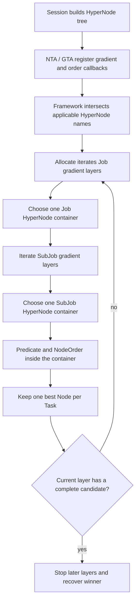
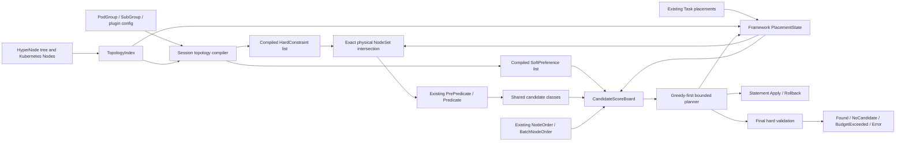
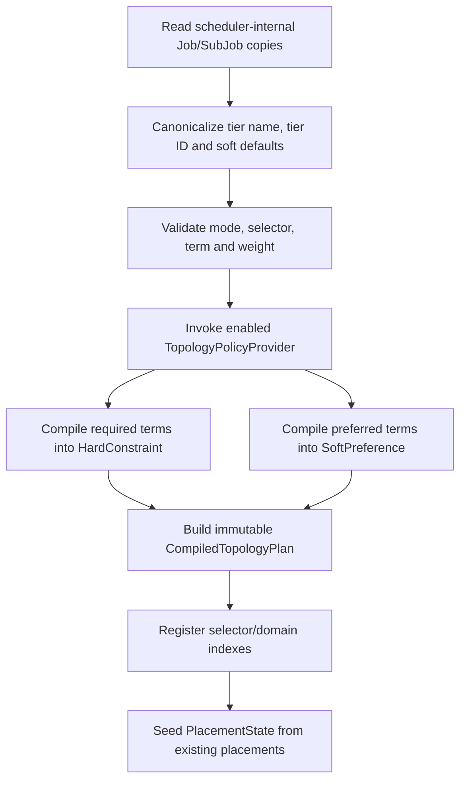
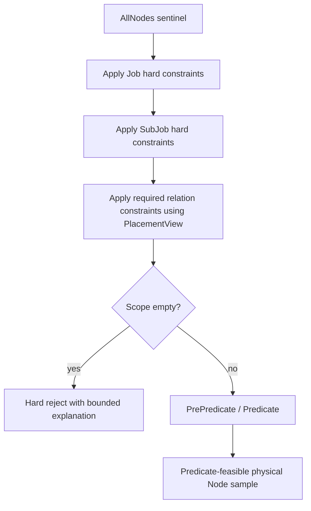
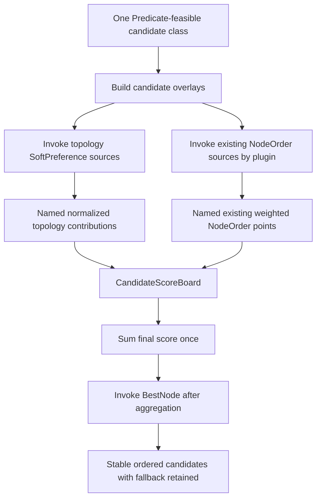
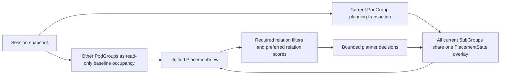
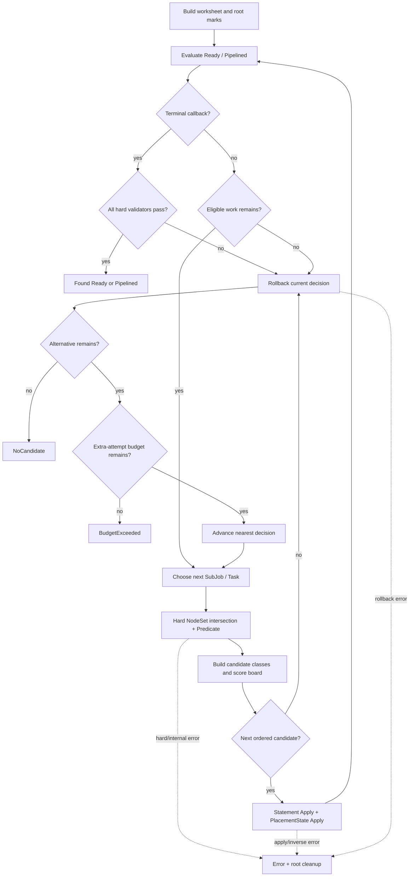
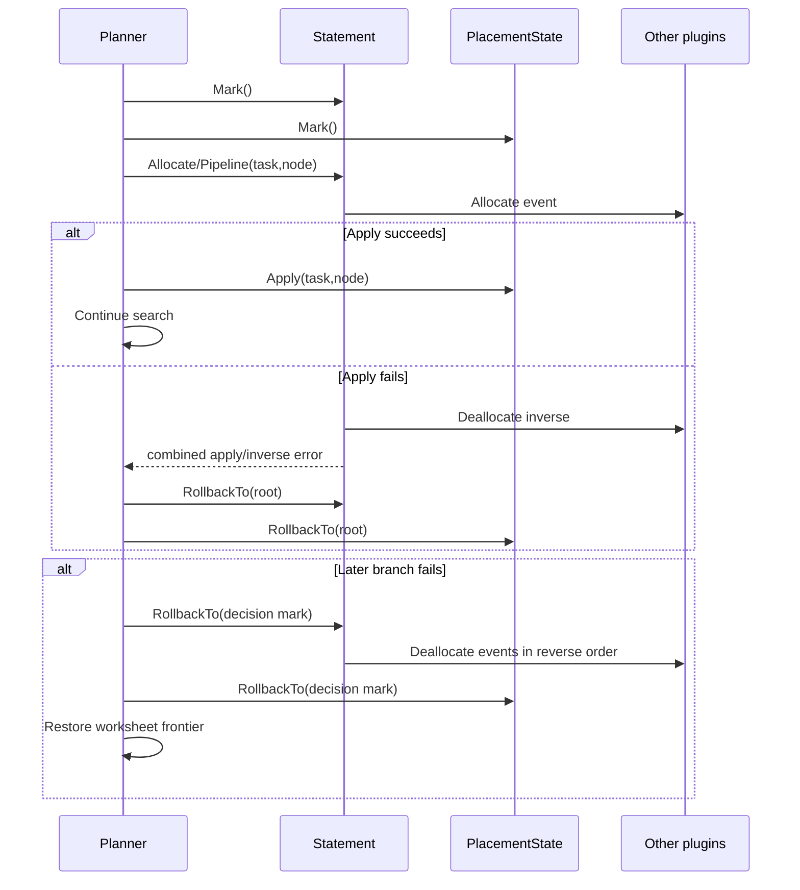

> 归档快照（2026-11-05）。本文保留原有阶段、基线和历史结论；其中的“当前”“完成”仅适用于原文对象。最终设计入口及证据边界见[归档说明](../../../../README.md)。本次仅迁移链接并添加此提示，未重新执行文中的命令。

# Feature 015：统一拓扑策略与有界放置重构 Proposal

> 2026-10-05 上游方案入口：[VOLCANO_UPSTREAM_TOPOLOGY_REFACTOR_DESIGN_CN.md](VOLCANO_UPSTREAM_TOPOLOGY_REFACTOR_DESIGN_CN.md)，固定基线为 `upstream/master@e0905bab6`。配套 [调度打分代码导读](VOLCANO_UPSTREAM_SCORING_CODE_WALKTHROUGH_CN.md) 与所有重构材料统一保存在本 issue；先读 [README.md](README.md) 了解整体思路及文档关系。本次为文档整理，未修改实现或替换已约定验收用例，issue 保持 `IP`。

> 2026-09-11 的 dev-1.14 设计：[TOPOLOGY_PLANNING_FRAMEWORK.md](TOPOLOGY_PLANNING_FRAMEWORK.md)。它依据已确认的八点诉求，以统一约束与收益模型、同一有界搜索树、结构性传播和收益界组织完整方案，包含源码依据、复杂度、Bug020及通用模型验算。015目标重构仍处于设计阶段；本文后续的旧方案正文和原型记录保留为历史资料。新设计和模型结果不自动替换已约定验收用例，不表示实现已完成。实施前再将获批设计与精确验证计划统一回本文。

> 2026-09-11 的进一步打磨：该完整方案第4.1节给出直观合同，第7.6节收紧首解必要工作，第11.12–11.14节给出当时源码操作账与质量成本公式。独立成本模型已核对；真实新旧调度延迟仍待目标实现测量，不能引用历史原型数据替代。

## Proposal 状态

- 类型：Feature / Scheduler architecture refactor
- 当前阶段：修订 Proposal，等待设计和验证用例重新审批
- 演进审视起点：`54c1d018`
- 当前生产线参照：`dev-1.14@71f1d3248`
- 第一版重构原型：`feat/015-unified-topology-placement@c4c6c3643`
- 原型备份：`feat/015-unified-topology-placement-backup@7c0eb9d4f`
- 目标实现提交：待实施后填写
- 关联场景与缺陷：Bug 018、019、020、021、022、023
- API/CRD：预期不变
- 本轮修改范围：仅重写 Proposal，尚未按本文方案修改 Volcano 源码

`c4c6c3643` 已经证明 exact physical Node scope、统一 Node-level planner 和有界回退
可行，但后续 Bug 020–023 表明它仍然是“旧 gradient/order callback 的 adapter 加新
planner”，不是最终的拓扑策略框架。本文以该原型作为实验和性能证据，不把其代码、
测试或 Kind 结果视为本文目标架构已经完成。

面向 reviewer 的详细架构说明见
`TOPOLOGY_SCHEDULING_REFACTOR.md`；第一版原型历史命令和结果见
`artifacts/VERIFICATION_RESULTS.md`。本文是后续实施和验收的权威 Proposal。

## Proposal 摘要

本次重构不再围绕某个 Bug 增加 candidate helper、forest route 或 plugin bridge，而是
建立四个稳定边界：

```text
Session compile
  -> typed HardConstraint / SoftPreference
  -> exact physical NodeSet + framework-owned PlacementState
  -> one shared CandidateScoreBoard
  -> greedy-first bounded placement planner
```

完成后：

- hard topology 只能过滤 physical Node，soft topology 只能贡献分数；
- required NodeAffinity 继续属于 Predicate，preferred NodeAffinity 继续属于 NodeOrder；
- topology soft、NodeAffinity、binpack、image locality 等对同一批 hard-feasible Node
  贡献分数，不再存在 HyperNodeOrder/NodeOrder 两个隔离平面；
- `B+C` 等 disconnected scope 是普通 NodeSet，不需要 candidate forest；
- peer count、LCA、已有 placement 和 speculative placement 由统一 PlacementView 提供；
- 第一个完整 hard-valid placement 即停止，不追求全局最优；
- 后续 dead end 只在一个额外尝试预算内回退；
- 新 topology plugin 只增加 policy provider 和测试，不修改 planner 主流程。

# 一、现状 / 核心痛点

## 1.1 当前生产代码的拓扑调度模型

从 `54c1d018` 开始，多个 topology plugin 通过 HyperNode gradient 协作。当前生产路径
仍以 HyperNode container 为核心：



该模型中：

- gradient 表示 hard membership，同时决定遍历顺序和 first-success 终止边界；
- HyperNode 既是 topology index，又是 Job/SubJob allocation container；
- NodeOrder 只能在已经选定的 container 内发挥作用；
- 前一个 Task 的 best Node 被选中后，后续 Task 失败不能回退到次优 Node；
- disconnected multi-root 需要 candidate forest 专用路径；
- Statement、worksheet、Recorder 和 `AllocatedHyperNode` 分别恢复不同状态。

## 1.2 演进中出现的局部修复

| 阶段 | 代表提交或 Bug | 已解决问题 | 暴露的共同结构限制 |
| --- | --- | --- | --- |
| 多 topology plugin | `54c1d018` | 多个 gradient 取交集，统一 minResource 粗筛 | 仍按 HyperNode identity 和 layer 组合 |
| PodGroup relation | PodGroup anti-affinity 系列 | placement、occupancy、follow-up、删除重建 | relation state 分散在 plugin 和 Job 字段 |
| SubGroup relation | `8fcc0012` 后续 | required/preferred affinity 和 anti-affinity | peer 关系依赖前序 placement，局部选择不可回退 |
| native soft | `18deb521` | 去除 soft-to-hard conversion | soft 仍受 layer、container 和 helper 影响 |
| exact B+C | Bug 014/018 | required PAA 可联合使用 B+C | 依赖 candidate forest 或 Ordered 补丁 |
| preferred 顺序 | Bug 019 | preferred-only GTA traversal 不丢失 | 仍然通过旧 outer container 顺序表达 soft |
| count-aware score | Bug 020 | anti-affinity 区分 domain 内 peer 数量 | plugin 缺少统一 placement/domain count view |
| soft default tier | Bug 021 | soft nil 等价 tier1 | raw optional API 状态泄漏到多个下游路径 |
| forest memory | Bug 022 | 旧 forest set/diagnostic 内存线性化 | scope 数据结构缺少框架级复杂度约束 |
| NodeAffinity isolation | Bug 023 | 尚未独立修复 | topology soft 与普通 NodeOrder 是两个 score 平面 |

这些问题并不是八个互不相关的 corner case。共同原因是 policy、candidate、score、
placement state 和搜索控制没有明确分层。

## 1.3 hard 与 soft 的执行边界仍然不清晰

代码已经在 API mode 上区分 hard/soft，但执行控制仍耦合：

- hard gradient 的 layer 顺序会决定哪些 soft candidate 可见；
- soft helper 可能先收窄 candidate，然后 NodeOrder 才发现其他候选不可行；
- preferred traversal order 需要额外 `Ordered` 信息穿过 gradient contract；
- soft NTA anchor 曾以 allocate helper 或 planner lexicographic rank 表达；
- soft score error、abstain 和空 gradient 在不同路径可能产生不同控制结果。

因此“hard 确定范围、soft 排序选择”尚未成为接口不变量，只是一条需要每个实现者
主动遵守的约定。

## 1.4 HyperNode identity 不是通用 hard composition 单位

两个 topology plugin 可能使用不同 tier 或不同 domain 名称，但它们允许的 physical
Node 存在合法交集。按 HyperNode name 求交时，这个交集可能丢失。

例如：

```text
Plugin A allows rack-a and rack-b
Plugin B allows zone-x

physical membership:
  rack-a = {node-1, node-2}
  rack-b = {node-3, node-4}
  zone-x = {node-2, node-3}

correct intersection = {node-2, node-3}
HyperNode name intersection = empty
```

同样，`B+C` 的正确 allowed scope 是：

```text
leaves(B) union leaves(C)
```

其 LCA 只能用于解释，不能把完整 LCA subtree 当成 allowed scope，否则 sibling A 会
被错误加入。

## 1.5 topology soft 与其他 plugin soft 被隔离

Bug 023 清楚地暴露了当前两级打分结构：

```text
HyperNodeOrder plane:
  NTA / GTA topology scores

NodeOrder plane:
  preferred NodeAffinity / binpack / image locality / Pod affinity / other scores
```

当前 outer HyperNode winner 只累计 HyperNodeOrder score；NodeOrder score 只用于
container 内选择 Node，随后被丢弃。结果是：

- preferred NodeAffinity 无法跨 HyperNode 打破平局；
- 调高 `nodeaffinity.weight` 不能改变 outer winner；
- 单 Node HyperNode 可能完全跳过 NodeOrder；
- 后续 gradient 中更符合普通 soft plugin 的 Node 不参与比较；
- 相同 Pod 模板在普通 Job 和 topology Job 中得到不同的 soft 行为。

该问题不只影响 NodeAffinity，也影响所有普通 NodeOrder soft contribution。

## 1.6 第一版统一 planner 仍不是最终框架

`c4c6c3643` 已经改为 physical Node candidate，并在同一函数中执行：

```text
existing NodeOrder score + adapted topology score
```

所以 Bug 023 的最小平分场景可以通过。但它随后使用 NTA-specific
`establishedSoftDomainRank` 做 lexicographic 分组。位于较低 rank 的 Node 即使普通
NodeOrder 总分更高，也可能无法胜过较高 rank 的 Node；NTA soft 在该路径上仍近似
无限权重。

此外原型仍有以下问题：

- hard plugin 继续输出 gradient；
- framework 仍先按 HyperNode name 聚合，再展开成 NodeSet；
- topology soft 继续通过最低层 HyperNode 分组调用旧 HyperNodeOrder；
- planner 直接读取 `HighestTierAllowed`；
- GTA 自行扫描 peer placement；
- exact scope 使用累计 `Set.Union` clone。

因此原型证明了 bounded Node planner 可行，但 policy contract 必须继续重构。

## 1.7 topology state 没有单一 owner

当前拓扑事实可能来自：

- Task 的实际 Node；
- Job/SubJob `AllocatedHyperNode`；
- Recorder；
- GTA occupancy cache；
- NTA resource cache；
- speculative Statement event；
- candidate helper 临时 anchor。

这会产生三类风险：

1. actual placement 与 scoring hint 混用；
2. rollback 只恢复资源，不恢复 peer count/LCA；
3. 一个新 plugin 需要重新实现已有 placement、candidate overlay 和删除重建逻辑。

## 1.8 scope 构建和诊断缺少复杂度不变量

Bug 022 修复了旧 candidate forest 中的 `O(NR)` 累计 set clone 和 `O(R²)` reason。
但第一版原型的 `topologyNodeScopeFromGradients` 仍对每个 root 执行累计
`Set.Union`。在 1,024 roots 的审计中，单次 scope 构建约：

```text
23,406,744 B/op
4,365 allocs/op
```

这说明删除 forest route 并不自动解决内存问题；NodeSet、index、cache 和 diagnostics
必须作为框架基础设施设计。

## 1.9 局部贪心过早丢失 alternative

典型场景：

```text
task-a: node-1 / node-2 都可行，node-1 分数更高
task-b: 只有 node-1 可行

局部贪心：
  task-a -> node-1
  task-b -> no candidate

可行布局：
  task-a -> node-2
  task-b -> node-1
```

目标不是枚举最优解，而是避免第一个局部 fit 被当成不可回退的最终决定。回退成本必须
有界，常见第一分支成功路径不能为此承担完整组合搜索成本。

# 二、设计目标 / 要解决的问题

## 2.1 总体目标

建立一套可解释、可扩展、有明确性能边界的 topology policy framework，使新增 topology
plugin 或新增 hard/soft 关系时只实现策略，不修改 planner 主流程。

目标执行模型为：

```text
compile policy once
  -> hard physical feasibility
  -> ordinary Predicate
  -> one shared soft score plane
  -> greedy-first bounded placement
  -> final hard validation
```

## 2.2 必须解决的问题

### G1：hard 和 soft 由接口而不是约定分离

- hard policy 可以返回 NodeSet 并执行 final validation；
- soft policy 只能返回 score contribution；
- soft 接口没有删除 candidate 的能力；
- hard 结果不贡献 score；
- 不再进行 soft-to-hard conversion。

### G2：所有 hard topology 在 physical Node 层组合

- single root、multi-root、不同 tier 和 future plugin 使用相同 NodeSet；
- hard plugin 注册顺序不影响交集；
- LCA 不替代 exact membership；
- nominated Node 也不能绕过 hard scope。

### G3：topology soft 与普通 NodeOrder 共享一个 score plane

- topology soft、preferred NodeAffinity、binpack、image locality 等看到同一批 candidates；
- 每个 score source 只应用一次配置权重；
- 可以解释每个 source 对最终 Node 的 contribution；
- 改变 NTA/GTA 与 NodeAffinity/binpack 相对权重，可以可预测地改变第一选择；
- soft 高分候选不可行时保留低分 fallback。

### G4：统一 canonicalization

- tier name、tier ID、soft nil 默认值在 Session compile 阶段统一；
- 下游不能观察本应等价的 raw API 表示；
- 原始 PodGroup/SubGroupPolicy 对象不被修改；
- 无效配置在进入 planner 前失败。

### G5：统一 topology placement state

- framework 维护 Job/SubJob actual placement、LCA、domain count 和 candidate overlay；
- NTA/GTA/future plugin 通过只读 PlacementView 查询；
- scoring hint 不写入 actual placement；
- apply/rollback 同步恢复 resource 和 topology state；
- 已存在 Pod、同 Session earlier Job 和删除重建具有一致口径。

### G6：保留有界回退

- 第一条 branch 使用统一 score 后的贪心首选，不为了后续搜索主动选择低分 Node；
- 后续 hard dead end 可回退最近的本轮 choice；
- 只使用一个 `maxExtraPlacementAttempts`；
- 第一个完整 hard-valid placement 即停止；
- `BudgetExceeded` 与 `NoCandidate` 分开。

### G7：性能与内存可预测

- NodeSet union/intersection 不反复 clone 累计集合；
- soft-only Job 不展开完整 HyperNode universe 来构造 neutral scope；
- static policy mask 只编译一次；
- dynamic scope 不构造无界 cache key 或保存完整 solution；
- diagnostics 和 trace 有固定或线性上界；
- 8,192-domain synthetic case 有明确门禁。

### G8：future topology plugin 可独立接入

新增 topology plugin 只需要：

1. 编译自身配置；
2. required 语义实现 HardConstraint；
3. preferred 语义实现 SoftPreference；
4. 使用 TopologyIndex 和 PlacementView；
5. 添加 plugin-owned test。

不得要求修改 allocate planner、NTA、GTA 或增加新的 route。

### G9：保持与其他 scheduler plugin 的关系清晰

- Predicate、NodeOrder、Ready、EventHandler 和 Commit 继续使用现有 Session contract；
- bounded search 可能增加 speculative callback 次数，因此验证 inverse 对称性；
- 不引入 `ReadOnly/Reversible/SnapshotRestore/CommitOnly/Unsupported` 分类；
- 不为 extender、device、NUMA 或 accounting plugin 建立 topology-specific path。

## 2.3 非目标

本重构不提供：

- soft/preferred 全局最优；
- 全部 feasible Node 或 placement 的完整枚举；
- 多个 Pending PodGroup 的原子联合求解；
- 已 bind Pod 的迁移；
- topology 与 preempt/reclaim 的联合优化；
- 跨调度周期持久化搜索游标；
- 通用 conflict graph、backjump、beam search 或 branch-and-bound；
- bind/cache Commit 的 failure-atomic 保证；
- API/CRD 变更；
- 所有普通 NodeOrder plugin 的重新实现。

## 2.4 完成后的架构判定标准

不是“Bug 018–023 的 fixture 全部通过”就算完成，还必须同时满足：

```text
结构：new topology plugin does not change planner
语义：hard only filters; soft only scores
状态：PlacementState is the single topology truth
组合：topology and ordinary soft use one score board
搜索：first hard-valid result; bounded alternatives
性能：scope and diagnostics are linear or bounded
```

# 三、设计原则

## 原则 1：Session 先编译，planner 不解释 raw API

Session Open 时将用户 API 和 plugin 配置编译为内部不可变策略：

```go
type CompiledTopologyPlan struct {
    Hard []CompiledHardConstraint
    Soft []CompiledSoftSource
}
```

编译负责：

- tier name 到稳定 tier ID；
- soft nil 到 tier1；
- mode、selector、term weight 和 plugin weight 校验；
- required/preferred 分离；
- static NodeSet 和 selector index 构建；
- duplicate score source ID 检查。

planner 不读取 `NetworkTopology`、`TopologyAffinity`、tier name 或 plugin name。

## 原则 2：hard 只决定 feasibility

概念接口：

```go
type HardConstraint interface {
    Name() string
    AllowedNodes(ctx HardContext, placement PlacementView) (NodeSet, Explanation, error)
    Validate(ctx ValidationContext, placement PlacementView) error
}
```

- 不适用的 policy 在 compile 阶段不注册；
- 当前 placement 下暂时 neutral 的 relation 返回 `AllNodes`；
- authoritative no-candidate 返回 `EmptyNodeSet`；
- hard evaluation error 返回 `Error`，不能降级为允许；
- filter 和 final validator 使用同一个 compiled policy object。

## 原则 3：soft 只决定 order

概念接口：

```go
type SoftPreference interface {
    Name() string
    Score(
        ctx ScoreContext,
        placement PlacementView,
        candidates []Candidate,
    ) (NormalizedScoreVector, error)
}
```

`NormalizedScoreVector` 对每个 candidate 返回 `0..100`，100 表示该 source 最偏好。
soft scorer：

- 接收同一 candidate class；
- 不能返回 NodeSet；
- 不能改变 candidate 数量；
- 低分和零分 candidate 仍保留；
- runtime error 只使该 source contribution neutral，并产生可见诊断；
- 不建立自己的 layer、container 或 lexicographic group。

## 原则 4：exact physical NodeSet 是唯一 hard scope

HyperNode 继续用于 topology index、ancestor、tier、LCA 和解释，不作为必须容纳整个
Job/SubJob 的 allocation container。

```text
scope(B+C) = leaves(B) union leaves(C)
LCA(B,C)   = H
```

`leaves(H)` 不能替代 `scope(B+C)`。

## 原则 5：所有 soft contribution 进入同一个 CandidateScoreBoard

对同一 Task 和同一 feasibility class：

```text
FinalScore(node)
  = ExistingNodeOrderPoints(node)
    + sum(TopologyNormalizedScore(source,node) * SourceWeight(source))
```

其中：

- existing NodeOrder adapter 保留现有 plugin 已应用的权重，不再二次乘权；
- compiled topology source 返回归一化分数，由 framework 应用一次 source weight；
- term weight 在 source 内聚合语义时使用；
- source/plugin weight 用于 source 之间的相对影响；
- score board 保存 named contribution 和 total；
- `BestNodeFn` 只在全部 contribution 聚合后调用；
- 若第三方 `BestNodeFn` 有显式 winner contract，它可以提升第一 candidate，但不能
  删除其他 alternative，trace 必须记录该 override；当前 in-tree 无注册实现。

统一 score plane 不意味着 topology soft 可以跨越 hard scope、Predicate 或资源/shard
feasibility class。

## 原则 6：PlacementState 由 framework 拥有

PlacementState 维护：

- Session baseline 中 topology-relevant 的已存在 Task placement；
- 当前 Job 本轮 speculative Task->Node；
- Job/SubJob actual NodeSet 和 LCA；
- compiled selector 在 tier/domain 的 peer count；
- matching PodGroup 的 external occupancy；
- placement revision 和 rollback mark。

plugin 只使用只读 PlacementView：

```go
NodeForTask(taskID)
NodesForSubject(subjectID)
LCA(subjectID)
DomainCount(selectorID, tierID, domainID)
WithCandidate(taskID, nodeID)
```

`WithCandidate` 是轻量 overlay，用于评分候选导致的 LCA/count，不修改 actual state，
不发送 Allocate event。

## 原则 7：greedy 是 bounded search 第一条 branch

候选按照现有 feasibility class、统一 score、BestNode 和稳定 tie-break 排序。第一次只
访问每个 decision 的第一个 candidate，天然是 common greedy branch。

- common branch 成功：`backtracks=0`；
- 后续 dead end：回退最近 decision；
- 额外 candidate 消耗同一个 budget；
- 首个完整 hard-valid Ready/Pipelined placement 即停止；
- 不为获得更高 soft 总分继续搜索。

## 原则 8：partial hard filter 与 final validation 共同保证正确性

required SubGroup relation和hard LCA依赖partial placement。每次选择前计算 current
allowed NodeSet，达到 Ready/Pipelined 后再执行全部 hard validator。

不维护动态 subtree，也不只依赖 final check 才发现所有错误。

## 原则 9：一个事务 owner，不增加 plugin capability 矩阵

每个 decision frame 同时保存：

- Statement mark；
- PlacementState mark；
- worksheet/touched frontier mark；
- 当前 candidate index。

rollback 同步恢复三者。topology plugin 没有 speculative mutable state；其他 scheduler
plugin 继续使用 Statement Allocate/Deallocate contract。

## 原则 10：最终源码只保留一条 topology runtime

第一版原型、旧 container path 和 migration adapter 由 backup branch/Git history 保存。
最终源码不长期保留 legacy/observe 双实现，也不保留 candidate forest、NTA soft helper
或 planner plugin-name 分支。

# 四、重构方案

## 4.1 总体架构



模块职责：

| 模块 | 只负责 | 不负责 |
| --- | --- | --- |
| Topology compiler | 规范化 API、编译 policy | 搜索和候选选择 |
| TopologyIndex/NodeSet | topology 查询和集合运算 | plugin 业务语义 |
| HardConstraint | allowed scope和final validation | score和搜索顺序 |
| SoftPreference | normalized score | 删除候选和终止搜索 |
| PlacementState/View | actual/speculative topology facts | scheduler resource accounting |
| CandidateScoreBoard | 合并 named soft contribution | hard feasibility |
| Planner | frontier、顺序、apply、rollback、budget | 理解 NTA/GTA/raw API |
| Statement | Session resource/task mutation和inverse | topology policy 计算 |

## 4.2 TopologyIndex 与 NodeSet

### 4.2.1 稳定内部 ID

Session 初始化时为 physical Node、HyperNode、tier 和 compiled selector 分配稳定 ID。
TopologyIndex 提供：

- Node -> 各 tier ancestor；
- HyperNode -> descendant physical Nodes；
- parent/children；
- LCA；
- tier ID/name；
- domain membership；
- stable diagnostic name。

### 4.2.2 NodeSet 抽象

NodeSet 支持：

- `AllNodes` sentinel；
- `EmptyNodeSet`；
- single domain mask；
- disconnected union；
- in-place/scratch union；
- intersection；
- cardinality；
- stable bounded sample。

底层可以根据规模使用 bitset 或 sparse set，但对 plugin 和 planner 不可见。实现必须
避免每加入一个 root 就 clone 已累计集合。

### 4.2.3 编译和缓存规则

- static domain membership 在 Session 中只构建一次；
- static hard policy mask 在 compile 阶段构建一次；
- dynamic relation 读取 PlacementView，当次使用 scratch NodeSet；
- 首版不建立通用、无界的 dynamic scope cache；
- 若 benchmark 证明需要 cache，key 必须来自 policy 明确依赖的 placement revision，
  不能序列化整个 Job/SubJob state。

## 4.3 Session topology compile



概念 provider：

```go
type TopologyPolicyProvider interface {
    Name() string
    Compile(ctx CompileContext, subject Subject) (CompiledTopologyPolicy, error)
}
```

`CompiledTopologyPolicy` 可以同时包含 hard 和 soft，但进入不同 typed collection。

canonicalization 顺序：

1. 已设置 numeric tier：保持；
2. 已设置 tier name：解析为 tier ID，未知 name 报错；
3. soft 且均未设置：内部 tier1；
4. hard 且未设置：按现有 API 合法性/默认规则处理，不误降级为 soft tier1；
5. 原始 API 对象保持不变。

compile error 形成明确的 Job/plugin configuration error，不进入 planner。

## 4.4 HardConstraint 执行

### 4.4.1 每个 Task 的 hard pipeline



required NodeAffinity 继续由 Predicate 处理，不复制到 topology plugin。最终 hard
feasibility 是：

```text
TopologyHardScope contains node
AND existing Predicate passes
```

### 4.4.2 dynamic hard relation

hard NTA、SubGroup affinity/anti-affinity 根据当前 PlacementView 计算：

- 当前 subject 尚无 placement 时，可以返回 static base scope；
- 已有 placement 时，候选 Node 必须维持允许 LCA/domain relation；
- peer relation 使用实际 domain occupancy，不用 peer LCA subtree 近似；
- rollback 后读取恢复后的 placement revision/count。

因此“两阶段 hard 确定范围、soft 排序选择”在语义上成立，但 hard 范围不是 Session
开始时固定的一棵完整子树，也不是先选定一个 HyperNode 后不再变化。static hard policy
先编译为 NodeSet；依赖已放置 peer/LCA 的 dynamic hard policy 在每个 decision 基于当前
PlacementView 增量求值。两者交集形成当前 Task 的 exact physical Node scope，随后才进入
Predicate 和 soft score。这样保留两阶段的可理解性，同时避免维护动态子树。

### 4.4.3 final validation

达到 Ready/Pipelined 后，对同一批 compiled hard constraints 执行 Validate：

- actual Task->Node 均在 allowed static scope；
- Job/SubJob LCA 满足 hard tier；
- required affinity/anti-affinity 满足；
- PlacementState LCA/count 与 Task placement 一致；
- nominated Node 没有绕过 scope。

validation 失败是普通 branch dead end，可以在预算内回退；hard evaluation 内部错误则
返回 `Error`。

## 4.5 CandidateScoreBoard：统一 soft score plane

### 4.5.1 评分流程



内部概念：

```go
type CandidateScoreBoard struct {
    Candidates    []Candidate
    Contributions map[ScoreSourceID]ScoreVector
    Totals        ScoreVector
}
```

score board 必须能回答：

- 当前 candidate class 包含哪些 Node；
- 每个 source 对每个 Node 贡献多少；
- 哪个 weight 已在何处应用；
- 最终 total；
- BestNode 是否覆盖了 numeric first choice；
- fallback 顺序。

soft 的可见域不是一个额外展开的完整 topology universe，而是当前 hard scope 内通过
Predicate 的 bounded Node sample。同一层级多个 HyperNode 的 descendant Node 会同时
出现在这个 sample 中，不会先选一个 HyperNode container。因此：

- preferred scorer 可以比较同层级多个 domain；
- 一个完整 placement 可以自然使用同层级两个或更多 HyperNode；
- 不需要先枚举 HyperNode 组合；
- `PercentageOfNodesToFind` 和 backtrack budget 继续限制计算量。

### 4.5.2 topology score 与 ordinary score 的组合

topology source：

```text
TopologyPoints(source,node)
  = NormalizedScore(0..100) * ConfiguredSourceWeight
```

ordinary NodeOrder source：

- framework 新增只由 topology planner 使用的 ordinary score collector，按现有 Volcano
  plugin 注册名收集 contribution；普通非 topology allocate 继续使用现有
  `PrioritizeNodes`；
- 同一 plugin 注册的 NodeOrder、BatchNodeOrder 和 map/reduce callback 共同组成一个
  named source，保持当前相加语义；
- collector 保留 callback 内已经应用的配置权重；进入 score board 时 adapter weight
  为 1，不再次乘权；
- 一个 ordinary source 在任一 callback/node 上失败时，该 source 对整个 candidate
  class neutral，避免部分 Node 因少算一个 source 获得非预期优势；
- `nodeorder` plugin 内部 NodeAffinity、image locality 等子策略可以继续由该 plugin
  聚合；当只有 NodeAffinity 启用时，`nodeorder` contribution 即为 NodeAffinity；
- future optional diagnostics 可以让 nodeorder 暴露子 source，但不是 Bug 023 正确性
  的前置条件。

计分单位约束：

- topology source 必须先归一化到 `[0, MaxNodeScore]`，再由 framework 应用一次 topology
  plugin/source weight；
- existing ordinary callback 的输出是现有 contract 的 authoritative points，不做
  per-candidate min-max normalization，以免改变普通 plugin 的强弱关系；
- `nodeorder` 中 Kubernetes scorer 已使用 `MaxNodeScore` 和各自 weight，因而可以与按
  同一基准归一化的 NTA/GTA source 直接组合；
- 其他 ordinary plugin 若使用自定义分值范围，仍按其当前 points 参与总分。这是既有
  NodeOrder contract，不在本重构中重标定；其相对影响继续由该 plugin 配置和测试负责；
- score board 元数据显式标记 contribution 是 `weighted` 还是 `unweighted`，相同 source
  ID 不得重复提交，防止 double weight 和重复打分。

最终：

```text
FinalScore(node)
  = sum(existing ordinary plugin points)
    + sum(compiled topology source points)
```

不再存在：

- NTA-specific lexicographic domain rank；
- preferred gradient traversal order；
- first-success soft layer；
- HyperNodeOrder winner 先于 NodeOrder winner；
- single-Node HyperNode 跳过跨 domain score comparison。

### 4.5.3 Bug 023 的结果

两个 physical Node 都 hard-feasible时：

```text
node-a:
  NTA=1000, nodeorder(NodeAffinity)=0, total=1000

node-b:
  NTA=0, nodeorder(NodeAffinity)=2000, total=2000
```

node-b 先尝试。交换相对 weight 后 node-a 可以先尝试。任一 preferred target 不可行
时，另一个 hard-feasible Node 仍在 candidate list 中。

topology plugin 不需要理解 NodeAffinity，nodeorder 也不需要理解 HyperNode。

### 4.5.4 score source error

统一规则：

- 一个 soft source runtime error：该 source 对本轮 candidate class contribution neutral；
- 其他 soft source 继续；
- candidates 不删除；
- 记录 source、subject、candidate count 和 error；
- 同一个 source 在单次 decision 中只调用一次；
- 若 plugin 内部包含多个不可分离子 scorer，整个 plugin source neutral。

这会替代当前某些 `PrioritizeNodes` 错误导致整个 score map 为空的耦合行为，是本重构
有意统一的 soft error contract。

## 4.6 PlacementState 与 PlacementView

### 4.6.1 状态分层

```text
Session topology baseline:
  existing Bound/Binding/Running/Allocated placements
  external PodGroup occupancy

Current plan overlay:
  this Job's speculative Task->Node choices
  Job/SubJob NodeSet and LCA
  compiled selector domain counts

Candidate overlay:
  current plan + one Task->Node candidate
  read-only, no event, no mutation
```

Pipelined 是否参与其他 Job 的 topology occupancy 保持当前已批准的 status 口径；不得在
本重构中无意扩大为持久 PodGroup anchor。当前 Job 的 final hard validation仍可读取本轮
Pipelined assume placement。

### 4.6.2 domain count

compile 阶段只为实际 policy selector 建立 index。Apply/rollback 时仅更新受当前 Task
labels影响的 selector/domain counter，避免每次扫描全部 SubJob。

Bug 020 的 preferred anti-affinity 使用：

```text
peerCount(candidateDomain)
maxPeerCount(candidates)
normalized preference = fewer peers -> higher score
```

不再将 `1/2/3 peers` 压缩成同一个 occupied boolean。

### 4.6.3 actual placement 与 scoring anchor

- actual Job placement：所有实际已选 Job Task 的 LCA；
- actual SubJob placement：该 SubJob 实际 Task 的 LCA；
- scoring anchor：SoftPreference 从 PlacementView 读取的实际 placement；
- candidate overlay：假设当前 candidate 后的结果；
- 不把 Job anchor写入SubJob actual placement；
- 不通过完整LCA subtree推导精确occupied domains。

### 4.6.4 多 PodGroup 与多 SubGroup 的联合关系



状态边界如下：

- 一个 planner transaction 只规划一个当前 Job/PodGroup；
- 当前 PodGroup 内所有 SubGroup 共享同一个 speculative PlacementState，因此
  SubGroup 之间的 required/preferred affinity 和 anti-affinity 是联合求值的；
- 其他 PodGroup 中已满足批准 status 口径的 Pod 作为只读 Session baseline，通过
  selector/domain index 参与 occupancy 和 peer count；
- 当前 PodGroup 的每次 Apply/rollback 增量更新所有受 Task labels 影响的 selector
  counter，因此后续 SubGroup 立即看到前序选择，也能在回退后看到恢复结果；
- 多个 Pending PodGroup 不做原子联合搜索。若关系依赖另一个尚未形成 baseline 的
  Pending PodGroup，本轮不会猜测其未来 placement；这保持现有按 Job 调度边界，避免
  把重构扩大为跨 Job 组合求解；
- 下一 Session/调度周期从 informer/cache snapshot 重新构建 baseline，不维护跨周期
  私有 topology cache，所以 follow-up、删除和重建不会依赖陈旧 plugin state。

## 4.7 Greedy-first bounded planner

### 4.7.1 working frontier

复用 `organizeJobWorksheet` 和现有 SubJobOrder/TaskOrder：

- 未满足 SubJob优先；
- 已满足但仍有elastic Pending work可继续；
- `touched` 防止已Ready或`minAvailable=0` Job空提交；
- Ready/Pipelined callback始终是权威完成条件；
- worksheet中其他eligible SubJob/Task保留为alternative。

### 4.7.2 candidate class

保留现有优先级：

1. idle / in-shard；
2. idle / other-shard；
3. futureIdle / in-shard；
4. futureIdle / other-shard。

统一 score 只在同一个 class 中比较。高分 soft candidate不能越过 hard/Predicate，也
不能把 futureIdle class 提升到 idle class之前。当前 class无法完成完整 placement 时，
较低 class可作为后续 fallback。

`PercentageOfNodesToFind` 继续限制实际 Predicate sample，因此该算法不承诺看到 scope
中的全部 Node。

### 4.7.3 搜索流程



### 4.7.4 搜索终止

| 结果 | 含义 |
| --- | --- |
| `Found(Ready)` | Ready callback与全部hard validator通过；进入现有Commit边界 |
| `Found(Pipelined)` | Pipelined callback与全部hard validator通过；保留Session assume state，不bind |
| `NoCandidate` | 当前snapshot、sample和已访问alternative中候选耗尽 |
| `BudgetExceeded` | 仍有未访问alternative，但extra-attempt预算耗尽 |
| `Error` | hard evaluation、apply、inverse、rollback或一致性错误 |

`NoCandidate` 和 `BudgetExceeded` 都不是数学意义上的永久不可调度。

### 4.7.5 不进行完整 solution soft optimization

score board 决定每个 decision 的 first branch顺序。如果第一条branch最终hard-valid，
立即停止；不会为了找到更高完整soft总分继续搜索。

回退只由hard dead end、Ready/Pipelined未满足或final validation失败触发。这与“兼顾
结果和性能，不追求最优解”的目标一致。

## 4.8 Statement 与统一 rollback

### 4.8.1 decision mark

```go
type PlacementDecisionMark struct {
    StatementMark StatementMark
    TopologyMark  PlacementStateMark
    FrontierMark  WorksheetMark
}
```

### 4.8.2 Apply/rollback 时序



`Statement.Allocate/Pipeline` 必须单次 failure-atomic：失败操作未写入 operation stack
前先完成自身 inverse。`RollbackTo` 只撤销已成功操作，并返回 error。

topology plugin 不通过 EventHandler 维护额外 speculative state；NTA 的必要 resource
accounting 若仍作为普通 scheduler score source使用，必须遵守现有 Allocate/Deallocate
对称 contract。

## 4.9 NTA 迁移

NTA 直接实现 provider，不再依赖 planner adapter：

### hard

- Job/SubJob hard network topology 编译为 HardConstraint；
- static allowed membership使用NodeSet；
- partial placement根据actual LCA约束下一Node；
- final Validate检查实际Job/SubJob LCA。

### soft

- soft network proximity编译为SoftPreference；
- 对每个candidate overlay计算resulting Job/SubJob LCA；
- 更低、更近的LCA得到更高normalized score；
- preferred tier不可行时远端candidate仍保留；
- soft nil已在compile阶段等价tier1；
- 删除planner `establishedSoftDomainRank` 和allocate soft-anchor helper。

### 现有其他NTA score

NTA当前HyperNode binpack、BatchNodeOrder等语义必须逐项审计：

- 与network proximity不同的独立策略可成为不同named source；
- 同一个语义不能同时通过SoftPreference和旧BatchNodeOrder重复贡献；
- 每个source ID唯一；
- 权重只应用一次；
- 是否保留为普通NodeOrder source由其输入和语义决定，不由planner判断plugin name。

## 4.10 GTA 迁移

GTA直接实现provider：

### hard

- required PodGroup anti-affinity返回exact physical NodeSet；
- required SubGroup affinity/anti-affinity读取PlacementView domain occupancy；
- `B+C`自然是disconnected NodeSet；
- 不再创建candidate forest、envelope或Ordered traversal；
- final Validate复核实际relation。

### soft

- preferred PodGroup/SubGroup relation编译为SoftPreference；
- 所有候选来自同一hard-feasible Node class；
- affinity使用peer同域程度；
- anti-affinity使用count-aware penalty，而不是occupied set；
- term weight在GTA source内部聚合，GTA source weight在framework应用一次；
- soft source出错不产生hard Pending。

## 4.11 与其他 plugin 的关系

### Predicate

- required NodeAffinity、taint、volume、device等继续过滤；
- topology hard scope先限定physical Node，Predicate继续判断Task-specific feasibility；
- 两者都不能被soft放宽。

### NodeOrder / BatchNodeOrder

- 每个enabled Volcano plugin作为named ordinary score source；
- 对同一candidate class调用；
- contribution进入CandidateScoreBoard；
- preferred NodeAffinity不被复制到NTA/GTA；
- binpack等普通score可以与topology soft按数值竞争。

### BestNode

- 在score board完成后调用；
- 只能提升first candidate，不删除fallback；
- 显式override必须进入trace；
- 默认in-tree路径继续由total score和稳定tie-break决定。

### Ready/Pipelined

- 继续是权威完成条件；
- 读取Statement已暂占的Session状态；
- terminal vote后仍需final hard validation；
- Pipelined不进入Commit/bind。

### EventHandler

- bounded backtracking会增加Allocate/Deallocate次数；
- capacity/DRF/proportion、device、NUMA、task-topology和extender必须做baseline equality；
- 发现具体inverse缺口时修复该plugin或Statement，不修改topology planner。

## 4.12 可解释性

每个decision输出有界summary：

```text
job/subJob/task
hard scope cardinality before/after each constraint
predicate candidate count
candidate class
score contribution by source for selected and bounded top alternatives
BestNode override, if any
attempt/backtrack/budget
final Job/SubJob LCA
result
```

必须能回答：

1. Node因哪个hard constraint或Predicate被拒绝；
2. NTA、GTA、NodeAffinity/binpack分别贡献多少；
3. 为什么先选择当前Node；
4. 在哪里dead end；
5. 回退到哪个choice；
6. 是否因budget停止；
7. 最终LCA/count是否来自真实placement。

只输出selected和固定数量top alternatives，不能记录完整搜索树或8k root列表。

## 4.13 Error contract

| 阶段 | 处理 |
| --- | --- |
| compile | 明确配置错误；不进入planner |
| hard evaluation | `Error`并清理root state；不能降级为允许 |
| soft source | 该source neutral，记录诊断，其他source继续 |
| Predicate | 保持现有FitError语义 |
| Apply/inverse | failure-atomic；失败返回`Error`并root cleanup |
| rollback | error可见；不得在污染state上继续 |
| budget | `BudgetExceeded`，不伪装为NoCandidate |
| Commit | 保持现有void/per-operation行为；不宣称bind transaction原子性 |

## 4.14 性能和内存边界

设：

- `N`：physical Node数量；
- `H`：HyperNode数量；
- `C`：当前Task applicable hard constraint数量；
- `S`：soft score source数量；
- `M`：当前Predicate candidate sample大小；
- `W`：本轮实际推进requirement数量；
- `B`：extra-attempt budget。

每个decision主要成本：

```text
hard scope: O(C * NodeSetWords) 或 O(actual sparse membership)
Predicate/ordinary score: O(M * plugin cost)
topology soft: O(S * M)
```

common branch约为：

```text
O(W * decisionCost)
```

dead-end额外成本受唯一budget限制：

```text
O(B * decisionCost)
```

明确禁止：

- `O(NR)`累计NodeSet clone；
- `O(R²)`完整root diagnostics；
- soft-only Job展开完整HyperNode universe；
- 每个candidate clone完整Statement/worksheet/PlacementState；
- 无界保存全部成功solution；
- score board保存scope外Node或完整历史decision。

# 五、实施范围与阶段

## 5.1 预期核心代码范围

| 路径 | 修改内容 |
| --- | --- |
| `pkg/scheduler/framework/session.go` | canonicalization、provider compile、PlacementState初始化 |
| `pkg/scheduler/framework/session_plugins.go`及topology相关文件 | ordinary contribution collector、TopologyIndex、NodeSet、compiled policy、PlacementView、score aggregation |
| `pkg/scheduler/api/` 内部类型 | stable IDs、NodeSet/placement/diagnostic内部模型 |
| `pkg/scheduler/actions/allocate/topology_planner.go` | 只消费compiled plan、score board和PlacementState |
| `pkg/scheduler/framework/statement.go` | failure-atomic Apply、Mark/RollbackTo、error传播 |
| `pkg/scheduler/plugins/network-topology-aware/` | NTA provider、hard constraint、soft source |
| `pkg/scheduler/plugins/group-topology-affinity/` | GTA provider、required constraint、count-aware soft source |
| `pkg/scheduler/plugins/task-topology/` | 若baseline测试确认，补齐现有inverse缺口 |
| scheduler trace/metrics | bounded explanation和最终边界metrics |

## 5.2 只做兼容验证、按证据定点修改

- capacity；
- DRF；
- proportion；
- predicates及device implementations；
- deviceshare；
- NUMA-aware；
- extender；
- nodeorder、binpack和其他NodeOrder plugin。

只有test证明当前callback/inverse或score source aggregation存在具体问题时才修改。不得
预先给每个plugin建立专用适配类型。

## 5.3 原则上不修改

- staging API和CRD；
- generated API code；
- controller-manager和webhook；
- enqueue/backfill/reclaim/preempt/shuffle主策略；
- 普通非topology allocate路径；
- 用户字段语义；
- 跨周期 scheduler state。

如实现确认必须修改这些范围，应停止实施、更新Proposal和验证用例并重新审批。

## 5.4 最终删除范围

最终源码删除：

- Job/SubJob/forest legacy topology runtime；
- candidate forest envelope、allowed roots和deprecated helper；
- topology planner对旧gradient/order callback的adapter；
- allocate中的NTA/GTA-specific soft helper；
- `establishedSoftDomainRank`；
- preferred `Ordered` traversal contract；
- raw topology API字段在planner中的判断；
- topology candidate的Save/Discard/Recover replay；
- 仅为旧路径存在的placement backup和Recorder分支。

Git history和backup branch提供历史对照，不在当前源码长期维护双实现。

## 5.5 建议实施阶段

### 阶段 A：基础数据结构

- TopologyIndex稳定ID；
- NodeSet All/Empty/sparse/dense操作；
- 8,192-domain红绿benchmark；
- bounded diagnostics。

门禁：P1通过后进入下一阶段。

### 阶段 B：compile和typed policy contract

- canonicalization；
- TopologyPolicyProvider；
- HardConstraint/SoftPreference contract；
- fake future plugin contract test。

门禁：U1/U2通过。

### 阶段 C：PlacementState和统一score board

- PlacementState/View和candidate overlay；
- domain count；
- ordinary NodeOrder named source adapter；
- topology normalized source；
- source error isolation和trace。

门禁：U3/U4和Bug 020/021/023 focused tests通过。

### 阶段 D：NTA/GTA迁移

- NTA hard/soft；
- GTA hard/count-aware soft；
- 删除plugin与planner之间的旧adapter；
- 审计重复score source。

门禁：U5和018–023语义回归通过。

### 阶段 E：bounded planner和transaction

- planner只消费compiled policy；
- Statement和PlacementState同步mark/rollback；
- fit-first和budget；
- Ready/Pipelined/final validation。

门禁：U6/U7/P2通过。

### 阶段 F：删除旧路径并完成系统验证

- 删除legacy、forest、Ordered、helper和raw API判断；
- other-plugin compatibility；
- repository gate、image和Kind矩阵；
- 更新文档、结果和commit。

# 六、风险与控制

| 风险 | 控制 |
| --- | --- |
| 新SPI本身过度复杂 | 只保留provider、hard、soft、PlacementView四个核心边界；无capability矩阵 |
| soft又形成隐式无限权重 | 禁止lexicographic topology rank；所有soft进入score board |
| existing NodeOrder被重复加权 | ordinary adapter保留既有weighted points，进入board不再乘权 |
| NTA同一语义通过两个source重复打分 | source ID唯一；migration逐项审计BatchNodeOrder/HyperNodeOrder |
| hard filter与final validate不一致 | 同一compiled constraint同时提供AllowedNodes和Validate，做等价测试 |
| PlacementState变成Session副本 | 只保存topology facts和incremental counters，不cloneJob/Node graph |
| domain counter维护成本过高 | 只为compiled selector建index，Apply/rollback更新受影响counter |
| score board内存放大 | 只保存当前candidate class和bounded trace，不保存历史board |
| DFS变成最优求解器 | 首个hard-valid停止；一个extra-attempt budget；无improvement pass |
| Predicate sample遗漏更优soft Node | 明确非完整搜索；保留现有PercentageOfNodesToFind contract |
| rollback泄漏其他plugin状态 | failure-atomic Apply、paired inverse和baseline equality |
| soft source故障导致Pending | source neutral，候选不删除；诊断可见 |
| equal score不稳定 | stable Node ID/name tie-break；显式BestNode override单独记录 |
| scope内存重现Bug 022 | 8k benchmark和bytes/op硬门禁先于plugin迁移 |
| 需要回看原型 | backup branch和artifacts保存；最终源码不保留双实现 |

# 七、验证计划

以下用例是本文方案的权威验收条件。实现开始前需要用户同时批准设计与验证矩阵。若用例
目标、setup或pass/fail发生实质变化，应先更新本文并重新批准。

## U1：Session compile 与 canonicalization

- Purpose：证明raw API只在compile阶段解释，soft nil与显式tier1等价。
- Scope：framework unit test。
- Setup：Job/SubJob分别覆盖numeric tier、tier name、soft nil、hard nil、未知name、
  原始对象不可变。
- Commands：

  ```bash
  go test ./pkg/scheduler/framework \
    -run 'TestTopologyCompile|TestTopologyCanonicalization' -count=50
  ```

- Expected：soft nil和tier1生成相同CompiledTopologyPlan；未知name报compile error；
  hard nil不被误转；原始API不变。
- Pass/fail：50次全部通过，compiled plan deep-equal，无API mutation。

## U2：typed hard/soft contract 与 future plugin

- Purpose：证明hard/soft能力由接口分离，future plugin不修改planner即可接入。
- Scope：framework contract test。
- Setup：fake plugin同时贡献一个不同tier hard mask和一个soft source；另一个plugin
  返回不同HyperNode identity但physical Node有交集。
- Commands：

  ```bash
  go test ./pkg/scheduler/framework \
    -run 'TestCompiledTopologyPolicy|TestFutureTopologyProvider|TestPhysicalNodeIntersection' \
    -count=50
  ```

- Expected：hard按physical NodeSet求交且与注册顺序无关；soft不能改变candidate数量；
  fake plugin无需planner分支。
- Pass/fail：allowed NodeSet完全符合预期，交换plugin注册顺序结果相同。

## U3：CandidateScoreBoard 与权重

- Purpose：证明topology soft和ordinary NodeOrder在同一candidate class中按贡献竞争。
- Scope：framework、allocate、nodeorder、NTA、GTA focused unit test。
- Setup：
  - topology与NodeAffinity分别偏好不同Node；
  - topology与binpack分别偏好不同Node；
  - GTA与NodeAffinity分别偏好不同Node；
  - 单Node HyperNode；
  - 同一ordinary plugin同时注册NodeOrder和BatchNodeOrder；
  - ordinary/topology source在单个Node或整个batch返回error；
  - BestNode override fixture。
- Commands：

  ```bash
  go test ./pkg/scheduler/framework ./pkg/scheduler/actions/allocate \
    ./pkg/scheduler/plugins/nodeorder \
    ./pkg/scheduler/plugins/network-topology-aware \
    ./pkg/scheduler/plugins/group-topology-affinity \
    -run 'TestCandidateScoreBoard|TestTopologyAndNodeOrderComposition|TestSoftSourceError' \
    -count=50
  ```

- Expected：改变相对weight可预测改变first candidate；每个weight只应用一次；同一
  ordinary plugin的callback只进入同一个named source；所有source看到相同candidate；
  单个Node失败也使该source对整个class neutral；其他source和fallback仍在；普通非
  topology路径保持原有`PrioritizeNodes`行为。
- Pass/fail：50次结果稳定，named contribution与公式一致，无candidate deletion。

## U4：PlacementState、domain count 与 candidate overlay

- Purpose：证明actual placement、scoring overlay和rollback状态正确分离。
- Scope：framework unit test。
- Setup：已有peer、当前plan peer、candidate overlay、多selector、跨domain placement、
  同一PodGroup多个SubGroup、external PodGroup baseline、另一个Pending PodGroup、
  apply/rollback、Pod删除重建。
- Commands：

  ```bash
  go test ./pkg/scheduler/framework \
    -run 'TestPlacement(State|View|Overlay|DomainCount|Rollback)' -count=100
  ```

- Expected：overlay不修改actual state；apply更新LCA/count；rollback精确恢复；同一
  PodGroup的全部SubGroup看到统一speculative state；external baseline可见；另一个
  Pending PodGroup不被推测；已有和speculative peer口径正确。
- Pass/fail：100次baseline deep-equal，无count漂移或LCA扩大。

## U5：NTA/GTA native policy

- Purpose：证明NTA/GTA直接实现新contract且不依赖gradient/order adapter。
- Scope：NTA/GTA/framework unit test。
- Setup：hard/soft Job/SubJob、required/preferred PAA、SubGroup affinity/anti-affinity、
  multi-root、same/different tier、peer count 2/1/1。
- Commands：

  ```bash
  go test ./pkg/scheduler/plugins/network-topology-aware \
    ./pkg/scheduler/plugins/group-topology-affinity ./pkg/scheduler/framework \
    -run 'Test.*(HardConstraint|SoftPreference|ExactScope|PeerCount)' -count=50
  ```

- Expected：NTA/GTA使用TopologyIndex/PlacementView；hard返回NodeSet；soft返回normalized
  score；2/1/1 domain分数可区分；无旧adapter调用。
- Pass/fail：50次通过，source ID唯一，权重无重复。

## U6：bounded placement 与 fit-first

- Purpose：证明greedy first branch、回退、budget和结果状态。
- Scope：allocate unit test。
- Setup：第一分支成功；第1/2/4/8个alternative成功；全部失败；fit-first
  task-a/task-b；多SubJob frontier。
- Commands：

  ```bash
  go test ./pkg/scheduler/actions/allocate \
    -run 'TestUnifiedTopology(FirstBranch|Backtrack|Budget|FitFirst|Frontier)' -count=50
  ```

- Expected：first branch `backtracks=0`；alternative计数确定；budget返回
  BudgetExceeded；fit-first找到可行布局；首个hard-valid即停止。
- Pass/fail：50次稳定，attempt不超过working set + budget，失败后状态干净。

## U7：Statement 与其他 plugin rollback

- Purpose：证明有界搜索不会泄漏普通scheduler plugin状态。
- Scope：framework、allocate及相关plugin focused test。
- Setup：capacity/DRF/proportion、predicates/device、NUMA、task-topology、extender paired
  endpoint、Allocate/Pipeline中途失败、rollback error。
- Commands：

  ```bash
  go test ./pkg/scheduler/framework ./pkg/scheduler/actions/allocate \
    ./pkg/scheduler/plugins/task-topology ./pkg/scheduler/plugins/extender \
    ./pkg/scheduler/plugins/predicates ./pkg/scheduler/plugins/deviceshare \
    ./pkg/scheduler/plugins/numaaware \
    -run 'Test.*(Rollback|FailureAtomic|Baseline|AllocateDeallocate)' -count=20
  ```

- Expected：successful operation成对inverse；failed Apply自清理；rollback error可见；
  root cleanup后Session/plugin baseline一致。
- Pass/fail：20次通过，无negative accounting、重复device reservation或external call
  mismatch。

## U8：Bug 018–023 allocate 回归

- Purpose：把已知问题作为架构回归，而不是plugin-specific planner分支。
- Scope：allocate full-action tests。
- Setup：使用各Bug原始或等价fixture。
- Commands：

  ```bash
  go test ./pkg/scheduler/actions/allocate \
    -run 'TestUnifiedTopologyRegression(018|019|020|021|022|023)' -count=50
  ```

- Expected：
  - 018：B+C联合，A=0；
  - 019：preferred peer关系看到同层候选；
  - 020：decode count为`[2,3,3]`；
  - 021：nil与tier1等价且可fallback；
  - 022：语义不因线性化改变；
  - 023：preferred NodeAffinity可跨topology domain影响first choice。
- Pass/fail：50次全部符合各Bug声明语义，planner中无Bug/plugin-name判断。

## P1：8,192-domain NodeSet/diagnostics

- Purpose：关闭Bug 022在新exact-scope路径中的内存风险。
- Scope：framework benchmark和allocation guard test。
- Setup：8,192 roots/nodes，single-root、disconnected union、overlap、intersection、
  AllNodes fast path、insufficient diagnostics。
- Commands：

  ```bash
  go test ./pkg/scheduler/framework \
    -run 'TestTopologyNodeSetMemoryBounds|TestTopologyDiagnosticsBounded' \
    -bench 'BenchmarkTopologyNodeSet8192' -benchtime=1x -benchmem -count=5
  ```

- Expected：bytes/op和allocs/op随Node/root线性或字宽线性增长；reason有界；没有累计
  clone。
- Pass/fail：具体bytes/op阈值在阶段A基于新数据写回本文并重新确认；必须显著低于第一版
  1,024-root约23.4MB/op红灯基线，8,192 roots不能出现GB级traffic。

## P2：planner common/dead-end 性能

- Purpose：验证common path和extra search成本边界。
- Scope：allocate benchmark。
- Setup：1000 Pod/100 SubGroup first branch；第1/2/4/8 alternative；budget exhausted；
  default plugin mix和score board。
- Commands：

  ```bash
  go test ./pkg/scheduler/actions/allocate \
    -run '^$' \
    -bench 'BenchmarkUnifiedTopology(FirstBranch|Backtrack)' \
    -benchtime=1x -benchmem -count=5
  ```

- Expected：first branch无backtrack；extra工作随budget有界；candidate score board不长期
  常驻；callback数与attempt一致。
- Pass/fail：attempt不超过working set + budget；无超线性内存趋势；实际ns/op、B/op、
  allocs/op写回本文后确定默认budget。

## R1：格式、构建与仓库门禁

- Purpose：验证代码质量和repository regression。
- Scope：Volcano repository。
- Setup：U1–U8、P1–P2通过。
- Commands：

  ```bash
  ./hack/update-gofmt.sh
  make vc-scheduler
  make unit-test
  make verify
  ```

- Expected：全部成功，无generated/API drift。
- Pass/fail：所有命令退出码0；平台既有失败如存在必须完整记录，不能用更弱检查替代。

## R2：本地镜像

- Purpose：为Kind验证构建包含目标实现的镜像。
- Scope：scheduler/controller/webhook必要镜像。
- Setup：R1通过，tag `dev-015-v2`。
- Commands：

  ```bash
  TAG=dev-015-v2 BUILDX_OUTPUT_TYPE=docker make images
  docker image inspect volcanosh/vc-scheduler:dev-015-v2
  ```

- Expected：镜像包含最终feat commit。
- Pass/fail：构建成功，记录image ID、architecture和commit SHA。

## K0：Kind环境

- Purpose：建立不超过8 Node的真实验证环境。
- Scope：1 control-plane + 4 workers，共5 Node。
- Setup：显式tier1/tier2/tier3 HyperNode tree，本地镜像，NTA/GTA/predicates/nodeorder
  启用。
- Commands：

  ```bash
  kind create cluster --name volcano-dev-015-v2 \
    --config ../issues/features/015-unified-topology-planning-framework-IP/artifacts/kind-5node-v2.yaml
  kubectl get nodes -o wide
  kubectl get nodes -o jsonpath='{range .items[*]}{.metadata.name}{" "}{.status.nodeInfo.architecture}{"\n"}{end}'
  kind load docker-image volcanosh/vc-scheduler:dev-015-v2 --name volcano-dev-015-v2
  helm upgrade --install volcano installer/helm/chart/volcano \
    --namespace volcano-system --create-namespace \
    --set basic.image_tag_version=dev-015-v2 \
    --set basic.image_pull_policy=IfNotPresent
  kubectl rollout status -n volcano-system deploy/volcano-scheduler
  ```

- Expected：5 Node Ready，scheduler运行R2镜像。
- Pass/fail：Node数不超过8，image ID一致，HyperNode tree状态正确。

## K1：exact B+C 与hard/native-soft SubGroup

- Purpose：验证Bug 018和hard/soft exact scope组合。
- Scope：Kind workload。
- Setup：A/B/C domain；anchor排除A；B/C各只能容纳部分Pod；四个one-pod SubGroup；
  分别运行hard和native-soft配置。先创建PodGroup，再创建Deployment。
- Commands：由实施阶段新增`artifacts/k1-v2-*` manifests和runner，核心检查：

  ```bash
  kubectl apply -f ../issues/features/015-unified-topology-planning-framework-IP/artifacts/k1-v2-hypernodes.yaml
  kubectl apply -f ../issues/features/015-unified-topology-planning-framework-IP/artifacts/k1-v2-podgroups.yaml
  kubectl apply -f ../issues/features/015-unified-topology-planning-framework-IP/artifacts/k1-v2-deployments.yaml
  kubectl get podgroups,pods -A -o wide
  kubectl logs -n volcano-system deploy/volcano-scheduler --since=10m
  ```

- Expected：hard和soft两轮均使用B+C，A=0，Job Running。
- Pass/fail：各重复20次，无Pending；actual LCA和exact scope trace正确。

## K2：preferred peer relation与count-aware布局

- Purpose：验证Bug 019/020和PlacementView domain count。
- Scope：Kind workload。
- Setup：
  - 019：2 prefill + 2 decode，preferred affinity tier2和same-role anti-affinity tier1；
  - 020：3 domain、8 prefill + 8 decode、每域8卡等价资源。
- Commands：使用`artifacts/k2-v2-*` manifests和重复runner。
- Expected：019选择一个tier2 pair并在两个tier1形成合理分布；020 decode为`[2,3,3]`
  （Node可置换）。
- Pass/fail：019重复20次、020重复30次全部符合布局；trace显示count contribution。

## K3：soft nil/tier1等价与fallback

- Purpose：验证Bug 021和compile canonicalization。
- Scope：Kind workload。
- Setup：同一workload分别soft nil和显式tier1；再让近端Node不可行。
- Commands：使用`artifacts/k3-v2-*` manifests，完整清理后依次运行三轮。
- Expected：nil/tier1 placement和score contribution一致；近端不可行时远端成功。
- Pass/fail：两轮等价，fallback轮Job Running，API原始字段未被持久修改。

## K4：统一soft score plane（Bug 023）

- Purpose：证明topology soft与其他plugin soft在同一决策中竞争。
- Scope：Kind workload。
- Setup：
  1. topology score平分，preferred NodeAffinity指向另一Node；
  2. NTA与NodeAffinity偏好相反，运行两组相反相对weight；
  3. GTA与NodeAffinity偏好相反，运行两组相反相对weight；
  4. NTA与binpack偏好相反；
  5. preferred目标无资源；
  6. required NodeAffinity只匹配一个Node；
  7. 每个tier1 HyperNode只有一个Node。
- Commands：使用`artifacts/k4-v2-*` manifests和断言runner；核心观测：

  ```bash
  kubectl get pods -A -o wide
  kubectl logs -n volcano-system deploy/volcano-scheduler --since=15m
  ```

- Expected：
  - 平分时preferred NodeAffinity打破平局；
  - 调整相对weight可预测翻转winner；
  - binpack同样参与；
  - preferred不可行时fallback；
  - required不匹配Node永不提交；
  - single-Node HyperNode不跳过score composition。
- Pass/fail：每个子场景重复20次；winner、named contribution和weight公式一致，无随机
  container结果。

## K5：fit-first bounded backtrack

- Purpose：真实验证第一选择导致后续dead end时可以有界回退。
- Scope：Kind workload。
- Setup：task-a可用worker1/2且先偏好worker1；task-b只能worker1；容量使第一分支失败。
- Commands：使用`artifacts/k5-v2-*` manifests。
- Expected：trace记录worker1 dead-end和rollback，最终task-a=worker2、task-b=worker1。
- Pass/fail：Job Running，extra attempts不超过批准budget，rollback后无状态残留。

## K6：plugin mix、follow-up与删除重建

- Purpose：验证其他plugin关系和跨轮topology state。
- Scope：Kind workload。
- Setup：gang、DRF、proportion、predicates、nodeorder、binpack、NTA、GTA、
  task-topology；已有PodGroup occupancy；follow-up allocation；删除并重建peer Pod；普通
  non-topology对照Job。
- Commands：使用`artifacts/k6-v2-*` manifests和scheduler logs/metrics检查。
- Expected：
  - rollback后accounting/device/bucket无残留；
  - follow-up读取已有placement；
  - 删除重建后domain count正确；
  - 普通Job继续现有NodeOrder路径；
  - bind只发生在最终Ready选择。
- Pass/fail：所有Job Running，无negative accounting、duplicate reservation、panic或
  stale occupancy。

## K7：清理

- Purpose：删除任务创建的本地资源。
- Scope：Kind cluster和临时验证资源。
- Commands：

  ```bash
  kind delete cluster --name volcano-dev-015-v2
  kind get clusters
  ```

- Expected：任务cluster不存在，日志和结果已保存。
- Pass/fail：清理成功，不删除用户其他cluster或镜像。

# 八、完成标准

Feature 015 只有满足以下条件才可标记 DONE：

1. 本文设计和U/P/R/K验证矩阵获得用户明确批准；
2. 阶段A–F全部完成；
3. U1–U8、P1–P2、R1–R2全部通过；
4. K0–K7全部执行并记录真实结果；
5. planner不读取raw topology API或plugin name；
6. hard和soft使用不同typed contract；
7. topology与ordinary soft使用同一CandidateScoreBoard；
8. NTA/GTA直接实现新policy，不运行旧gradient/order adapter；
9. PlacementState是唯一topology speculative truth；
10. B+C不泄漏A，required relation/final validator正确；
11. NodeAffinity/binpack可按权重与NTA/GTA竞争，且每个weight只应用一次；
12. soft source故障不删除candidate或形成hard Pending；
13. fit-first可在批准budget内回退，BudgetExceeded语义准确；
14. Statement、PlacementState和worksheet rollback后baseline一致；
15. 8,192-domain scope和diagnostics满足批准的线性内存门槛；
16. other-plugin compatibility通过；
17. legacy、forest、Ordered、soft helper和临时adapter从最终源码删除；
18. API/CRD、普通Job和其他action边界保持；
19. 最终命令、benchmark、Kind placement、logs、image ID和commit写回本文；
20. 文档和代码不宣称optimal或complete search。

# 九、待审批项

开始实现前需要用户确认：

1. 是否批准本文四个核心部分：现状、目标、原则和重构方案；
2. 是否批准统一soft error为“单source neutral + 可见诊断”；
3. 是否批准existing NodeOrder保留已加权points、topology source由framework应用一次
   weight的组合规则；
4. 是否批准U1–U8、P1–P2、R1–R2、K0–K7作为权威验证矩阵；
5. 是否批准阶段A先确定8,192-domain bytes/op门槛，再进入plugin迁移；
6. 是否批准最终源码删除第一版adapter和全部legacy topology runtime，仅由Git/backup
   branch保留历史。

未获得上述批准前，不修改实现代码。
