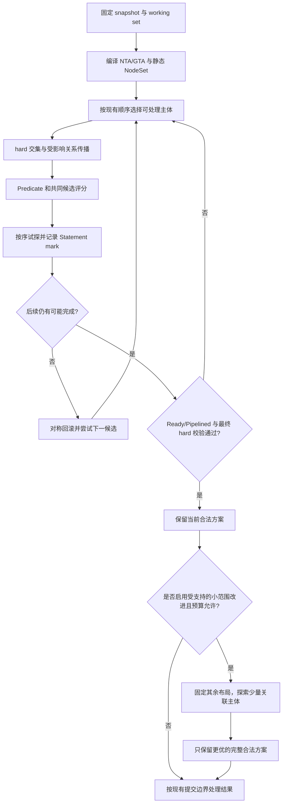

> 归档快照（2026-11-05）。本文保留原有阶段、基线和历史结论；其中的“当前”“完成”仅适用于原文对象。最终设计入口及证据边界见[归档说明](../../../../README.md)。本次仅迁移链接并添加此提示，未重新执行文中的命令。

# 拓扑调度重构再评审：正确性、联合收益、搜索成本与修改边界

> 历史评审材料。按本轮已确认诉求重新组织的完整方案见 [TOPOLOGY_PLANNING_FRAMEWORK.md](TOPOLOGY_PLANNING_FRAMEWORK.md)。本文件保留先前分析过程，不作为当前最终设计入口。

日期：2026-09-11。本文是 Feature 015 的独立设计评审，不替换已经约定的验收用例，不代表新设计已经实现或获得实施批准。

核心判断：保留“精确物理 Node 集合、hard/soft 分离、统一候选计分、可回滚放置”的方向，但需要补齐三个契约：**局部 hard 过滤不得误删可扩展解；局部排序分不自动等于整体方案收益；预算必须统计实际搜索工作。** 在这些基础上，用约束传播与有界联合调整同时处理 hard 死路和 soft 顺序损失。完整全局求解器不应成为第一阶段依赖。

最终推荐框架见第14节：**精确候选集合 + 增量约束传播 + 统一评分 + 共享事务上的有界联合规划**。第11节是实现拆分；仅完成其阶段 A 不代表完成用户本次关于 soft+hard 和 SubGroup 顺序的整体目标。

能够形成论文级贡献的方向，是对具体问题族给出正确性、复杂度和质量界，并以真实插件与在线调度实验验证收益。引用图搜索论文不能直接证明当前 Volcano 实现正确，也不能据此宣称新算法本身具有原创性。

## 1. 证据、版本与原始目标

本轮读取了此前任务“重构拓扑调度框架”的讨论、015 设计/博客/proposal、017 联合搜索需求、023 联合打分问题和024 required 语义记录，并对照两份代码：

| 对象 | 实际状态 | 本轮用途 |
| --- | --- | --- |
| `dev-1.14@7947e875600ff450318b412bb0c8c39f7020238a` | 当前检出的生产基线，工作区干净 | 真实调用链与兼容基线 |
| `feat/015-unified-topology-placement@c4c6c3643efed8a17f1ef31e8991d9ce1e25f891` | 第一版原型 | 回溯、适配器、缓存、预算的静态审查 |
| `PROPOSAL_COMMIT.md` | 后续修订设计，等待重新审批 | 评估目标框架；不能当作已实现源码 |
| `artifacts/VERIFICATION_RESULTS.md` | 第一版原型历史验证 | 只提供历史证据，不能验收本轮建议 |

015 的 DESCRIPTION 仍有“实现与验证完成”等历史表述，与后续 proposal 的修订状态不同。本轮以代码和后续 proposal 为准。生产代码也已经前进到 `7947e8756`，不再是旧文档中的 `71f1d3248`。

原始优化目标应继续成立：hard 不放宽；尽量避免有解却 Pending；偏好可以共同影响结果；常见成功路径便宜；复杂路径成本可控；运维能解释；修改集中在拓扑规划必需边界。新增目标不是无条件求全局最优，而是**知道当前求解范围、为什么停、还不能保证什么**。

“最优”的范围必须固定：

1. 一个 Task、一个 candidate class、已采样候选内的最高分。
2. 当前 PodGroup 的固定 working set、固定外部占用、全部 hard 条件下的最高整体收益。
3. 改变 working set 或 Gang 准入集合后的最优。
4. 多个排队 Job 的公平性、吞吐、未来碎片和等待时间的长期最优。

015 首先解决第 1 层的可比性和第 2 层的可行性。本文的数学优化模型限定在第 2 层；既不把最小 Gang 成员数扩大为整个 Job 的所有 Pending Pod，也不宣称覆盖第 3、4 层。

## 2. 源码带来的新结论

### 2.1 生产分支仍存在两套不能共同决策的 soft 分数

`allocateForJob`/`allocateForSubJobInCandidateForest` 先选择 HyperNode 方案，内部 `allocateResourcesForTasks` 调用 `prioritizeNodes` 后丢弃返回的 Node score。HyperNode 的最终比较不包含普通 NodeOrder 的联合贡献。见 [allocate.go](https://github.com/VanderChen/volcano/blob/7947e875600ff450318b412bb0c8c39f7020238a/pkg/scheduler/actions/allocate/allocate.go#L640)、[HyperNode 方案打分](https://github.com/VanderChen/volcano/blob/7947e875600ff450318b412bb0c8c39f7020238a/pkg/scheduler/actions/allocate/allocate.go#L851)。

因此，023 的方向仍正确：候选必须汇合到物理 Node 层。把 NodeAffinity 再实现一遍塞进 NTA/GTA，或者直接累加某一次贪心 dry-run 的得分，都会继续固化两层选择的问题。

### 2.2 原型相加了分数，但仍有更高优先级的 NTA soft rank

原型 `topology_planner.go:545–625` 先算 `ordinary + topology`，随后按 `establishedSoftDomainRank` 分组，先访问 rank 高的组，再按总分排序。普通 NodeAffinity 再高也不能跨越这个 rank。后续 proposal 已计划删除它，这是必须保留的修订，不是本轮才发现的新需求。

必须把这种历史 topology soft rank 与现有资源/shard candidate class 区分：后者是框架已有的调度策略边界，第一阶段保持兼容；前者是拓扑偏好在统一总分之外的额外优先权，应消除。

### 2.3 新发现：NodeAffinity 并没有自动归一化到 0–100

生产 `nodeorder` 将 NodeAffinity 注册在普通 `NodeOrderScorePlugins`，对每个 Node 直接调用 `Score()`，乘 weight 后相加，没有调用该 scorer 的 `NormalizeScore()`。见 [NodeAffinity 注册](https://github.com/VanderChen/volcano/blob/7947e875600ff450318b412bb0c8c39f7020238a/pkg/scheduler/plugins/nodeorder/nodeorder.go#L250)、[NodeOrderFn](https://github.com/VanderChen/volcano/blob/7947e875600ff450318b412bb0c8c39f7020238a/pkg/scheduler/plugins/nodeorder/nodeorder.go#L314)。

项目实际依赖 Kubernetes `v1.34.1`。对应 `NodeAffinity.Score()` 返回匹配 preferred term 的权重之和；独立的 `NormalizeScore()` 才将其缩放到 `MaxNodeScore`。两条匹配的 weight=100 规则会产生原始分 200。见 [Kubernetes v1.34.1 源码](https://github.com/kubernetes/kubernetes/blob/v1.34.1/pkg/scheduler/framework/plugins/nodeaffinity/node_affinity.go#L257)。

旧 proposal §4.5.2 中“nodeorder 中 Kubernetes scorer 已使用 MaxNodeScore，因此可直接在相同基准上组合”的概括过强。**函数来自 Kubernetes，不意味着 Volcano 执行了 Kubernetes 的完整评分生命周期。**

建议第一阶段保持 existing ordinary weighted points，不偷偷改变权重语义；score board 标明 raw/normalized、weight owner、理论范围、candidate cohort。将 NodeAffinity 的完整规范化迁移作为独立行为变更评审。直接把 raw 200 改为 normalized 100，会改变它与 topology 150 的胜负关系，不能称为纯重构。

### 2.4 新发现：Predicate 失败缓存缺少 speculative state 版本

`predicate_helper.go` 按 `Job/TaskRole -> Node` 保存错误；`allocate.predicate` 包括 `FutureIdle` 资源检查。原型在整个 planner 生命周期内复用这个 helper；rollback 更新了 topology 的 placementRevision，但没有同步清理 Predicate 失败缓存。见 [失败缓存](https://github.com/VanderChen/volcano/blob/7947e875600ff450318b412bb0c8c39f7020238a/pkg/scheduler/util/predicate_helper.go#L90)、[缓存键](https://github.com/VanderChen/volcano/blob/7947e875600ff450318b412bb0c8c39f7020238a/pkg/scheduler/util/predicate_helper.go#L139)、[资源 Predicate](https://github.com/VanderChen/volcano/blob/7947e875600ff450318b412bb0c8c39f7020238a/pkg/scheduler/actions/allocate/allocate.go#L1201)。

反例：A 先占满 node-a；有 TaskRole 的 B 检查 node-a，缓存资源不足；回退 A 并放到 node-b 后，node-a 已经可用，但 B 仍命中旧错误。这个缓存模型不支持“回滚后重试所有合法候选”的证明。

本轮确认的是源码中的失效条件，并用独立模型演示；尚未在 Volcano/Kind 中执行新的最小复现。实施门禁必须增加真实回归。

最小修订是在每次会影响可行性的 speculative apply/rollback 后失效整个动态 Predicate cache；后续才对已证明只依赖静态标签/规则的结果保留缓存。只在 rollback 清理还不足以支持会被后续正亲和放置改变的负结果。静态缓存键也不能仅假设相同 TaskRole 的全部 Pod 完全等价。

### 2.5 新发现：有界放置次数不等于有界决策成本

原型 `search()` 只在即将 `apply` 时消耗 extra attempt；无候选的 Task、PrePredicate、Predicate 扫描和打分已经执行。`PredicateNodes` 限制的是找到的可行 Node 数量，最坏仍扫描整个 scope。并发 Predicate 加上共享扫描游标还会影响候选样本；最终按名称排序不能消除样本成员的不确定性。见 [PredicateNodes](https://github.com/VanderChen/volcano/blob/7947e875600ff450318b412bb0c8c39f7020238a/pkg/scheduler/util/predicate_helper.go#L42)。

旧 proposal 中 `Predicate = O(M × pluginCost)` 只有在 M 表示实际检查的节点数时才成立，不能把 M 写成成功返回的样本数。

另外，原型第一次 backtrack 后 `backtracking=true` 不再复位，修复分支后续的每次放置都消耗 extra budget。一个很早的错误只需改选一次，却可能需要重走 20 个 Task；`B=8` 仍无法完成。它严格限制工作量，但不是“可以纠正 8 次错误”。这需要文档和指标解释清楚，不能只提高默认值掩盖。

## 3. hard 约束：精确表示、保守传播、最终校验

令物理节点集合为 N，本轮待规划 Task 为 T；变量 `x_t ∈ N` 表示 Task 的节点，S 为外部固定状态与当前 speculative placement。最终可行集合为：

```text
F = { x | resource(x) ∧ Predicate(x) ∧ NTA-hard(x)
          ∧ GTA-required(x) ∧ readiness(x) }
```

框架自身不能替代插件对语义的正确实现。证明中的每个 hard predicate，都需要映射到实际 API 规则、适用主体和状态版本。

### 3.1 三类 hard 不能只靠同一种“过滤”理解

| hard 类型 | 例子 | 处理 |
| --- | --- | --- |
| 静态单体限制 | required NodeAffinity、硬件型号、外部已占用 PAA 域 | 编译到精确 NodeSet，按需与普通 Predicate 配合 |
| 已确定状态下的增量限制 | 可用资源、已放置 peer 的 required anti-affinity、当前 NTA LCA | 每次 apply 后按受影响依赖更新，rollback 对称撤销 |
| 需要多个未放置主体共同决定 | 两个未放置 SubGroup required affinity、多个 SubGroup 的共同容量 | 保留未决关系，用约束传播/支持检查缩小候选，最后校验完整关系 |

`NodeSet` 的“精确”表示它不会把 B+C 扩张成包含 A 的 LCA envelope。它不表示每个保留的节点一定能完成整个 Job。后者相当于解决剩余联合可行性问题，通常昂贵。

对 partial placement P，理想定义为：

```text
E_t(P) = { n | 存在完整合法方案 x，x 扩展 P 且 x_t=n }
```

高效 hard filter 返回 `A_t(P)` 时，应满足 `E_t(P) ⊆ A_t(P)`。保留多余候选可以交给后续搜索与 final validator；删除 E 中的节点则会损害搜索覆盖。不要强制插件计算 E 的精确投影。

### 3.2 不用“大罚分”模拟 hard

required 未通过的节点不进入可提交候选；任何数量的 preferred 分数都不能抵消 required。预算耗尽、soft source error 或当前无 peer 均不能把 required 改为 preferred。

无 peer 时的语义按具体规则处理。当前 GTA required affinity 在 peer 集合为空时允许继续，并在后续放置中约束同域；不能把“尚无 peer”统一当作违反 affinity，也不能把这个行为推广为所有未来 affinity 插件的语义。见 [GTA required 检查](https://github.com/VanderChen/volcano/blob/7947e875600ff450318b412bb0c8c39f7020238a/pkg/scheduler/plugins/group-topology-affinity/group_topology_affinity.go#L603)。

### 3.3 NTA hard 与 GTA required 的组合

在经过验证的层级树上，NTA `LCA(placement) ≤ tier τ` 可以使用增量 LCA 和 tier ancestor 检查。GTA 则根据匹配主体的实际占用域过滤，不应仅保留一个 LCA；LCA 无法表达多个不连续的占用域。

Job、SubJob、NodeAffinity 等约束按物理 Node 交集组合。相同层级的 required affinity 如果确实表示“所有相关主体同域”，可形成共同 domain 变量，其候选为各主体**可能使用域的交集**。required anti-affinity 随后在域变量之间传播不同域关系。

这种合并只适用于同一 topology realm、同一层级和确切的同域等价语义；不能把跨层级、带方向的 selector、允许多域的 SubGroup 任意 union-find 合并，也不能把“同 rack”误解为“同 Node”。

### 3.4 有用而便宜的可行性前瞻

先做受影响的未来 Task/SubGroup 候选非空检查，再做受支持的容量检查。例如 A 可去 a/b，B 只能去 a；试探 A→a 后立刻检查 B，便能在走完整个 Job 之前发现冲突。

对同构、不可拆 Task 和可按单位 slot 表达的容量，可以建立 Task→slot 二分图：若某一组 Task 的可达 slot 数小于 Task 数，则联合放置不可能。小图可用匹配/流检查，并输出具体瓶颈集合。这个结论来自 Hall 条件；带容量时可以将容量理解为多个 slot。参考 [CMU 匹配与 Hall 定理讲义](https://www.cs.cmu.edu/afs/cs.cmu.edu/academic/class/15251-s12/www/lectures/notes13/notes13.pdf)。

对异构多资源任务，这类图只有在被证明是原问题的**放宽模型**时才可用于拒绝：原问题可行必须推出图可行。反方向不成立。总 CPU 足够也不是完整可行性证明，例如两个节点各剩 3 CPU，不能承载一个需要 4 CPU 的 Pod。不要把资源检查升级为新的误剪枝来源。

## 4. 多 SubGroup 顺序：分别解决无解误判与有解但较差

### 4.1 只在失败时回退，解决不了所有顺序质量问题

两个节点各一个 slot，两个 SubGroup 各一个 Task，所有 hard 均通过：

| 统一偏好分 | node-a | node-b |
| --- | ---: | ---: |
| SubGroup A | 100 | 99 |
| SubGroup B | 100 | 0 |

先排 A：A→a，B→b，完整方案分 100，没有任何 hard dead end，015 立即停止。

先排 B 或联合看一步：B→a，A→b，完整方案分 199。

因此，“有界回退提升有解率”和“降低调度顺序导致的收益损失”是两个不同承诺。前者不能作为后者的证明。NodeAffinity 已经进入统一评分，也仍会出现这个反例。

### 4.2 不需要枚举 SubGroup 的所有排列

当 working set 固定、所有节点分配被完整枚举、partial filter 不误删可扩展解时，任意固定变量顺序都能找到全部合法完整赋值。因此，无预算限制时，固定 SubGroup/Task 顺序本身不妨碍找到最优解。

顺序主要影响**有限预算内先访问哪些方案**，以及目前实现的 early return/working frontier 选择。更合适的工程路径是改善搜索顺序和少量分支探索，而不是把整个 SubGroup 排列变成额外搜索维度。

现有 Ready/Pipelined、optional/elastic Task、TaskOrder 及具有先后语义的插件会限制上述定理的适用范围。若比较的两个方案涉及不同 admitted Task 集合，已经改变优化问题，不能直接比较总分。

### 4.3 推荐的处理顺序

1. **先做 hard 支持传播。** 保留现有优先级，尽早发现后续主体无候选；这种剪枝不依赖偏好大小。
2. **仅在现有排序契约允许交换的同优先级主体内，优先处理候选稀少或损失较大的主体。** 候选数少称为 fail-first；“最好选择与次好选择的差”可作为机会损失线索。不能越过 Gang/TaskPriority/显式顺序，也不能把这一线索变成隐藏 hard 约束。
3. **对有联系的少数 SubGroup 做有限前瞻。** 在上述例子中检查 A→a 对 B 的损失，不需要完整全局搜索。前瞻只用于排序或产生可验证的局部替代；没有证明的估计不能剪枝。
4. **确实要优化首个可行解时，再启用小范围替换。** 固定其余 speculative placement，在少量相关 Task 上重新放置；只接受 hard-valid 且明确整体收益更高的替代。预算内没有改进就保留原方案。

第 2–4 项都会影响历史调度结果，需要独立行为测试；第 4 项尤其不是“纯回溯重构”。第一阶段可以只交付第 1 项与已有失败回退，后续按真实 workload 数据决定是否启用其他项。

可以用简单“移动/交换”先验证改进价值，但不能只检查 single-Pod swap 就声称 SubGroup 级局部最优。硬同域组可能必须整体移动，Gang 与 NUMA/device 也可能使两节点交换不可行。

## 5. soft 约束：统一比较，同时定义分数的含义

### 5.1 保持一个候选评分入口

每个 candidate class 中，在同一批通过 hard/Predicate 的物理节点上聚合：

```text
OrderScore(t,n | P)
  = ordinary_existing_weighted_points(t,n | P)
  + Σ topology_source_weight × topology_source_score(t,n | P)
```

这解决 023 的跨 HyperNode 可见性问题。每个 source 只应用一次权重；NTA 同时注册普通 batch score 与新 topology source 时，尤其要防止同一偏好被计算两遍。按 source 的语义身份去重，而不只是检查注册名是否重复。

保持 required、候选 class、BestNode 显式 override 的既有边界。若 BestNode 选择了较低分节点，应记录 override；不能继续声称实际第一候选就是数值最大值。分组优先级也是条件最优的范围，不是所有节点的全局比较。

### 5.2 决策分、完整方案收益、搜索上界分开命名

| 数值 | 回答的问题 | 可否直接作全局最优证明 |
| --- | --- | --- |
| `OrderScore(t,n|P)` | 当前先试哪个节点 | 不能；允许历史插件的动态/相对评分 |
| `Utility(x; S0)` | 在固定 snapshot/working set 下，哪个完整方案更符合目标 | 可以作为优化目标，前提是定义固定且可重算 |
| `UpperBound(P)` | 所有扩展 P 的方案最多能有多好 | 只有证明乐观且覆盖未搜索候选后，才可剪枝或出质量界 |

现有插件仍可只贡献 OrderScore。后续 bound/utility 扩展可选；不提供时返回“未知”，不要逼全部插件迁移，也不要用未知分数提供最优性证书。

### 5.3 整体目标使用因素分解，避免重复计费和顺序歧义

在愿意采用明确整体目标的受支持问题族中，可以定义：

```text
Utility(x; S0)
  = Σ task unary preference(t, x_t)
  + Σ declared relation utility(x_scope; S0)
  + Σ declared resource/layout utility(x_scope; S0)
```

NodeAffinity 是 unary 因素；NTA 的紧凑性可以是 Job/SubJob LCA 因素；GTA 是 peer domain 关系因素；资源布局可以有单独的整体因素。NTA 的“最低 LCA”与“所有任务对之间的通信距离总和”是不同目标，不能只因图论容易处理就相互替换。

单位要明确：Job、SubGroup、Pod、relation term、peer pair 各按何种范围计分。把同一个 Job 级偏好对每个 Pod 重复相加，会随 replica 数放大权重。按 Pod 平均、按 SubGroup 平均和按 peer pair 求和分别代表不同产品语义，需要明确选定；任意归一成 0–100 不会自动消除这些差异。

### 5.4 count-aware anti-affinity 可以有直接证明

仅对一个对称关系组、每个主体在相关层级只占一个域的简化情形，设 `c_d` 为域 d 的不同 peer 主体数量。使用碰撞对数势函数：

```text
Φ(c) = -Σ_d c_d(c_d-1)/2
ΔΦ(加入域 d 的一个新主体) = -c_d
```

peer 分布 2/1/1 时，增量为 -2/-1/-1，自然区分两个已占用域的拥挤程度。在任意放置顺序下：

```text
Σ incremental ΔΦ = Φ(final) - Φ(initial)
```

所以对相同最终布局，计费不随顺序改变。它提供可解释的“新增多少对同域冲突”，而不是只有 occupied/not-occupied 的布尔惩罚。

这不是对全部 GTA 语义的直接替换。有方向的 selector、不同 term 权重、允许一个 SubGroup 跨域等场景，必须按被声明的主体关系和实际域集合计算；同一个 SubGroup 在同一域增加第二个 Pod 不应自动算新增 peer。硬同域和软分散规则也可能作用在不同层级。

### 5.5 稳定收益仍不消除冷启动顺序问题

没有已放置 peer 时，亲和的立即增量可能为零。第一个主体仍可能因为自己的 NodeAffinity 选中对后续主体不合适的锚点。即使使用上述势函数，增量贪心也不保证整体最优；它只是使完整收益与增量记账一致。需要约束传播、前瞻或有限改进来处理先手影响。

### 5.6 归一化与采样存在耦合

如果采用 candidate-relative normalization，扩大 sample 会改变未变节点的相对竞争强度：A/B/C 原始偏好为 10/20/100，另一来源给 A 加 40 分。只看 A/B 并按最大值归一时，A=90、B=100；看 A/B/C 时，A=50、B=20，A/B 的相对次序反转。

所以不同 sample、不同 HyperNode 分片或不同决策时刻的 normalized score 不能直接累加为整体方案收益。保持 cohort 固定可以保证本次决策内部可比，不能保证跨 branch 的整体可比。

第一阶段保留既有 ordinary points，同时记录来源；若未来要提供稳定整体 Utility，应为支持的 source 采用固定语义标尺/明确的终态函数，或将候选相关的历史 scorer 仅作为搜索启发。启用某 source 失败后按 class neutral 的旧提案也要失效相应 score/bound；在更大范围的质量比较中不能悄悄换掉目标函数。

## 6. 推荐主流程：一条路径，逐层增加能力



这条主流程保持运维可读性：先确认能去哪里，再解释为什么先试这里，走不通就说明冲突并撤销。启用改进时，再说明新方案比旧方案在哪些因素上提高。图中的改进步骤属于后续阶段，默认第一阶段不执行。

第一版不引入 solver portfolio、不持久保存所有成功方案、不搜索不同 Job 的调度次序、不改变绑定事务。保留现有 Statement 回滚基础；任何恢复错误都终止本次计划并报告一致性错误，不能接着搜索一个可能已经污染的 Session。

## 7. 搜索效率：先消除无效工作，再选择更复杂算法

### 7.1 NodeSet 与拓扑索引

对确认无重复物理叶归属的层级树，以稳定 NodeID 和 DFS 叶序区间表示子树，B+C 用多个不相交区间表示；复杂 NodeAffinity 标签交集使用稀疏集合或 bitset。HyperNode 身份不能代替物理 membership 交集。

树索引构建约 `O(N+H)`；子树 membership 可以常数时间判断，二进制提升 LCA 查询可为 `O(log H)`，构建和空间为 `O(H log H)`。选择何种 LCA 实现由测量决定，现网树高很小时简单 ancestor 链可能更合适。不能将 LCA 的复杂度当作完整调度复杂度。

当前 HyperNode 对象只有一个 Parent，并拒绝多个 HyperNode parent，但这还不自动证明所有物理叶集合互斥；物理 Node selector 重叠仍需检查。见 [HyperNode 结构](https://github.com/VanderChen/volcano/blob/7947e875600ff450318b412bb0c8c39f7020238a/pkg/scheduler/api/hyper_node_info.go#L130)、[parent 校验](https://github.com/VanderChen/volcano/blob/7947e875600ff450318b412bb0c8c39f7020238a/pkg/scheduler/api/hyper_node_info.go#L517)。未来 network/failure-domain 多个独立 realm 或 DAG 拓扑必须有自己的集合语义，不能强套一棵树。

### 7.2 利用 domain 做批量计算，而不是提前锁定 domain

多个节点共享同一个 topology 增量时，domain contribution 算一次，再叠加每个节点不同的 NodeAffinity/资源分。物理节点仍参加全局候选比较；domain 只作为计算索引。

更进一步，可给尚未展开的 domain 一个对**总分**的乐观上界。例如 domain 内 topology 上界加上该 Task 的 NodeAffinity/其他所有 source 上界，再决定先展开哪个 domain。只有它不可能超过当前已知最好节点时，才停止寻找本次决策的更高分节点。

这不等于永久删除该 domain：如果当前选择导致后续失败，较低局部分的节点仍可能是唯一可行 fallback。局部 Node score 上界只能证明本次最高分候选；要删除整条 placement branch，需要完整 Utility 的 branch 上界。

NodeAffinity 未入 bounds、候选间归一化未固定、某个插件无上界时，不能安全排除 domain。未知上界用“不可剪枝”，保留普通展开。因此此项只作为可选优化，不增加第三方插件接入门槛。

### 7.3 缓存按依赖失效，优先做简单正确的版本

Session 内缓存稳定 tier 解析、静态 membership、静态 selector 和 peer 匹配关系。speculative state 中缓存占用、资源、动态 scope 与 score，键包含所依赖的 revision；回滚必须更新/恢复版本。第一阶段全量失效更容易验证，细粒度 dependency revision 后续按 profile 优化。

不要用“相同 LCA”判断布局等价：两个方案可以有同一个 LCA，却占用不同的节点、设备和故障域。不要按“同 HyperNode”合并节点：不同 NodeAffinity、taint、NUMA、资源和镜像状态都可能打破等价性。安全的对称压缩必须保持所有剩余变量的可行性和目标值，证明义务远高于名称相同。

### 7.4 预算区分两个含义，但避免暴露一组难调参数

对外保留少量配置；内部计数至少分别覆盖：checked nodes、scored nodes、expanded decisions、apply、rollback、插件耗时、未展开候选。extraPlacementAttempts 可以继续保持现有含义，但不能作为总成本的唯一证明。

定义 `R` 为实际决策展开数，`P_r` 为该次检查的全部候选/Task 对数量，`M_r` 为实际打分节点数，则更诚实的工作量估计是：

```text
T = T_compile
  + Σ_r (T_scope(r) + P_r*C_pred + M_r*C_score
         + T_propagate(r) + T_sort(r))
  + A*C_apply + U*C_undo + T_diagnostics
```

它包含零成功放置时的工作。若每次递归扫描全部剩余 Task，最坏额外乘以待处理 Task 数；不要只写成 `O((W+B)×sample)`。尽量用可推进 frontier 避免反复扫描全部 Pending 列表。

内部工作计费必须在执行昂贵操作前检查；并行批次需要预留在途额度。wall-clock deadline 只能在 callback 能取消或有超时上限时形成时间保证，`context.TODO()` 或外部 extender 超时不受 allocation 次数自动约束。内存还需明确候选栈/缓存/trace 上限，并非有工作预算就自然低内存。

### 7.5 回溯策略不宜同时引入多套

普通按栈回溯最容易维护，建议首先保留。若数据证明预算经常耗在一个很早已错误的子树内，可比较 Limited Discrepancy Search：按偏离启发式首选的少数决策组织搜索，更直接探索“早期只有一处选错”的方案。[Harvey 与 Ginsberg，IJCAI 1995](https://www.ijcai.org/Proceedings/95-1/Papers/080.pdf) 给出了该方向的分析和实验。

LDS 的“偏离次数”与真实工作额度是不同量；仍需工作预算。不能依据该论文断言它对 Volcano 所有负载更快。第一阶段不同时实现 DFS/LDS/beam/回跳；先用明确反例和同工作预算消融决定是否更换一个搜索策略。

## 8. 可以写成定理的部分，以及前提

以下是本评审提出的条件性论证，不是现有实现的完整形式化验证。

### 定理 A：最终 hard 安全性

假设：初始 Session 可接受；每次 apply 在当前状态下满足所需资源与即时约束；所有可能受后续放置影响的 hard 关系在完成时重新校验；Ready/Pipelined 语义按现有合同执行；最后接受前只允许硬校验通过的完整方案。

结论：任何接受的方案满足本次准入所适用的全部 hard 条件。

证明：以操作序列归纳维护状态与分配一致；最终 validator 检查剩余全局关系。搜索顺序、soft 分数和预算仅影响是否发现方案，不改变接受条件。对 bind 之后的外部变化、跨 Job 并发、设备现实可用性，这个结论不能超出相应 commit/reservation 协议。

注意：final validation 应覆盖受新放置影响的约束，同时保留 `IgnoredDuringExecution` 等现有语义；不应将该规则解读为要求所有历史 Running Pod 重新符合后来修改的策略。

### 定理 B：安全 hard 剪枝与固定顺序的条件完备性

假设：固定 Task 集合、有限 Node 候选、固定 snapshot；每个 filter 满足 `E_t(P) ⊆ A_t(P)`；每个节点 alternative 最终被访问；不采样、不提前用预算停止；rollback 恢复所有相关状态；终态检查等价于模型约束。

结论：若模型中有可行完整方案，任意固定合法变量顺序都能找到一个。

证明：取任意可行 x。其第一个赋值在候选中；对每个前缀归纳，下一赋值都属于 E，因此不会被 filter 删除。有限枚举最终沿该路径到达 x。

当前实现的失败缓存、候选采样、working set 选择和既有插件先后语义意味着不能直接给整个 Volcano 声称此定理。有限预算版本只能声明 hard 安全与有限探索，不声明完备。

### 定理 C：对称回滚的状态隔离

假设每个操作 `a` 有真实逆操作 `a^-1`，恢复资源、Task 状态、Job/SubJob、设备、插件 side state 与缓存语义；逆操作成功。

结论：从 mark 开始执行 `a1…ak`，再逆序执行 `ak^-1…a1^-1`，恢复 mark 时的观察状态。

证明由复合函数逐项消去得到。仅恢复 Node 资源不够。缓存可以清空而不恢复同一内存布局，但清空后的观察行为必须正确。Statement 在 Session 中可逆，也不意味着外部 bind 本身是原子事务。

### 定理 D：因素上界允许安全剪枝，并给出实例质量差距

假设固定最大化目标 `Utility(x)=Σ_f f(x_scope)`；对 partial P，每个未完全确定的因素有上界 `u_f(P)`，大于等于其在任何合法扩展中的贡献。已关闭因素不再因后续放置变化。

定义：

```text
UB(P) = Σ_closed f(P) + Σ_open u_f(P)
LB = Utility(目前最好的完整合法方案)
UB_global = max(LB, 所有尚未完成搜索分支的 UB)
```

对任意扩展 x，每一项都被其上界覆盖，求和得 `Utility(x) ≤ UB(P)`。所以当 `UB(P) ≤ LB` 时，该 branch 不会改善当前方案，可以剪枝。

若全部未搜索分支都被 bounds 覆盖，则：

```text
LB ≤ OPT ≤ UB_global
0 ≤ OPT-LB ≤ UB_global-LB
```

`UB_global=LB` 时，获得固定模型、snapshot、working set 范围内的最优性证书。它不是集群长期最优。若节点采样丢弃了分支而没有保留其上界，或者某插件缺少有效上界，必须标记 `qualityBound=unknown` 或 `scope=sample`，不能报告全候选空间的 gap。

“各未放置 Task 都取其最好节点，忽略相互资源竞争，再加尚未确定关系的最好可能值”就是一个便宜但可能松的 relaxation bound。只累加 Task 最好分会漏掉未来亲和奖励，不一定是上界。

若启用有限改进并始终保留 incumbent，随同一确定搜索序列的预算增加，LB 不下降。随机重启、不同采样集合、修改目标、改变工作集或因为截止时间改变搜索前缀时，不自动具有这个性质。

优先报告加性差距；带负惩罚的目标可能跨零，相对百分比需要单独定义。目标加常数不改变方案选择，但会改变比例 gap。

### 定理 E：势函数增量的路径无关记账

对于任何固定势函数 Φ，沿 placement 状态序列累加 `Φ(P_next)-Φ(P)`，中间项相消，结果仅由起点终点决定。因此第 5.4 节的碰撞对数可以保证计账不随顺序变化。

这只证明收益定义一致，不证明每步取最大 ΔΦ 能得到最优解。候选相关 normalize、clip、重复乘权会破坏“记账等于该势函数差”的关系；如需非负分作本次排序，可以加共同常数，但比较不同长度工作集时不能直接把这些常数当收益。

### 定理 F：小结构上的精确算法

如果只有固定 unary cost、单位 slot 容量和候选可达边，完整 Task 放置可编码为整数容量的最小费用流；整数解对应离散放置，此时可精确最优。添加一般多资源 Pod、Gang 选择和任意 peer 关系后，这个模型不再自动适用。

如果全部因素的 primal constraint graph 有已知宽度 w 的树分解，变量最多 D 个值，且因素评估成本受控，则沿分解表进行动态规划可做到对 D 的指数仅依赖 w 的复杂度，常用表界约为 `O(number_of_bags × D^(w+1))`。**这里的图是完整约束图，不是 HyperNode 物理树。** 一个共享节点容量因素就可能把许多 Task 连在一起，不能仅看 SubGroup affinity 关系图很稀疏便宣称 w 很小。

这些精确子问题可以先用于离线 oracle 或小范围局部求解；不要求第一阶段在在线调度器里实现流引擎和树分解引擎。[Dechter 与 Pearl 的约束树研究](https://cdn.aaai.org/AAAI/1988/AAAI88-027.pdf) 提供结构化约束求解的依据；上面的 Volcano 映射与适用条件是本评审的推导。

## 9. 为什么不应把目标叫作“一般快速子图搜索”

需要区分三张图：

| 图 | 顶点与边 | 用途 |
| --- | --- | --- |
| 物理拓扑树/图 | Node、HyperNode、网络/故障域关系 | membership、LCA、距离、局部容量 |
| 工作负载约束图/超图 | Task/SubGroup 变量，资源/亲和/Gang 因素 | 决定联合求解复杂度和可分解性 |
| 搜索树 | partial placement 与下一次选择 | 顺序、回退、预算、upper bound |

Task 可以共置、消耗异构资源，约束包括集合、计数与 Gang，因此它通常是带拓扑结构的约束满足/组合优化问题，不是一般子图同构。

即使物理拓扑是星形，仅要求将不可拆任务放入固定容量的节点，也已经包含装箱/划分问题。举例，将和为 2B 的整数任务需求放进两个容量 B 的节点，完整可行性正对应把整数划为和为 B 的两组。增加 CPU/GPU/NUMA 和关系因素不会让一般问题自动变简单。

所以合理理论目标是：**利用层级集合加速可行域操作，利用受限依赖加速传播，在明确成本下搜索；对可解析子问题证明精确最优，对一般实例给条件性界或诚实的未知。**

## 10. 相关论文应如何使用

| 原始来源 | 与本项目的关系 | 不能直接推出的结论 |
| --- | --- | --- |
| [Dechter & Pearl，Tree-Clustering Schemes，AAAI 1988](https://cdn.aaai.org/AAAI/1988/AAAI88-027.pdf) | 约束图的树结构、聚类和宽度解释哪些子问题可以高效精确求解 | HyperNode 是树，所以所有调度问题都是多项式复杂度 |
| [Harvey & Ginsberg，Limited Discrepancy Search，IJCAI 1995](https://www.ijcai.org/Proceedings/95-1/Papers/080.pdf) | 在较好启发式附近修正少量选错，适合与按栈回溯做消融 | 默认 8 次放置回溯具有 LDS 的覆盖或收益保证 |
| [Dechter & Rish，Mini-Buckets，JACM 2003](https://ics.uci.edu/~dechter/publications/r62.pdf) | 放宽耦合构造界，以受限推理复杂度换更紧质量估计 | 任意插件总分可以不建模直接塞入算法 |
| [Isard 等，Quincy，SOSP 2009](https://www.sigops.org/s/conferences/sosp/2009/papers/isard-sosp09.pdf) | 将受支持的调度代价与容量表达为流网络，在该模型内联合优化 | 多资源 Gang、任意拓扑 affinity 都可无损化成普通最小费用流 |
| [Gog 等，Firmament，OSDI 2016](https://www.usenix.org/conference/osdi16/technical-sessions/presentation/gog) | 结构化图表示、增量求解与专门优化可以兼顾质量和延迟 | 其论文的速度数字可迁移到 Volcano 或本重构 |
| [Likhachev 等，ARA*，NIPS 2003](https://robots.stanford.edu/papers/Likhachev03b.html) | anytime 搜索先给解、再改善并维护次优界的参考 | 直接给本 planner 设 epsilon 就自动得到近似比；其假设需要重新满足 |

第一版最值得借用的是约束传播、乐观松弛和保留 incumbent 的思想。论文级论证不要求把所有论文对应的求解器都放进代码。

## 11. 修改范围与推荐分期

### 阶段 A：完成必要框架重构，优先保证语义与回滚

目标：把已有 015 方向落实到当前生产基线，并修正本轮暴露的证明缺口。

- 沿用 NodeSet、TopologyIndex、PlacementView、Statement，避免另一套 solver state 与实际 state 并行维护。
- NTA/GTA 各自编译 hard/soft；planner 不按插件名解释 raw API，不保留 NTA soft rank。
- score board 保留 existing weighted ordinary points；补充真实分值范围和来源标记，避免重复 NTA 贡献。
- 动态 Predicate/scope/score 缓存正确失效；final validation 与 rollback 覆盖同一状态。
- 加入受影响 hard 候选非空检查；保持 fixed SubJob/Task order、first-feasible 和现有 candidate class。
- 统计真实检查成本、采样覆盖和终止原因。默认预算不从历史 8 直接改成新的语义。

主要代码范围：`actions/allocate`、拓扑相关 `framework/api` 数据结构与 callback、NTA/GTA 两插件、必要的 Predicate helper/Statement 修复。设备、task-topology、extender 等只按真实回滚缺口定点修改。API/CRD/controller/preempt/reclaim 的新联合策略均不在范围内。

相对于只换搜索循环，typed hard/soft 和 state ownership 的修改不可完全避免；这正是停止堆积特殊路径的必要边界。但无需同步重写所有 scheduler plugin。

### 阶段 B：同一个 PodGroup 内的小范围质量改进

目标：针对 100→199 一类“有可行解、无 hard dead end、但布局较差”的顺序问题。

- 先选定并文档化支持的完整 Utility；历史任意 ordinary callback 继续可作 OrderScore。
- 同优先级主体的 fail-first/regret 顺序，或固定顺序下有限前瞻，两者先做对照后选一种。
- 对少量关联主体启用有限联合替换，保留 incumbent；其余 placement 固定。
- 针对 native NTA/GTA、静态 NodeAffinity 等可建模来源做精确收益比较；混合未知 source 时明确质量目标范围，或不启用改进。
- 不将一个 SubGroup 强制压缩成单节点；局部求解仍须容纳真实多 Pod/多节点布局。

这一阶段能证明“被接受的改进不降低已定义 Utility”，不能笼统声明消除了顺序影响。若完整枚举局部邻域，只能声明相对于该邻域的最优。

### 阶段 C：有数据支持时才引入质量证书与专门搜索

候选包括合法总分 bounds、domain 惰性展开、小规模 flow/DP oracle、LDS。每一项都应证明删除或延后了什么工作，绑定适用问题族，并通过同预算实验选择。第一阶段不新增多个 solver mode，不引入通用 plugin transaction capability 矩阵，不做跨 Job 全局优化。

如必须只批准一期，推荐阶段 A；如需求明确包含“有解但次优”的可观察改善，则至少纳入阶段 B 的一个受控前瞻/局部替换策略。只实现阶段 A 后，不能在收益说明中写“消除 SubGroup 顺序导致的非最优”。

## 12. 验证建议与本轮实际结果

以下为新增验证建议，未替换原 proposal 的 U/P/K 用例。正式实施时需把准确函数名、配置权重、镜像和操作脚本写入原验收方案并审批；本轮不按未批准的计划修改实现。

| 新增验证 | 目的和设置 | 预期 / 判定 |
| --- | --- | --- |
| Q1 hard 组合 | B+C、NTA hard、required NodeAffinity、多 SubGroup required 同域/异域；固定不同策略枚举顺序 | 相同语义给相同允许集合；无 A 泄漏；全部 accepted placement 合法 |
| Q2 回滚缓存 | A 占 a 使带 TaskRole 的 B 在 a 缓存不足，A 回退到 b；另测正亲和产生新支持 | 重新检查后 B 可在 a；缓存开关不改变完整搜索下的可行结果 |
| Q3 score scale | 两条 weight=100 的 preferred NodeAffinity 与 topology=150 竞争；源重复注册和 batch+native 双路 | 兼容阶段保留 raw 200；权重只应用一次；规范化迁移单独产生已声明结果 |
| Q4 有解但较差 | 本文 A=100/99、B=100/0；多副本 peer、冷启动亲和以及更高优先级阻止换序 | baseline=100；启用受控联合策略时得到199；不越过优先级合同 |
| Q5 完整收益 | 同一布局按多个 Task 顺序构造；2/1/1 peer；SubGroup 同域第二个 Pod | 受支持 Utility 不随构造顺序改变；peer 主体不重复计数 |
| Q6 真正工作上限 | 大量无候选 Task、N 个 Predicate 全失败、首个错误后长 suffix、慢 callback | work计数包含失败与在途调用；截断清理完整；不把 sampling/budget 解释为无解 |
| Q7 小规模 oracle | 同一个固定模型，穷举全部布局与优化器比较；有/无 bounds、不同预算 | hard 不误剪；完整模式匹配最优值；有限模式每个 gap 覆盖真实 OPT |
| Q8 结构边界 | 物理叶重叠、多个 realm、共享资源打破关系图独立性、两个域内不同 NodeAffinity | 不使用不成立的树/对称性/独立性假设；不支持时回到普通安全路径 |

后续建议 Go 命令，测试名为待实现名称，**本轮未运行**：

```bash
cd /Users/vanderchen/workspace/dev/volcano-workspace/volcano
go test ./pkg/scheduler/actions/allocate ./pkg/scheduler/framework ./pkg/scheduler/util \
  -run 'TestTopologyReview' -count=1
go test ./pkg/scheduler/plugins/nodeorder ./pkg/scheduler/plugins/network-topology-aware \
  ./pkg/scheduler/plugins/group-topology-affinity -run 'TestTopologyReview' -count=1
go test ./pkg/scheduler/actions/allocate -run '^$' -bench 'BenchmarkTopologyReview' -benchmem -count=5
```

真实实现仍需执行项目要求的 `make unit-test`、相关 verify、宿主镜像构建和 Kind。Kind 沿用最多4个实际节点的 tier1→tier2→tier3 显式树，每个用例先建 PodGroup 再建 Deployment；比较 Pod placement、Ready/Pipelined、scheduler trace、rollback 后跟进作业的资源状态。不能只用下面的数学脚本代替 Kind。

性能验收要同时报告：首解延迟、最终采用方案延迟、调度成功率、已知 oracle 下的收益差距、P50/P95/P99、callback 次数、B/op/allocs/op、预算截断比例。固定集群与 trace、插件/权重、候选覆盖和工作预算，分别关闭 NodeSet 优化、传播、前瞻、bounds 做消融。记录多随机种子与置信区间；主机噪声下不给未经数据支持的提升百分比。Kind 验证语义，大规模合成 snapshot/benchmark 验证数量级。

### 本轮已完成的独立模型检查

脚本：[model_checks.py](review-2026-09-11/model_checks.py)。结果：[model-results.json](review-2026-09-11/model-results.json)。

```bash
cd /Users/vanderchen/workspace/dev/volcano-workspace
python3 issues/features/015-unified-topology-planning-framework-IP/review-2026-09-11/model_checks.py
```

固定 seed=15023911，500 个4 Task/4 Node 随机模型：完整 branch-and-bound 与穷举最优值全部一致；65,000 次可行前缀与上界检查通过；2,500 次有限工作预算运行通过；1,876 次有界联合调整检查满足“完整合法、收益不下降、成本计数不超限”。两 Task 顺序反例通过最多8次候选检查从100改善为199。另验证 peer 势函数的24种顺序、raw/normalized 分值胜负变化、候选 cohort 导致相对次序变化、失效缓存与容量碎片反例。

模型限定为单位 slot、静态候选、同/异域硬关系和 unary/pairwise soft utility；不包括 Volcano Session、实际插件、异构资源、minMember 工作集选择或绑定。实验是推导的有限实例核查，既不是普遍数学证明，也不是实现完成或性能收益证据。

## 13. 推荐的对外理论表述

> 本框架将拓扑调度表达为固定调度快照中的约束放置问题。精确物理候选集合和保守约束传播保留合法扩展；统一增量状态与最终校验保证已接受方案满足适用的硬约束；有限工作预算控制搜索成本。对具有明确整体目标和有效乐观界的受支持问题族，框架可进一步报告当前方案与最优值的差距；一般插件组合保持可解释的启发式调度，不宣称无条件全局最优。

这一表述把原始工程目标与数学证明连接起来，同时留下可逐步实现的边界。下一步的设计收敛应围绕阶段 A 的必需契约和阶段 B 的一个具体顺序改善策略，避免把“论文级”误解为一次性实现所有组合优化算法。

## 14. 收敛后的新框架：同一个有界规划器处理 hard 死路和 soft 顺序损失

补充要求强调，015 博客只是目标与经验来源，不是必须沿用的最优设计。因此最终推荐不再把“第一个 hard-valid 方案立即停止”写成框架永久原则。它可以是没有额外质量探索时的行为，但不能阻止框架改进已经可行的明显较差布局。

推荐保留一套 planner、一套 PlacementState/Statement、一套 hard/soft 编译接口。规划器先产生完整可用方案，再对影响较大的少量关联主体进行有界联合调整；两类搜索复用相同的 `expand / check / score / apply / undo / validate` 原语。普通独立成功路径直接返回，复杂关系只承担经预算批准的额外工作。

### 14.1 统一处理 hard-only、soft-only 和 mixed

| 拓扑配置 | 候选范围 | 选择/搜索行为 |
| --- | --- | --- |
| 只有 topology hard | 精确 hard NodeSet，再过普通 Predicate | 普通 NodeOrder 仍有效；支持传播与有界失败回退 |
| 只有 topology soft | 不因 topology preferred 删除节点；普通 required/资源/Predicate 照常 | 拓扑与普通偏好共同排序；有关系或资源竞争时可有界联合调整 |
| hard + soft 混合 | 所有 hard 求交，preferred 不改变该集合 | 在相同候选空间中计分、回退和调整；任何软收益都不能越过 hard |
| 新拓扑插件 | 实现本插件 hard/soft 语义并声明依赖 | 主循环不识别插件名；无可证明质量模型时仍可提供排序功能 |

hard/soft 是 policy 的能力类型，不是两条调度 runtime。一个 Job 同时有 NTA hard、GTA preferred 和 NodeAffinity 时，不存在“进入哪一个模式”的策略分叉。

### 14.2 比旧博客新增的最小机制：联合调整窗口

窗口是一小组可重新规划的 Task/主体，其余当前 PodGroup 的分配和外部占用暂时固定。它不是某个 HyperNode 容器，不限制这些 Task 必须共同进入一个域。

窗口依据三类证据选取：

1. **hard 冲突**：B 无候选是因为 A 占用了 B 唯一可用资源，优先尝试能释放该资源的相关选择。
2. **声明的 soft 关系**：P/D affinity 或多个 peer 的 anti-affinity，当前布局造成可计算的关系损失。
3. **资源机会损失**：两个 SubGroup 都能放，但它们竞争同一个高收益/稀缺节点，例如100/199反例。

第一版用保守的关联 watch index 和最近决策栈构造小窗口，不构建全 Job 的稠密冲突图，也不实施未经证明的冲突回跳。一个原因解释可以帮助优先搜索，但除非它是充分的冲突证据，否则不能据此删除窗口外的其他选择。

粒度按语义闭包扩展：若一个 hard 同域组需要整体迁移，则窗口纳入实际需要一起调整的 Task。超过工作/内存额度时停止扩展并保留 incumbent，不能拆掉 required 来强行完成局部优化。两个 SubGroup 各有数百 Pod 时，绝不能把“窗口大小为2”当作常数成本。

### 14.3 一个主循环的概念伪代码

```text
compile topology policy and indexes
freeze working set, external placements and objective version
find a complete hard-valid placement with ordered bounded search
if no placement:
    undo to root; return sampled/exhausted/budget/error with accurate reason

incumbent = compact task-to-node plan + utility + objective version
for each selected related window while work budget remains:
    start from the incumbent baseline
    expose alternatives across all allowed physical domains for this window
    use the same hard propagation and placement search primitives
    for each complete trial:
        validate affected hard conditions against the whole placement
        if comparable utility is strictly better:
            retain the compact better plan
    restore or install the best verified plan
return incumbent under existing Ready/Pipelined and commit semantics
```

只保留一个 incumbent 和当前搜索所需状态。窗口调整必须保证“基线可恢复”；如果任意中间调整/恢复失败，返回错误并进入既有清理，不声称还能安全提交旧方案。

`Ready` 与 `Pipelined` 不随意互换。第一版质量调整固定 completion class，防止为了更高 soft 分数把可立即运行方案改成等待资源方案。想在预算内主动寻找 Ready 替代 Pipelined，应单独定义更高层目标和验证，不从节点 class 顺序推导整 Job 已最优。

### 14.4 修改范围的关键取舍：先复用 root replay，不先做任意操作删除

现有 Statement 的 mark/rollback 天然支持后缀撤销；“移除已经放置的任意两个 SubGroup，保留中间操作”不是免费能力。若为窗口优化直接增加任意删除，就会扩大设备、extender、task-topology 等插件的事务复杂度。

第一版建议保留原有事务模型：用紧凑 placement plan 保存 incumbent；回到 root mark，按原先受支持顺序重放被固定的选择，并在待调整位置枚举 alternatives。必要时一次 trial 重放较长前缀/后缀，其成本全部计入 budget。动态 Predicate 必须重新检查，普通插件 callback 按既有合同发生，不能把静态计划当作可跳过验证的承诺。

这种方式可能限制大 Job 的调整次数，但把修改范围限定在 planner 与已存在的回滚能力。之后只有 profile 证明 replay 是瓶颈，才讨论受控 checkpoint/更细粒度 overlay。论文与性能说明必须统计 replay 和最终恢复 incumbent 的成本，预留恢复额度，不把窗口局部变量数当成全部成本。

### 14.5 整体收益兼容策略

第一批可证明质量改进的来源限定为明确建模的 native NTA/GTA 和静态 unary NodeAffinity 等；保留当前 NodeAffinity raw weight 口径，并定义拓扑因素按 Job/SubGroup/peer 计费的范围。其他普通插件继续参加决策总分。

如果某个参与偏好的普通插件只有动态 OrderScore、没有可比较终态 Utility，框架仍可以正常规划，但不能声称“全部插件联合收益不下降”。建议第一版在这种配置下不启用完整方案质量调整，仍使用统一排序和有界可行性回退，并在结果中标明 `qualityOptimization=unsupportedSource`。这是一条明确可解释的能力边界，不是按 plugin name 的运行分支；后续插件可提供终态评价能力解除限制。

不推荐默认只优化 topology 的局部指标而忽略未知 ordinary source，却把它宣传为“联合最优”。一个 NTA/GTA 布局变好但 NodeAffinity 或资源策略明显变差的调整，必须通过完整目标表达这种取舍。

### 14.6 运维实际看到的解释

例如一次调度可以输出紧凑记录：

```text
Hard scope: B+C; A excluded by PodGroup required anti-affinity
Feasible baseline: A->node-a, B->node-b; utility=100
Joint window: SubGroup A/B; reason=shared scarce node
Alternative: A->node-b, B->node-a; utility=199
Change: A NodeAffinity -1, B NodeAffinity +100, topology unchanged
Validation: required/Predicate/Gang pass; completionClass unchanged
Outcome: improved; local candidate coverage=complete
Global quality bound: unknown; stop=work budget / no selected window remains
```

这是解释示例，不是已执行的 Volcano 日志。不要将“窗口穷尽”写成“所有 SubGroup 组合穷尽”。第一分支成功且没有值得检查的窗口时，记录首解和停止原因即可；无需为每个 Pod 输出大量 trace。

### 14.7 最终收益承诺

- **hard 正确性**：接受的方案满足适用硬条件；搜索没有成功时不伪装为已证明无解。
- **联合可见性**：NTA/GTA 与 NodeAffinity 等普通分数在共同物理候选层影响选择。
- **顺序改善**：在明确支持的整体目标下，窗口调整可修复部分 first-feasible 无法发现的较差方案；接受的改进不降低该目标。
- **效率**：取消按 HyperNode 重复完整 dry-run；静态编译、增量传播、共享状态降低重复成本；额外联合工作包含重放并有明确额度。
- **范围**：只有一个拓扑 planner；不改 API/CRD，不强迫全部插件迁移，不引入跨 Job 优化、多个通用 solver 或新的绑定事务。

最终交付应覆盖阶段 A 加这一种受控联合调整机制，再通过实际测量确定启用条件与默认额度。这个框架既继承015博客中值得保留的效率目标，也修正它“只有 hard 失败才值得再次考虑前序决策”的核心限制。
