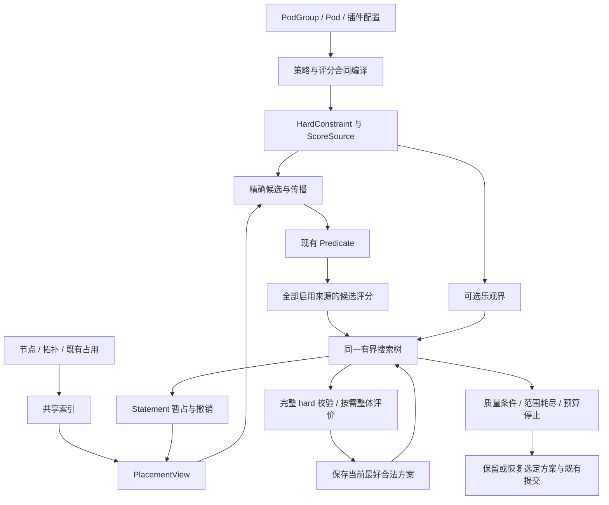

> 归档快照（2026-11-05）。本文保留原有阶段、基线和历史结论；其中的“当前”“完成”仅适用于原文对象。最终设计入口及证据边界见[归档说明](../../../../README.md)。本次仅迁移链接并添加此提示，未重新执行文中的命令。

# 统一拓扑调度框架：模型、算法与工程方案

## 1. 方案结论

建议将拓扑调度统一为**具有结构化约束和综合收益的有界放置问题**。物理节点是决策变量的取值，拓扑提供集合与关系索引，hard 规则定义合法放置，soft 与普通评分定义放置收益。规划器在同一棵决策树中寻找可行方案并提高收益，策略插件不控制搜索路线。

核心实现采用**增量约束传播、统一评分、按偏离次数组织的有界搜索，以及安全的收益上界剪枝**。首次沿综合评分的首选分支前进；需要继续探索时，优先考虑少数决策选用其他候选的路径。每条路径重新生成后续放置，因此一次前序选择变化可以自然改变许多后续 Pod 的节点。

这套机制同时处理“后续任务无法放置”和“全部可放置但综合质量较差”。它不依赖两个 Pod 的交换、某种资源比例或某个 Bug 的修复模板。Bug020、多层拓扑、不同 affinity 组合和普通评分竞争，都是相同模型的输入实例。

高效性有三个来源：**减少重复完整试放；利用约束与计数结构提前排除无效搜索；将额外计算限制在可观测的工作、内存与时间额度内。** 一般问题不具有无条件多项式最优算法；框架提供的是条件正确性、可控制的覆盖范围，以及在上界有效时可解释的质量保证。

**与当前实现相比，速度结论有条件：**拓扑候选反复试放较多、统一后候选检查量没有明显膨胀时，新首解路径有明确的减负空间；原路径已经很短，或新路径检查更多节点、执行昂贵插件时，也可能变慢。整体耗时还要加上购买更好布局所需的探索成本。目前没有本文目标架构的实现测量，不能给出真实加速倍数或劣化百分比。第11.12–11.14节给出源码操作账、盈亏条件和质量预算的计算方法。

```text
策略编译与共享索引
  → 固定本轮准入目标与评分合同
  → 精确物理候选 + 安全约束传播
  → 所有启用评分共同排序
  → 同一搜索树：选择 / 暂占 / 传播 / 校验 / 记录最好方案 / 回退
  → 达到质量界、搜索范围耗尽或预算停止
  → 保留或恢复选定方案，进入既有 Ready / Pipelined 提交过程
```

本文给出可供实施评审的完整设计。015目标重构仍处于设计阶段；源码和历史记录用于判断现有合同与修改范围，不表示本文架构已经实现。

## 2. 目标、范围与优先级

### 2.1 必须同时成立的目标

| 目标 | 设计中的含义 |
| --- | --- |
| hard 安全 | 不用 soft 分抵消资源、required 关系或其他适用的硬约束 |
| 联合放置 | 当前 PodGroup 的多个 SubGroup 使用一致的资源与关系状态，前序选择可以被重新考虑 |
| 综合偏好 | NTA/GTA、NodeAffinity、Binpack 及其他启用来源共同影响候选与方案选择 |
| 通用组合 | 插件声明规则和收益；新增策略组合不新增 allocator 路线 |
| 大规模效率 | 常见路径不反复生成完整布局，困难路径的实际工作与空间有上限 |
| 运维可解释 | 说明排除依据、评分贡献、探索范围、收益差异和停止原因 |
| 可证明性 | 明确模型、假设、剪枝、恢复、完备性和复杂度之间的关系 |
| 修改范围可控 | 主要调整 allocate 的规划边界、拓扑 provider、评分适配和必要状态维护 |

### 2.2 “全局最优”的确切范围

本方案的联合优化范围是：一次固定调度快照、一个 PodGroup、本轮准入工作集及适用的候选范围。外部 Running Pod 作为既有占用，不在规划中迁移。跨排队 Job 的公平性、未来到达任务、preempt/reclaim 的联合优化继续由既有系统负责。

工作集由现有 Job/SubJob/Task 优先级与准入条件决定，包含实现该准入目标所需的任务及其 required 关系。不能为了提高平均分，悄悄将16个必须运行的 Pod 改成只放8个。弹性任务扩展属于下一次明确的准入目标，不与较小工作集直接比较平均收益。

实现上先让 `WorkingSetBuilder` 消费既有 worksheet/frontier。对不能静态确定完成条件的自定义 Ready callback，首个合法准入结果确定比较主体；之后固定该主体进行质量比较。此时保证范围明确限定为该工作集，不能宣称同时优化了所有可能的准入子集。

Ready/Pipelined、hard sharding 和既有服务优先级先于 soft 收益。可将比较键表达为：

```text
J(x) = (既有准入与服务等级，综合收益 U(x))，按既有优先级作字典序比较
```

服务等级包含完成类别以及按固定 Task 顺序定义的候选 class 优先级。soft 分只在相同等级内比较。允许探索低优先级 class 的条件沿用既有策略，不能将分数加大来获得原先不允许的资源类别。后文数值推导在固定服务等级内进行；跨等级剪枝还必须证明该分支不能获得更高等级。

### 2.3 兼容性的边界

保留 API/CRD 的 required/preferred、selector、tier、主体身份和准入含义，以及现有调度与事件处理入口。新方案会改变选择算法；软偏好由容器顺序变成可共同权衡的收益时，历史布局不一定保持不变。

因此应区分三件事：业务语义兼容、插件调用合同兼容、历史分值及布局完全一致。前两项是设计要求；第三项通过明确的评分迁移合同管理，不能在引入整体目标后无依据地声称完全等价。

## 3. 统一模型

### 3.1 放置变量与三种图

令待规划 Task 集为 T，节点集为 N，`x_t ∈ N` 表示 Task t 的目标节点。SubGroup 与 PodGroup 是关系和收益的作用主体，物理决策仍可落到 Task。多个 Task 可以共置，资源请求可以不同。

三种结构必须分开：

- **物理拓扑图**：Node membership、网络层级、故障域、ancestor/LCA 等查询。
- **约束与收益依赖图**：哪些任务或主体通过资源、required 关系和 soft 收益互相影响。
- **搜索树**：部分放置如何扩展为完整放置。

物理拓扑是一棵树，不代表依赖图也是树。拓扑图用于减少查询成本与建立聚合；搜索复杂度由依赖关系、候选数量和约束强度共同决定。该问题不是简单的子图同构：Task 可以共置，还包含异构不可拆资源、主体计数和准入条件。

### 3.2 hard 与 soft 的数学形式

固定外部状态 S0，资源约束为：

```text
对每个 Node n、资源 r：
Σ_{t:x_t=n} demand(t,r) ≤ available_S0(n,r)
```

设 hard 规则为 `H_j(x;S0)`，收益来源为 `V_s(x;S0,T)`，则：

```text
F = {x : 所有适用的 H_j 成立，且准入与过程合同成立}
U(x) = Σ_s w_s · V_s(x)，w_s ≥ 0
求 x ∈ F，使 J(x) 尽可能大。
```

每项 H 或 V 是一个有明确作用域的“因子”：可能只依赖一个 Task，也可能依赖某个 SubGroup、节点资源计数或一组匹配 peer。因子是建模与接口概念，不要求在内存中建立一个通用图数据库或物化所有任务对。

同一业务关系可以生成 hard 因子或 soft 因子：required 同域生成必须满足的关系，preferred 同域生成违反程度或满足收益。planner 只理解因子的合同，不根据 NTA/GTA 名称选择流程。

### 3.3 拓扑视图与精确集合

`TopologyView` 为每种拓扑关系提供稳定 ID、物理 membership 和语义明确的查询。树形 HyperNode 可用 ancestor/LCA；未来的多个 fabric、重叠故障域或距离图使用自己的 membership/distance 查询，不被强行解释为一棵树。

候选以精确 NodeSet 表达。例如允许 B+C：

```text
allowed = leaves(B) ∪ leaves(C)
```

即使 B、C 的共同祖先还包含 A，也不能将 A 引入候选。多个 topology provider 的 hard 结果在物理节点集合上求交。重叠 membership 先按物理节点去重，不能在不同 HyperNode 中重复计算同一份容量。

树结构是索引能力，不是必须先选一个“装下整个 Job 的容器”的要求。

## 4. 组件与接口



### 4.1 先用五句话说明合同

合同就是“组件提供什么保证，调用者因此可以省掉什么工作”。不要求运维人员先理解求解器理论：

| 一句话 | 组件的保证 | 框架据此做什么 |
| --- | --- | --- |
| **排除必须有依据** | hard 过滤只删除不可能通向合法结果的候选；完整放置再次验收 | 放心跳过被证明不可能的分支；尚未确定的关系继续保留 |
| **比较必须用同一把尺** | source 明确计分对象、权重、标尺和状态依赖；两份方案按同一规则求值 | 合并所有启用偏好，不靠调用顺序决定哪份布局更好 |
| **撤销必须还原事实** | 成功、部分失败和撤销后，各插件看到的资源与关系状态一致 | 用一条选择栈重算后续放置；当前合法胜者可以直接交付 |
| **上界只能乐观，算不出就不剪** | 可选求界组件不会低估任何尚未访问方案的最高收益 | 确认整条分支都赢不了时提前停止；未知界不影响合法性 |
| **额外计算必须付得起** | 计算、重试与恢复都计费；启动前留下退出额度 | 在有预算时改善布局，停止时仍能交付已找到的合法结果 |

例如：required 同域排除异域节点，要解释违反了哪条规则；preferred 同域只记收益；回退一个 decode 后，prefill 看到的是回退后的真实可用容量。证明与诊断都从这些日常事实出发。

策略作者主要提供业务规则和评分含义。版本管理、预算、规范重放和选择栈由框架统一负责；不要求每个策略作者各自实现事务或搜索算法。可选传播和上界是加速能力，完整 hard 校验与被比较来源的稳定求值是正确性边界。

### 4.2 最小接口

最小边界如下，名称为设计接口：

```go
type HardConstraint interface {
    Restrict(ctx Context, view PlacementView, task TaskID) (NodeSet, Reason, error)
    Validate(ctx Context, view PlacementView) error
}

type ScoreSource interface {
    ScoreCandidates(ctx Context, view PlacementView, nodes []NodeID) (Contribution, error)
}

type PlanEvaluator interface {
    Evaluate(ctx PlanContext, view PlacementView) (Utility, error)
}

// 可选能力；缺失或返回 Unknown 表示不能用该能力剪枝。
type UtilityBound interface {
    Upper(ctx PlanContext, view PlacementView) (Bound, error)
}
```

编译元数据记录 source ID、作用主体、权重归属、数值范围、归一化合同和依赖。`PlacementView` 只读；状态变化集中由 Statement 协同的维护层更新。优化器仅依赖这些边界。

传播支持索引、增量求值和聚合界是能力增强，不要求所有插件一次性实现所有接口。缺少安全传播时保留较宽候选；缺少上界时使用 Unknown；已有评分始终进入统一评分板。完整质量比较的能力边界见第5节。

## 5. 统一评分与整体收益

### 5.1 候选层包含所有启用来源

对当前部分放置 P，在同一允许的候选 class 内：

```text
Order(t,n | P) = Σ_s weighted_points_s(t,n | P)
```

collector 收集全部 NodeOrder、BatchNodeOrder、map/reduce 以及 native topology contribution。NTA/GTA 不先将候选缩小到一个 preferred 域再交给普通评分。preferred 分数再低，节点仍保留为合法 alternative，除非 hard 或有效收益上界排除了整条分支。

现有 `binpack` 与 `nodeorder` 回调内部已乘权重，不能在 collector 中重复乘。`nodeorder` 又包含多个子 scorer，诊断与整体评价不能只看到一个总和，遗漏其中实际启用的资源评分。[^S2][^S3][^S4]

独立 Binpack 与 MostAllocated 同时启用可能是有意配置。框架只消除同一来源重复接线，不擅自删除名称不同、同时启用的偏好。

### 5.2 一个固定的整体目标，两种求值方式

候选分是先探索哪条分支的启发式。完整收益是比较两份合法方案的依据。二者可以有不同计算成本，但必须清楚交代关联；不能假设逐步分数的和自动等于放置质量。

完整评价提供两种接入方式，汇入同一个 U：

| 接入方式 | 完整收益定义 | 使用范围 |
| --- | --- | --- |
| 原生放置因子 | 直接从 S0 与最终 x 求值，可选增量值与上界 | NTA/GTA、Binpack、节点资源策略、静态偏好等能明确表达终态语义的来源 |
| 规范重放适配 | 按固定顺序 π 和固定评分合同重放 x，累计该来源的实际回调贡献 | 暂不能直接表达终态函数、但能稳定重放的普通或第三方 scorer |

规范重放定义为：

```text
V_legacy(x) = aggregate_t Score_legacy(t, x_t | prefix_π(x), ReferenceCandidates_π(t,x))
```

π、随机种子、参考候选生成规则、归一化过程和快照版本在本次比较中固定。即使参考候选依赖重放前缀，这仍然是确定的 x 的函数；不能使用某次偶然试探时留下的局部分数。其偏好带有 π 的过程含义，必须在配置和解释中说明。

参考候选必须包含本次要评价的目标节点；采用确定的参考采样并显式加入该节点，再执行完整 batch/normalize 合同。两个方案因目标节点不同而产生不同的参考集合，是这个已声明函数的一部分，不能再将其分值解释为独立于参照集合的绝对偏好。原生固定标尺用于逐步消除这类过程含义。

原生 evaluator 只读。规范重放由 framework 控制：保存当前选择序列，撤销到根，按 π 评分并重放待评方案，再恢复原选择序列和相应状态；原顺序恰好等于 π 时才可省掉已证明冗余的恢复。评分插件不获得直接修改 PlacementView 的权限。额外重放与最终恢复均须预留预算。

原生方式提供更直接的布局含义和更便宜的评价；规范重放保留已有评分行为的定义，代价可能是一次完整评分与回调重放。两者是 source 的求值方式，不产生新的搜索路线。第一阶段必须提供 NTA/GTA、独立 Binpack、NodeAffinity 及启用的 NodeOrder 资源策略的完整评价；其他内建来源逐一采用原生评价或规范重放。

**能力必须具备，调用可以延迟。** 首个完整合法方案只需交付、且不请求整体质量数值或证书时，无须为它额外执行一次完整评分重放。此时记录 `utility=not-evaluated`，不报告质量改善或 gap。准备继续质量比较时，先在预算内求出 incumbent 的完整 U；比较新方案前也必须求齐同一组来源。候选层的全部启用评分始终执行，延迟的是完整方案求值，不能借此省略 NodeAffinity、Binpack 等参与节点选择的贡献。

如果某个来源既不能稳定重放，也未提供完整评价，则不能宣称综合收益已经涵盖它。它仍参与全部候选排序；同一 planner 可以寻找可行方案，但不得用不完整的 U 宣称“联合质量改善”。这是不透明插件的能力边界，必须显示在能力清单中。新增第三方评分要获得整体质量保证，需提供至少一种稳定求值方式；提供有限上界后才获得相应剪枝能力。

### 5.3 权重、范围与主体

每个 source 声明未经外层加权的 `V_s`、作用主体和聚合方式，再由外层应用一次 `w_s`。Task 级来源对固定 T 聚合；SubGroup/Job 级来源对固定主体聚合，避免一个 Job 级奖励被所有 replica 无意重复放大。

原生来源优先使用固定标尺，通常为0–100；已有 raw 分数范围保持显式声明，不能仅因 Kubernetes 通常使用0–100，就将本地回调强行裁剪。当前 NodeOrder 调用 NodeAffinity 的 Score 后直接加权，没有在该逐节点入口调用 NormalizeScore；多个匹配 term 的 raw 和需要按本地代码解释。[^S3]

多 source 权重只能表达已定义指标之间的偏好，不能从权重推出未配置的“拓扑永远优先”。旧容器顺序与新综合收益不存在普遍等价的权重换算；迁移需要固定案例、分项收益和负载回放进行校准。

### 5.4 NTA 的原生评价

将网络 locality 与域利用率区分为同一 provider 下的不同因素：

- locality 根据固定 Job/SubGroup 最终占用的网络范围计算，例如以实际 tier 的有序秩映射 `100·(1-rank(LCA)/rank(root))`。该指标表达层级紧凑程度，不冒充实际带宽或时延。
- domain binpack 根据最终占用域的资源利用率求值，保留原有配置资源权重。每个固定 SubGroup 作为一个评价主体，域资源按物理 membership 去重。
- 原有任务数量平局偏好可保留为声明的平局规则；不得在总分不等时越过其他 source 改变 winner。

为保持一个 NTA source 的标尺，内部 locality 与 domain-binpack 取非负加权平均，外层 NTA weight 只乘一次。设计起点采用二者等权；这是新整体评价的初始权重选择，实施前用历史配置回放校准，不宣称复刻过去 HyperNodeOrder 的主次关系。[^S5]

hard tier 由 H 处理，不进入这组加权平均。未来距离图可以提供新的 locality 因子，planner 不变，距离查询成本单独计入。

只有一个可区分层级时，locality 取中性的固定值，避免零分母。没有参与某资源评分的请求时，该资源不贡献分数。终态资源、InitResreq/Resreq 及 idle/futureIdle 的选择使用既有分配合同，不能在 evaluator 中自行换一种资源记账口径。

### 5.5 GTA 的主体计数与关系评价

计数单位是匹配的 PodGroup/SubGroup 主体，不能直接改成 Pod 数。一个 SubGroup 的多个 Pod 在同一 domain 内只贡献一次该主体的占用；跨多个 domain 时保留各域 membership。selector、方向和单 policy/跨 policy 的匹配逻辑沿用现有 API 语义。[^S6]

对同 policy 的 preferred anti-affinity，单域主体的自然惩罚是碰撞主体对数：

```text
C_term(x) = Σ_domain choose(count_term(domain), 2)
V_GTA(x) = 100 · [1 - average_term((termWeight/100) · C_term/Cmax_term)]
```

`Cmax_term` 由固定参与主体确定；没有适用关系的 term 不贡献惩罚。一般 selector 和跨 policy term 使用实际匹配关系，而非直接套用 `choose(count,2)`。例如两个 policy 之间可用各域计数的乘积；多个 domain 重叠时必须按所声明的 pair/domain 口径去重或计数，并固定上界。

preferred affinity 则评价匹配主体的同域满足程度；现有要求所有相关 peer 同域的语义不能被默默改成“找到任意一个 peer 即满足”。一般关系可先使用规范重放，随后在等价性或显式迁移合同下增加原生因子。

候选层继续保留 count-aware 的边际偏好。`ΔC = C(after)-C(before)` 可增量计算，但“每次选最小 ΔC”不自动证明完整最优。原生 pair 成本是新整体目标的明确选择，而不是声称旧的逐候选归一化累计恰好等价于它。

### 5.6 Binpack 与其他普通来源

独立 Binpack 的当前核心是 Task 放入后，在它请求且配置了权重的资源上的利用率平均：

```text
local_binpack(t,n|P) = 100 · Σ_r α(t,r) · (used_P(n,r)+request(t,r))/capacity(n,r)
```

这里 α 归一化到该 Task 实际参与评分的资源，外层权重另计。容量8、依次放1和2单位时，局部分数和为 `1/8+3/8=1/2`；颠倒顺序则为 `2/8+3/8=5/8`，终态相同。[^S2]

推荐原生整体评价为固定工作集的最终节点利用率平均：

```text
V_binpack(x) = (100/|T|) · Σ_t Σ_r α(t,r) · used_x(x_t,r)/capacity(x_t,r)
```

它包含 S0 的既有占用，保持资源权重与 Task 适用资源范围，表达将本轮任务放入较满节点的偏好。同一 x 不受探索顺序影响。它是明确的终态语义，不与旧的路径分数和混称。按 Node 与资源预聚合已放置主体的 α，可以避免每次更新重新扫描所有已放置 Pod。

| 普通来源 | 接入要求 |
| --- | --- |
| MostAllocated / LeastAllocated | 按各自资源权重评价最终利用率，不能与独立 Binpack 自动合并 |
| BalancedAllocation | 保留多资源比例的含义，不能用单 GPU 使用率代替 |
| NodeAffinity | 固定 Task→Node 标签偏好；raw 分数范围和权重显式化 |
| ImageLocality | 固定镜像/节点快照下的节点收益，可缓存静态贡献 |
| TaintToleration | 软 taint 的惩罚范围与聚合过程明确；必要时规范重放 |
| InterPodAffinity | 保留 selector、namespace、方向、既有 Pod 和 speculative Pod 的关系语义 |
| PodTopologySpread | 保留 eligible domain、计数与 skew 规则，不以 GTA 计数替代 |
| task-topology / extender / 未来评分 | 原有分数进入统一候选层；以原生或规范重放提供整体收益，未知界不用于剪枝 |

## 6. 安全传播与统一状态

### 6.1 传播的合同

设 `E_t(P)` 是所有能扩展成合法完整方案的下一步节点集合。高效传播输出 `A_t(P)`，要求：

```text
E_t(P) ⊆ A_t(P)
```

传播可以保留以后才发现不适合的节点，不能删除仍能完成的节点。“精确 NodeSet”指 membership 精确，不意味着每次都精确求出了整个剩余问题的可行投影。

required affinity 的未分配 peer 保留为未决关系，可维护共同 domain 支持；不能因当前没有已分配 peer 就断定无解。required anti-affinity 根据实际匹配主体的占用域排除冲突。拓扑缺失、tier 解析失败和未知关系按既有 API/验证合同处理，不能把 Unknown 当空集合或当成功。

### 6.2 统一的低成本传播器

初始传播能力包括静态节点支持、关系域支持、单节点资源检查及资源形状数量上界。对于相同请求向量 q 的待放置任务：

```text
slots(n,q) = min_{r:q_r>0} floor(free(n,r)/q_r)
Σ_{n∈allowed_union(q)} slots(n,q) ≥ remaining_count(q)
```

allowed_union 使用所有相关任务可能使用节点的上包络。忽略它们的个体差异是放宽，因此 slot 不足可以安全拒绝，足够不能证明成功。多个资源形状分别计算时可能共享同一容量，逐类检查只是必要条件集合。

这是一般的异构资源约束传播，适用于不同 CPU、GPU、内存和设备请求，不根据 decode/prefill 命名。设备分配、NUMA 与 volume 仍由真实 Predicate 和相应状态检查，聚合数量不替代具体分配可行性。

### 6.3 增量维护与缓存

维护固定 peer 索引、主体→domain membership、domain→计数、请求形状→支持，以及受影响因子的依赖。apply/undo 只更新受影响节点、祖先和关系，避免每一步重扫所有 peer。

静态缓存依赖快照/规则版本；动态缓存依赖资源、peer 与评分 cohort 的版本。回滚要恢复事实并使依赖过期的缓存失效。Node 的资源不足错误不能跨回退无条件复用；相同 TaskRole 也不保证 Pod 的全部 Predicate 等价。当前 PredicateHelper 的 taskGroup/node 错误缓存需要按新状态合同处理。[^S7]

第一版可采用粗粒度动态失效，保持实现简单；之后通过 profile 增加细粒度版本。索引使用 policy/term 聚合与倒排关系，避免先构造一个潜在 `O(G²)` 的全量 peer 图。

失效不等于立即重算。当前选择只访问受影响的依赖；未轮到的 Task 可以保留宽候选，到实际决策时再检查。昂贵的全局支持传播可以延迟，代价是少剪枝。不得将“增量传播”实现为每放一个 Pod 就重扫全部未分配 Task×Node；确需全局检查的规则按实际成本计费。未知依赖可粗粒度失效，但仍按需重算。

## 7. 同一规划算法处理可行性与质量

### 7.1 为什么采用按偏离次数探索

候选按统一分数排列，首选记为第0项。某次决策选择第0项以外的候选，记一次偏离。先搜索0次偏离的路径，再搜索恰好1次、2次……，直到停止条件满足。

这样可以在有限预算内重新考虑不同深度的选择，避免将全部预算消耗在一个较早错误决定之下的巨大后缀。理论来源是 Limited Discrepancy Search 及其避免重复完整叶访问的改进；本文将其作为有界搜索的访问顺序，与结构化传播和收益界组合，而不借用论文的实验加速比例作为性能承诺。[^R1][^R2]

**偏离次数不等于改动 Pod 数。** 改变一个前序决定后，后续资源、peer 计数和候选评分都会重算，后续许多 Task 可以选择不同节点。因此多任务联合放置属于搜索本身，不需要定义某种固定大小的交换邻域。

在非零偏离层内，初版优先探索较早位置的 alternative，再按稳定顺序探索其余位置。这是可解释的启发式，是否优于其他顺序需要同预算消融。算法的正确性不依赖它总能预测关键决定。

### 7.2 核心伪代码

以下以固定 T、服务等级和候选视图为例；完整实现用显式栈以避免大工作集递归栈增长：

```text
incumbent = none
for discrepancy = 0 .. |T|:
    result = Explore(root, discrepancy)
    if result == DeliverCurrent: hand off active statement; return
    if StopCondition(): break
restore incumbent or clean root

Explore(P, remainingDiscrepancy):
    charge work before computation
    if remainingDiscrepancy > unassignedCount(P): return
    propagate safe hard constraints
    if contradiction: record reason; return
    if incumbent utility is known:
        compute an affordable bound only when it may prune
        if valid upper bound cannot beat incumbent: return

    if complete(P):
        if remainingDiscrepancy != 0: return
        validate all applicable hard and readiness; reject if invalid
        if no incumbent: save compact legal plan, utility initially unknown
        if stopping here and current state is the chosen valid plan:
            return DeliverCurrent
        ensure incumbent utility is known before continuing quality search
        evaluate every enabled utility source needed to compare P
        if J(P) improves incumbent: replace compact plan and contributions
        if stop condition holds and current state is the chosen valid plan:
            return DeliverCurrent
        return

    t = next task under fixed priority/order contract
    candidates = exact scope → Predicate → all-source scoring → stable best
    visit permitted candidates in this discrepancy layer:
        delta = 0 if candidate is first choice else 1
        skip if remaining discrepancy cannot fit remaining depth
        reserve undo/restore work; mark; preserve = false
        try:
            apply candidate; result = Explore(child, remainingDiscrepancy-delta)
            if result == DeliverCurrent:
                preserve = true; return DeliverCurrent
        finally:
            if not preserve: undo to mark
```

完整叶仅在恰好用完本层偏离次数时评价。相同部分状态的候选排序须稳定；incumbent 的变化只影响剪枝，不随意重新定义“首选”，否则上述枚举范围与计数公式不再直接成立。

显式 BestNodeFn 的合法返回值可作为当前 class 的首选，其余节点按统一分数构成 alternatives；NominatedNode 也必须通过 exact scope 和 Predicate。随机选择按搜索视图固定种子并记录，不能依赖并行完成顺序决定候选序号。新增质量探索会改变最终选择分布，不声称与历史随机首解行为逐次相同。

`DeliverCurrent` 只向上转交当前已验收的 Statement 所有权，不在搜索内部绑定 Pod。普通失败、异常或当前状态不是胜者时仍按栈撤销。额外质量额度不足以支付 incumbent 求值及退出时，保留首解并报告未作质量比较；不会拿不完整收益比较方案。

伪代码省略统一的预算/错误退出信号：额度不足会退出整个探索循环，沿栈恢复，再交付 incumbent 或干净根；不能将预算异常吞掉后继续枚举。当前 P 就是 incumbent 且其 U 已求出时直接复用，不重复评价同一完整状态。

找到第一个合法叶与找到更好的叶，使用同一段验收和记录逻辑，求值按用途延迟。没有“可行性搜索结束后再启动 Bug 修复器”的过程。配置可将额外质量额度设为0，但本轮完整需求的验收必须覆盖正额度下的质量改善。

### 7.3 SubGroup 顺序与过程语义

固定变量顺序不等于贪心地冻结前面 SubGroup 的位置。对固定工作集和完整候选枚举，改变节点选择即可覆盖所有完整映射，不需要枚举 `M!` 种 Task 排列。有限预算下，顺序影响有用方案位于哪一偏离层，因此需要测量顺序敏感性。

保留既有优先级；仅在允许自由排列的同优先级主体中，后续可以加入“支持更少者优先”的排序能力。它是通用搜索启发式，不是处理特定 role 的前置条件。

还有一个必须明确的理论边界：某些普通 Predicate 带有逐步执行语义，可能拒绝当前前缀，尽管把未来 peer 同时放好后终态看似满足。框架不擅自绕过这些检查。完备性要么要求相关检查对合法扩展安全，要么将可行集明确限定为固定顺序下**通过现有执行合同的放置**。原生 GTA 的未决关系可按其 API 语义延迟判断，普通插件不能无依据地同样处理。

### 7.4 采样、范围与质量停止

候选采样限制检查成本，但不会把“样本耗尽”变成“集群无解”。同一搜索视图内冻结候选生成规则与随机种子；同一 P 返回稳定样本与排序。若要扩大样本，建立新的候选视图并在同一总预算内重启该模型的枚举，保留可比较的 incumbent，记录视图版本。

批量归一化对 cohort 敏感，不能一边插入新候选一边把旧排名当作未变化。原生固定标尺收益跨样本可比较；规范重放来源也必须固定自己的参考候选合同，否则需重新评价 incumbent。

停止条件包括：达到硬预算；全部声明范围耗尽；取得有效全域上界且 gap 达到容忍值；或明确配置为首解停止。gap 默认为绝对收益差，避免在负收益或不同基线下使用没有意义的百分比。只有全部来源有固定有限范围时，才可另报告相对总标尺的 gap。

### 7.5 算法选择的依据

| 候选算法 | 适合之处 | 本轮取舍 |
| --- | --- | --- |
| 普通深度优先回退 | 栈与现有 Statement 直接对应，实现简单 | 保留其状态操作；访问顺序改为偏离层，使较早 alternative 获得可预期的探索机会 |
| 全局 best-first / beam | 可同时保存多条有希望的前缀 | frontier、状态复制或恢复成本较高；beam 丢弃分支后也失去相应完备性，首阶段不采用 |
| 大邻域搜索 | 已有解的局部改进可很有效 | 需要额外选择、冻结和解冻变量的策略；首阶段直接在原决策树探索，避免同时维护两种搜索语义 |
| 通用 CP-SAT / ILP | 对可准确建模的复杂组合可提供强求解能力 | 全量编码普通 Predicate、callback 与资源设备语义的侵入性较高，不作为首阶段依赖 |
| 最小费用流 | 单位/可交换资源与可分离费用下结构清晰 | 用作满足条件的问题族或放宽模型，不强行承载所有异构关系 |
| 偏离层搜索 + 传播/界 | 沿用候选启发式和后缀恢复，空间可控，覆盖与停止容易解释 | 作为初始主算法；前缀重访和宽候选成本必须计费，并与普通DFS做同预算比较 |

该选择是结合当前源码与修改范围的工程建议，不是证明它在所有负载上优于上述方法。模型、求值和事务边界保持独立；若性能证据支持其他访问顺序，可替换搜索控制而不重写每一种拓扑策略。

### 7.6 让第一条成功路径只做必要工作

1. **先选最大值，访问备选时再排序。** 同一 cohort 的 Predicate、所有 score 及批量归一化完成后，线性扫描选首项；只有实际访问 alternative 时才建立 heap 或排序。候选分值和稳定平局规则冻结，延迟排序不改变该前缀的枚举顺序。当前源码本就通过扫描最高分选择节点，新设计不能无意为每一步增加完整排序。[^S10]
2. **没有已知 incumbent 收益，不计算收益剪枝界。** hard 可行性检查继续执行；收益上界此时无法排除任何改善分支。强聚合界只在便宜界不够、剩余预算允许且需要质量判断时计算。
3. **已有计数直接用于原生收益。** GTA 复用主体计数，静态偏好复用已选贡献；Binpack 的终态评价维护每节点的任务权重和，再乘最终节点利用率，不在每个叶重扫全部 Task。必须包含已有任务/新增任务的正确作用范围；维护成本记入 I_i，不能因其称为增量就当作免费。
4. **合法胜者原地交付。** 当前路径恰好是要交付的完整方案时保留暂占状态。只有当前位于其他路径或部分路径时才撤销并恢复 incumbent。

这些是同一算法内部的惰性计算与状态所有权规则。hard 校验、候选层联合评分、正预算下的多 SubGroup 整体优化均保留。评估能力、精确候选与安全剪枝的定义不因计算时机改变。

## 8. 利用结构降低搜索成本

### 8.1 拓扑块负责压缩访问，不先决定放置

静态候选可用共享 bitset、稀疏集合或域范围描述。只有实际需要 Predicate/score 的节点才物化为候选对象。树索引一次建立，不为每个 HyperNode 重建一个完整 Job 放置。

块级拒绝必须来自安全 hard 条件；块级收益剪枝必须使用覆盖该块全部节点与全部相关来源的乐观界。只有“拓扑分相同”不足以把整个域压成一个代表节点，因为 NodeAffinity、镜像、资源形状或设备条件可能不同。

真正等价的任务/节点可以进行对称性消除，但等价性必须覆盖所有 hard、soft 和 callback 依赖。第一阶段不将同 role 或同 HyperNode 自动视为等价，也不依赖这一优化才能正确运行。

### 8.2 因子独立放宽：便宜的整体上界

对每个 source 或因子，提供部分放置 P 下所有完整扩展的收益上界 `UB_s(P)`，则：

```text
对任意合法扩展 x：U(x) ≤ Σ_s w_s·UB_s(P) = UB(P)
```

这些来源各自假定能占到最好的资源，即使彼此竞争，也只会让上界更乐观。只要 `UB(P) ≤ U(incumbent)`，该分支就不可能改善当前结果。对于未知界的来源使用 `+∞`，不能假设它不会改变胜负。

静态 Task 偏好可取剩余候选最大值；有界资源利用率可取100；NTA 的已形成最小覆盖范围给出后续可达紧凑性的界。peer 碰撞惩罚使用计数结构求下界，再转换为收益上界。

例如剩余 m 个相同主体可放入 d 个同等域，忽略个体限制后，凸碰撞成本由尽可能均匀的计数取得最小值。已有计数作为下限时，可以依次将剩余主体放到当前计数最小的域，得到放宽问题的最优值。忽略标签、资源与其他关系扩大了可行域，因此所得成本是安全下界。

### 8.3 有界因子合并：在值得时购买更紧的界

单独计算各来源的最优值可能过于乐观。可以把少量共享资源或计数的因子放入一个受限聚合问题，一起求界。该思路与 bounded inference、mini-bucket 和树分解中的控制依赖宽度有关；这里的具体资源模型与界由本方案单独证明。[^R3][^R4]

一个可直接实现的聚合器处理少数同质资源类。令 q_c 为第 c 类请求向量，m_c 为待放置数量，y_nc 为节点 n 上该类数量：

```text
Σ_n y_nc = m_c
Σ_c q_c,r · y_nc ≤ free(n,r)
y_nc 为非负整数
```

对每个节点枚举容量允许的数量向量，将该节点的计数成本记为 f_n(y_n)，按节点做动态规划：

```text
DP_n(z) = min_{y∈Patterns(n), y≤z} [DP_(n-1)(z-y) + f_n(y)]
```

此处可放宽个体 selector、跨主体关系及无法纳入的因素；未纳入因素用各自独立界。每个合法完整放置都映射为上述整数计数方案，所以聚合最小成本仍不大于真实最小成本。若类别已包含所有影响且类内任务完全可互换，才可以将聚合方案进一步解释为精确解。

请求类还要按所需计数身份拆分。对部分放置，节点已有计数 c_n 是固定事实，`f_n(y_n)` 计算 `C_n(c_n+y_n)`，资源使用 free(P)，避免遗漏既有惩罚或重复计费。多个 Pod 构成的 SubGroup 不能直接被当作一个不可拆 Task，也不能把 Pod 数当作主体数；若这种数量表示不能证明是放宽，就不启用该合并能力，保留其他有效界。

合并替换原来对应因子的界，不能将同一收益同时计入“独立界”和“合并界”。对同一完整目标的两个有效上界可取较小值；对于成本下界则可取较大值。

计算前估算状态数、转移数和内存，超限便继续使用便宜界。相同输入可缓存；优先在已经有 incumbent、便宜界仍留下明显 gap 时按需计算。合并规则由因子的支持形态与依赖决定，不按案例名称触发。

### 8.4 可以拆分的独立部分

只有当两个任务集合之间没有 hard/soft 关系、候选资源也不竞争，并且不存在未声明的全局插件依赖时，才能独立求解并合并结果。单纯属于不同 SubGroup 并不满足此条件。

这类分解能把一个乘积搜索空间变成若干求解成本之和。共享一个 Node 容量也算依赖；黑盒 callback 的依赖未知时保守视为全局。初版只采用容易证明的分解，不建立昂贵的全量冲突图。

## 9. 状态、恢复与插件生命周期

### 9.1 复用 Statement 的边界

维持一个活动 Session/Statement、一条选择栈和一个紧凑 incumbent。试探通过现有 Allocate/Pipeline 与事件回调推进；撤销按反向顺序进行。incumbent 保存 Task→Node、服务类别和必要元数据，不保存多份完整 Session。

当前 Statement 提供 Allocate、UnAllocate、Discard、Save/RecoverOperations 等能力；完整实现需要安全的后缀 mark/undo 适配，不要求支持任意删除中间操作。[^S8]

规划中从较早 mark 回退并重算后缀，自然可改变多个 SubGroup 的放置。结束时，当前完整状态若正是 incumbent、版本与验收仍有效，直接将活动 Statement 转交调用者；各层释放搜索元数据而不执行 undo。否则回到根并重放 incumbent。重放需重新通过相关检查；普通回调的 mutable state 必须与 allocate/deallocate 对称恢复。

### 9.2 必须补齐的合同

| 合同 | 实施要求 |
| --- | --- |
| 失败试探可恢复 | Allocate/Pipeline 部分更新后失败也能撤销，失败不能遗漏在 operation stack 之外 |
| inverse 可观察 | 不将“错误只写日志、函数返回 nil”直接当作已证明恢复成功 |
| 状态一致 | Task、Node、Job、peer、device、volume、插件本地缓存看到同一试探事实 |
| 恢复额度 | 搜索开始前及试探前预留 undo、incumbent 重放与最终校验所需的额度 |
| 外部变化 | 快照失效或重放失败时按一致性错误处理，不能在污染状态上继续比较 |
| 提交语义 | Ready 使用既有 Commit；Pipelined 保持既有行为，不宣称新增原子绑定事务 |

这些合同来自通用试探与回退的需要。实现只修复证明不足的具体状态边界，不要求所有插件迁移到一套新的通用事务协议。

规范评分重放同样消耗真实 callback/Predicate 成本，不能隐藏为零成本读取。不能假设只改变少数选择就只需要恢复少数 Pod；最坏恢复仍与整个工作集大小相关。

## 10. 正确性与最优性论证

### 10.1 hard 安全

假设初始快照一致、状态更新与 inverse 正确、普通执行检查正确、最终校验覆盖全部受新放置影响的适用 hard 条件。沿选择栈归纳，PlacementView 与实际试探状态一致；只接受最终验证通过的叶，因此任何返回的方案均满足相应 hard 与过程合同。

`IgnoredDuringExecution` 等历史语义依然有效：最终校验不是要求所有已 Running Pod 对后续规则变化重新合规。

### 10.2 传播与收益剪枝不误删目标解

传播器满足 `E_t(P)⊆A_t(P)`，所以任一合法解对应的下一步不会被错误删除。slot 检查通过放宽个体限制得到可装入数量上界，数量不足时原问题必不足。

对收益界，因子逐项不低估可达最大值，则它们的加权和不低估整体最大值。对于合并放宽，每个真实解可映射到放宽问题，故其最小成本不高于真实最小成本。只有这些已证明的界可以剪枝，局部候选分的高低本身不具有这一资格。

数值实现也属于合同：资源与主体计数使用相应整数单位；评分的上界按保守方向舍入，或者显式包含误差区间。未控制浮点误差时不能仅凭近似相等发布 gap=0 的严格证书。模型验证中的浮点容忍值仅服务于该有限模型的数值比较。

### 10.3 条件完备性与最优性

固定 T、S0、服务合同、候选视图和排序规则，假设有限候选完整枚举、所有 hard 剪枝安全且恢复真实，不设预算/采样截断。任一完整放置在该搜索树上对应一条长度 M 的路径，其非首选次数不超过 M，所以会在某一偏离层被覆盖。

一个最优解若被收益界剪掉，说明当时 incumbent 已经不差于它；否则它会被访问。因此完整范围搜索结束后，返回该模型中的最优解。只有逐步 Predicate 对终态解的前缀安全时，才能将此范围扩展到所有终态可行映射；否则范围是通过既有过程合同的映射。

固定变量顺序不影响这个条件性结论。有限预算、采样和不同启发式会影响访问到的部分，不能据此宣称生产结果对任何 SubGroup 顺序都完全相同。

### 10.4 有限预算下的性质

有 incumbent 时，只有完整评价确认 J 更高才替换，所以一次运行中当前最好结果不会变差。更大额度的跨运行结论需要额外条件：快照、候选视图、排序、求界调度和计费相同，追加额度只延长同一轨迹。这时返回结果也不会变差。若较大预算触发新的昂贵求界、不同采样或访问策略，则不再是相同轨迹，不能直接推出该结论；wall-clock 超时和并行完成顺序也应分别测量。首解 U 尚未求值时只报告合法首解，不报告数值单调性或 gap。

若 `UB_global` 覆盖所有未探索分支与所有启用来源，则：

```text
0 ≤ U* - U(incumbent) ≤ UB_global - U(incumbent)
```

gap=0 给出该声明范围的最优性证书；gap≤ε 给出加性误差界。没有这样的界时报告 Unknown，不能用“最近若干次没有改善”冒充最优性证明。root bound 可以安全但较松；维护全部精确 frontier 界通常会增加空间，初版不依赖它。

### 10.5 为什么不能承诺一般多项式全局最优

考虑一个极简实例：3个可用物理节点，各有足够容量；每个图顶点对应一个单 Pod SubGroup，每条图边对应两主体不能同节点的 required anti-affinity。找到合法放置等价于给该图做3着色。3着色的困难性并不因物理拓扑只有3个叶子而消失。[^R5]

这给出了本问题包含 NP-hard 子问题的直接归约。它不证明每个实际负载都困难，也不证明所有算法必须逐项枚举，但足以说明不能同时无条件保证任意组合、全局最优与多项式时间。

### 10.6 可以给出更强保证的结构

若约束/收益图有给定树分解、最大袋大小为 w+1、每个变量最多 b 个取值，且袋内因子可按所声明成本求值，则动态规划的典型表规模为 `O(b^(w+1))`，总时间再乘袋数与局部计算成本。这里的 w 是依赖图宽度，不是 HyperNode 的层数。[^R3]

只有单位/可交换资源、可用边与可分离费用等条件成立时，才可以用匹配或最小费用流得到更强保证。Quincy 与 Firmament 提供了调度流建模和增量求解的参考；它们不证明任意异构 Gang 与 peer 关系可以直接转化为同一类流问题。[^R6][^R7]

本方案利用这些结构实现传播、界或可证明的局部分解；第一阶段不引入多个求解器 runtime。未来更强求解器也通过相同模型提供解或界。

### 10.7 惰性计算与直接交付为什么安全

固定同一候选 cohort、分值与稳定平局键，线性选出的最大项与完整排序首项相同，剩余项按相同键从 heap 取出与完整排序一致。因此按需建立 alternatives 不改变该前缀的选择序列。

尚无已知 incumbent 收益时，收益界不能证明任何分支不如 incumbent；省去这些求界只省计算。可选 hard 传播的延迟保留更宽集合，可能改变启发式或增加失败试探，但不会误删合法扩展；实际选点的 Predicate 和最终 hard 验收仍然执行。完整 U 的延迟求值不允许跳过真实比较：首解可以无比较交付，两份方案的替换仍必须通过同一完整目标。

直接交付依赖的条件是“当前完整状态就是被选中的合法方案，且版本与验收仍有效”。在状态恢复合同成立时，先撤销再重放同一序列也只能重建这个状态；保留它减少操作而不改变结果。若该条件不成立则不能走直接交付。对于依赖不可逆外部副作用的回调，此状态合同并不自动成立，必须在实施验证中明确处理。

## 11. 时间与空间复杂度

### 11.1 符号与计费范围

| 符号 | 含义 |
| --- | --- |
| N、H、L | 物理节点数、拓扑对象数、实际 membership/依赖输入长度 |
| M、G、P0 | 本轮 Task 数、相关 SubGroup/主体数、相关既有 Pod 数 |
| R、ℓ、Q | 资源维度、树查询路径长度、不同请求/支持类别数 |
| K、S | hard 规则数、评分来源数，含需要分别处理的子 scorer |
| Z | dense bitset 的机器字数 `ceil(N/wordBits)` |
| A_i、C_i | 第 i 次决策实际 Predicate 检查数、进入评分的候选数 |
| I_i、V_i | 增量传播/索引更新成本、完整验证与评价成本 |
| D、F、E | 实际展开决策次数、完整评价次数、试探/撤销边操作次数 |
| b、d | 每次最多的候选分支数、已覆盖的最大偏离层 |
| B、K_mem | 搜索工作额度、动态内存额度 |

`c_pred` 包含实际 Predicate 插件成本；`c_s` 为单个 source 的每节点成本，批量来源另记 `c_batch(C)`；`c_tx` 包含状态与 callback 成本。这些量可能依赖 P0、R、关系数量或外部调用，不能全部默认常数。

### 11.2 编译与摊销

共享拓扑树和 membership 基本建立成本为 `O(N+H+L)`。解析已有放置、selector 与 policy 的成本分别记录：

```text
T_compile = O(N+H+L) + T_existingPlacement + T_selector + T_policy + T_support
```

若每个已有 Pod 都沿 ℓ 层更新索引，`T_existingPlacement=O(P0·ℓ)`；朴素 K 个 selector 扫 N 个节点可达 `O(KN·c_selector)`；Q 类资源支持表可达 `O(QNR)`。任意 pair 关系最坏仍可能二次增长，所以不能把 policy 编译隐去。

树索引可选简单 ancestor 路径 `O(ℓ)` 查询；若使用 binary lifting，则需另计 `O(H log H)` 建立与空间，LCA 查询为 `O(log H)`。重叠 membership 或一般距离图使用其实际输入与查询代价。

Session 可共享的索引只建一次，再按 Job 统计新增成本。不能将整个 Session 编译开销重复算给每个 Job，也不能从整个调度器延迟统计中删除它。

编译也可按需进行：读取本轮范围和资源需求后，先使用已有汇总信息执行安全的便宜必要条件；确定需要进入放置时再构建相关 peer/支持索引。推迟的是索引求值，不能漏读适用 hard 规则或用未编译状态宣称可行。该安排改善快速拒绝和小 Job 的常数，不改变最坏 T_compile。

### 11.3 单次决策与实际总成本

采用 dense mask 时，一个保守表达为：

```text
D_i = O(K_i·Z + A_i·c_pred + C_i·Σ_s c_s
        + c_batch(C_i) + T_order_i + I_i + T_bound_i)

T_actual = T_compile + Σ_(i=1..D) D_i
           + E·c_tx + Σ_(j=1..F) V_j + T_final_restore + T_trace
```

采用共享稀疏集合后，将 `K_i·Z` 替换为实际访问规模；若每个 Task 都重新物化 dense mask，则该项仍存在。增量更新 I_i 包含受影响的资源类别、关系与 ancestor，最坏不能假设只改变一个计数。

仅取首项时 `T_order_i=O(C_i)`；需要 alternatives 时可再付 `O(C_i)` 建 heap，逐项取出支付 `O(log C_i)`，或一次付 `O(C_i log C_i)` 完整排序。heap/排序与首项共享稳定规则。不能将完整排序强制计入每条首解路径，也不能将已访问 alternatives 的成本漏掉。

规范评分重放的 V_j 可能达到一次 `O(M·decisionCost)` 加完整 callback 重放。原生因子才可能将其降为小的聚合查询。只记录“成功 Allocate 次数”不能代表上述实际成本。

### 11.4 最好情况

共享索引已就绪，scope 使用共享或稀疏访问而不在每步复制全 N 的 mask；每个 Task 很快取得唯一支持或首选即可完成；不需要继续求更高质量，或独立因素的便宜界已证明首解达到目标。若每步受影响依赖、资源维度与插件成本有界：

```text
T_best = T_compile + O(M·(c_pred+c_score+c_tx+Rℓ)) + V_final
```

在这些条件下，规划部分为 Θ(M)，因为至少需要处理 M 个 Task。若即使首分支成功，也要为每个 Task 扫描/评分全部 N 个节点，则最好成功路径仍可能为 `Θ(MN)` 加实际插件成本；只取首项不额外乘 log N。

“第一条分支成功”本身不保证总体停止。若请求继续提高质量且没有有效停止界，还要加上额外探索成本；不能将首解复杂度冒充完整优化复杂度。

### 11.5 常见路径与候选稀疏性

无回退且每步检查 A、评分 C 时，主要成本为 M 次 D_i。结构性收益来自更小的 A/C、少做相同检查、增量计数，以及省去按多个 HyperNode 反复重建完整方案。

若节点检查顺序为均匀随机排列，全 N 中有 F_n 个 Predicate 可行节点，找前 C 个可行节点的期望检查数为：

```text
E[A] = C·(N+1)/(F_n+1)，条件为 F_n ≥ C
```

因此在该假设下近似 `C/f`，f 为可行比例。F_n<C 时必须扫完 N 才能确认样本不足。N=10,000、C=128、可行率80%时约检查160个；可行率1%只有100个可行节点，则可能检查全部10,000个。真实调度顺序不一定随机，此公式用于解释采样成本，不作为线上保证。

### 11.6 无解与困难前缀

即使一次 Allocate 都没有成功，第一个 Task 的节点检查也可能花费 `Θ(N·c_pred)`。逐个 Task 重扫可达 `Θ(MN·c_pred)`。前面很多决策都可行、最后才发现冲突时，还会产生组合搜索。

传播可以提前发现部分无解，例如资源形状不足或没有任何匹配域；一般 hard 组合仍可能直到很深处才失败。缓存不能省略状态已变化的重检。

### 11.7 有限偏离层的覆盖与代价

在深度 M、每步 b 个候选且排序稳定的完整树中，至多 d 次偏离包含的完整叶数为：

```text
L_d = Σ_(j=0..min(d,M)) choose(M,j)·(b-1)^j
```

选择 j 个非首选位置，每个位置有 b−1 个 alternative，即得该式。实际树可以更小；剪枝不使覆盖超过这个完整树上界。每个叶最多涉及 M 个前缀，因此有一个容易审计的保守工作界：

```text
T_d = O(T_compile + M·L_d·D_max + M·L_d·c_tx + L_d·V_max)
```

这里 D_max 包含重复前缀的候选生成、评分、传播与界计算。固定小 d 时，搜索覆盖具有 `O(M^(d+1)·(b-1)^d)` 量级的保守决策工作界，而非默认遍历 b^M；这仍可能很大，d 增大也不再便宜。该式不是“任意问题都只需要小 d”的证明，也不是关于 d 的 FPT 承诺。

以 M=100、b=8 为例，d≤1已有701个完整叶，保守约70,100次前缀处理；d≤2已有243,251个叶，保守约2,432万次。生产预算通常只能覆盖其中一部分，必须记录实际工作，不能把偏离层数当作成本额度。

### 11.8 无界搜索最差情况

完整候选空间为 `b^M` 个映射。单次普通 DFS 的树节点数为 `(b^(M+1)-1)/(b-1)`。恰好偏离层的迭代会重访前缀；在完整均匀树中，总前缀访问数为：

```text
Q_full = Σ_(i=0..M) (M-i+1)·b^i
       = [b^(M+2) - (M+2)b + (M+1)]/(b-1)^2
```

深度 i 的前缀可能服务于其剩余 M−i 层的不同偏离次数，所以最多访问 M−i+1 次。固定 b≥2 时仍为 `Θ(b^M)`，完整叶不重复，但前缀重复不能漏算。不同深度提前失败时，相对单次 DFS 的开销可能更高。[^R2]

因此：

```text
T_worst = O(T_compile + Q_full·D_max + Q_full·c_tx + b^M·V_max)
```

当 b=1 时只有一条路径，不应无意义地执行多个偏离层。若采样视图多次扩大并重启，上述成本按各视图累加，最终仍受同一预算约束。

### 11.9 聚合界自身的复杂度

对 Q_c 个数量类，状态数 `S_count=Π_c(m_c+1)`，每节点可用模式数最多 A_count：

```text
T_count_DP = O(N·S_count·A_count·Q_c·R)
Space_count_DP = O(S_count + A_count) 加向量存储
```

这是对类数有指数依赖的有界子问题，不是免费的“常数时间传播”。模式生成、整数计数、查询和缓存都计费。按存储的向量分量展开，空间还要乘 Q_c；若所有节点模式同时保存，另计 `N·A_count·Q_c`。

逐因素凸计数界可通过 heap 水位填充实现 `O((G_remaining+D_domain) log D_domain)`，或在已有计数排序上按段合并。前者实现直接，后者适合计数大且重复查询的情况；二者的依赖更新成本均须计入。

### 11.10 生产预算的可证明边界

预算台账覆盖节点访问、Predicate、逐节点/批量评分、集合运算、排序、传播、界计算、状态操作和诊断。并行批量工作在发出前预留额度，不能等线程完成后才发现超额。小批次能够降低预算碎片和取消后剩余工作。

若收费工作总额不超过 B，每类收费原语的最坏成本由 c_max 控制，恢复预留成本为 R_restore，则：

```text
T_bounded ≤ T_compile + O(B·c_max) + R_restore
```

它是带前提的上界。一次回调内部扫描 P0 个 Pod，则其 c_max 包含 P0；无界 RPC 则不存在有限 wall-clock 保证。对原生循环细粒度计费，外部调用依照超时和取消合同独立记录。时间截止不是可抢占任意 Go 回调的机制。

初版对外保持较少控制项：总搜索工作额度、最大规划时间、内存额度，以及可选质量容忍值。基础推进额度随工作集和候选上限预留，额外探索额度用于可行性与质量的同一循环。旧“额外放置次数”仅用于诊断，不能直接宣称等价于新的实际工作额度。默认数值通过同负载标定，不在缺少生产证据时承诺固定毫秒或加速倍数。

为回答“愿意为更好布局多花多少”，预算策略还应允许表达首解之后的相对质量额度，例如首解规划工作量的10%。它是同一总额度中的更紧停止条件；首解之前仍服从总额度，找到首解后为整体求值、后续探索和最终恢复统一计费。工作量百分比与墙钟时间百分比是两个指标，不能混称；时间策略的回调超时与退出余量见第11.14节。10%仅是下文的计算示例，默认值待测量。

### 11.11 空间与并行

一个保守空间表达为：

```text
O(N+H+L + K_static·Z + Index_dynamic
  + M·C_saved + C_current·S + State_deltas + Bound_tables + Trace_limit)
```

选择栈每层保存 alternative，最坏 `M·C_saved`；一个当前评分板不意味着整个 planner 只占 O(C)。每层复制完整动态 mask 还会增加 `O(MZ)`。静态 scope 尽量共享；动态候选/界缓存受 K_mem 控制，淘汰缓存可以重算，不能静默删除未搜索 alternative 后仍宣称完备。

Predicate 与 score 并行降低部分墙钟时间，不改变总工作量的渐进复杂度。状态更新、依赖传播、回退和部分 batch callback 是串行的，不能将总成本统一除以线程数。

### 11.12 对照现有源码：首解路径到底省掉什么

以下比较同一快照、工作集 M 和成功放置的规划过程，截止到交付可提交 Statement；相同的后续 Commit/绑定成本另列。忽略布局收益，保留两边各自需要的候选检查、评分与资源状态成本。核对基线是 `7947e875600ff450318b412bb0c8c39f7020238a`。[^S11]

当前拓扑路径有两层完整试放：SubJob 对候选 HyperNode 逐一 Allocate、保存操作并 Discard，再恢复选中的 SubJob 方案；Job 对外层候选重复这个过程，保存、Discard 后再恢复最终 Job 方案。`RecoverOperations` 再次调用 Allocate，并非只恢复一个指针；`SaveOperations` 逐操作 Clone Task。

先取一个可以精确计数的成功路径族：只有一层成功 gradient，没有此前失败试探；所有候选都完成相同工作集；每个 SubGroup 一次完成其 m_g 个 Task，没有弹性重入，`Σ_g m_g=M`。设外层候选数为 J_o，外层 j 下 SubGroup g 的内层候选数为 S_jg：

```text
W = Σ_j Σ_g S_jg · m_g       // 真正重新选择节点的 Task 试放数
κ = W / M                    // 平均重复选择次数
```

| 规划操作 | 当前拓扑路径 | 新框架首分支成功且直接交付 |
| --- | ---: | ---: |
| Task 候选生成 / Predicate / 节点选择 | W 次 | M 次 |
| Allocate | W + J_o·M + M 次 | M 次 |
| 撤销已成功 Allocate | W + J_o·M 次 | 0 |
| SaveOperations 引起的 Task Clone | W + J_o·M 次 | 0 |
| 新增框架维护 | 不包含在这张计数表中 | 编译、依赖更新、最终校验、紧凑选择记录，必须另计 |

新路径的“0 Clone”仅指删除上述 SaveOperations 的 Task Clone；不声称内部 Pod/插件对象完全没有复制或内存分配。Pipeline、失败、重入及多 gradient 情形按实际轨迹另算，不套用这张成功路径表。

让所有 S_jg=S，表中操作数除以 M 后更直观：

| J_o | S | 当前选择次数 | 当前 Allocate / 撤销 / Task Clone | 新首解 Allocate / 撤销 / 此项 Clone |
| ---: | ---: | ---: | ---: | ---: |
| 1 | 1 | 1 | 3 / 2 / 2 | 1 / 0 / 0 |
| 1 | 4 | 4 | 6 / 5 / 5 | 1 / 0 / 0 |
| 4 | 1 | 4 | 9 / 8 / 8 | 1 / 0 / 0 |
| 4 | 4 | 16 | 21 / 20 / 20 | 1 / 0 / 0 |

因此，即使两层各只有一个成功候选，旧路径每个 Task 也经历3次 Allocate 与2次撤销，新路径可以只经历1次 Allocate。**这是5次状态推进/撤销变成1次的操作计数，不是整体快5倍的结论。** Predicate、评分、索引和 GC 的占比尚未测量。

至少有四种情况需要另外看：

- **普通非拓扑直达路径**本来就是 M 次选择、M 次 Allocate，没有两层试放可删；不应强制承担拓扑编译和质量探索。
- **候选森林已合并**时 J_o 可能已是1，不能以旧版本未合并时的 J_o 估算当前收益。
- **旧路径在汇总资源过滤就拒绝**时，可能还没有任何 Task 试放；新框架应复用便宜必要条件，不先付完整关系编译或强求界费用。
- **统一物理候选后 C 变大**时，每次选择可能更贵。旧实现对单个候选节点直接选择、跳过普通 NodeOrder；合并多个物理候选后，联合评分带来的额外工作必须计入。它使普通偏好能够改变布局，但不是免费收益。[^S1]

### 11.13 从操作数推导速度盈亏条件

设 f_old、f_new 是各自一次 Task 节点选择的平均成本，包含 PrePredicate、Predicate、全体候选评分及最大值选择；a、u、c 分别为 Allocate、撤销和上述 Task Clone 的平均成本。先在相同状态回调单价的条件下比较，新增增量维护单列为每 Task 的 i。H_old/H_new 包含各自编译、gradient/worksheet、HyperNode 评分、最终校验及其他未列开销；不能在 H 与其他项重复计费。

```text
T_old  = H_old + W·f_old
         + (W+J_o·M+M)·a + (W+J_o·M)·(u+c)

T_new0 = H_new + M·f_new + M·a + M·i

T_new0 - T_old
       = (H_new-H_old) + M·(f_new-κ·f_old) + M·i
         - (W+J_o·M)·(a+u+c)
```

`T_new0` 是新框架首分支成功、首解直接交付的成本。最后一项是省掉的重复状态操作和复制，前三项给出候选变化与框架维护的代价；差值为负才更快。不同候选/插件单价不同时使用逐项求和，若回调本身被重构则分别记录 a_old/a_new 等，不强行套相同单价。

令候选选择膨胀比例 `γ=f_new/f_old`，仅看候选计算部分，γ<κ 才省工作。例如旧方案每个 Task 重选4次，新方案每次选点成本扩大到2倍，这部分工作减少50%；若每次扩大到8倍，则这部分增加100%。**这些是指定参数下的算术，不是目标实现的测量结果。** 最终是否更快仍取决于状态操作与编译成本。

同理，不能把“统一视图”理解成每个 Task 必须遍历全部集群。继续使用精确 scope、共享索引与有界采样；采样范围明确写入质量保证。若要求在所有 N 个节点中找最高综合候选，而某个 scorer 只能逐节点求值且没有安全块上界，一般就要付 Ω(N) 次该 scorer 查询。宣称既完整考虑所有节点又不读取任意黑盒分数，没有依据。

考虑最好的和最差的比较边界：旧两层重复数 κ 大、i/H_new 小且 γ 接近1时，新首解可明显减负；旧路径很短而 γ、i 或编译成本很大时，新首解也可能更慢。新框架有回退而旧框架快速失败时，两边还没有产生同等服务结果；此时应同时报告成功率和耗时，不能把失败快当作同等调度吞吐。

若不限制额外质量探索，本算法的最坏耗时可以从旧单轮试放增长为第11.8节的指数搜索成本，不存在可承诺的统一劣化百分比。总预算约束困难搜索的绝对工作量；与旧实现相比的相对耗时还取决于基础编译和首解成本，不能只由预算名称推出。

### 11.14 为更好目标多花多少：必须把两笔账分开

记 `T_first` 为新框架找到首个完整合法结果并可直接交付的实际耗时；有回退时它大于第11.13节的 T_new0。记 T_quality 为此刻之后直到最终交付的全部额外耗时，包括首次完整 U 求值、求界、后续搜索、撤销、incumbent 恢复、最终再校验及诊断：

```text
T_new = T_first + T_quality
r_first = T_first / T_old
T_new / T_old = r_first + T_quality/T_old
```

若实际保证额外全过程 `T_quality ≤ ρ·T_first`，则：

```text
T_new / T_old ≤ r_first·(1+ρ)
相对旧实现的耗时变化比例 ≤ r_first·(1+ρ)-1
```

用 **ρ=10%的假设上限**说明如何读账，不表示已测得下列速度：

| 测量得到的首解成本比 r_first | 加入至多10%首解耗时的质量工作后 | 相对旧实现 |
| ---: | ---: | --- |
| 0.80 | ≤0.88 | 仍至少减少12%耗时 |
| 1.00 | ≤1.10 | 最多增加10%耗时 |
| 1.05 | ≤1.155 | 最多增加15.5%耗时 |
| 1.20 | ≤1.32 | 最多增加32%耗时 |

不能将“额外探索10%”直接解释成“相对旧实现最多慢10%”：首解框架成本本身可能变快或变慢。也不能用10%工作额度保证10%墙钟额度，尤其有昂贵规范重放或插件回调时。

在现有不可任意抢占的 Go 回调下，上述严格时间上限需要回调成本上界及恢复预留支持。若仅使用计时停止，搜索超时前已开始的最长操作为 L_tail，尚未纳入额度的退出成本为 R_exit，则诚实的上界是：

```text
T_new ≤ T_first·(1+ρ) + L_tail + R_exit
```

实现应尽量在启动额外操作前为 L_tail 与 R_exit 预留，而不是超时后才付款。如果一次求值加退出已经超过可用质量额度，就直接交付首解；若无法为某黑盒回调给出上界，则报告软时间截止及真实超额，不能承诺硬百分比。原生工作循环可以细分批次、计费和取消来缩小超额。

这存在一个真实的最低购买成本：从已完成首解继续访问早期 alternative，可能必须撤销并重算长后缀；最坏退出恢复也与 M 成正比。如果首解本来很便宜，10%额度可能连一次完整求值与恢复都付不起，此时质量探索会停止。预算应从目标场景的实测成本校准，不能把极小相对额度与 Bug020 等联合重排的稳定改善同时当作无条件承诺。原生计数求值与原地交付降低这项门槛，但不能消除组合搜索的工作。

因而本阶段能给出的确定回答是：**重构有可由源码说明的降本项，默认首解路径应主动删除额外排序、无效求界和冗余重放；真实速度以及换取质量的劣化百分比仍须由同负载实现测量给出。** 即使付出固定额外预算，也不能保证任意问题一定改善或达到全局最优；能够保证的是合法性、已知收益不下降和清楚的覆盖/停止说明。

本节操作公式由独立[成本账本模型](design-validation/performance_cost_model.py)按循环累计核对，结果见[performance-cost-results.json](design-validation/performance-cost-results.json)。它不执行 Volcano，也不计时，不替代性能 benchmark。

## 12. 同一机制如何覆盖不同场景

### 12.1 场景与模型映射

| 场景 | 模型中的表达 | 相同流程产生的行为 |
| --- | --- | --- |
| 只允许 B+C | 精确 NodeSet | A 不进入候选；B、C 内所有评分共同作用 |
| NTA hard + GTA preferred | hard 范围因子 + 关系收益因子 | hard 取交集，preferred 在合法集合中取舍 |
| 多层/多视图关系 | 各视图查询 + 物理 Node 映射 | 同一 planner 不依赖一个固定容器层级 |
| required 同域/异域 | 未决关系、已确定域与支持传播 | 后续选择受一致状态约束，失败返回既有选择栈 |
| 灵活任务抢占稀缺节点 | 个体候选与共享容量 | 首分支无扩展后，其他选择可释放后续支持 |
| 多 SubGroup 已可行但得分低 | 固定完整收益 U | 同一搜索继续比较其他完整叶 |
| Binpack 与 spreading 冲突 | 独立收益因素与权重 | 按综合目标取舍，均匀分布不是额外 hard |
| NodeAffinity 等偏好很强 | 普通 source 加入同一候选与整体评价 | 可以改变拓扑布局选择，无需新路线 |
| 新网络距离/新第三方偏好 | 新 provider/evaluator | 因子接入、依赖与成本显式化，搜索不变 |

这里的“覆盖”指模型表达和同一算法的处理能力；有限预算下的成功率与质量由验证矩阵给出，不能由表格直接推导任意规模下必然成功。

### 12.2 顺序影响的两个基本实例

两个节点各能放一个任务。A 可用两节点，B 只能用 node-1。若 A 先选 node-1，传播发现 B 无候选；另一条路径将 A 放到 node-2，B 随后可放置。整个过程只包含通用支持检查和选择枚举。

再让 A、B 都可用两节点，A 的分数为 `[100,90]`，B 为 `[100,0]`。首选路径可合法得到100，总体更好的路径得190。完整收益评价与继续探索处理这类损失，不能仅因第一个方案可调度就称其综合选择合理。

两个例子使用相同算法，仅 hard 支持和收益输入不同；前者需要找可行解，后者需要提高已有解的收益。

### 12.3 Bug020 的完整验算

受控实例为3个节点、每节点8卡；8个 decode SubGroup 各一个2卡 Pod，8个 prefill SubGroup 各一个1卡 Pod，全部必须准入；两个 policy 各有 preferred 同策略反亲和。历史配置启用 NTA/GTA，NTA 域 binpack 只计算 GPU；独立 Binpack 等作为扩展组合另行验证。[^S9]

令节点 i 上两类数量为 d_i、p_i：

```text
Σd_i=8，Σp_i=8，2d_i+p_i≤8
总需求=总容量=24，因此 p_i=8-2d_i。
```

其他来源中性且资源利用率一致时，采用第5节的碰撞成本：

```text
C = Σ_i [choose(d_i,2)+choose(p_i,2)]
  = (5·Σ_i d_i² - 80)/2
```

在 `0≤d_i≤4、Σd_i=8` 下，平方和由相差不超过1的分布最小化。若 a−b≥2，转移一个 decode 并对向转移等量资源的 prefill，平方和减少；因此最优为 decode 3/3/2、prefill 2/2/4 的同节点对应排列。

| decode | 对应 prefill | C |
| --- | --- | ---: |
| 3/3/2 | 2/2/4 | 15 |
| 4/2/2 | 0/4/4 | 20 |
| 4/3/1 | 0/2/6 | 25 |
| 4/4/0 | 0/0/8 | 40 |

完整资源计数模型只有15个有序布局，3个达到C=15。prefill 不可能也为3/3/2，因为满载条件要求 p_i 为偶数。这说明优化必须联合考虑资源 hard 与 soft 分布。

同一框架的各层作用为：精确物理候选覆盖3节点；资源形状传播控制后续可扩展性；GTA 保留主体数量；Binpack 参与统一分数；完整收益比较最终布局；有界搜索重新考虑前序选择。

若 prefill 先得到3/3/2，剩余容量5/5/6，只能装入 `floor(5/2)+floor(5/2)+floor(6/2)=7` 个 decode。第6节的一般 slot 条件会拒绝这个前缀。它没有引用角色名称，只利用请求向量和剩余数量。

满载坏布局之间的改善可能涉及多个 Task。规划器并不对这个布局执行专门的交换动作；它回到决策前缀后重新放置后续任务，联合变化由同一搜索自然产生。

### 12.4 Binpack 与 NodeAffinity 如何影响 Bug020

全部节点最终 GPU 都为8/8时，原生 GPU Binpack 的最终收益相同，不能用历史放置路径分差来解释终态差异。GTA 因此能区分上述计数布局。CPU/内存利用率、设备约束、镜像或 NodeAffinity 不同的实例则可能得到其他综合最优结果。

以两条8主体 term 的平均归一化计算，C=20与15对应 GTA 收益约64.286和73.214，相差8.929。假设改善需损失18.75点 NodeAffinity 收益，二者权重均1时可以保留原布局；GTA 权重为3时改善布局胜出。该数字是说明综合目标的构造例子，不是历史配置测量。

### 12.5 同一模型中的上界质量与成本

对两类分别忽略资源耦合，最小碰撞各为7，总下界14；它是安全界，但无法证明真实最优15。第8节的通用整数数量聚合器同时考虑资源类和计数，得到下界15，进而可证明该受控实例的最优布局。聚合器不识别 Bug020 或 decode/prefill，仅接受资源向量、类数量、容量和计数成本。

这个例子体现一种普遍取舍：较强的界可能省掉大量后续搜索，但求界本身也有开销。框架按预算与 gap 决定是否计算它，不能总是计算最强界。

## 13. 验证依据与实施验收设计

### 13.1 已完成的独立模型验证

本目录提供同一规划器的可执行模型与原始结果：

- [unified_model.py](design-validation/unified_model.py)
- [unified-results.json](design-validation/unified-results.json)

复现命令：

```bash
cd /Users/vanderchen/workspace/dev/volcano-workspace/issues/features/015-unified-topology-planning-framework-IP/design-validation
python3 unified_model.py
```

同一个算法处理全部 fixture，不调用某种交换或场景修复函数。它包含多维资源、精确候选、hard 同域/异域、静态节点收益、计数惩罚、紧凑性因素、GPU/资源利用率、必要条件传播、收益界和偏离层搜索。

模型采用最小化 cost 的等价记法，并省略不影响比较的固定常数。例如 Bug020 的 `cost=100·C/56−100`，最优值约−73.214；正文中 `V_GTA+V_binpack` 的最优值约173.214，二者相差一个固定基准并取反，不是不同的布局目标。

| 已执行检查 | 观察结果 |
| --- | --- |
| 200个随机4 Task/4 Node、多资源与多因素实例，各3种固定顺序 | 600次完整搜索均与穷举 oracle 的最优值/无解结果一致 |
| 1,000次有界运行 | 按声明模型计费不超过预算，返回结果合法，同轨迹增加额度不降低最好结果 |
| 4,926个合法前缀 | 有真实完整扩展时支持与 slot 检查不拒绝，模型收益界不误剪 |
| 不连续候选、hard 拓扑与多个 soft 来源、fit-first、可行但低收益 | 同一 planner 均与各自穷举 oracle 一致 |
| Bug020 的 D-first、P-first、交错顺序 | 均得到C=15；P-first 在偏离层1找到首解，另两者在层0找到 |
| 通用数量聚合界 | 三种顺序均取得该受控模型的最优性证书 |
| 120个额外的同质数量类、多资源、不同标签/关系与普通偏好实例 | 聚合下界及启用该界的完整搜索均与各自 oracle 核对 |
| Binpack权重变化、普通偏好覆盖spreading、六任务环形候选 | 权重改变winner；一次前序偏离可得到与另一合法布局六个位置都不同的方案 |
| 偏离层组合计数 | 直接枚举与第11节的 L_d 公式一致 |

下面是模型内部声明的收费工作单位；包含按例程预留的费用，不是 CPU 指令、真实 Predicate 次数或生产延迟：

| Bug020 顺序 | 首个最优布局出现时的模型费用 | 加入通用聚合界后停止的总费用 | 仅独立界、300,000额度 |
| --- | ---: | ---: | --- |
| D-first | 12,360 | 71,409 | 已有最优布局，继续探索至额度停止 |
| P-first | 80,655 | 139,704 | 已有最优布局，继续探索至额度停止 |
| 交错 | 11,859 | 70,908 | 已有最优布局，继续探索至额度停止 |

费用表也显示聚合界比“直接返回首解”更贵；它购买的是证明并提前终止额外探索。不能用这张表推导 Volcano 的加速倍数。模型不包含真实 plugin 生命周期、设备、volume、RPC 或绑定过程，不替代源码实现测试与 Kind。

历史 Bug020 的 Kind 结果仅作为已有案例证据，本轮没有重新部署或执行那些测试。[^S9]

### 13.2 实施前需固化的验证矩阵

| 类别 | 设置与检查 | 通过标准 |
| --- | --- | --- |
| 模型/语义 | 单/多视图、B+C、hard/soft 任意组合、缺失 tier、未分配 peer、多 Pod SubGroup | 原生规则与 API 语义一致；无隐式 soft-to-hard |
| 评分组合 | NTA/GTA 与 Binpack、Most/Least、Balanced、NodeAffinity、batch 来源、第三方桥接 | 同一物理候选完整收集、权重一次、整体收益包含全部启用来源 |
| 顺序 | 固定实例多种同优先级顺序、不同资源形状和候选稀缺性 | 有界运行记录差异；小模型完整运行与 oracle 一致 |
| 搜索/质量 | 可行性与低收益两类案例、深前序影响、大候选数 | 单一主流程可返回合法改进；无特定工作负载分支 |
| 界 | 每个 bound 与小规模完整扩展比较、合并因子不重复计费 | 不低估可达收益；Unknown 不剪枝；证书范围真实 |
| 事务 | Allocate/Pipeline 失败注入、callback 状态、重复 undo/replay、动态缓存 | 快照等价恢复，失败试探无残留，恢复错误可观察 |
| 服务合同 | Gang/minAvailable/minSubGroups、Ready/Pipelined、shard、BestNode | 保留既有优先级与提交合同，soft 不越级 |
| 复杂度 | 唯一候选、全节点拒绝、低可行率、长后缀、密集关系、很多资源类 | 观察成本能由台账解释，预算和内存不被隐藏工作绕过 |

实施阶段在新增用例定义完成后固定精确运行命令与 Kind manifests，纳入 `PROPOSAL_COMMIT.md` 的获批验收计划。基础包入口包括：

```bash
cd /Users/vanderchen/workspace/dev/volcano-workspace/volcano
go test ./pkg/scheduler/actions/allocate ./pkg/scheduler/framework ./pkg/scheduler/util
go test ./pkg/scheduler/plugins/network-topology-aware ./pkg/scheduler/plugins/group-topology-affinity
go test ./pkg/scheduler/plugins/binpack ./pkg/scheduler/plugins/nodeorder
```

这些是实施后回归的包级入口，不能在尚未新增用例时把现有测试通过视为目标设计已验收。之后遵循工作区要求执行格式检查、unit-test、必要 verify、构建本地镜像和约定 Kind 用例。

Kind 功能验证使用最多8个可见 Kubernetes 节点，保留显式 HyperNode 树；大集群性能使用离线 scheduler snapshot/benchmark，不能用小 Kind 拓扑声称验证万节点延迟。

### 13.3 性能实验与决策标准

以相同快照、工作集、插件配置与预算，对比当前源码路径、统一首解策略、完整有界策略，以及传播/界的消融版本。记录首解成功率、最终成功率、首解延迟、总延迟的p50/p95/p99、调度吞吐、内存、callback次数、实际工作量、gap和各停止原因。

规模维度至少覆盖节点数量、工作集大小、拓扑深度、候选可行率、资源形状数量、关系密度及不同 plugin 成本。质量与延迟共同绘制 Pareto 关系；不能只展示一个易例的更好布局，或只统计成功分支的速度。

核心通过标准是：语义与状态安全不退化；已定义场景族由同一过程覆盖；常见路径新增开销与删去的重复工作可解释；额外成本受约束；在同预算下测得质量/成功率收益。默认预算和质量容忍值依据这些结果确定，不先承诺一个没有数据支持的数值。

性能报告必须可以回答第11.12–11.14节中的量，而不只给一个总加速倍数：

| 对照 | 解决的问题 | 必须同时记录 |
| --- | --- | --- |
| 当前源码 vs 新框架首解停止 | 不购买额外质量时，基础规划快慢 | 同输入下 T_old/T_first，编译摊销，候选 A/C，三类状态操作与 Task Clone |
| 新首解停止 vs 同一框架正质量额度 | 更好目标实际花了多少 | T_quality 及求值/求界/搜索/退出分项，实际超额，成功率与 ΔU |
| 单候选、多个内外层候选、合并后宽候选 | 源码降本是否被候选膨胀抵消 | κ、γ、i、分配字节数、GC 与串行 callback 时间 |
| 首解直接交付 vs 撤销后重放；按需排序 vs 完整排序 | 两项内部优化的独立收益 | 同冻结选择序列与最终状态、额外操作计数，分别关闭一项的消融 |
| 便宜资源拒绝、深层失败、密集关系、昂贵插件 | 最差路径和预算退出是否可信 | 无首解耗时、恢复失败、尾部超额、是否把失败当作成功吞吐 |

新旧最终布局不同时仍可比较同负载服务延迟，但不能将所有差值归因于框架本身。基础机制的专项对照另使用两边首选和终态相同的输入；算法对照允许选择变化，同时展示结果与成本。冷 Session 编译、已共享索引的 Job 增量规划和端到端调度延迟分别报告；核心数与并行配置一致，调度吞吐不能只由单 Job 延迟倒数估算。

已有 [unified_model.py](design-validation/unified_model.py)是偏重穷举核对的有限模型，保留递归、较积极传播与回退，其历史工作单位不是上述首解优化后的成本预测。新增成本账本只核对成功路径计数、算术、稳定排序及抽象状态所有权；真实 callback 的失败原子性、GC、并行与墙钟边界仍由目标 Go 实现验证。

## 14. 修改范围与交付顺序

### 14.1 预期修改边界

| 区域 | 必要变化 | 保留边界 |
| --- | --- | --- |
| `actions/allocate` | 接入工作集、物理候选、统一搜索和停止结果 | Queue/Job 优先级、准入、Ready/Pipelined 主合同 |
| `framework` / 相关 scheduler API | 策略/评分适配、只读 PlacementView、预算与选择栈 | 既有普通插件入口；不新增通用绑定事务 |
| NTA/GTA | 策略编译、精确集合、主体计数、原生收益与安全界 | API/CRD 字段、selector/tier/主体匹配语义 |
| Binpack / NodeOrder 等 | source 贡献采集、原生或规范重放 evaluator、范围元数据 | 原有局部评分仍可用于候选；显式管理整体语义迁移 |
| Statement / Predicate cache | 必要的失败恢复、mark/undo 与动态依赖失效 | 使用既有事件处理，不复制多份 Session |
| controller / CRD / admission | 首阶段预期不改 | 拓扑对象生成、API 与业务声明保持现有边界 |

普通非拓扑任务不必承担额外探索和原生拓扑索引开销。内部可以共享候选/评分工具；是否统一更多普通路径，以实际收益为依据，不扩大本轮重构范围。

### 14.2 建议实施顺序

1. 固定工作集、服务合同与评分语义，建立最小模型/oracle 和回归输入。
2. 建立共享 NodeSet/TopologyView、PlacementView、typed hard/soft 与全部来源评分接线。
3. 在既有事务上实现同一有界搜索循环、缓存失效、失败恢复和完整评价。
4. 加入通用支持/资源形状传播、便宜因素界；按相同接口接入有界数量聚合界。
5. 完成插件组合、状态、Kind 与规模验证，校准预算和原生评分迁移。

这些是实现依赖顺序，不是多个可独立宣称完成本次目标的缩小方案。最终交付须同时包含 hard 死路处理、合法方案的综合质量选择、普通评分协作和实际成本治理。

不将一个完整冲突图、通用 SAT/ILP runtime、任意中间操作删除或跨 Job 优化作为首阶段依赖。后续结构性优化通过相同约束与收益边界进入，先证明安全，再用同预算消融判断是否值得。

## 15. 运维解释与结果合同

结果应分别描述三件事：有没有合法方案、在哪个范围内达到什么质量、为什么停止。建议结果字段如下：

```text
feasibility: Found | NotFoundWithinBudget | InfeasibleInDeclaredModel | Error
quality: FirstFeasible | BestVisited | GapBounded | OptimalInDeclaredModel | Unknown
utility: not-evaluated | complete contributions + total
stop: Budget | Deadline | Memory | ScopeExhausted | GapSatisfied | CapabilityLimit | Error
scope: snapshot / workingSet / candidateView / serviceClass / scoreContract
work: candidateChecks / predicate / score / propagation / bound / apply / undo / replay
latency: compile / firstFeasible / qualityExtra / finalRestore / deadlineOverrun
```

延迟字段须标明包含关系：firstFeasible 是截至首解可交付的累计成本，含本 Job 应计编译；qualityExtra 含 finalRestore，后者是诊断子项。不可将这些包含关系中的字段再次相加。没有首解时记录 null，不填0。

日志对代表性的决策记录 hard 来源、候选各 source 贡献、选择位置与偏离层；对完整方案记录分项收益变化、incumbent 更新和界的范围。追踪信息有固定容量，不能输出完整搜索树或为每个 Job 建高基数长期指标。

例如一次停止可以解释为：“全部16个任务有合法放置；按当前全部启用来源，最好布局收益为U；资源与计数聚合界证明同范围无法更好，因此停止。”另一种合法解释是：“已有合法布局，额外评分额度耗尽，尚未覆盖全部候选，质量为BestVisited。”

首解直接交付则可以说：“全部16个任务满足 hard；本次配置在首解停止，未做整体质量比较；当前暂占方案直接提交，无最终重放。”`FirstFeasible` 与 `utility=not-evaluated`是有效结果，不能展示虚构的总分或零 gap。

错误日志必须区分硬约束拒绝、评分无法评价、搜索未覆盖和状态恢复失败。预算不足不等于资源无解；搜索树上的完整规划也不等于 Kubernetes 绑定原子提交。

## 附录 A. 与015既有思考的关系

继承精确物理候选、hard/soft 分离、统一评分、共享试探状态和有界成本的目标。重新组织的重点是：以明确的完整收益与统一约束优化模型作为主线，让可行性和质量共用一棵树，并用结构性传播和收益界减少额外探索。

首解停止成为同一算法的一种预算/质量策略；不将其固定为所有负载的唯一终止方式。偏离层是通用的访问顺序；主体计数与数量聚合是通用因素，不增加案例交换模板。

旧文、评审草稿与历史实验是研究输入。本文不把015目标方案当成已实施系统，也不将本轮模型结果当作 Volcano 实现结果。

## 附录 B. 证据与参考文献

源码核对基线为 `dev-1.14@7947e875600ff450318b412bb0c8c39f7020238a`。以下文件路径指向本地核对版本；分支继续前进后需结合该提交理解行号。日期为2026-09-11。

| 编号 | 来源 | 本文使用范围 |
| --- | --- | --- |
| S1 | [allocate 主流程](https://github.com/VanderChen/volcano/blob/7947e875600ff450318b412bb0c8c39f7020238a/pkg/scheduler/actions/allocate/allocate.go#L279)、[候选 class 与选择](https://github.com/VanderChen/volcano/blob/7947e875600ff450318b412bb0c8c39f7020238a/pkg/scheduler/actions/allocate/allocate.go#L1094) | 现有拓扑路线、候选优先级、修改边界 |
| S2 | [BinPackingScore](https://github.com/VanderChen/volcano/blob/7947e875600ff450318b412bb0c8c39f7020238a/pkg/scheduler/plugins/binpack/binpack.go#L206) | 使用资源、利用率公式、内部加权与路径依赖 |
| S3 | [NodeOrder](https://github.com/VanderChen/volcano/blob/7947e875600ff450318b412bb0c8c39f7020238a/pkg/scheduler/plugins/nodeorder/nodeorder.go#L195)、[逐节点/批量调用](https://github.com/VanderChen/volcano/blob/7947e875600ff450318b412bb0c8c39f7020238a/pkg/scheduler/plugins/nodeorder/nodeorder.go#L314) | 启用子 scorer、raw Score 与 batch 分工 |
| S4 | [PrioritizeNodes](https://github.com/VanderChen/volcano/blob/7947e875600ff450318b412bb0c8c39f7020238a/pkg/scheduler/util/scheduler_helper.go#L75) | map/reduce、order、batch 的实际汇合 |
| S5 | [NTA HyperNodeOrder](https://github.com/VanderChen/volcano/blob/7947e875600ff450318b412bb0c8c39f7020238a/pkg/scheduler/plugins/network-topology-aware/network_topology_aware.go#L351) | 域 binpack 与历史评分顺序 |
| S6 | [GTA peer 匹配](https://github.com/VanderChen/volcano/blob/7947e875600ff450318b412bb0c8c39f7020238a/pkg/scheduler/plugins/group-topology-affinity/group_topology_affinity.go#L860) | 主体占用与单 policy/跨 policy 关系 |
| S7 | [PredicateHelper](https://github.com/VanderChen/volcano/blob/7947e875600ff450318b412bb0c8c39f7020238a/pkg/scheduler/util/predicate_helper.go#L53) | 采样、缓存及并行检查的计费边界 |
| S8 | [Statement Allocate](https://github.com/VanderChen/volcano/blob/7947e875600ff450318b412bb0c8c39f7020238a/pkg/scheduler/framework/statement.go#L263)、[撤销与提交](https://github.com/VanderChen/volcano/blob/7947e875600ff450318b412bb0c8c39f7020238a/pkg/scheduler/framework/statement.go#L357) | 失败恢复、事件、保存/重放与提交合同 |
| S9 | [Bug020案例与历史验证记录](../../bugs/020-preferred-subgroup-antiaffinity-count-blind-scoring-DONE/PROPOSAL_COMMIT.md) | 问题配置、计数现象与历史结果；不作为新方案实施证明 |
| S10 | [SelectBestNodeAndScore](https://github.com/VanderChen/volcano/blob/7947e875600ff450318b412bb0c8c39f7020238a/pkg/scheduler/util/scheduler_helper.go#L190) | 当前选最大分为扫描，不需要完整排序 |
| S11 | [Job 试放](https://github.com/VanderChen/volcano/blob/7947e875600ff450318b412bb0c8c39f7020238a/pkg/scheduler/actions/allocate/allocate.go#L346)、[SubJob 试放](https://github.com/VanderChen/volcano/blob/7947e875600ff450318b412bb0c8c39f7020238a/pkg/scheduler/actions/allocate/allocate.go#L640)、[Save/RecoverOperations](https://github.com/VanderChen/volcano/blob/7947e875600ff450318b412bb0c8c39f7020238a/pkg/scheduler/framework/statement.go#L442) | 第11.12节成功路径中选择、Allocate、撤销与Task Clone计数 |

1. **R1** — William D. Harvey, Matthew L. Ginsberg. [Limited Discrepancy Search](https://www.ijcai.org/Proceedings/95-1/Papers/080.pdf). IJCAI, 1995, pp.607–613。用于访问顺序的理论来源，不据此外推本方案成功率。
2. **R2** — Richard E. Korf. [Improved Limited Discrepancy Search](https://cdn.aaai.org/AAAI/1996/AAAI96-043.pdf). AAAI, 1996, pp.286–291。用于恰好偏离层、前缀重访及复杂度分析的对照。
3. **R3** — Rina Dechter, Judea Pearl. [Tree-Clustering Schemes for Constraint-Processing](https://cdn.aaai.org/AAAI/1988/AAAI88-027.pdf). AAAI, 1988。用于约束结构与树分解，不能将物理拓扑树当作约束树。
4. **R4** — Rina Dechter, Irina Rish. [Mini-Buckets: A General Scheme for Bounded Inference](https://ics.uci.edu/~dechter/publications/r62.pdf). Journal of the ACM 50(2), 2003, pp.107–153。用于有界因素推理及界的思想；资源类DP是本文具体推导。
5. **R5** — Kevin Wayne. [Algorithm Design: Intractability I](https://www.cs.princeton.edu/~wayne/kleinberg-tardos/pdf/08IntractabilityI.pdf), slides 62–67, updated 2022。3-SAT到3着色的教学证明；本文再给出3着色到受限放置问题的直接归约。
6. **R6** — Michael Isard et al. [Quincy: Fair Scheduling for Distributed Computing Clusters](https://www.sigops.org/s/conferences/sosp/2009/papers/isard-sosp09.pdf). SOSP, 2009。调度流模型的原始研究。
7. **R7** — Ionel Gog et al. [Firmament: Fast, Centralized Cluster Scheduling at Scale](https://www.usenix.org/conference/osdi16/technical-sessions/presentation/gog). OSDI, 2016。增量求解与大规模调度工程参考。

本文的定理与复杂度是对明确模型和合同的推导；引用论文支持算法思想与问题边界，不替代 Volcano 源码验证，也不构成对方案原创性或论文发表水平的认定。

[^S1]: 本地源码：[候选 class 与单节点直达选择](https://github.com/VanderChen/volcano/blob/7947e875600ff450318b412bb0c8c39f7020238a/pkg/scheduler/actions/allocate/allocate.go#L1094)。

[^S2]: 本地源码：[BinPackingScore](https://github.com/VanderChen/volcano/blob/7947e875600ff450318b412bb0c8c39f7020238a/pkg/scheduler/plugins/binpack/binpack.go#L206)。

[^S3]: 本地源码：[NodeOrder](https://github.com/VanderChen/volcano/blob/7947e875600ff450318b412bb0c8c39f7020238a/pkg/scheduler/plugins/nodeorder/nodeorder.go#L314)。

[^S4]: 本地源码：[PrioritizeNodes](https://github.com/VanderChen/volcano/blob/7947e875600ff450318b412bb0c8c39f7020238a/pkg/scheduler/util/scheduler_helper.go#L75)。

[^S5]: 本地源码：[NTA HyperNodeOrder](https://github.com/VanderChen/volcano/blob/7947e875600ff450318b412bb0c8c39f7020238a/pkg/scheduler/plugins/network-topology-aware/network_topology_aware.go#L351)。

[^S6]: 本地源码：[GTA peer匹配](https://github.com/VanderChen/volcano/blob/7947e875600ff450318b412bb0c8c39f7020238a/pkg/scheduler/plugins/group-topology-affinity/group_topology_affinity.go#L860)。

[^S7]: 本地源码：[PredicateHelper](https://github.com/VanderChen/volcano/blob/7947e875600ff450318b412bb0c8c39f7020238a/pkg/scheduler/util/predicate_helper.go#L53)。

[^S8]: 本地源码：[Statement](https://github.com/VanderChen/volcano/blob/7947e875600ff450318b412bb0c8c39f7020238a/pkg/scheduler/framework/statement.go#L263)。

[^S9]: 历史任务记录：[Bug020 PROPOSAL_COMMIT.md](../../bugs/020-preferred-subgroup-antiaffinity-count-blind-scoring-DONE/PROPOSAL_COMMIT.md)。

[^S10]: 本地源码：[SelectBestNodeAndScore](https://github.com/VanderChen/volcano/blob/7947e875600ff450318b412bb0c8c39f7020238a/pkg/scheduler/util/scheduler_helper.go#L190)。

[^S11]: 本地源码：[Job 层试放](https://github.com/VanderChen/volcano/blob/7947e875600ff450318b412bb0c8c39f7020238a/pkg/scheduler/actions/allocate/allocate.go#L346)、[SubJob 层试放](https://github.com/VanderChen/volcano/blob/7947e875600ff450318b412bb0c8c39f7020238a/pkg/scheduler/actions/allocate/allocate.go#L640)、[保存与恢复操作](https://github.com/VanderChen/volcano/blob/7947e875600ff450318b412bb0c8c39f7020238a/pkg/scheduler/framework/statement.go#L442)。

[^R1]: Harvey与Ginsberg，[Limited Discrepancy Search](https://www.ijcai.org/Proceedings/95-1/Papers/080.pdf)，IJCAI 1995。

[^R2]: Korf，[Improved Limited Discrepancy Search](https://cdn.aaai.org/AAAI/1996/AAAI96-043.pdf)，AAAI 1996。

[^R3]: Dechter与Pearl，[Tree-Clustering Schemes for Constraint-Processing](https://cdn.aaai.org/AAAI/1988/AAAI88-027.pdf)，AAAI 1988。

[^R4]: Dechter与Rish，[Mini-Buckets: A General Scheme for Bounded Inference](https://ics.uci.edu/~dechter/publications/r62.pdf)，JACM 2003。

[^R5]: Kevin Wayne，[Intractability I](https://www.cs.princeton.edu/~wayne/kleinberg-tardos/pdf/08IntractabilityI.pdf)，slides 62–67。

[^R6]: Isard等，[Quincy](https://www.sigops.org/s/conferences/sosp/2009/papers/isard-sosp09.pdf)，SOSP 2009。

[^R7]: Gog等，[Firmament](https://www.usenix.org/conference/osdi16/technical-sessions/presentation/gog)，OSDI 2016。
