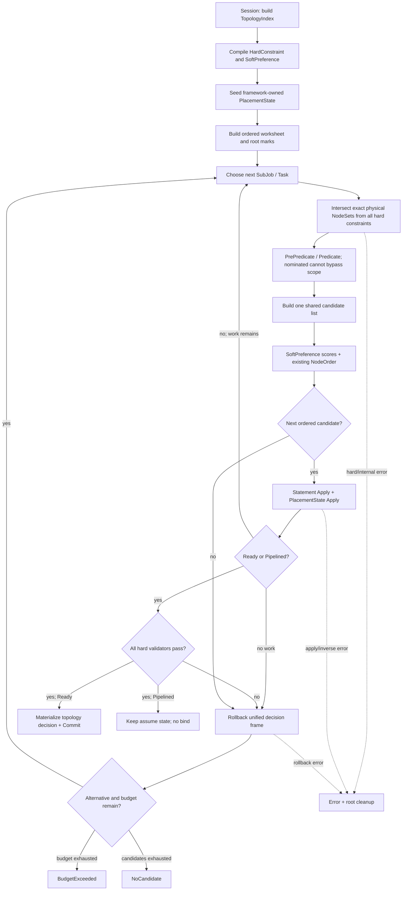

> 归档快照（2026-11-05）。本文保留原有阶段、基线和历史结论；其中的“当前”“完成”仅适用于原文对象。最终设计入口及证据边界见[归档说明](../../../../README.md)。本次仅迁移链接并添加此提示，未重新执行文中的命令。

# Volcano 拓扑调度重构设计

## 文档范围与当前状态

本文是一份面向架构 reviewer 的独立设计材料，不假设读者参与过前期讨论。

- 演进审视起点：`54c1d018`
- 当前生产线参照：`dev-1.14@71f1d3248`
- 第一版重构原型：`feat/015-unified-topology-placement@c4c6c3643`
- 原型备份：`feat/015-unified-topology-placement-backup@7c0eb9d4f`
- 后续场景与缺陷：Bug 018、019、020、021、022
- 目标：重新定义 topology policy、hard/soft、placement state 和搜索之间的边界
- API/CRD：预期不变
- 当前阶段：修订设计，尚未按本文目标架构完成实现

`c4c6c3643` 已经证明 exact physical Node scope、统一 Node-level planner 和有界回退
在工程上可行，也解决了 Bug 018、019 的关键失败前提。但是，后续 Bug 020、021、022
证明它仍然主要是“统一搜索器加旧 topology callback adapter”，还没有形成稳定、可扩展
的 topology policy framework。因此本文不把 `c4c6c3643` 视为最终实现，而把它作为
第一版原型和验证证据。

本文按照以下顺序展开：

1. 重构背景；
2. 重构收益；
3. 核心思想与原则；
4. 当前代码、第一版原型和目标架构的完整调度逻辑；
5. 三者之间的核心差异与影响评估；
6. 已知场景如何落入统一模型；
7. 扩展性、兼容性、性能和验证门禁。

实施拆分、命令和最终验证结果应在设计批准后同步修订
`PROPOSAL_COMMIT.md`。原有 `artifacts/VERIFICATION_RESULTS.md` 只作为第一版原型的
验证记录，不能替代本文目标架构的验收。

## 一、重构背景

### 1.1 拓扑调度解决的问题

Volcano 使用 HyperNode tree 表示网络层级、故障域或其他物理拓扑。一个 HyperNode
可以包含下层 HyperNode 或 Kubernetes Node；tier 越高，domain 越粗。

当前能力包括：

| 能力 | 调度对象 | hard 语义 | soft 语义 |
| --- | --- | --- | --- |
| Job/SubJob network topology | PodGroup 或 SubGroup | 最终 placement 的 LCA 必须在允许 tier 内 | 倾向于更低、更近的 LCA，可回退到更远 domain |
| PodGroup anti-affinity | 当前 PodGroup 与其他 PodGroup | 避开匹配 PodGroup 已占用的 domain | 降低已占用 domain 的优先级 |
| SubGroup affinity | 同一 PodGroup 内多个 SubJob | 与匹配 peer 使用相同 domain | 倾向于与 peer 同域 |
| SubGroup anti-affinity | 同一 PodGroup 内多个 SubJob | 与匹配 peer 使用不同 domain | 倾向于 peer 更少的 domain |
| Predicate/NodeOrder | 单个 Task | 普通 Node 可行性 | 普通 Node 排序 |

本文使用以下术语：

| 术语 | 含义 |
| --- | --- |
| subject | 一个 Job、SubJob 或当前 Task 所属的拓扑调度主体 |
| exact scope | 精确允许的物理 Node 集合，可以是不连续的多个 domain union |
| placement | Task 到物理 Node 的实际映射 |
| PlacementState | framework 拥有的当前实际和 speculative placement 状态 |
| PlacementView | topology plugin 只读访问 PlacementState 的接口 |
| TopologyIndex | Node、HyperNode、tier、ancestor、membership 和 LCA 的统一索引 |
| compiled policy | Session 阶段由 API 和 plugin 配置生成的内部 hard/soft 策略 |
| NodeSet | 以物理 Node 为基准的集合抽象，不暴露底层稀疏或稠密表示 |
| Statement | Session 内记录 Allocate/Pipeline 等 speculative 操作的 operation log |

### 1.2 从 `54c1d018` 开始形成的现有模型

`54c1d018` 首次将多个 topology plugin 的 HyperNode gradient 在 framework 中聚合，
并将 HyperNode minResource 粗筛集中到 allocate。该模型解决了单一 plugin 独占候选的
问题，但保留了原来的两级 container 搜索：

```text
plugin Job gradients
  -> framework 按 HyperNode 名称取交集
  -> allocate 选择一个 Job HyperNode container
  -> plugin SubJob gradients
  -> allocate 选择一个 SubJob HyperNode container
  -> container 内对 Task 做 Predicate/NodeOrder
  -> first-success layer 后停止
```

从 `54c1d018` 到当前生产线，PodGroup anti-affinity、SubGroup affinity/anti-affinity、
soft anchor、native soft 和 candidate forest 都是在这套控制模型上增加的。

这些修复已经独立解决了对应生产问题；重构不否定它们，也不要求等待新框架才能使用。
问题在于，同一批概念承担了过多职责：

- gradient 同时表示 hard membership、遍历顺序和终止 layer；
- HyperNode 同时是索引、搜索 container 和 placement 解释；
- `AllocatedHyperNode` 同时是实际状态和 speculative anchor；
- preferred score 只能看到当前 container 或当前成功 layer；
- candidate forest、soft helper 和普通路径分别维护自己的候选与恢复逻辑。

### 1.3 第一版统一 planner 解决了什么

`c4c6c3643` 将 topology Job 收敛到一条 Node-level bounded planner：

- 将 hard gradient 展开为 physical Node scope；
- Job/SubJob scope 按 Node 交集；
- soft HyperNodeOrder 被适配成 per-Node score；
- 不再先选择一个必须容纳整个 Job/SubJob 的 HyperNode container；
- nominated Node 也必须经过 exact scope；
- greedy 是第一条 branch，后续 dead end 可在预算内回退；
- Statement 支持 mark/rollback；
- 第一个完整 hard-valid Ready/Pipelined placement 即停止。

这使以下场景变得自然：

- required PodGroup anti-affinity 产生精确 `B+C`，A 不会因 LCA envelope 泄漏；
- 一个 SubJob 可以联合使用同层多个 HyperNode；
- hard NTA 可以和 `B+C` physical scope 直接组合；
- preferred-only GTA 不再因先选中单个 tier1 container 而失去 peer 联合评分；
- fit-first dead end 可以回退前一个 Task 的次优 Node。

因此，exact NodeSet 和 bounded planner 方向成立。

### 1.4 第一版原型为什么仍不够

第一版原型改变了 allocator，却没有真正替换 topology policy contract：

1. hard plugin 仍返回 HyperNode gradient；framework 先按 HyperNode 名称组合，再展开
   为 NodeSet；
2. soft plugin 仍返回 HyperNodeOrder；framework 将 Node 按最低层 HyperNode 分组后
   再把分数映射回 Node；
3. planner 内仍直接读取 `NetworkTopology.HighestTierAllowed`，实现 NTA-specific
   soft anchor rank；
4. plugin 没有统一的 partial placement 只读视图，GTA 继续自行扫描和压缩 peer 状态；
5. exact scope 仍通过反复 `Set.Union` 构建，数据模型统一了，复杂度没有统一。

换句话说，第一版原型是：

```text
旧 gradient/order callback
  -> framework adapter
  -> 新 bounded planner
```

目标架构应当是：

```text
API/plugin config
  -> Session compile
  -> typed HardConstraint + SoftPreference
  -> exact NodeSet + shared PlacementView
  -> bounded planner
```

### 1.5 后续 Bug 018–022 提供的架构证据

| Bug | 现象 | 对架构的启示 |
| --- | --- | --- |
| 018 | required PAA 精确范围是 B+C，逐根尝试导致 Job Pending | disconnected exact NodeSet 必须是一等模型，HyperNode/LCA 不能作为 allowed scope 替代物 |
| 019 | preferred-only GTA abstain 后，先选 tier1 container 导致 peer scorer 看不到同层候选 | soft scorer 必须看到同一个 hard-feasible candidate 集合，不能由 container/layer 截断可见域 |
| 020 | preferred SubGroup anti-affinity 只记录 domain 是否占用，无法区分 1 个和多个 peer | plugin 需要统一 PlacementView 和 domain count，而不是各自维护布尔 occupancy |
| 021 | soft 未指定 tier 本应等价于 tier1，但 nil 泄漏到不同下游路径 | 等价 API 表示必须在 Session compile 阶段规范化，planner 不应解释 raw optional 字段 |
| 022 | candidate forest 对 root 数产生 `O(NR)` set clone 和 `O(R²)` diagnostics | scope representation、集合运算和 diagnostics 必须是框架级复杂度不变量 |

对 `c4c6c3643` 的补充审计进一步确认：

- Bug 020 最小用例中，peer 分布 `2/1/1` 的三个 domain 仍全部得到相同 penalty；
- Bug 021 期望 soft nil 在 Session 内变为 tier1，实际仍为 nil；
- 新 `topologyNodeScopeFromGradients` 在 1,024 roots 下单次构建约
  `23,406,744 B/op`、`4,365 allocs/op`，与 Bug 022 旧 forest 路径同量级。

因此，不能通过把 020、021、022 三个提交逐个叠加到第一版原型来宣称重构完成。
需要修订 topology framework 本身。

### 1.6 重构边界

本重构解决单个当前 Job 在一个 Session snapshot 内的拓扑规划，不提供：

- soft/preferred 全局最优；
- 所有可行 placement 的完整枚举；
- 多个 Pending PodGroup 的原子联合求解；
- 已 bind Pod 的迁移；
- topology 与 preempt/reclaim 的联合优化；
- 跨调度周期持久化搜索游标；
- bind/cache Commit 的 failure-atomic 保证。

预算耗尽表示本轮没有继续访问 alternative，不表示集群中不存在可行解。

## 二、重构收益

### 2.1 场景收益

| 场景 | 当前生产实现 | 目标架构收益 |
| --- | --- | --- |
| hard + soft 混合 | hard membership、gradient layer、soft helper 和 first-success 共同影响结果 | hard 只产生 exact feasibility；soft 只在相同 hard-feasible candidates 上排序 |
| `B+C` exact scope | 依赖 PAA candidate-forest route，其他组合不自然 | 任意 hard policy 都返回 physical NodeSet，single-root/multi-root 使用相同表示 |
| 多 topology plugin hard 组合 | 先按 HyperNode 名称求交集，受层级和命名影响 | 所有 hard 结果展开为 physical NodeSet 后做交换律成立的交集 |
| soft multi-domain | scorer 只看到当前 layer/container | scorer 看到本次真正参与竞争的同一候选集 |
| preferred peer 关系 | plugin 自行拼装 occupancy，可能丢失数量 | 通过 PlacementView 查询实际和 speculative domain count |
| soft 默认值 | nil 和显式值可进入不同下游路径 | Session compile 后只存在一种内部规范表示 |
| fit-first dead end | 前一 Task alternative 被丢弃 | 按统一 decision stack 在预算内回退 |
| 大规模 topology | set clone、完整 root reason 和重复 scope 计算可能放大 | NodeSet/TopologyIndex 提供线性或有界运算和诊断 |

### 2.2 架构收益

#### hard/soft 边界由类型保证

`HardConstraint` 可以返回 NodeSet，并参与 final validation；`SoftPreference` 只能返回
分数。soft 接口没有删除候选的能力，因此不再依赖开发者记住“不要把 soft 当 hard”。

#### policy 与搜索控制完全分离

topology plugin 负责：

- 编译自身配置；
- 计算 hard allowed NodeSet；
- 校验最终 hard placement；
- 计算 soft score；
- 提供有界、可解释的 reason。

planner 负责：

- worksheet frontier；
- hard NodeSet 交集；
- Predicate；
- score 聚合和稳定排序；
- apply/rollback；
- budget；
- Ready/Pipelined 终止。

新增 topology plugin 不需要修改 planner 主流程。

#### topology truth 有单一 owner

framework-owned PlacementState 保存实际和本轮 speculative placement。topology plugin
只能读取 PlacementView，不拥有 speculative mutable state，也不需要额外的 plugin
checkpoint/capability 类型树。

#### 数据结构复杂度可以独立治理

NodeSet 隐藏稀疏 set、bitset 或其他实现。hard policy 不直接反复操作
`map[string]struct{}`，性能门禁可以集中在 TopologyIndex/NodeSet 层。

### 2.3 工程收益

- API 解析、hard filter、soft score、search 和 rollback 可以分层单测；
- future plugin 可以通过 fake provider 验证“只注册策略、不改 allocator”；
- hard plugin 顺序不影响 physical NodeSet 交集；
- topology soft 权重只应用一次，并与现有 NodeOrder contribution 一起解释；
- trace 可以展示每个 constraint 的 scope 变化和每个 preference 的 score contribution；
- diagnostics 使用 count 和有界 sample，不保存完整搜索树或完整 root 列表；
- 020 这类 scorer bug局限在 GTA，021 局限在 compile，022 局限在 NodeSet/index；
- 普通非 topology Job 保持原 allocate path。

### 2.4 收益的现实边界

框架不能保证未来 topology plugin 永远没有语义 bug。例如 GTA 的 penalty 公式写错，
仍需要修改 GTA。但是成功标准是：

```text
plugin 语义问题只修改 plugin
输入规范问题只修改 compiler
集合复杂度问题只修改 NodeSet/TopologyIndex
搜索策略问题才修改 planner
```

如果新增 topology plugin 或新增 preferred term 需要在 planner 中判断 plugin name、
原始 API 字段或专用场景，说明框架边界失败。

## 三、重构核心思想与原则

### 原则 1：Session 先编译，planner 只消费内部策略

Session Open 阶段将用户 API、tier name、默认值、selector 和 plugin 配置编译为不可变
的内部 plan：

```go
type CompiledTopologyPlan struct {
    Hard []HardConstraint
    Soft []SoftPreference
}
```

编译阶段负责：

- `highestTierName` 到内部 tier ID 的解析；
- soft nil 到默认 tier1 的规范化；
- mode、weight、selector 和作用主体校验；
- required/preferred term 分离；
- plugin-specific immutable data 构建；
- 无效配置的提前报错。

编译完成后，planner 不读取 `NetworkTopology`、`TopologyAffinity`、tier name 或 plugin
名称。原始 PodGroup/SubGroupPolicy 对象不被修改。

### 原则 2：hard 只决定 feasibility

概念接口如下，具体 Go 形态可在实现评审中调整：

```go
type HardConstraint interface {
    Name() string
    AllowedNodes(ctx HardContext, placement PlacementView) (NodeSet, Explanation, error)
    Validate(ctx ValidationContext, placement PlacementView) error
}
```

每次选择 Task->Node 前，framework 对所有 applicable hard constraint 的 NodeSet 做交集：

```text
HardScope(state, task)
  = AllNodes
    intersection Job hard scopes
    intersection SubJob hard scopes
    intersection relation hard scopes
```

不存在 runtime `Applied/Abstain` 的控制流含义。不适用的 policy 不进入 compiled plan；
当前 placement 下暂时没有约束的 hard relation 返回 `AllNodes`。authoritative empty
返回 `EmptyNodeSet`。

所有 hard constraint 还必须以同一个 compiled object 执行 final validation，避免
candidate filter 和最终校验由两套逻辑实现。

### 原则 3：soft 只决定 order

概念接口如下：

```go
type SoftPreference interface {
    Name() string
    Weight() int64
    Score(
        ctx ScoreContext,
        placement PlacementView,
        candidates []Candidate,
    ) (ScoreVector, error)
}
```

soft scorer：

- 接收同一批 hard scope + Predicate 后的 candidates；
- 可以读取当前 placement 和候选落点后的轻量 overlay view；
- 返回归一化 contribution；
- 不能返回 NodeSet，不能删除 candidate；
- framework 统一应用 weight，且只应用一次；
- 低分或零分 candidate 仍保留为 fallback。

NTA soft proximity、GTA preferred affinity、GTA preferred anti-affinity 都通过该接口
实现。planner 中不保留 `establishedSoftDomainRank` 或其他 NTA/GTA 特判。

无效配置在 compile 阶段失败。运行期 hard evaluation error 终止当前 plan，因为无法
证明 hard 正确性；运行期 soft scoring error 将该 scorer 本轮 contribution 降级为
neutral，并记录 event、日志和 metric，不能因为 preferred scorer 故障把 Job 变成
hard Pending。

### 原则 4：exact physical NodeSet 是唯一 hard scope

```text
scope(B+C) = leaves(B) union leaves(C)
LCA(B,C)   = H
```

H 只用于 ancestor 查询、LCA 计算和结果解释，`leaves(H)` 不能替代 `scope(B+C)`。

NodeSet 必须支持：

- `All`、`Empty`、single-domain 和 disconnected union；
- 线性或字宽线性的 union/intersection；
- clone-once 或 scratch builder，禁止累计 `Union` clone；
- stable iteration 只在需要输出或评分时发生；
- bounded diagnostics；
- 底层 sparse/dense 表示对 plugin 和 planner 不可见。

soft-only Job 的 neutral hard scope 使用 `AllNodes` sentinel，不通过遍历整棵 HyperNode
tree 构造 universe。

### 原则 5：PlacementState 由 framework 拥有

PlacementState 同时包含：

- Session 开始前已经 Bound/Running/Allocated 的 Task placement；
- 当前 Job 本轮 speculative Task->Node；
- Job/SubJob 当前实际 Node 集合和 LCA；
- 编译过的 selector/policy 在各 tier/domain 的 occupancy count；
- matching PodGroup 的只读外部 occupancy；
- placement revision 和 mark/rollback 信息。

topology plugin 通过 PlacementView 查询：

```go
NodeForTask(taskID)
NodesForSubject(subjectID)
LCA(subjectID)
DomainCount(selectorID, tierID, domainID)
WithCandidate(taskID, nodeID)
```

`WithCandidate` 是轻量只读 overlay，用于在真正 Apply 前计算候选导致的 Job/SubJob LCA
和 soft score，不调用 plugin event，也不修改 Session。

GTA 不再自行从 `AllocatedHyperNode` 推断 peer occupancy；NTA 不再把 Job anchor 写入
SubJob actual placement。实际 placement、scoring anchor 和候选 overlay 是不同概念。

### 原则 6：greedy 是 bounded search 的第一条 branch

候选顺序为：

```text
eligible nominated hint
  -> existing resource/shard feasibility class
  -> topology soft contributions + existing NodeOrder
  -> configured BestNode promotion
  -> aggregate score + stable fallback tie-break
```

第一条 branch 只访问每个 choice 的第一个 candidate，因此保持贪心 common path。
后续 requirement dead end 时，统一 decision stack 回退最近的本轮 choice。

- 不增加 fast/forest/repair/improvement 多套状态机；
- 不为了 soft score 更高继续搜索已经找到的完整 hard-valid placement；
- 只有失败后的额外 candidate 计入 `maxExtraPlacementAttempts`；
- `BudgetExceeded` 与 `NoCandidate` 分开记录。

`PercentageOfNodesToFind` 和现有 Node sampling 仍可能限制参与比较的 candidates，因此
该搜索不是 complete search，也不承诺全局 soft 最优。

### 原则 7：partial hard filter 与 final validation共同保证正确性

required SubGroup relation、hard NTA LCA 等约束依赖当前 partial placement。目标不维护
一棵随每次选择变化的动态 subtree，而是：

```text
current PlacementView
  -> each HardConstraint.AllowedNodes
  -> physical NodeSet intersection
  -> Predicate
  -> candidate scoring
  -> Apply
```

达到 JobReady/JobPipelined 后，再对同一批 compiled hard constraints 执行 `Validate`。
filter 用于尽早排除不可能候选，validator 用于关闭增量推导遗漏。

### 原则 8：一个事务 owner，不引入 plugin capability 矩阵

每个 decision frame 保存：

- Statement mark；
- PlacementState mark；
- worksheet/touched frontier mark；
- 当前 candidate index。

rollback 按相同 frame 恢复三者。topology plugin 是 compiled immutable policy 加只读
PlacementView，不拥有 speculative mutable state，因此不需要
`ReadOnly/Reversible/SnapshotRestore/CommitOnly/Unsupported` 类型体系。

其他 scheduler plugin 继续通过现有 Statement Allocate/Deallocate callback 观察
speculative resource state。有界回退会增加 callback 次数，因此 failure-atomic 和
inverse 对称性仍是兼容门禁，但不为不同 plugin 建立不同 planner route。

### 原则 9：第一个完整 hard-valid placement 即成功

成功条件是：

```text
(JobReady OR JobPipelined)
AND all compiled HardConstraint.Validate pass
```

- `Found(Ready)`：物化最终 topology decision，调用现有 Commit；
- `Found(Pipelined)`：保留 Session assume state，不 bind；
- 两者都不继续寻找 soft 总分更高的完整解。

`Statement.Commit()` 当前不是 failure-atomic transaction；本文的 `Found` 是 planning
结果，不承诺后续所有 bind/cache 操作都成功。

## 四、调度逻辑

### 4.1 当前生产代码中的调度逻辑

本节描述 `dev-1.14@71f1d3248` 所代表的 container/gradient 模型。

#### 4.1.1 Session

1. 从 cache snapshot 构造 Job、SubJob、Task、Node 和 Queue；
2. 构造 HyperNode tree、tier、`RealNodesList/Set`；
3. 从已分配 Task 和 annotation 恢复 Job/SubJob `AllocatedHyperNode`；
4. 将部分 tier name 翻译成 numeric tier；soft nil 当前不会统一规范化；
5. NTA/GTA 注册 Job/SubJob gradient、HyperNodeOrder、NodeOrder 和 event callback。

#### 4.1.2 hard aggregation

1. framework 调用所有 gradient callback；
2. `Applied=false` 表示 abstain；
3. applicable hard plugin 的 HyperNode 名称取交集；
4. 交集结果保持 gradient layer；
5. allocate 按 HyperNode 聚合 minResource；
6. 无 applicable hard plugin 时使用低 tier 到高 tier 的 universe。

这里组合的是 HyperNode identity，不是 physical Node membership。

#### 4.1.3 Job/SubJob container 搜索

1. Job 按 gradient layer 遍历 outer HyperNode；
2. 每个 outer candidate Clone worksheet 并 dry-run；
3. 每个 SubJob 再按 gradient layer 遍历一个 HyperNode container；
4. container 内对 Task 执行 Predicate/NodeOrder，只保留一个 best Node；
5. 当前 layer 出现成功 candidate 后不再访问后续 layer；
6. winner 通过 Save/Discard/Recover replay；
7. JobReady 后 Commit，Pipelined 只保留 assume state。

required PAA 的 B+C 使用 candidate forest 专用路径：B、C 是 allowed roots，LCA 只作
traversal envelope。该路径解决了特定 union，但不是任意 policy 可复用的 scope model。

preferred-only GTA 依赖额外 `Ordered` traversal；native soft NTA 依赖 allocate 中两个
soft-anchor helper。soft policy 因而仍影响 container traversal 和 first-success 行为。

#### 4.1.4 状态与恢复

Statement、worksheet backup、`AllocatedHyperNode` capture、Recorder 和 plugin event
分别维护不同状态。候选比较需要 Save、Discard 和 RecoverOperations；后续失败不能
回到更早 Task 的次优 Node。

### 4.2 第一版统一 planner 的逻辑

`c4c6c3643` 删除旧 topology runtime route，主要流程是：

1. 调用旧 Job/SubJob gradient callback；
2. framework 聚合 gradient，再展开 eligible HyperNode 的 physical Nodes；
3. 得到 Job/SubJob exact scope 并求交集；
4. Predicate 只检查 exact scope 内 Node；
5. 将 physical Node 按最低层 HyperNode 分组，调用旧 HyperNodeOrder；
6. planner 自行增加 NTA soft-anchor lexicographic rank；
7. 与现有 NodeOrder 聚合后形成 ordered Node candidates；
8. 使用 Statement/placement mark 做 bounded chronological backtracking；
9. Ready/Pipelined 后执行 final hard validation；
10. 第一个完整 hard-valid placement 成功。

它统一了搜索状态机，但 hard/soft policy 仍通过旧 callback 和 planner 特判表达。

### 4.3 目标架构的调度逻辑

#### 4.3.1 Session topology compile

Session Open 时：

1. 构建 TopologyIndex，为 Node 和 domain 分配稳定内部 ID；
2. 构建 ancestor、tier、membership、LCA 查询；
3. 对 common topology 字段执行 canonicalization；
4. 调用各 topology policy provider 编译 Job/SubJob policy；
5. 生成 `CompiledTopologyPlan{Hard, Soft}`；
6. 注册 compiled selector，只为实际 policy 建立需要的 occupancy index；
7. 从已存在 placement 初始化 PlacementState；
8. compile error 形成明确配置错误，不进入 planner。

拓扑 plugin 的概念注册边界为：

```go
type TopologyPolicyProvider interface {
    Compile(ctx CompileContext, subject Subject) (CompiledTopologyPolicy, error)
}
```

一个 plugin 可以同时编译 hard 和 soft policy，但两者进入不同 typed collection。

#### 4.3.2 构建 worksheet 和 planner root state

1. 复用 QueueOrder/JobOrder/SubJobOrder/TaskOrder；
2. worksheet 保留所有本轮 eligible SubJob/Task，不把第一个优先项固定为唯一解；
3. 创建 Statement root mark；
4. 创建 PlacementState root mark；
5. 记录本轮 touched frontier；
6. 已存在 placement 作为 immutable baseline，不被本轮 rollback 删除。

#### 4.3.3 选择下一 requirement

planner 根据现有 Ready/Pipelined callback 和 worksheet 选择下一 SubJob/Task：

- 未满足 requirement 优先；
- elastic Pending work 仍可继续；
- 当前 choice 后 callback 已满足时进入 final validation；
- callback 未满足且仍有 eligible work时继续；
- callback 未满足且无 work 时回退。

#### 4.3.4 计算 hard scope

对当前 Task：

1. 从 `AllNodes` 开始；
2. 读取当前 PlacementView；
3. 依次调用 compiled hard constraints；
4. 每个结果直接是 physical NodeSet；
5. framework 原地/字宽线性求交集；
6. Empty 后立即返回 hard reject；
7. 输出每个 constraint 前后 cardinality 和有界 reason sample。

不同 plugin 可以返回不同 tier、不同 domain name 和 disconnected union，只要 physical
Node membership 有交集，组合结果就正确。

#### 4.3.5 Predicate 和 candidate sample

1. exact hard scope 限定普通和 nominated Node；
2. 执行 PrePredicate/Predicate；
3. nominated Node 只有在 scope 内并通过 Predicate 才提升优先级；
4. 继续遵守 `PercentageOfNodesToFind`；
5. 形成现有 idle/futureIdle、shard 等 feasibility class；
6. 低优先级 class 保留为失败后的 fallback，不与 hard reject 混淆。

#### 4.3.6 soft score

对当前 class 中同一批 candidates：

1. 构造每个 Task->Node 的只读 candidate overlay；
2. 调用所有 compiled SoftPreference；
3. scorer 可查询候选导致的 Job/SubJob LCA、peer domain count 和现有 anchor；
4. framework 校验 score vector 完整性和范围；
5. framework 应用 topology plugin weight 一次；
6. 与现有 NodeOrder contribution 聚合；
7. BestNode 结果提升为第一 candidate；
8. 其他候选按 aggregate score 和稳定 Node ID/Name 排序；
9. soft error 的该项 contribution 为 neutral，候选集合不变。

NTA 的 soft score来自候选 placement 形成的 LCA，不再是 planner 中的 lexicographic
rank；GTA preferred anti-affinity 的 score来自 domain peer count，不再是 occupancy set。

#### 4.3.7 Apply、rollback 和动态 state

选择 candidate 后：

1. 保存 Statement、PlacementState 和 worksheet mark；
2. 执行 failure-atomic Statement Allocate/Pipeline；
3. PlacementState Apply Task->Node；
4. 增量更新 subject NodeSet、LCA 和已注册 domain counts；
5. 继续下一 requirement或 final validation。

后续失败时：

1. Statement `RollbackTo(mark)`；
2. PlacementState `RollbackTo(mark)`；
3. 恢复 worksheet/touched frontier；
4. 访问当前 frame 下一 candidate；
5. 增加 extra-attempt/backtrack 计数。

任一 rollback/inverse 失败均返回 `Error`，不在污染状态上继续搜索。topology plugin
本身没有 speculative event state需要回滚。

#### 4.3.8 final validation 和终止

Ready/Pipelined callback满足后：

1. 所有 compiled HardConstraint 对最终 PlacementView 执行 Validate；
2. 校验 PlacementState LCA/count 与 Task placement 一致；
3. 失败则回退当前 branch；
4. 通过则返回 `Found(Ready/Pipelined)`；
5. Ready 写最终 topology decision 并调用现有 Commit；
6. Pipelined 保留 Session assume state，不 bind；
7. 不继续搜索 soft 分数更高的完整解。

终止状态：

| 状态 | 含义 |
| --- | --- |
| `Found(Ready)` | Ready callback 和全部 final hard validation 通过 |
| `Found(Pipelined)` | Pipelined callback 和全部 final hard validation 通过 |
| `NoCandidate` | 本轮实际 candidate sample 和 budget内候选耗尽 |
| `BudgetExceeded` | 仍有未访问 alternative，但额外尝试预算耗尽 |
| `Error` | compile 之外的 hard evaluation、apply、inverse、rollback 或一致性错误 |

#### 4.3.9 目标完整流程



## 五、核心差异与影响评估

本章是 reviewer 评估重构影响的重点。它同时比较当前生产模型、第一版原型和目标架构。

### 5.1 模型转变

```text
当前生产：
  HyperNode gradient
  -> Job/SubJob container
  -> container 内局部选择
  -> first-success layer

第一版原型：
  旧 gradient/order
  -> adapter 展开 Node scope/score
  -> bounded Node planner

目标架构：
  Session compiled hard/soft policy
  -> exact physical NodeSet + PlacementView
  -> bounded Node planner
```

第一版原型只完成了搜索结构转移；目标架构还要完成 policy contract、state ownership
和集合基础设施的转移。

### 5.2 hard 边界差异

| 维度 | 当前生产 | 第一版原型 | 目标架构 |
| --- | --- | --- | --- |
| plugin 输出 | HyperNode gradients | HyperNode gradients | physical `HardConstraint` |
| 多 plugin 组合 | HyperNode name intersection | 仍先做 name intersection，再展开 Nodes | physical NodeSet intersection |
| 不适用 | runtime Abstain | runtime Abstain | compile 时不注册 |
| 暂时 neutral hard relation | universe gradient | universe gradient展开 | `AllNodes` sentinel |
| disconnected scope | PAA forest 专用 | 可表达 exact NodeSet | 所有 hard plugin 的统一结果 |
| dynamic relation | plugin 从 mutable Job state推断 | callback + placement revision cache | HardConstraint 读取 PlacementView |
| final check | 分散在 gradient/LCA | planner final validator | 同一 compiled constraint 的 Validate |

目标架构最重要的行为变化是：hard 组合不再依赖插件选择的 HyperNode 层级和名称。

### 5.3 soft 边界差异

| 维度 | 当前生产 | 第一版原型 | 目标架构 |
| --- | --- | --- | --- |
| 可见候选 | 当前成功 layer/container | exact scope内的 Node，但按最低 HN适配旧 scorer | 同一 Predicate-feasible candidate list |
| 作用方式 | score + helper + traversal order | HyperNodeOrder adapter + planner NTA rank | typed SoftPreference，只返回 contribution |
| candidate 删除 | 可能被 layer/first-success 间接丢失 | 不直接删除，但 lexicographic rank仍在 planner | 类型上无 NodeSet/filter 能力 |
| weight | 分散在 plugin/helper/order | 旧 plugin 语义复用 | framework 对归一化 score 应用一次 |
| state | `AllocatedHyperNode` 和 plugin扫描 | `AllocatedHyperNode` + adapter | read-only PlacementView + candidate overlay |
| runtime error | 路径不一致 | topology score Error | neutral contribution + visible diagnostic |

soft 不保证最终全局最优，只保证在本次 hard-feasible sample 中形成可解释的第一分支和
fallback 顺序。

### 5.4 topology state 差异

| 维度 | 当前生产 | 第一版原型 | 目标架构 |
| --- | --- | --- | --- |
| Task/resource state | Statement | Statement | Statement |
| topology actual state | `AllocatedHyperNode` + Task mapping | planner维护 LCA marks | framework PlacementState |
| peer occupancy | plugin自行扫描/推断 | plugin自行扫描/推断 | compiled selector 的 domain count |
| candidate score hint | 可能复用/改写 actual anchor | planner计算 rank | candidate overlay，不修改 actual state |
| rollback | Statement + worksheet +手工 backup | Statement + placement marks | 一个 decision frame统一恢复 Statement/PlacementState/frontier |
| topology plugin mutable state | event/Job字段 | event/Job字段 | 无；只读 PlacementView |

PlacementState 不是复制一套 Session shadow graph；它只维护 topology planning 所需的
placement facts，并与 Statement mark 同步。

### 5.5 HyperNode 和 NodeSet 差异

| 维度 | 当前生产 | 第一版原型 | 目标架构 |
| --- | --- | --- | --- |
| HyperNode 角色 | index + container + placement解释 | index +旧 callback单位+解释 | index/domain ID +解释 |
| hard scope存储 | subtree/forest roots | `sets.Set[string]` | NodeSet abstraction |
| union/intersection | map clone和专用 helper | 累计 `Set.Union` clone | scratch/bitset/sparse线性运算 |
| soft-only universe | 低到高遍历全树 | 展开全部 universe HN后 union | `AllNodes` sentinel |
| diagnostics | root列表可重复 | gradient stats | constraint cardinality + bounded sample |

### 5.6 搜索与终止差异

| 维度 | 当前生产 | 第一版原型 | 目标架构 |
| --- | --- | --- | --- |
| first choice | first layer/container/best Node | ordered best Node | ordered best Node |
| alternative | candidate级 Save/Recover，无 Task局部回退 | bounded Task/Node backtracking | 保留 bounded planner |
| greedy | 独立 first-success控制流 | 第一 branch | 第一 branch |
| budget | 无统一预算 | `maxExtraPlacementAttempts` | 保留一个核心预算 |
| success | current layer winner Ready/Pipelined | first complete hard-valid | first complete hard-valid |
| optimality | 不保证 | 不保证 | 不保证 |

目标架构不推翻第一版 bounded planner，只替换 planner 输入和 topology state。

### 5.7 plugin 扩展方式差异

当前或第一版原型新增 topology plugin 往往需要考虑：

- 是否返回 gradient；
- gradient layer 如何排序；
- soft 是否 Abstain；
- HyperNodeOrder 接收哪些 container；
- allocator 是否需要新 route/helper；
- speculative state如何恢复。

目标架构下只需要：

1. 实现 provider 并编译配置；
2. required 语义实现 HardConstraint；
3. preferred 语义实现 SoftPreference；
4. 使用 TopologyIndex 和 PlacementView；
5. 添加 plugin-owned semantic test。

不修改 allocate planner。一个 fake future plugin 必须能够在不修改 planner 的情况下：

- 返回与 NTA 不同层级的 hard NodeSet并正确求交；
- 对同一候选集提供 soft score；
- 在 backtrack 后读取恢复后的 PlacementView。

### 5.8 有意改变的行为

- topology planner 不再调用旧 gradient/order callback；
- hard constraint 按 physical Node membership 组合，不按 HyperNode name；
- soft nil在 Session 内统一为 tier1；
- NTA soft anchor从 planner lexicographic rank迁移为 weighted SoftPreference；
- GTA preferred anti-affinity按 peer count评分；
- soft scorer runtime error不删除候选，只产生 neutral contribution和诊断；
- soft-only Job不通过完整 HyperNode universe构造 hard scope；
- deprecated candidate forest helper和旧 topology route从最终源码删除；
- diagnostics不输出无界完整 root列表；
- equal score在 BestNode contract之外使用稳定 tie-break；
- nominated Node不能绕过 hard scope；
- BudgetExceeded与NoCandidate分离。

### 5.9 必须保持的不变量

- soft mode不转换为hard；
- hard constraint不被任何soft contribution放宽；
- preferred目标不可行时保留其他hard-feasible fallback；
- Ready/Pipelined callback仍是完成条件；
- QueueOrder/JobOrder/SubJobOrder/TaskOrder定义第一选择；
- 已存在Running/Allocated placement作为当前Session anchor；
- final annotation/Recorder从实际Task placement导出；
- 普通Predicate、NodeOrder、BestNode和资源/shard规则继续参与；
- Pipelined不进入bind；
- API/CRD和用户字段语义不变；
- `!RequiresHyperNodeAllocate()` 普通Job保持现有路径；
- 不宣称optimal或complete search。

## 六、关键场景如何落入统一模型

### 6.1 hard NTA + soft GTA

```text
NTA HardConstraint -> allowed NodeSet
Predicate          -> feasible candidates
GTA SoftPreference -> candidate contribution
NodeOrder          -> ordinary contribution
```

GTA只能排序NTA允许的Node，不能扩大hard scope。

### 6.2 soft NTA + required GTA

```text
GTA required relation -> exact NodeSet
NTA soft proximity    -> score each candidate's resulting LCA
```

NTA没有hard filter能力；preferred domain不可行时仍可使用GTA允许范围内的远端Node。

### 6.3 B+C + hard NTA

```text
PAA allowed = leaves(B) union leaves(C)
NTA hard    = candidates whose resulting LCA satisfies tier
final       = same PAA and NTA constraints Validate
```

A从未进入physical NodeSet；不需要forest gate或LCA envelope。

### 6.4 preferred SubGroup affinity/anti-affinity

PlacementView提供已存在和本轮speculative peer的domain count：

- affinity：同域peer越多，score越高；
- anti-affinity：同域peer越少，score越高；
- domain都被占用后仍比较数量，而不是全部并列为零；
- term保持soft，不因domain不足而产生empty NodeSet。

这覆盖Bug 019的候选可见性和Bug 020的count语义。

### 6.5 soft nil与显式tier1

两种API输入在Session compile后生成完全相同的CompiledTopologyPolicy。后续NTA scorer、
PlacementView和planner无法观察它们原始表示的差别；原始API对象保持不变。

### 6.6 fit-first dead end

```text
task-a candidates = [node-1, node-2]
task-a -> node-1
task-b -> no candidate
rollback unified frame
task-a -> node-2
task-b -> node-1
Found
```

这是通用search行为，不属于任何topology plugin。

### 6.7 多PodGroup与多SubGroup

- 已经形成placement的其他PodGroup作为ExternalOccupancy进入PlacementView；
- 当前Job内多个SubGroup共享同一个PlacementState；
- required/preferred relation通过compiled selector查询peer；
- backtrack同步恢复当前Job speculative counts；
- 多个尚未调度的PodGroup仍按JobOrder顺序处理，不做跨Job原子联合搜索；
- 已bind Pod不迁移。

### 6.8 future topology plugin

例如未来增加“同故障域上限”“跨机架带宽等级”或“同模型副本分散”策略：

- required部分编译成physical HardConstraint；
- preferred部分编译成SoftPreference；
- domain和ancestor查询使用TopologyIndex；
- placement关系使用PlacementView；
- planner、Statement和其他topology plugin不修改。

## 七、扩展性与其他plugin影响

### 7.1 topology plugin新SPI

目标SPI是scheduler内部接口，不要求修改PodGroup/HyperNode API。NTA和GTA必须直接迁移
到新provider；新planner不再通过旧gradient/order adapter运行它们。

最终提交前删除临时迁移shim和legacy topology控制流。若后续社区评审要求Go source
compatibility，应单独评估版本化接口，不能为了兼容重新引入layer/container/first-success
语义。

### 7.2 普通scheduler plugin

以下contract继续复用：

- PrePredicate/Predicate；
- BatchNodeOrder/NodeOrder/BestNode；
- JobReady/SubJobReady/Pipelined；
- Statement Allocate/Pipeline/Deallocate；
- QueueOrder/JobOrder/SubJobOrder/TaskOrder；
- Commit bind/cache。

bounded backtracking可能增加speculative Allocate/Deallocate次数，因此必须验证：

- capacity/DRF/proportion accounting基线一致；
- predicates/device Reserve/Release对称；
- NUMA state回滚一致；
- extender paired endpoint调用次数一致；
- task-topology不存在Allocate-only泄漏；
- speculative branch不重复记录完成型metrics。

不引入plugin capability分类，也不为某个plugin建立专用planner路径。发现具体inverse
缺口时修复该plugin或Statement contract。

### 7.3 error和diagnostics

统一规则：

| 阶段 | 错误处理 |
| --- | --- |
| policy compile | 明确配置错误；不进入planner |
| hard evaluation | `Error`并回滚，因为无法证明hard正确性 |
| soft score runtime | contribution neutral；记录plugin、subject和原因，候选不变 |
| Predicate | 保持现有FitError语义 |
| Apply/inverse/rollback | `Error`并恢复root state；恢复失败不得继续Session搜索 |
| budget | `BudgetExceeded`，不伪装为NoCandidate |

diagnostics只记录constraint/preference ID、candidate数量、scope cardinality、score摘要和
有界sample，不记录完整root集合或完整搜索树。

## 八、性能与复杂度边界

### 8.1 复杂度模型

设：

- `H`：Session中的HyperNode数量；
- `N`：物理Node数量；
- `C`：当前subject的compiled hard constraint数量；
- `S`：soft preference数量；
- `W`：本轮实际推进的Task/requirement数量；
- `B`：额外placement尝试预算；
- `P`：Predicate和普通NodeOrder综合成本。

Session index/compile成本应与实际tree membership和policy数量线性相关。每次decision的
主要成本近似为：

```text
hard scope: O(C * NodeSetWords) 或 O(实际稀疏membership)
predicate/order: O(candidateSample * P)
soft score: O(S * candidateSample)
```

common branch约为：

```text
O(W * decisionCost)
```

dead-end额外成本受唯一预算限制：

```text
O(B * decisionCost)
```

禁止出现：

- 每增加一个root就clone全部累计NodeSet的`O(NR)` allocation traffic；
- 每个root reason重复包含完整root列表的`O(R²)` diagnostics；
- soft-only Job为构造universe遍历并union所有层级HyperNode；
- 为每个candidate保存完整Statement/worksheet副本；
- 无界保存所有成功placement。

### 8.2 NodeSet/TopologyIndex门禁

- 8,192 leaf/domain的single-root、multi-root和overlap union；
- 两个不同层级hard plugin physical intersection；
- `AllNodes` neutral scope fast path；
- sparse和dense场景的bytes/op、allocs/op；
- static compiled scope只构造一次；
- dynamic relation在placement revision变化后正确刷新；
- rollback后cache和PlacementState不漂移；
- diagnostics长度与root数量线性或有界。

第一版原型1,024-root约23.4MB/op只能作为修订前红灯基线。目标门槛应在实现proposal中
给出具体bytes/op上限，并用8,192-root benchmark锁定。

### 8.3 planner门禁

- greedy first-branch成功路径无额外backtrack；
- 第1/2/4/8个alternative成功的attempt/backtrack计数确定；
- budget耗尽后Statement、PlacementState、worksheet恢复root baseline；
- candidate list按需生成释放；
- common和dead-end分别报告ns/op、B/op、allocs/op；
- trace输出量不随搜索树组合数无界增长。

## 九、代码影响范围与实施顺序

### 9.1 预期核心范围

| 路径 | 目标修改 |
| --- | --- |
| `pkg/scheduler/framework/session.go` | topology canonicalization、provider compile、PlacementState初始化 |
| `pkg/scheduler/framework/` topology相关文件 | TopologyIndex、NodeSet、compiled policy、PlacementView和聚合接口 |
| `pkg/scheduler/actions/allocate/topology_planner.go` | 只消费compiled hard/soft和PlacementState；保留bounded search |
| `pkg/scheduler/framework/statement.go` | mark/rollback和failure-atomic兼容门禁 |
| `pkg/scheduler/plugins/network-topology-aware/` | 直接实现NTA hard constraint和soft preference |
| `pkg/scheduler/plugins/group-topology-affinity/` | 直接实现PAA/SubGroup hard constraint和count-aware soft preference |
| topology/unit/benchmark tests | contract、018–022、8k规模和future fake plugin |

### 9.2 删除范围

最终实现应删除：

- topology planner对旧HyperNode gradient/order的adapter；
- Job/SubJob/forest legacy topology runtime；
- candidate forest envelope、allowed-root route和deprecated helper；
- allocate中的NTA/GTA-specific soft helper或rank；
- topology candidate的Save/Discard/Recover replay；
- raw topology API字段在planner中的判断；
- 只为旧路径存在的placement backup/recorder分支。

Git history和固定backup branch提供历史对照，不在当前源码长期维护双实现。

### 9.3 原则上不修改

- `staging/src/volcano.sh/apis/`；
- `config/crd/`；
- controller和admission；
- enqueue/backfill/reclaim/preempt/shuffle主策略；
- 普通非topology allocate path；
- 用户配置字段语义。

其他plugin仅在compatibility test发现具体Statement/inverse缺口时定点修改。

### 9.4 建议实施顺序

1. 先实现TopologyIndex/NodeSet及8k性能红绿门禁；
2. 实现canonical compile和typed hard/soft contract；
3. 实现PlacementState/PlacementView及rollback等价性；
4. 将NTA迁移为native hard/soft policy；
5. 将GTA迁移为required hard和count-aware preferred policy；
6. 修改bounded planner只消费compiled plan；
7. 删除gradient/order adapter和legacy helper；
8. 运行018–022和mixed-plugin回归；
9. 运行其他plugin compatibility、benchmark和Kind；
10. 更新proposal、验证记录和最终commit。

每一步必须保持单一目标；不得为了临时通过场景重新在planner增加plugin-specific分支。

## 十、验证门禁

### 10.1 framework contract测试

- 两个hard plugin返回不同tier/不同HyperNode名称但physical Node有交集；
- hard plugin注册顺序变化不改变NodeSet结果；
- soft preference无法改变candidate cardinality；
- 两个soft preference收到相同candidate列表；
- topology weight只应用一次，调整相对weight可以改变第一选择；
- compile后的soft nil与显式tier1完全相同，原始API不变；
- candidate overlay不修改actual PlacementState；
- apply/rollback后LCA和domain count恢复；
- final Validate与incremental AllowedNodes一致；
- fake future topology plugin不修改planner即可贡献hard和soft。

### 10.2 已知场景回归

- Bug 018：required PAA得到精确B+C，A为0；hard/native-soft SubGroup均通过；
- Bug 019：preferred affinity + same-role anti-affinity选择一个tier2 pair，并在两个
  tier1间形成语义合理分布；
- Bug 020：3个domain、8 prefill + 8 decode得到count-aware `[3,3,2]` decode布局；
- Bug 021：soft nil与显式tier1结果等价，本地不可行时仍fallback远端；
- Bug 022：8,192 roots exact scope和diagnostics满足线性内存门槛；
- B+C与Job hard NTA、SubJob hard NTA组合；
- nominated Node位于scope外时被拒绝；
- fit-first需要一次回退才能找到可行解；
- budget不足时状态干净且返回BudgetExceeded；
- 多SubGroup quota和required/preferred relation；
- follow-up allocation读取已有placement；
- Pod删除/重建后occupancy count正确。

### 10.3 其他plugin兼容

- capacity/DRF/proportion accounting baseline equality；
- predicates/device/NUMA repeated rollback；
- extender paired callback次数；
- task-topology inverse；
- Ready/Pipelined vote；
- Pipelined no-Commit；
- completion metrics只在最终边界记录；
- 普通非topology Job路径不变。

### 10.4 Kind验证矩阵

在不超过8个Kubernetes Node的约束下，至少覆盖：

1. mixed hard NTA + soft GTA；
2. soft NTA + required GTA；
3. exact B+C + hard/native-soft SubGroup；
4. Bug 019 preferred peer布局；
5. Bug 020 count-aware 3-domain布局；
6. Bug 021 nil/tier1等价和soft fallback；
7. fit-first bounded backtrack；
8. follow-up allocation和Pod重建。

每个case记录PodGroup、Deployment、Node绑定、最终LCA、domain count、attempt/backtrack、
scheduler日志和清理结果。

### 10.5 reviewer重点检查

- [ ] planner是否完全不读取raw topology API字段或plugin name；
- [ ] hard和soft是否通过不同接口和返回类型表达；
- [ ] soft接口是否结构上不能删除candidate；
- [ ] hard组合是否发生在physical NodeSet而非HyperNode name；
- [ ] NTA/GTA是否直接实现新policy contract，而非旧callback adapter；
- [ ] PlacementState是否是唯一topology speculative truth；
- [ ] candidate scoring anchor是否与actual placement分离；
- [ ] rollback是否同步恢复Statement、PlacementState和worksheet；
- [ ] exact NodeSet是否没有被LCA subtree替代；
- [ ] soft nil是否只在compile阶段规范化一次；
- [ ] peer count是否来自统一PlacementView；
- [ ] 8k scope构建是否没有`O(NR)` clone；
- [ ] diagnostics是否有界；
- [ ] greedy是否只是第一branch；
- [ ] 是否只有一个extra-attempt budget；
- [ ] BudgetExceeded是否未被解释为永久无解；
- [ ] 第一个完整hard-valid placement后是否停止，不宣称soft最优；
- [ ] 新增fake topology plugin是否不需要修改planner；
- [ ] legacy topology runtime和临时adapter是否从最终源码删除；
- [ ] API/CRD、普通Job和其他action边界是否保持；
- [ ] 文档和代码是否没有宣称optimal或complete search。

## 十一、最终架构判定标准

本重构完成的标准不是“018–022全部通过”这一组有限场景，而是同时满足：

```text
结构：
  Session compile -> typed hard/soft policy
  -> physical NodeSet + PlacementView
  -> one bounded planner

语义：
  hard only filters
  soft only scores
  final hard validation closes correctness

扩展：
  new topology plugin adds policy implementation and tests
  without changing planner control flow

性能：
  scope construction and diagnostics are linear/bounded
  search extra work is bounded by one budget
```

如果后续场景仍要求在planner中增加某个plugin、tier、forest、soft helper或corner case的
专用分支，应优先判定为framework contract不完整，而不是继续添加补丁。
