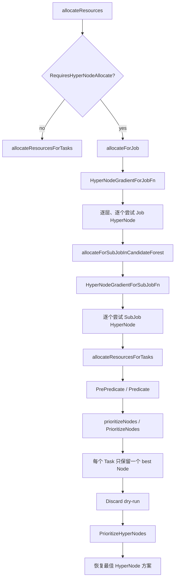
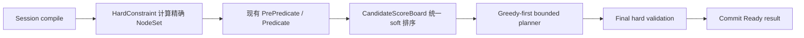
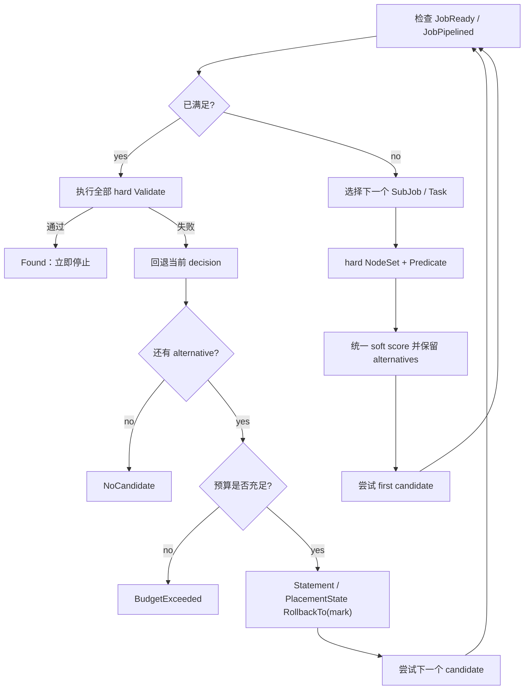
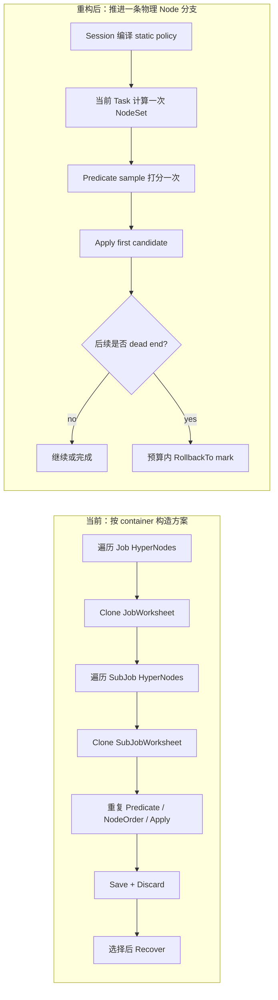

> 归档快照（2026-11-05）。本文保留原有阶段、基线和历史结论；其中的“当前”“完成”仅适用于原文对象。最终设计入口及证据边界见[归档说明](../../../../README.md)。本次仅迁移链接并添加此提示，未重新执行文中的命令。

# 从 HyperNode 分层选择到统一有界规划：Volcano 拓扑调度将如何重构

> 本文介绍 Volcano 拓扑调度重构的目标设计与实施思路。文中“当前函数”来自现有代码；`TopologyPolicyProvider`、`HardConstraint`、`SoftPreference`、`CandidateScoreBoard` 等名称是设计接口，最终实现时可能微调。本文不表示重构已经完成。

## 引言：我们不是要找到最优解

拓扑调度需要同时回答两个问题：哪些 Node 可以使用，以及在这些 Node 中更希望使用哪一个。前者是 hard constraint，后者是 soft preference。

过去的实现围绕 HyperNode 逐层选择：先选一个拓扑容器，再在容器中选择 Node。随着 PodGroup、SubGroup、affinity/anti-affinity、native soft 和多拓扑插件不断加入，代码逐渐需要用 candidate forest、preferred traversal、soft anchor 等局部逻辑修补新的场景。这些修改解决了当时的问题，却没有改变一个根本事实：hard、soft、候选搜索和状态恢复仍然耦合在“选择 HyperNode 容器”的流程中。

这次重构不会把 Volcano 变成一个追求全局最优的组合求解器。我们的工程目标更实际：

> 让所有合法候选都能被正确看见，让不同插件的偏好能够一起比较；默认仍走快速的贪心路径，只有贪心走进死路时，才在明确预算内回退有限次数。

这也是调度效果与调度效率之间的核心平衡。

## 一、当前拓扑调度是怎样工作的

### 1. 先选择 HyperNode，再在其中选择 Node

当前 `allocate` action 在 `allocateResources()` 中根据 `job.RequiresHyperNodeAllocate()` 分流。普通 Job 直接调用 `allocateResourcesForTasks()`；需要拓扑调度的 Job 则进入 `allocateForJob()`。

现有拓扑调用链可以简化为：



其中有两个相互独立的排序阶段：

- `PrioritizeHyperNodes()` 聚合 NTA、GTA 等拓扑插件的 `HyperNodeOrder`；
- `PrioritizeNodes()` 聚合 NodeAffinity、Binpack、ImageLocality 等普通 `NodeOrder`。

NodeOrder 只负责一个已经选定的 HyperNode 内部，Node 得分不会进入外层 HyperNode 方案的比较。这意味着一个 Node 即使同时满足所有 hard 条件，并获得很高的 preferred NodeAffinity 分数，也可能因为所在 HyperNode 没有被外层选中而完全不可见。

### 2. HyperNode 同时承担了太多职责

在当前模型中，HyperNode 同时是：

- 拓扑树的索引单位；
- hard constraint 的组合单位；
- Job 和 SubJob 的分配容器；
- soft traversal 的顺序单位；
- dry-run 方案的保存与恢复单位。

这些职责并不总能使用同一个拓扑对象表达。例如，hard PodGroup anti-affinity 允许的范围可能是两个不连续的 domain `B+C`。它的精确含义是：

```text
allowed nodes = leaves(B) union leaves(C)
```

`B+C` 的 LCA 可能是更高层的 `H`，但 `leaves(H)` 还包含 sibling `A`。因此 LCA 可以用于描述 placement，却不能替代精确 allowed scope。为了表达这种场景，旧流程只能引入 candidate forest 等专用路径。

### 3. 局部贪心没有保留退路

`allocateResourcesForTasks()` 对一个 Task 调用 `prioritizeNodes()` 后，只保留一个 `bestNode`。如果这个选择让后续 Task 无处可放，前面的选择不会被重新考虑。

```text
task-a: node-1、node-2 都可用，node-1 分数更高
task-b: 只有 node-1 可用

当前贪心：task-a -> node-1，task-b -> Pending
可行布局：task-a -> node-2，task-b -> node-1
```

这里不需要穷举全部布局。只要在保留首选的同时保留少量 alternative，并允许回退一次，就能找到可行结果。

## 二、重构的核心：统一策略、统一候选、统一状态

目标架构不再把 HyperNode 当成必须装下整个 Job/SubJob 的分配容器。HyperNode 回归其更自然的角色：提供 topology index、ancestor、tier 和 LCA 查询。真正参与 hard 组合与 soft 排序的是 physical Node。

整个调度过程拆成五个稳定阶段：



这五个阶段的边界非常重要：

- hard 只能删除不合法 Node，不能贡献排序分数；
- soft 只能贡献分数，不能删除候选；
- planner 只负责选择、推进和回退，不理解 NTA、GTA 或 raw API；
- PlacementState 提供统一拓扑事实，插件不再维护各自的 speculative truth；
- 找到第一个完整 hard-valid 结果就停止，不继续搜索更高的全局 soft 总分。

## 三、重构后的完整调度思路

### 1. Session Open：把 API 编译成可执行策略

当前 `framework.OpenSession()` 依次构造 Session、调用各插件的 `OnSessionOpen()`，然后初始化 cycle state。重构后会在这个阶段增加 topology compile：

1. 根据 HyperNode tree 和 physical Node 建立 `TopologyIndex`；
2. 统一解析 tier name、tier ID，以及 soft 未配置 tier 时的默认值；
3. 调用各拓扑插件注册的 `TopologyPolicyProvider`；
4. 将 required term 编译为 `HardConstraint`；
5. 将 preferred term 编译为 `SoftPreference`；
6. 构建 immutable `CompiledTopologyPlan`；
7. 从当前 Session snapshot 初始化 `PlacementState`。

设计接口类似：

```go
type HardConstraint interface {
    AllowedNodes(ctx HardContext, placement PlacementView) (NodeSet, error)
    Validate(ctx ValidationContext, placement PlacementView) error
}

type SoftPreference interface {
    Score(
        ctx ScoreContext,
        placement PlacementView,
        candidates []Candidate,
    ) (NormalizedScoreVector, error)
}
```

这里最关键的不是接口名称，而是能力边界：`SoftPreference` 根本拿不到删除 candidate 的入口；`HardConstraint` 也不能通过 traversal order 暗中表达偏好。hard 与 soft 不再依赖插件开发者“自觉分开”，而是由接口保证。

编译还有一个直接的效率收益：静态 domain membership、selector index 和 hard mask 只在 Session 内构建一次，planner 不必在每次 Task 决策中重新解析 API 或展开整棵树。

### 2. 选择下一个 Task：沿用现有顺序，不搜索 Task 排列

planner 复用 `organizeJobWorksheet()`、`SubJobOrderFn` 和 `TaskOrderFn` 的现有语义。它优先推进尚未满足 Ready/Pipelined 的 SubJob，然后才处理已经满足最小要求但仍有 elastic work 的 SubJob。

这意味着 bounded planner 只探索“当前 Task 应该落在哪个 Node”，不会排列所有 Task 顺序。这个限制大幅减少搜索空间，也保持了 Volcano 现有队列、Job、SubJob 和 Task 优先级语义。

### 3. hard 阶段：逐个决策计算精确 physical NodeSet

对当前 Task，planner 从 `AllNodes` 开始，依次求交：

```text
Job hard constraints
  intersect SubJob hard constraints
  intersect required relation constraints
  = current topology hard scope
```

这个范围不是 Session 启动时固定的一棵子树。静态约束会预编译成 NodeSet；依赖已放置 peer、当前 LCA 或 domain occupancy 的动态约束，则通过 `PlacementView` 在当前 decision 增量计算。

因此“hard 确定范围，soft 排序选择”仍然是清晰的两阶段模型，但 hard 范围可以随当前 placement 合理变化，而不需要维护一棵复杂的动态子树。

得到 topology hard scope 后，继续调用现有：

```text
Session.PrePredicateFn(task)
PredicateHelper.PredicateNodes(...)
```

required NodeAffinity、taint、volume、device、NUMA 等仍由现有 Predicate 判断。拓扑框架不复制其他插件的 hard 逻辑，最终可行性就是：

```text
node belongs to topology hard NodeSet
AND existing Predicate passes
```

### 4. soft 阶段：所有插件在同一批 Node 上打分

通过 hard 和 Predicate 后，候选仍按现有资源/shard 语义分成四类：

1. idle / in-shard；
2. idle / other-shard；
3. futureIdle / in-shard；
4. futureIdle / other-shard。

soft 分数只在同一个 class 内比较，不会让一个高分 futureIdle Node 越过可立即分配的 idle Node，也不会越过 Predicate。

对于一个 class，`CandidateScoreBoard` 收集两类 contribution：

```text
FinalScore(node)
  = sum(existing NodeOrder / BatchNodeOrder points)
    + sum(normalized topology score * topology source weight)
```

普通 `NodeOrder` callback 保持现有计分和权重；NTA/GTA 等 topology source 先归一化到 `0..MaxNodeScore`，再由 framework 应用一次 source weight。每项 contribution 都带有 source name，既防止重复加权，也能解释最终选择。

`BestNodeFn` 在所有 contribution 聚合完成后调用。即使它提升了某个 first candidate，其他候选仍留在 ordered list 中，供后续 dead end 时回退。

单个 soft source 运行失败时，该 source 对当前 candidate class 整体按 neutral 处理，其他 source 和候选继续参与。这样既不会让“少算了一个插件”的个别 Node 获得意外优势，也不会把 soft scorer 故障升级成 hard Pending；错误仍会作为 named diagnostic 暴露。

这一步解决了过去两个 soft score plane 的隔离。例如 NTA 偏好 `node-a`，preferred NodeAffinity 偏好 `node-b` 时，不再先由 NTA 选择一个 HyperNode 再执行 NodeAffinity，而是两个插件直接对相同的 `node-a/node-b` 贡献分数。改变相对权重，就能以可预测方式改变 first choice。

### 5. Apply：资源状态与拓扑状态同步推进

对排序第一的 Node，planner 保存统一 decision mark，然后调用：

```text
Statement.Mark()
PlacementState.Mark()
Statement.Allocate(...) or Statement.Pipeline(...)
PlacementState.Apply(task, node)
```

`Statement` 继续维护 Volcano Session 中的资源、Task 状态以及 Allocate/Deallocate event；`PlacementState` 只维护拓扑事实：

- Task -> Node；
- Job/SubJob actual NodeSet 和 LCA；
- selector 在各 tier/domain 的 peer count；
- 当前 Job 的 speculative placement；
- 其他 PodGroup 已存在 placement 形成的 baseline occupancy。

NTA、GTA 和未来拓扑插件只读取 `PlacementView`。它们不再分别扫描 Task、写 `AllocatedHyperNode` 作为临时 hint，或维护各自无法统一回滚的缓存。

同一 PodGroup 中的多个 SubGroup 共享一个 speculative PlacementState，因此后一个 SubGroup 能看到前一个 SubGroup 的选择；如果 planner 回退，相关 LCA 和 domain count 也会一起恢复。其他已经存在的 PodGroup 作为只读 baseline 参与 relation 计算。多个 Pending PodGroup 不做原子联合搜索，避免把问题扩大为跨 Job 组合求解。

### 6. 终止或回退：贪心优先，但不是一条路走到底

新 planner 的核心流程预计落在 `allocateForTopologyJob()` 和 `topologyPlanner.search()` 一类函数中：



常见路径仍然是纯贪心：每个 Task 尝试排序第一的 Node，完整 placement 一次成功，`backtracks=0`。只有后续 Task 无候选、Ready/Pipelined 无法满足或 final validation 失败时，才回退最近决策。

回退受唯一的 `maxExtraPlacementAttempts` 约束。预算耗尽时返回 `BudgetExceeded`，而不是声称系统已经证明无解。planner 也不会：

- 枚举全部 Task 顺序；
- 保存全部成功方案；
- 为提高 soft 总分继续搜索已经可用的结果；
- 使用 beam search、branch-and-bound 或完整动态规划。

## 四、调度速度为什么会提升，以及如何控制额外搜索成本

重构不是在“效果”和“效率”之间选择一边，而是把不同成本的能力放在合适的位置。

### 1. 最主要的提速：不再为每个 HyperNode 反复构造完整方案

当前代码为了比较 HyperNode，必须先证明每个 HyperNode 是否能形成完整方案：

- `allocateForJob()` 遍历 Job gradient 中的 HyperNode；
- 每次尝试都会 `JobWorksheet.Clone()`；
- `allocateForSubJobInCandidateForest()` 再遍历 SubJob gradient 中的 HyperNode；
- 每次又会 `SubJobWorksheet.Clone()`，然后调用 `allocateResourcesForTasks()`；
- 每个 Task 重新执行 Predicate、NodeOrder 和 speculative Allocate/Pipeline；
- 成功方案通过 `SaveOperations()` 保存，随后 `Statement.Discard()`；
- 选出最佳 HyperNode 后，再用 `RecoverOperations()` 恢复一次。

当多个 HyperNode 的 descendant Nodes 重叠，或者 Job/SubJob 有多层 gradient 时，同一个 Task 和 Node 可能在不同 container dry-run 中被重复 Predicate、打分、Allocate 和撤销。调度耗时不仅来自算法判断，也来自 worksheet clone、operation backup、map/set 构造和 Go GC。



重构后的 common path 不会先生成所有 HyperNode 成功方案。统一 score 直接决定当前 Task 的 first Node，planner 沿这一条 branch 向前推进；只要最终 Ready/Pipelined 且 hard validation 通过，就立即返回。也就是说，速度提升的最大来源不是“计算一个更复杂的最优解”，而是删除了为比较 container 而进行的大量重复完整 dry-run。

可以用一个简化成本模型表示这种差异。当前实现近似为：

```text
for each Job HyperNode candidate:
    clone Job worksheet
    for each SubJob and its HyperNode candidate:
        clone SubJob worksheet
        run Predicate + NodeOrder + Apply/Discard for multiple Tasks
    save successful solution
recover selected solution
```

重构后的 common path 近似为：

```text
compile static topology once per Session
for each required Task:
    NodeSet intersection
    Predicate on bounded sample
    one unified score pass
    apply first candidate
```

两者都会做必要的 Predicate 和评分，但新路径不再把这套工作乘上需要比较的 Job/SubJob HyperNode container 数量。

### 2. 另外五个直接影响延迟的优化点

第一，**静态拓扑只编译一次**。HyperNode descendant membership、tier、ancestor、selector index 和静态 hard mask 在 Session Open 时进入 `TopologyIndex`，Task 决策只做 NodeSet 运算，不反复解释 raw API、扫描整棵树或重新展开 domain。

第二，**hard 先限定 Predicate 输入**。多个 hard policy 先通过 bitset/sparse NodeSet 求交，再把精确 scope 交给 Predicate。对于 disconnected union，精确 scope 未必比单个 container 小，但它只作为一个 bounded sample 处理，不再把多个重叠 container 分别送入 Predicate。`AllNodes` sentinel 还能避免 soft-only Job 为表达 neutral scope 而展开完整集群。

第三，**soft 在每个 decision/revision 只打分一次**。当前路径先在每个 container 中执行 `PrioritizeNodes()`，完整方案形成后又执行 `PrioritizeHyperNodes()`。新路径让 topology soft 和 ordinary NodeOrder 对同一个 bounded Node sample 各贡献一次分数，然后一次聚合出最终顺序。

第四，**状态增量更新代替对象复制与全量扫描**。`PlacementState.Apply()` 只更新当前 Task 影响的 Job/SubJob LCA 和 selector/domain counter；candidate score 使用轻量 overlay。`Statement.Mark()/RollbackTo()` 与 `PlacementState.Mark()/RollbackTo()` 使用 operation mark 恢复，不为每个 HyperNode clone worksheet、保存完整 solution 再 Discard/Recover。

第五，**减少分配与 GC 压力**。NodeSet 使用稳定 Node ID、scratch/in-place union，score board 只保存当前 candidate class，diagnostic 只保存 winner 和固定数量 alternatives。这不仅降低 B/op 和 allocs/op，也会缩短大规模 domain 下由临时 map、set 和字符串引起的 GC 停顿。

### 3. 有界回退不是无条件提速，而是受控地购买调度成功率

需要诚实说明：bounded backtrack 本身不是提速手段。如果当前贪心第一分支成功，新旧对比的收益来自删除重复 dry-run，此时目标是 `backtracks=0`。如果第一分支失败，新 planner 会比当前“直接 Pending”多做几次工作，但这些工作换来了找到浅层可行布局的机会，并且受 `maxExtraPlacementAttempts` 硬限制。

不同 workload 的预期如下：

| 场景 | 速度预期 | 原因 |
| --- | --- | --- |
| common topology Job，第一分支成功 | 主要提速场景 | 不枚举和恢复多个 HyperNode 完整方案 |
| 多层或大量重叠 HyperNode | 提速收益更明显 | 避免对相同 Task/Node 重复 Predicate 和打分 |
| 第一分支 dead end | 比直接 Pending 多付有限成本 | 额外尝试不超过批准的 budget |
| 很小的单 domain topology Job | 可能接近持平 | 省下的 dry-run 较少，新增 score board 有固定开销 |
| 普通非 topology Job | 保持现状 | 继续使用现有 `allocateResourcesForTasks/PrioritizeNodes` 路径 |

所以这里的性能目标不是声称所有 case 都以固定百分比加速，而是：明显降低 topology common path 的重复工作；在困难 case 中把额外成本限制在可配置上界；普通 Job 不承担重构成本。

### 4. 效果与成本的对应关系

| 设计 | 对调度效果的帮助 | 对调度成本的控制 |
| --- | --- | --- |
| exact physical NodeSet | 不遗漏跨 domain 合法组合，不引入 LCA sibling | static mask Session 内编译一次，使用 bitset/sparse set 求交 |
| 统一 CandidateScoreBoard | topology、NodeAffinity、Binpack 等偏好共同决定 first choice | 只对 Predicate sample 和当前 candidate class 打分 |
| PlacementState 增量更新 | 多 SubGroup、peer count、LCA 使用一致事实 | Apply/rollback 只更新受影响 selector/domain counter |
| greedy-first | 优先尝试综合分数最高的候选 | common path 不回退，不搜索其他方案 |
| bounded backtrack | 修复少量局部贪心造成的 Pending | 额外尝试受单一 budget 限制 |
| first hard-valid stop | 获得完整、符合约束的可用结果 | 不为 soft 最优继续搜索 |
| bounded diagnostics | 能解释 hard rejection、score 和回退原因 | 只记录 winner 和固定数量 alternatives，不保存完整搜索树 |

如果用变量表示：

- `M`：本次 Predicate 保留下来的 Node sample；
- `C`：当前 Task 的 hard constraint 数；
- `S`：soft score source 数；
- `W`：完成 Job 所需推进的 Task 数；
- `B`：额外尝试预算。

一次 decision 的主要成本约为：

```text
hard scope     = O(C * NodeSetWords)
Predicate      = O(M * predicate cost)
soft score     = O(S * M)
```

common path 约为 `O(W * decisionCost)`；dead-end 增加的工作受 `B` 限制，约为 `O(B * decisionCost)`。它不是完整搜索的指数级承诺，而是一个可以通过 benchmark、metrics 和配置直接治理的工程边界。

此外，`PercentageOfNodesToFind` 仍然约束 Predicate sample。重构承诺的是“在现有 sample 和额外尝试预算内更合理地使用候选”，不是枚举整个集群并寻找数学最优解。

### 5. 在数据证明之前，不提前承诺加速比例

实施阶段会用相同 fixture 对比当前路径和目标路径，而不是只看功能测试。至少记录：

- first-branch、1/2/4/8 次 alternative 和 budget exhausted 的 `ns/op`；
- `B/op`、`allocs/op` 和 GC 压力；
- Predicate、NodeOrder、topology score callback 调用次数；
- worksheet clone、Statement Apply/rollback 和 total placement attempts；
- 1,024/8,192-domain 下 NodeSet 构建和 diagnostic 成本；
- Kind 中批量提交相同 topology Job 时的调度延迟分布。

common path 必须满足 `placementAttempts≈W`、`backtracks=0`；进入回退后，总额外尝试不超过 `B`。最终可以对外声明的加速比例以这些 benchmark 和 Kind 数据为准。如果一个简单场景因统一 score board 出现明显回退，应先优化数据结构或调用次数，而不是用架构收益掩盖性能回归。

## 五、新旧逻辑的关键差异

| 维度 | 当前实现 | 重构后 |
| --- | --- | --- |
| hard 组合单位 | HyperNode name、gradient 和 container | exact physical NodeSet |
| hard/soft 边界 | gradient、order、helper 和 traversal 共同影响流程 | typed HardConstraint / SoftPreference |
| soft 可见域 | 先选 HyperNode，再在内部比较 Node | 同一 hard-feasible Node sample |
| 普通插件关系 | HyperNodeOrder 与 NodeOrder 两个 score plane | 一个 CandidateScoreBoard |
| 多 domain placement | 需要 forest/envelope 等特殊路径 | disconnected NodeSet 是普通输入 |
| 状态来源 | Job/SubJob 字段、Recorder、plugin cache、Statement 分散维护 | framework-owned PlacementState/View |
| Task 选择 | best Node 选中后不可回退 | first candidate + bounded alternatives |
| 终止条件 | first-success gradient/container | first complete hard-valid placement |
| 扩展新拓扑插件 | 增加 callback 后还可能修改 allocate helper | 实现 provider、hard/soft policy 即可 |

## 六、为什么它能解决过去难以顺畅解决的问题

### 场景 1：hard 约束允许 `B+C`，但不能允许 `A`

过去必须寻找一个 HyperNode 容器承载方案。`B+C` 没有单一真实 container，使用 LCA 又会把 `A` 带进来，所以需要 candidate forest。

重构后，GTA hard policy 直接返回 `leaves(B) union leaves(C)`，再与其他 hard policy 的 NodeSet 求交。planner 从始至终只在精确 physical Node 中选择，`A` 不会泄漏，也不需要 forest 专用 route。

### 场景 2：hard NTA 与 soft affinity 混合

过去 hard gradient 既决定范围又决定逐层遍历；soft 还可能通过 helper 或 preferred order 影响 candidate 是否可见，容易演变为新的转换和条件判断。

重构后，hard NTA 先输出允许 NodeSet，soft affinity 只在该 NodeSet 通过 Predicate 的 Node 上打分。preferred 目标不可行时，其他 hard-feasible Node 仍然存在，因此无需 soft-to-hard conversion，也不会因为 soft 偏好失败而错误 Pending。

### 场景 3：同层多个 HyperNode 联合放置

过去按层逐个选择 container，一个 soft scorer 通常只能看到当前 container。即使两个同层 HyperNode 联合使用更符合语义，也可能因 first-success layer/container 被截断。

重构后，同层多个 HyperNode 的 descendant Node 同时进入同一 candidate sample。一个完整 placement 可以自然跨两个或多个同层 domain；planner 不枚举 HyperNode 组合，只按 Task 推进 physical Node，因而效果提升没有带来组合枚举成本。

### 场景 4：多 SubGroup relation 和 count-aware anti-affinity

过去 GTA 需要从分散状态推断 peer placement，常把 domain 简化为 occupied/not occupied，无法自然区分 `1/2/3` 个 peer，也容易在 rollback 后读到不一致状态。

重构后，所有 SubGroup 共享 PlacementState。`DomainCount(selector, tier, domain)` 直接提供实际 peer 数，candidate overlay 可以在不修改真实状态的前提下计算“如果放在这里”的分数。required relation 用它过滤，preferred relation 用它打分，rollback 则恢复同一套 counter。

### 场景 5：topology soft 与 preferred NodeAffinity 冲突

这正是两个 score plane 无法解决的问题。过去 NodeAffinity 只能决定一个 HyperNode 内部的 Node，不能影响跨 HyperNode 选择。

重构后，两者对同一 physical Node 列表贡献分数：

```text
node-a = NTA 1000 + NodeAffinity 0    = 1000
node-b = NTA 0    + NodeAffinity 2000 = 2000
```

`node-b` 会成为 first candidate；交换相对 weight 后 winner 可以预测地翻转。拓扑插件无需理解 NodeAffinity，NodeOrder 也无需理解 HyperNode。

### 场景 6：fit-first 造成后续 Pending

过去 `prioritizeNodes()` 返回一个 best Node，后续失败后没有 alternative。

重构后不会为了搜索而主动选择低分 Node，仍先尝试统一评分最高的 `node-1`。当 task-b 因此失败时，planner 回到 task-a 的 mark，在预算内尝试 `node-2`。它解决的是浅层局部死路，而不是承诺解决任意深度的组合问题。

### 场景 7：大规模 domain 下的内存问题

仅仅把 forest 删除并不代表性能自然变好。如果每次 union 都 clone 已累计集合，仍然会出现接近 `O(NR)` 的临时内存。

重构将 NodeSet 作为独立基础设施设计：稳定 Node ID、AllNodes sentinel、in-place/scratch union、bitset/sparse representation 和 bounded diagnostics。8,192-domain benchmark 会在 NTA/GTA 迁移前作为门禁，而不是等功能完成后再补性能问题。

## 七、与其他调度插件如何协作

重构会修改 topology planning framework，但不会为每个普通插件设计一套 `ReadOnly/Reversible/SnapshotRestore/CommitOnly` 分类。

- Predicate：继续负责 required NodeAffinity、volume、device、NUMA 等 Task 级 hard feasibility；topology 只在它之前提供精确 Node scope。
- NodeOrder/BatchNodeOrder：通过 framework collector 进入统一 score board，插件业务实现和普通非 topology Job 的行为保持不变。
- Ready/Pipelined：继续是 Job/SubJob 是否完成的权威回调；planner 不自行复制 gang 语义。
- EventHandler：bounded backtrack 可能增加 speculative Allocate/Deallocate 次数，因此 Statement 必须保证成功操作有成对 inverse，失败 Apply 自身清理。
- Commit：只对最终 `Found(Ready)` 结果执行；`Found(Pipelined)` 保持 assume 语义，不直接 bind。

这条边界让 topology planner 只管理“选择哪条 branch”，而不接管 capacity、DRF、device 或 extender 的业务状态。若测试发现某个现有插件的 Allocate/Deallocate 不对称，修复的是该 inverse 或 Statement 原子性，不在 planner 中增加 plugin-name 特判。

## 八、重构将如何落地

为了避免再次形成“大改动中的小补丁集合”，实施会按架构依赖分阶段推进，并在每一阶段设置退出门禁。

### 第一阶段：先建设不带业务语义的基础设施

实现 `TopologyIndex`、`NodeSet`、稳定 ID 和有界 diagnostics；先用 8,192-domain benchmark 验证集合运算的内存与时间边界。

### 第二阶段：建立 typed policy contract

在 Session Open 中完成 canonicalization 和 compile，引入 provider、hard、soft 接口；用 fake future plugin 证明接入新插件不需要修改 planner。

### 第三阶段：统一状态与打分

实现 PlacementState/View、candidate overlay、domain count 和 CandidateScoreBoard；接入普通 NodeOrder contribution，先验证 topology、NodeAffinity 和 Binpack 的组合与错误隔离。

### 第四阶段：迁移 NTA 与 GTA

NTA/GTA 直接实现新 hard/soft contract，逐项审计现有 HyperNodeOrder、BatchNodeOrder 和 term/plugin weight，确保同一语义只贡献一次分数。

### 第五阶段：接入有界 planner 与统一 rollback

让 `allocateForTopologyJob()` 只消费 compiled policy、score board 和 PlacementState；实现 greedy-first、decision mark、`Statement.RollbackTo()`、budget 和 final validation。

### 第六阶段：删除旧路径并做真实回归

删除 legacy Job/SubJob container runtime、candidate forest、preferred gradient order、NTA soft helper 和临时 adapter。随后完成：

- 已知 Bug 018–023 的架构回归；
- NodeSet 和 planner benchmark；
- capacity、DRF、predicate、device、NUMA、extender 等插件兼容测试；
- 本地镜像与不超过 8 Node 的 Kind 场景验证；
- common path `backtracks=0`、extra attempt、score contribution 和 rollback baseline 的可观察性验证。

最终源码只保留一条 topology runtime。历史原型由 Git 和 backup branch 保存，不在主线长期维护 legacy/observe 双实现。

## 结语

这次重构真正改变的不是某一个 affinity 算法，而是拓扑调度的基本决策单位和执行边界：

```text
从：先选择 HyperNode container，再在其中选择 Node
到：先得到精确 hard-feasible Nodes，再统一排序，并对局部死路做有界回退
```

它不会保证最优，也不会保证在任意复杂场景下找到所有可行解。它保证的是更有工程价值的几件事：hard 不被 soft 偷偷改变，合法候选不会因容器边界提前消失，不同插件的偏好可以共同决定首选，常见路径仍然保持贪心成本，而少量错误选择拥有有限的纠正机会。

当这些能力成为框架不变量后，过去需要 candidate forest、soft helper 或 plugin-specific 条件判断才能处理的场景，就会自然落入同一条调度流程。这既是调度效果的提升，也是架构可维护性和长期调度效率的提升。
