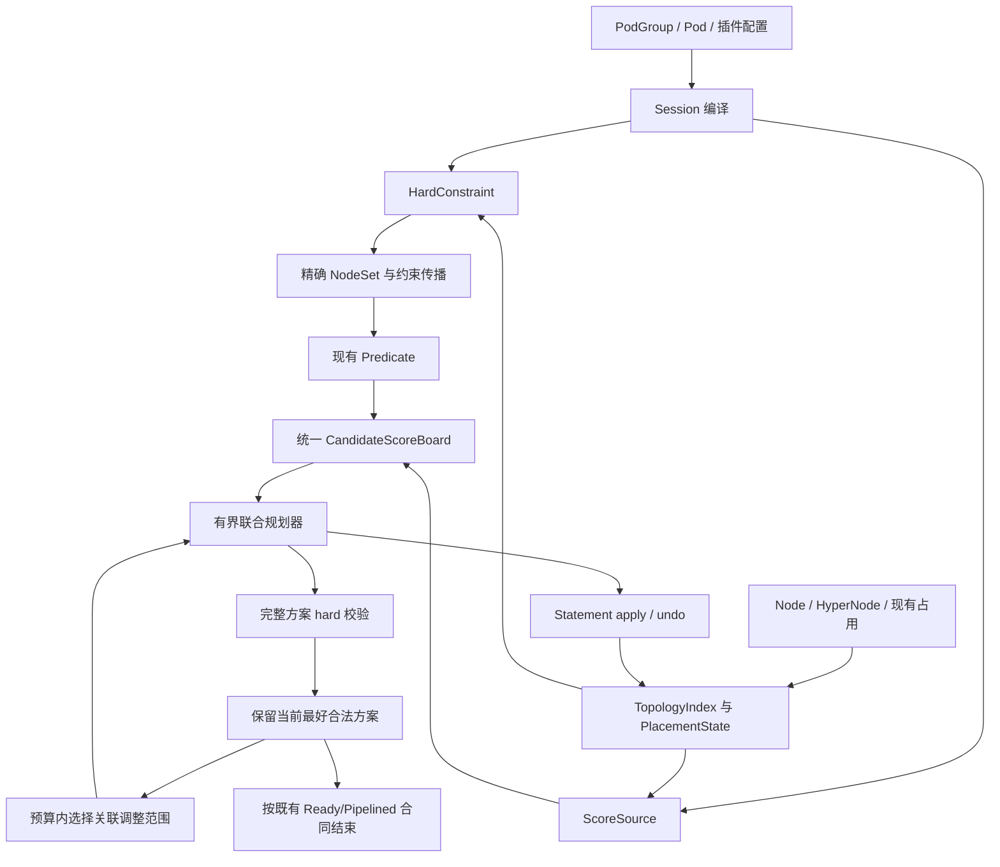
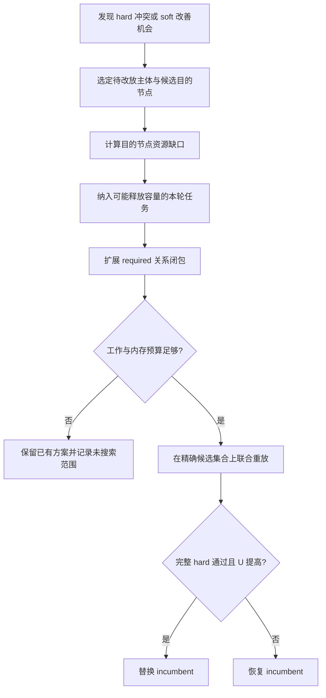

> 归档快照（2026-11-05）。本文保留原有阶段、基线和历史结论；其中的“当前”“完成”仅适用于原文对象。最终设计入口及证据边界见[归档说明](../../../../README.md)。本次仅迁移链接并添加此提示，未重新执行文中的命令。

# 统一拓扑与多策略联合调度框架设计

> 中间研究草稿，保留供历史对照。按本轮已确认诉求重新组织的完整方案已另写为 [TOPOLOGY_PLANNING_FRAMEWORK.md](TOPOLOGY_PLANNING_FRAMEWORK.md)。当前完整方案以统一模型与同一搜索过程为主线，Bug020作为验证实例；015目标重构仍处于设计阶段。

版本：设计讨论稿，2026-09-11。本文独立定义完整目标框架，不要求读者阅读此前讨论。文中的接口和算法是设计方案，不表示 Volcano 实现已经完成；数学模型结果与历史 Kind 结果分别注明来源。

## 1. 目标与核心方案

框架在一次调度快照内，为一个 PodGroup 的当前准入工作集寻找合法且符合综合偏好的物理节点放置。它需要同时兼容 network-topology-aware（NTA）、group-topology-affinity（GTA）、Binpack、NodeAffinity 和其他调度插件，处理多 SubGroup 的资源竞争与拓扑关系。

核心流程是：

```text
编译策略与索引
  → 精确物理候选集合
  → 增量 hard 约束传播与 Predicate
  → 全部启用评分来源共同排序
  → 有界放置，保留一个完整合法方案
  → 在预算内进行资源可行的联合调整
  → 最终校验与既有提交过程
```

hard/soft 是规则类型，不是不同 allocator：hard 决定哪些方案可以接受；soft 表达合法方案之间的取舍。一个 PodGroup 同时包含 NTA hard、GTA preferred、Binpack 和 NodeAffinity 时，进入同一个主流程。

框架目标按以下顺序解释：

1. 已接受方案满足适用的 hard、资源和 Gang 条件。
2. 减少因局部选择造成的无谓 Pending。
3. 在固定工作集上综合多个评分来源，减少 SubGroup 顺序导致的收益损失。
4. 常见成功路径减少重复检查和对象复制，困难场景的实际工作量受控。
5. 解释候选为什么被拒绝、为什么采用某个方案，以及搜索因何停止。
6. 把变更集中在拓扑策略、规划与相关状态边界，保持普通插件可逐步接入。

“全局”仅指当前固定工作集、候选范围和快照内的联合放置。跨多个排队 Job 的公平性、未来到达任务、迁移已绑定 Pod、preempt/reclaim 联合优化不包含在该目标里。框架不承诺任意插件组合下都找到可行解或全局最优。

## 2. 问题模型与概念

### 2.1 调度对象

| 概念 | 定义 |
| --- | --- |
| 工作集 T | 本轮依据既有 Job/SubJob Ready、minMember/minSubGroups 与 TaskOrder 选定的待规划 Task |
| 放置 x | 每个 Task 到一个物理 Node 的映射；Task 不可拆到多个 Node |
| 外部状态 S0 | 已存在的任务占用、资源、其他 PodGroup、拓扑、标签与配置版本 |
| partial placement P | 本轮已暂占的部分放置 |
| NodeSet | 精确物理 Node 集合，可以为 AllNodes、单域或多个不连续域的并集 |
| topology realm | 一个具有独立 membership/层级语义的拓扑视图，例如网络域或故障域 |
| placement state | 资源与拓扑相关事实的统一观察视图，包含实际占用和本轮 speculative 更新 |
| incumbent | 当前保存的一个完整合法方案，不是全部成功方案集合 |

比较完整方案时固定 T 和 S0。不能将只准入8个 Pod 的方案与准入16个 Pod 的方案直接按得分比较；也不能通过改变 minMember 让不可行方案变得可行。Ready 与 Pipelined 分别保留现有合同，初版质量调整保持 completion class 不变。

### 2.2 三张图的不同作用

物理拓扑树用于 membership、ancestor、LCA 和域资源查询；工作负载约束图描述 Task/SubGroup 之间的关系与共享资源；搜索树描述已尝试的放置选择。只有第一张图是树，不代表另外两张图也简单。

调度属于带拓扑结构的约束放置问题。Task 可以共置，具有不同资源需求，约束还包含计数与 Gang，因此不宜直接等同于一般子图同构搜索。

### 2.3 数学表达

对 `t ∈ T`，令 `x_t ∈ N`。每种资源 r 满足：

```text
Σ_{t: x_t=n} demand(t,r) ≤ available_S0(n,r)
```

全部适用的 required 关系、Predicate 和 readiness 共同定义可行集合 F。soft 优化在 F 内进行：

```text
maximize U(x; S0), subject to x ∈ F
```

U 是由已定义整体评价能力的启用来源组成的目标。无法表达为终态收益的历史 callback 仍可提供决策排序；框架不得把缺失的整体评价悄悄按零处理。

## 3. 总体架构



| 部件 | 负责 | 边界 |
| --- | --- | --- |
| TopologyIndex | 稳定 ID、membership、tier、ancestor、LCA、域统计 | 不选择 Job 容器 |
| CompiledPolicy | 解析默认值、规则适用范围、selector 与依赖 | 不控制搜索顺序和终止 |
| HardConstraint | 保守传播与最终校验 | 不返回软偏好分 |
| ScoreSource | 当前候选分；可选的整体评价与乐观界 | 不修改 hard 候选集合 |
| PlacementState/View | 统一实际占用、peer 主体计数和 speculative 事实 | 插件只读，更新与 Statement 协同 |
| Planner | 选择、回退、联合调整、预算、结果状态 | 不按 NTA/GTA 名称分支 |
| Statement | Allocate/Pipeline 及其反向操作 | 不自动提供绑定原子性 |

概念接口如下，最终实现名称可调整：

```go
type HardConstraint interface {
    AllowedNodes(ctx Context, view PlacementView) (NodeSet, error)
    Validate(ctx Context, view PlacementView) error
}

type ScoreSource interface {
    ScoreCandidates(ctx Context, view PlacementView, candidates []Candidate) (Contributions, error)
}

// 可选能力：有此能力的来源才能参与完整方案的严格收益比较。
type PlanEvaluator interface {
    EvaluatePlan(ctx PlanContext, view PlacementView) (UtilityContribution, error)
}
```

Bound 是进一步的可选能力。没有 evaluator/bound 的插件仍能接入普通排序；不会因此绕过它的硬检查或删除其分数。

## 4. hard 约束与候选传播

### 4.1 精确集合不是“保证能完成 Job”的集合

NTA hard、GTA required 和普通 required NodeAffinity 在物理节点上组合。允许 B+C 时，LCA 可以用于解释，但不能把 A 一并带入 allowed set。

令 `E_t(P)` 为所有能够扩展成完整合法方案的下一步节点集合。高效过滤返回 `A_t(P)` 必须满足：

```text
E_t(P) ⊆ A_t(P)
```

它可以保留后续才发现不合适的节点，不能误删仍有合法扩展的节点。要求每次过滤都返回 E 的精确投影，通常就等于提前求解整个剩余问题。

### 4.2 规则分工

| 规则 | 处理 |
| --- | --- |
| 静态标签、required NodeAffinity、外部已占用反亲和域 | 复用静态索引或普通 Predicate，按快照版本缓存 |
| NTA Job/SubJob hard tier | 增量 LCA/ancestor 检查，最终校验适用主体的完整放置 |
| required SubGroup affinity | 保留未决同域关系；peer 已确定后约束共同域，不能把暂无 peer 误判为必然失败 |
| required SubGroup anti-affinity | 对实际匹配 peer 的精确域集合拒绝冲突，不把多个域压缩成一个 LCA |
| 容量/设备/NUMA/volume | 现有 Predicate 与相应状态合同；聚合容量仅用于安全的必要条件检查 |
| Gang 与 optional/elastic Task | 沿用 readiness 合同；比较方案前固定本轮工作集 |

required 不通过时，不存在“大量 soft 分数抵消”的途径。final validation 覆盖新放置影响的全部适用关系，同时保留 `IgnoredDuringExecution` 等历史语义，不要求所有 Running Pod 因后续配置变化重新合规。

### 4.3 传播先检查支持，再检查可装入数量

每次试探后，只更新可能受影响的后续主体：是否还有合法节点、是否还有相容拓扑域、是否还有足够的资源装入它们。

对于具有相同资源请求向量 q 的一组待放置任务，可用一个便宜的必要条件：

```text
slots(n,q) = min_{r:q_r>0} floor(free(n,r)/q_r)
Σ_{n∈allowed_union(q)} slots(n,q) ≥ remaining_tasks(q)
```

若 allowed_union 是所有相关任务可能使用节点的上包络，忽略了彼此不同的标签限制，算出的 slot 数是乐观上界；不足可以安全拒绝，足够不能保证成功。不同资源形状的 class 不能同时把同一容量当作各自独占，因此逐 class 检查是必要条件集合，不是联合充分条件。

已配置的约束可以维护 class→node 支持索引与域容量计数。只在资源变化节点上更新 floor 计数，避免每个 Task 重扫整个集群。资源形状/selector class 数可能很多，这部分建立与更新成本必须纳入复杂度；不能默认它恒为常数。

更强的匹配、流松弛或同域组传播可在小范围使用。任何传播器都必须证明“原问题可行 ⇒ 放宽模型可行”，否则不能用它拒绝原问题。

### 4.4 缓存与状态版本

静态 selector/规则缓存与动态资源/peer 错误缓存分开。apply、undo、外部快照更新后，依赖已变化的结果必须失效。第一版允许较粗的全量动态失效，之后按 profile 增加依赖版本。

不能以相同 LCA 判断布局相同，也不能仅按 TaskRole 假设两个 Pod 的 Predicate 完全等价。回滚后的资源不足缓存尤其必须重新检查。

## 5. 统一评分：包含 Binpack，也覆盖一般评分插件

### 5.1 一个候选集合，全部启用来源共同竞争

当前候选按照既有 idle/futureIdle、shard 等 class 处理。在同一 class 中：

```text
OrderScore(t,n|P) = Σ_s weighted_points_s(t,n|P)
```

来源包含所有启用的 NodeOrder、BatchNodeOrder、map/reduce 与 native topology contribution，而不只包含示例中的 NodeAffinity。source 记录单位、范围、适用主体、cohort、配置权重和是否已加权。现有 ordinary callback 已乘过的权重不再重复应用。

| 来源 | 候选分关注内容 | 完整评价关注内容 |
| --- | --- | --- |
| GTA | peer 主体计数、同域/异域偏好 | 实际匹配主体之间的关系满足程度或冲突数量 |
| NTA locality | candidate 与已有 placement 的 tier/LCA | Job/SubJob 最终紧凑性，保持声明的 tier 语义 |
| NTA HyperNode binpack | 拓扑域使用率与资源权重 | 最终域使用率；与 Node binpack 分开命名 |
| 独立 `binpack` | 当前 Node 放入任务后的资源利用率 | 最终放置的节点利用率评价，详见下节 |
| NodeOrder MostAllocated/LeastAllocated | 聚集/分散资源使用 | 对应最终利用率目标 |
| NodeOrder BalancedAllocation | 节点内不同资源的利用比例 | 最终资源比例；不能只拿 GPU 代表多资源均衡 |
| NodeAffinity | preferred 标签匹配、term 权重 | 固定工作集内各 Task 的静态偏好收益 |
| ImageLocality | 镜像本地性 | 在固定镜像/快照版本下评价所选节点 |
| TaintToleration | 未容忍的软 taint 惩罚 | 固定的软 taint 代价与作用对象 |
| InterPodAffinity | 对其他 Pod 的关系分数 | 按其方向、selector、namespace 与 domain 语义定义关系评价 |
| PodTopologySpread | domain count、skew 和 eligible domain | 依据该插件语义计算整体分布；不能直接复用 GTA 计数替代 |
| task-topology/extender/未来插件 | 原有 callback 提供的 points | 显式提供终态评价，或声明只有排序能力 |

这张表规定接入范围，不声称现有插件已经实现 PlanEvaluator。尤其 `nodeorder` 内包含多个子 scorer，完整评价必须覆盖实际启用的全部子 scorer，不能因为 NodeAffinity 可评价，就把整个 nodeorder 标记为可评价。

NTA 同时提供域 binpack 与网络 locality 时，两者是不同业务因素，应保留明确身份。独立 binpack 与 MostAllocated 同时启用可能是用户有意的双重偏好；框架只防止同一 callback/迁移语义被重复注册，不擅自删除用户启用的不同策略。

### 5.2 决策分与完整收益各自有明确用途

OrderScore 只决定先尝试什么。整体收益用于比较两份完整合法布局：

```text
U(x;S0,T) = Σ_s w_s · V_s(x;S0,T)
```

每个 `V_s` 固定主体范围和标尺，不能随着当前候选批次改变归一化分母。task 级收益默认对固定 T 求平均；Job/SubGroup/term 级收益按编译时声明的主体平均或加权。这样避免同一 Job 级奖励被每个 replica 无意重复放大。不同聚合口径具有不同产品含义，需作为评分合同写明。

先搜索哪条分支与最后如何评价完整方案可以使用不同的函数：前者是成本较低的启发式，后者是接受改进的依据。它们使用相同启用来源和配置，不再是“拓扑先决定容器、普通评分只在内部生效”的隔离。

对不能提供完整评价的来源，采用统一排序与有界可行性搜索，明确报告 `qualityOptimization=unsupportedSource`。这只影响额外质量调整，不影响 hard、已有评分或调度可用性。第一批整体评价必须覆盖 NTA/GTA、独立 Binpack、实际启用的 NodeOrder 资源子策略与 NodeAffinity；不能以避开 Binpack 来简化目标。

### 5.3 Binpack 的完整方案评价

独立 `binpack` 的核心是对 Task 请求涉及的配置资源求加权平均：

```text
local_binpack(t,n|P)
  = 100 · w_bp · Σ_r α(t,r) · (used_P(n,r)+request(t,r))/capacity(n,r)
```

α 是该 Task 实际参与打分资源的归一化内部权重。资源是否真的可分配仍由 Predicate 判断，binpack score 不是 hard 判定器。

这个局部分数在异构请求下具有顺序依赖。容量8，两个 Pod 分别请求1和2：先1再2的分数和为 `1/8+3/8=1/2`；先2再1为 `2/8+3/8=5/8`。最终都是3卡占用，却得到不同路径分。因此不能把这些分数直接累计成终态收益。

推荐完整评价为固定工作集的最终利用率平均：

```text
V_bp(x) = (100/|T|) · Σ_{t∈T} Σ_r α(t,r) · used_x(x_t,r)/capacity(x_t,r)
```

外部既有占用计入 used_x，任务分母固定为 T；插件权重 w_bp 在整体聚合时应用一次。它读取最终使用率，不再次加上当前 Task request。上述两个顺序都得到37.5分。它延续“在已使用节点聚集”的目标，但不是对历史逐步分数和的等价变形；这是联合评价的新明确语义。

相同形状任务可以在 Node 上维护 `Σ_t α(t,r)` 系数，增量更新只涉及移动任务及受影响节点，无需每个候选扫描全部 T。不同资源维度、形状与动态外部占用仍需分别计费。

域 binpack 使用对应 HyperNode 的最终资源使用率与声明主体粒度评价。MostAllocated 可使用同类终态利用率，LeastAllocated 使用相应反向目标，BalancedAllocation 使用其资源比例函数。它们应各自有 evaluator，不能统一简化成一个“利用率高就是好”的函数。

### 5.4 GTA 必须保留 peer 数量与主体身份

计数单位是 SubJob，不是 Pod。同一个 peer SubJob 在一个域中有多个 Pod，只计一个 peer；跨多个域时按实际占用域分别计数。单策略 anti-affinity 统计同 policy 的 peer，多策略 term 继续按现有 cross-policy 规则选择 peer。

当前候选排序可保留 count-aware 的有界 penalty：

```text
penalty(t,d) ∝ term_weight · peer_count(t,d)/max_peer_count(t,current_cohort)
```

它保证单条适用 term、其他因素相同时，`[2,1,1]` 的拥挤域分更低；所有域都占用时也不会删除候选。多个 term 聚合、clip 或其他分数覆盖时，不把该局部性质夸大成绝对均衡保证。

完整评价使用固定范围的关系成本，不能继续依赖 current_cohort 的 maxCount。对单域、对称同策略关系，可定义：

```text
C_role(x) = Σ_d choose(count(role,d),2)
V_GTA(x) = 100 · [1 - mean_terms((termWeight/100) · C_term(x)/Cmax_term)]
```

`Cmax_term` 由固定参与主体和规则确定，无适用 pair 的 term 视为无惩罚。term 内权重控制该项惩罚强度；固定 term 平均控制 source 范围；GTA plugin weight 在外层乘一次。该设计为整体评价定义了可校准的有界标尺，不声称复现所有历史权重的布局结果。

一般 selector、带方向/不同 policy 关系、既有 peer 和跨域 SubGroup，应按真实匹配 pair/domain 关系计算成本和固定上界。不能把上面同策略简式直接用于所有 GTA term。若要用增量记账，使用 `ΔC=C(after)-C(before)`；同一最终布局的这些差分和必然相同，但逐步取最好差分仍不保证最优。

### 5.5 NodeAffinity 与归一化合同

当前 Volcano 对 NodeAffinity 调用 Score 后直接乘权，没有执行对应 NormalizeScore；匹配多条 preferred term 的 raw score 可超过100。兼容候选排序阶段保持现有 weighted points。整体 NodeAffinity 收益使用固定 T 的 raw term 匹配均值，标明范围，不偷偷把200改为100。

未来若采用 Kubernetes 完整 NormalizeScore 生命周期，应作为明确评分语义迁移。任何候选相关 normalize、source error 后 neutral、candidate class 变化，都不能使完整方案比较中途换目标。对完整评价不确定的来源，本轮取消质量调整并保留已有合法方案；记录受影响来源。

## 6. 有界联合规划与顺序问题

### 6.1 首个合法方案

规划器沿用既有 Job/SubJob/Task 优先级，首先走统一候选分指导的分支。每次 apply 之后进行受影响的 hard 传播，失败时按选择栈回退。

不枚举 SubGroup 的所有排列。对固定工作集、纯约束、完整节点枚举和安全剪枝，固定变量顺序也能覆盖全部布局；有限预算下，顺序影响搜索效率。对没有既有顺序要求的同优先级主体，可以根据候选支持数选择 fail-first，但这是可独立验证的启发式，不是 correctness 的前提。

### 6.2 首个可行解之后的联合调整

对于存在明确关系损失或稀缺资源竞争的部分，保留 incumbent，并构造一个受限调整范围。它由以下信息驱动：

- 某主体失去候选的具体资源/域冲突。
- 较差布局中的同域 peer 冲突与潜在目的域。
- 多个主体争用同一个高收益、难替代的节点。

调整范围按**实际资源缺口和 required 关系闭包**扩展，不固定为两个 Pod 或两个 SubGroup。目的节点缺2卡，可以纳入一个可移动2卡任务，也可以纳入两个可移动1卡任务；寻找释放集合本身也受预算限制，不保证找到最小集合。

算法只在本轮 speculative 工作集内调整，不逐出外部 Running Pod。多资源缺口是向量，不能只比较总卡数；hard 同域组、device/NUMA/volume 约束可能要求扩展更多 Task。超过额度时保留已有方案。



这种搜索与增广/交换思想有关，但异构不可拆资源的“释放集合”不等价于普通流网络的一条增广路；不能直接套用最大流的多项式复杂度保证。

### 6.3 事务实现边界

第一版复用 mark/undo 和紧凑计划重放。Statement 主要支持后缀撤销，因此不预设可以安全地任意删除中间两个操作。

每次完整 trial 可回到 root mark，按合法顺序重放固定选择和待调整选择，执行真实 Predicate 与 callback。只保留一个 incumbent；试探期间保存的方案只是 Task→Node 映射及必要元数据，不保存多份 Session。

必须预留“撤销当前 trial + 恢复 incumbent + 最终验证”的工作额度。不能用尽搜索额度后发现已经无力恢复。若 undo/replay 失败，报告一致性错误并按既有清理处理，不继续在污染的 Session 中搜索或宣称旧方案仍可安全提交。

小窗口不等于小事务成本：初版一次完整重放最坏仍涉及 |T| 个 Task。这是用实现范围换额外开销的明确取舍。只有性能证据显示它是瓶颈，才引入更细的受控 checkpoint。

### 6.4 搜索结果与解释

| 结果 | 含义 |
| --- | --- |
| Found / Improved | 已有完整 hard-valid 方案；可注明是否经过严格收益改善 |
| BudgetExhausted | 停止了仍有工作可做的搜索；有 incumbent 则返回它，否则本轮未找到 |
| SampleExhausted | 当前候选样本耗尽，可能还有未覆盖节点 |
| Exhausted | 指定有限模型/候选范围枚举完毕；只有范围完整且过滤有效才可声明该模型无解 |
| Error | hard evaluator、apply、undo 或状态一致性错误 |

日志包含 hard 排除来源、候选 class、各评分来源、联合调整涉及的资源缺口、收益变化、实际检查数量、剩余覆盖与停止原因。采样 seed、工作集/快照/配置版本用于重现。不能只记录“因为分高”或“调度失败”。

## 7. Bug020：贯穿框架的验算

### 7.1 固定问题

一个 PodGroup 包含8个 decode SubGroup 和8个 prefill SubGroup，每个 SubGroup 一个 Pod。decode 请求2卡，prefill 请求1卡；3个节点各8卡。两个 policy 各有 weight=100 的 preferred 同策略反亲和，全部16个 Pod 必须准入。

历史验证配置启用 NTA/GTA，权重均10，NTA HyperNode binpack 只计算 `example.com/gpu`。独立 binpack 与额外普通资源策略作为扩展组合验证；不能把它们冒充为历史配置已执行内容。

令每节点数量为 d_i、p_i：

```text
Σ d_i=8, Σ p_i=8, 2d_i+p_i≤8
```

总需求24卡等于总容量，任何完整合法方案都满足 `2d_i+p_i=8`，故 `p_i=8-2d_i`。prefill 的数量必须为偶数，不可能与 decode 同时都达到3/3/2。这个例子需要在资源 hard 条件下求 soft 分布，不能把“每个 role 都平均”变成隐式 hard。

### 7.2 目标布局的数学最优性，仅在本受控模型内成立

NodeAffinity 等其他来源中性、所有节点配置相同时，使用同策略碰撞对成本：

```text
C(x) = Σ_i [choose(d_i,2)+choose(p_i,2)]
     = (5·Σ_i d_i²-80)/2
```

在 `0≤d_i≤4、Σd_i=8` 下，平方和最小发生在数值相差不超过1，即 d 为3/3/2的置换；相应 p 为2/2/4。证明：若 a-b≥2，将一个 decode 从 a 移到 b，并反向交换两个 prefill，平方和变化 `2(b-a+1)<0`，容量保持可行。

| decode 数量 | 对应 prefill 数量，按同一节点顺序 | 碰撞成本 C |
| --- | --- | ---: |
| 3/3/2 | 2/2/4 | 15 |
| 4/2/2 | 0/4/4 | 20 |
| 4/3/1 | 0/2/6 | 25 |
| 4/4/0 | 0/0/8 | 40 |

该模型共有15个有序计数布局，只有3个节点置换意义上的最优布局。独立枚举结果与上述推导一致。

### 7.3 Binpack 不应让历史路径偏好压过终态事实

这些完整布局全部占满3个节点的GPU。GPU-only 的终态 Node/HyperNode binpack 均为满利用率，彼此同分。因此在其他来源中性的本例中，完整评价能让 GTA 区分15与20/25，而不会继续奖励“先把 decode 填满某节点”的路径历史。

这不代表 Binpack 被忽略：换成未满载、节点异构、CPU/内存使用率不同或其他资源权重不同的例子，它的完整贡献必须改变。NodeAffinity、ImageLocality 等也可能合法地覆盖部分分散偏好。若它们给聚集布局足够大的加权优势，最终采用聚集布局是 soft trade-off，而非 required 被破坏。

按两条8主体 term 的固定平均归一，C=20与15的 GTA source 分数分别约64.286与73.214，差8.929。假设为了改善需牺牲18.75点普通 NodeAffinity 均值：两者 source weight 都为1时可以保留原布局，GTA weight提高为3后改善布局胜出。该假设用于验证权重组合，不是对历史对象的测量。

### 7.4 首分支排序要继续保持 count-aware

decode peer 为2/1/1时，不能退化成三个“已占用”布尔值。相同其他贡献下，后两个域获得更高 GTA 候选分。通过域与主体计数索引查询，不应在每个候选上扫描全部已放置 Pod。

这是评分正确性的独立要求。不能故意保留 count-blind 首分支，再靠昂贵的联合调整补救。

### 7.5 prefill 先放时，需要资源形状传播

如果8个 prefill 被先放成3/3/2，则剩余卡为5/5/6。待放 decode 的 slot 数为：

```text
floor(5/2)+floor(5/2)+floor(6/2)=7 < 8
```

总空闲卡仍为16，但无法放下8个2卡 Pod。框架应在完成这段 prefill 放置时就识别必要条件不满足，回退到如4/2/2的 prefill 分布；不能等到最后一个 decode Pending 才发现，也不能只检查总卡数。

该传播仅拒绝当前已固定前缀的扩展。它不表示整个 Job 无解，回退前序 prefill 后仍可恢复可行性。

### 7.6 满载坏布局需要至少三个 Task 联合调整

对于 `[dddd][ddpppp][ddpppp]`：

```text
node-a -> node-b: 一个 decode（2卡）
node-b -> node-a: 两个 prefill（各1卡）
```

得到 `[dddpp][dddpp][ddpppp]`。

单个 Pod 不能移到另一个满节点。两个 Pod 若交换不同角色，2卡与1卡不平衡，会超配；交换相同角色不改善聚合角色计数。因此最多改变两个 Task 的邻域无法改善该布局，三个 Task 的交换可以。

新框架从“目的节点缺2卡”扩展释放集合，纳入两个1卡 prefill；这是通用向量资源缺口驱动的窗口扩展，不是硬编码一个 decode 换两个 prefill 的特例。历史实际记录中的4/3/1布局也可以通过同类三任务交换达到3/3/2。

### 7.7 受控验证与保证范围

独立模型中，D-first、P-first 和交错三种固定顺序均找到理想完整布局；P-first 需要2次必要条件剪枝/回退。模型的节点检查数分别20、22、20。这只是3节点GPU简化模型的操作计数，不是生产延迟，也不证明任意顺序和预算下均成功。

新框架验收应分别覆盖：局部 count 单调性、各规定顺序的完整可行性、坏布局的三任务联合改善、Binpack/NodeAffinity 权重覆盖、required 冲突、预算不足及恢复。小预算无法完成调整时，应报告保留了哪个合法方案，不把它宣传为已达到理想布局。

## 8. 时间复杂度：最好、常见、最差与预算上界

### 8.1 符号与计费边界

以下首先分析 CPU 工作量，wall-clock 单独讨论。外部 RPC 和任意插件不能视为免费或默认常数。

| 符号 | 含义 |
| --- | --- |
| N、H、ℓ | 物理节点数、HyperNode 数、有效层级高度 |
| M、G | 当前工作集 Task 数、SubGroup 数 |
| P0 | 建立相关基线统计时访问的既有 placement 数 |
| K、S、R | 适用 hard 规则数、评分来源数、资源维度数 |
| w、Z | 机器字位数、一个稠密 NodeSet 的字数 `Z=ceil(N/w)` |
| A | 一次决策中真正检查的 Task-Node 对数，含失败 |
| C | 实际参与评分的可行节点数；C≤A |
| D | 已展开决策数，包含失败/回退后重新展开 |
| I | 执行的传播/依赖更新工作量 |
| F | 完整方案验证与评价次数 |
| L | 全部 Allocate/Pipeline/undo/replay 次数 |
| B | 搜索工作额度，含检查、评分、传播、候选构造和调整准备 |
| K_mem | 当前活跃候选、动态缓存、诊断的内存额度 |

令 `c_pred` 为一次 Predicate 聚合成本；`c_score` 为一个节点全部评分来源的 per-node 成本；`c_tx` 为一次状态操作及 callback 成本。batch PreScore/normalize 的成本另计 `c_batch(C)`。这些量可以依赖 R、K、S、P0，不能未经分析当作常数。

### 8.2 编译与索引建立

在经过验证、物理叶归属不重叠的单一树视图上，稳定叶 ID、DFS 区间和父子索引建立为 `O(N+H)`。ancestor 链查询/更新最多 `O(ℓ)`；如采用二进制提升，则 LCA 索引构建/空间 `O(H log H)`、查询 `O(log H)`，不同时声称该版本构建仍为线性。

完整预处理还包括：

```text
T_compile = O(N+H) + O(P0·ℓ) + T_selector + T_policy + T_support_index
```

朴素对K个静态 selector各扫描N个节点，会有 `O(KN·c_selector)` 成本；倒排索引降低的是实际匹配访问量，不是消除最坏输入规模。按每种资源形状为N节点建立支持 slot 表，Q种形状可能为 `O(QNR)`。基线 peer 任意两两关系也可能达到 `O(G²)`，因此设计优先使用 term/policy 聚合索引，避免物化全部 pair。

静态 NodeSet 可在 Session/Job/SubGroup 级共享；一次构建被复用时，不应在每个 Pod 上重新付出。Session 公共成本可以在实际共享的多个 Job 之间摊销，但每 Job 的 selector/工作集编译不能被错误除以整个集群作业数。

若存在多 realm、重叠 membership 或非树结构，索引建立应按实际输入 membership 数计费；不能继续使用单树 `O(N+H)` 结论。

### 8.3 单次决策

使用稠密集合交集和完整候选排序时：

```text
d = O(KZ + A·c_pred + C·c_score + c_batch(C)
      + C log C + I_decision + L_decision·c_tx)
```

其中 `KZ` 是本次实际物化的动态集合交集成本。纯静态集合已共享或使用惰性 membership 检查时，可用实际稀疏访问成本替代；不能一方面每次构造N位mask，另一方面声称scope与N无关。

native 的典型成本：Binpack per-node 为 `O(R)`；GTA 在匹配关系和counter预先建立后为适用term/域查询量；NTA为适用主体的ancestor/LCA查询量。NodeAffinity取决于term和表达式数量。InterPodAffinity、PodTopologySpread、device或extender可能有与已有Pod、域、设备或远程服务相关的成本，保留在各自 c 中。

完整排序是 `C log C`。如果以后改为heap/惰性取下一候选，可变成构建 `O(C)` 加实际弹出次数的 `O(log C)`；该优化不是当前复杂度推导的前提。

### 8.4 最好情况

前提：静态索引已构建；每个Task的精确候选通过索引直接缩到一个；hard关系稀疏；第一分支完成；无需质量调整；插件调用有界；动态scope不反复物化全集。

```text
T_best = T_compile + O(M·(c_pred+c_score+c_tx+K_local+Rℓ)) + V_final
```

K_local、R、ℓ和插件成本有界时，规划部分为 `Θ(M)`，因为至少要处理M个Task。这是有前提的最好情况，不是一般场景保证。

若每个Task仍需对N节点打分，即使第一分支一次成功，成本也可为 `O(MN·(c_pred+c_score+log N))`。首分支成功只消除了回退，并不消除节点扫描。

### 8.5 常见路径与候选采样

若每次实际检查A个节点、评分C个节点，第一分支成功且没有额外调整：

```text
T_common ≈ T_compile + M·d + V_final
```

“找到C个可行节点后停止”并不保证只检查C个节点。设当前scope中有N个节点，其中F_n个可行；若按均匀随机排列扫描，且 `F_n≥C`，找到第C个可行节点的期望访问数为：

```text
E[A] = C·(N+1)/(F_n+1) ≈ C/f，f=F_n/N
```

若 `F_n<C`，需要检查全部N个节点才能知道不足。该期望公式来自随机排列次序统计，不适用于任意固定或对抗性扫描顺序；生产中标签/资源分布常高度相关，必须测量实际A。

示意：N=10,000、C=128、可行比例80%时，期望约160次检查；可行比例1%时总可行节点只有100个，找不满128，检查量为10,000。两者最终候选列表都很小，成本可以相差很大。

### 8.6 无解或候选稀疏的最差情况

单个Task所有节点都被拒绝，仍可能花费 `Θ(N·c_pred)`，apply次数为0。M个不可能任务若没有共享失败/支持索引，可能重复为 `Θ(MN·c_pred)`。

约束传播可能提前证明资源形状不足，从而降低实际工作；但一般情况不能假设传播总会发现无解。重复检查的缓存仅在依赖版本和任务等价条件正确时有效。

### 8.7 无预算约束的搜索最坏为指数

固定M个变量，每个最多b个节点alternative，且 `b≥2`。完整b叉搜索树的内部决策数、叶数和边数分别为：

```text
D_full = (b^M-1)/(b-1)
F_full = b^M
L_edges = Σ_{i=1..M} b^i = b(b^M-1)/(b-1)
```

设每个内部决策的候选生成/过滤/评分/排序最坏成本为d_max，每个完整叶的验证与评价成本为V_max，边上的apply+undo成本为c_tx，则：

```text
T_full = O(T_compile + D_full·d_max + b^M·V_max + L_edges·c_tx)
```

它明确是指数量级。一般情况下 `b≤N`，不能把该算法写成无条件 `O(MN)`。固定变量顺序避免了显式再枚举M!个顺序，但不消除 `b^M` 的节点赋值组合。b=1时搜索退化为单链，内部节点为M。

问题本身也包含不可拆资源装箱/划分：和为2C的整数任务需求能否放入两个容量C的节点，已经对应整数划分。物理拓扑是树不足以支持一般线性时间精确求解承诺。

### 8.8 有界联合调整的最坏情况

一个已确定调整窗口有k个实际Task，每个最多b个节点选择，最多 `b^k` 个完整方案。发现窗口/释放集合的成本为W_select；一次完整方案重放与评价成本为R_trial，则一个安全但较松的上界为：

```text
T_window = O(W_select + (b^k-1)/(b-1)·d_window + b^k·R_trial)
R_trial = O(M·c_tx + M·c_pred + V_full + C_replay_scoring)
```

初版root replay的M不能换成k。窗口内的3个任务改变可能仍要重放16个或更多Task。若在M个Task中枚举所有大小k窗口，窗口数还会有 `choose(M,k)`；设计使用受影响索引挑选少量窗口，**不穷举所有窗口组合**。挑选本身也计入B。

Bug020证明k不能永久限制为2；同时不能把k不设上限。可用资源缺口驱动扩展，达到实际工作或内存额度即停止，接受有限覆盖。

### 8.9 生产预算下的可证明上界

使用一个对外工作预算，内部统计不同操作。每项原生循环工作（set字处理、节点检查、score、传播、候选排序准备、试探/重放）消耗非零额度；batch按实际输入规模预扣，已在途并行任务预留额度。

若总收费操作数不超过B，各类单项最坏成本有界为c_max，恢复预留成本为R_restore，则：

```text
T_bounded ≤ T_compile + O(B·c_max) + R_restore
```

这个表达式只有在计费覆盖实际工作、单项成本上界成立时有效。若一次“score额度”内部可以扫描P0个Pod，c_max就含P0；若它能执行无界外部RPC，就不存在这条wall-clock保证。native循环可按更细粒度收费，外部调用采用已有超时/取消合同并分别记录。

更精细、用于实现审计的总式为：

```text
T = T_compile
  + Σ_decisions(T_scope + A_j·c_pred + C_j·c_score + c_batch(C_j)
                + C_j log C_j + I_j)
  + L·c_tx + F·V_full + T_window_selection + T_diagnostics
```

不能只限制成功Allocate次数。无候选扫描、source错误、传播、undo、最终恢复全部在账内。可在UI仅暴露一个规划工作额度和现有deadline，内部保留上述分项计数，避免给运维一组难以解释的算法参数。

预留恢复额度与当前最大活跃深度、incumbent大小相关，初版root回滚/恢复通常至少要考虑 `O(M·c_tx + V_final)`。很小的搜索额度不意味着可以忽略必要的恢复工作。

### 8.10 空间复杂度

设计不保存全部搜索树。一个较保守的额外空间表达为：

```text
Space = O(N+H + P_related + K_static·Z + I_policy
          + M·C_saved + C·S + State_deltas + Trace_limit)
```

`M·C_saved` 表示DFS每层保留候选alternative的最坏空间；`C·S` 为当前评分板。仅有“一个当前score board”不意味着整个planner只占O(C)。若各层缓存一份完整动态mask，还会增加 `O(MZ)`，应通过共享不可变scope或scratch控制。

动态counter与依赖索引大小以实际term/domain/subject membership计，最坏关系密集时仍可能二次增长。因此限制活跃缓存和trace，并对policy索引使用聚合计数；无法廉价表示时按预算退化，不能无界创建pair表。

相比保存所有成功方案的指数空间，DFS加一个incumbent保持工作空间可控。独立K_mem确保超大候选栈不会在CPU预算耗尽之前先耗尽内存。

### 8.11 并行与大规模集群的解释

Predicate/score并行可以降低一部分wall-clock，但不改变总工作量的渐进复杂度。不能把上述时间统一除以16：集合构造、状态更新、传播依赖和许多callback是串行的，外部调用还可能限制并发。

10,000节点场景的必要优化是控制A、重复决策数D、完整重放次数F以及编译/索引规模，而不只是限制返回的C。吞吐、P95/P99延迟、GC和单Job占用时间都应成为验收指标。

总体取舍是：无预算的理论搜索可能指数；线上通过预算主动放弃部分覆盖，并使用结构化候选、传播和关系驱动窗口，使有限工作更可能产生有用结果。有限时间保证与全局完备性不能同时无条件承诺。

## 9. 正确性与质量保证

### 9.1 hard 安全与恢复

假设初始状态可接受、即时检查正确、受影响的全局hard最终校验正确、状态操作与反向操作满足合同，则任何被接受方案都合法。证明沿操作序列归纳维护状态一致，再由终态validator覆盖剩余关系。

每个操作都有正确逆操作时，逆序撤销恢复观察等价状态。缓存可以清空，但不能保留失效结论。该性质不延伸为外部bind的原子性。

### 9.2 条件完备性

在固定T、有限候选、固定快照、没有采样/预算截断、safe filter不误剪、完整alternative枚举以及真实回滚的前提下，固定变量顺序的搜索能找到存在的合法方案。证明取任一合法方案，逐前缀说明下一节点不会被删，最终被枚举到。

线上有界版本只继承hard安全，不能继承无条件完备性。现有有时序要求的plugin/working set变化也需单独限定。

### 9.3 接受的联合改善不降低目标

固定U、T、S0和completion class；只在完整合法且 `U(new)>U(incumbent)` 时替换。每次接受后U严格增加，因而不会用更差的已定义整体收益替换已有方案。该结论不要求局部候选分的路径和等于U。

它不保证搜索找到所有更好方案。两任务局部最优也不推出三任务局部最优，Bug020给出直接反例。

### 9.4 有效上界与质量证书

若U可分解为因素之和，并为每个未确定因素提供对所有合法扩展有效的乐观上界，则所有上界相加得到UB(P)。对于当前完整方案收益LB：

```text
UB(P)≤LB ⇒ 该branch不能改善当前方案，可安全剪枝
LB≤OPT≤max(LB, 所有未搜索branch的UB)
```

只有未采样域也被上界覆盖、全部source具有有效界且目标固定时，才能报告全候选空间的gap。否则报告unknown或明确sample/window范围。局部节点分的上界只证明本次排序，不足以剪掉整个Job放置分支。

### 9.5 可精确求解的问题族

固定unary代价与单位slot容量可用最小费用流表达；一般异构多资源、Gang选择及任意关系不能直接套用。完整约束图若具有已知宽度t的树分解、每变量最多b值，可用约 `O(number_of_bags·b^(t+1))` 的表式动态规划；共享资源因素也必须算入图，不能只看稀疏的affinity边。

这些算法首先适合作为小模型oracle或局部优化研究，不要求主框架同时实现多套solver。

## 10. 验证设计

| 类别 | 必须证明的内容 |
| --- | --- |
| hard/soft 组合 | NTA/GTA各种hard/soft组合、B+C与NodeAffinity、required不可被soft覆盖、未来fake plugin无需改主循环 |
| 普通评分来源 | 独立Binpack、NTA域binpack、Most/Least/Balanced、NodeAffinity、ImageLocality、Taint、PodAffinity/Spread实际启用组合都被计入 |
| score合同 | source权重只应用一次、cohort一致、raw NodeAffinity范围、动态分不能冒充终态收益、错误不改变目标 |
| Bug020 | count单调性，D-first/P-first/交错，资源slot传播，三任务交换，历史4/3/1，其他评分权重覆盖 |
| 事务 | 动态Predicate缓存、allocate失败、undo、root replay、恢复额度、device/NUMA/extender跟进任务无残留 |
| 复杂度 | 唯一候选最好路径、全节点拒绝、低可行率、深回退、长suffix重放、密集关系、大量资源形状、内存截断 |
| 数学oracle | 小规模全枚举与完整模式一致；有限模式hard安全、收益单调；每次声称的UB/gap都覆盖精确结果 |
| 生产规模 | 1K/10K/更大合成节点快照，不同M/G、GPU形状、拓扑高度、可行比例与source组合；记录实际A而非只看C |

同一trace、source/权重、工作集、候选覆盖与预算下，对比关闭/开启NodeSet复用、传播、联合调整、bounds。报告成功率、首解/最终采用方案延迟、目标收益、oracle gap、CPU/allocs/bytes/GC、P50/P95/P99、各类操作数量和截止比例。

Kind验证真实行为，使用1 control-plane+3 worker的最多4节点拓扑；HyperNode保持显式树，先建PodGroup再建Deployment，宿主构建/拉取并加载镜像。大规模渐进成本由内存快照benchmark与受控负载测量，不能用4节点Kind延迟外推10K节点速度。

本文不给未经测试的默认工作预算、固定加速比例或毫秒SLO。默认值应在上述数据下选择，尤其包含恢复预留与不支持终态评价的组合。

### 本轮已执行的独立模型

[bug020_model.py](design-validation/bug020_model.py) 与 [完整结果](design-validation/bug020-results.json)。复现命令：

```bash
cd /Users/vanderchen/workspace/dev/volcano-workspace
python3 issues/features/015-unified-topology-planning-framework-IP/design-validation/bug020_model.py
```

已核查：15个聚合布局的最优成本15；从4/2/2出发，最多改变2 Task的512个候选无改善，允许3 Task的4,992个候选可达最优；从历史4/3/1也可达到最优；三种固定顺序的简化传播搜索通过；预算耗尽恢复零暂占；Binpack路径分与终态分的区别；竞争source权重能够改变winner。

搜索树计数模型中，b=3、深度2/4/6/8的完整边数为12/120/1,092/9,840，与几何级数公式一致；64次检查预算下访问量为12/64/64/64。它验证操作计数和截断机制，不是CPU耗时benchmark。

这个模型只含GPU容量、role计数和简化评分/传播；不调用Volcano，不包含真实plugin生命周期，不替代Go测试和Kind。历史Bug020的30/30结果仅来自已有任务记录，不是本轮重新运行。

## 11. 修改范围与交付边界

设计落实集中在 `actions/allocate`、拓扑相关`framework/api`、NTA/GTA provider、普通score collector/evaluator，以及必要的Predicate cache和Statement修复。独立Binpack与nodeorder中的评价适配属于联合目标的必要范围，不能完全宣称它们不用调整。

保留API/CRD与controller语义，复用priority、queue、Gang、device、volume及extender既有合同；只对证实的不对称状态定点修复。完整Evaluator是逐来源增加的能力，不要求所有第三方插件同步重写。普通非拓扑Job的现有路径可继续保持。

落地顺序：先建立索引、typed hard/soft、统一状态与普通评分接线；再完成安全传播和有界首解；随后接入包含Binpack的完整评价与资源缺口驱动的联合调整；最后完成插件组合、事务和规模验证。实现可拆分，但最终需求验收必须包含hard死路和soft已可行布局改善两类场景。

不把“最多两个Task的swap”当最终联合能力，不引入通用任意操作删除、跨Job搜索、多个solver runtime或新的绑定事务。后续更复杂算法必须通过同预算消融证明收益。

## 12. 理论来源与证据

- [Tree-Clustering Schemes for Constraint-Processing，Dechter与Pearl，AAAI 1988](https://cdn.aaai.org/AAAI/1988/AAAI88-027.pdf)：约束结构、树分解与宽度；本文据此限定可精确求解的问题族，未将物理树等同于约束树。
- [Mini-Buckets: A General Scheme for Bounded Inference，Dechter与Rish，JACM 2003](https://ics.uci.edu/~dechter/publications/r62.pdf)：有界推理和质量界；本文因素上界推导还需满足各实际source的合同。
- [Quincy，SOSP 2009](https://www.sigops.org/s/conferences/sosp/2009/papers/isard-sosp09.pdf)：调度的流网络建模案例；不将其模型无条件扩展到Volcano的异构Gang与peer关系。
- [Firmament，OSDI 2016](https://www.usenix.org/conference/osdi16/technical-sessions/presentation/gog)：增量求解、结构利用与规模化调度的工程参考；不引用其加速数字作为本方案性能承诺。

源码核对：当前基线`dev-1.14@7947e8756`，015原型`c4c6c3643`；计数修复另核对`fix/020-preferred-subgroup-antiaffinity-count-scoring`。主要依据为 [独立 Binpack](../../../../prototype/source/pkg/scheduler/plugins/binpack/binpack.go.txt#L206)、[NodeOrder](../../../../prototype/source/pkg/scheduler/plugins/nodeorder/nodeorder.go.txt#L314)、[NTA](../../../../prototype/source/pkg/scheduler/plugins/network-topology-aware/network_topology_aware.go.txt#L351)、[Bug020案例与历史结果](../../bugs/020-preferred-subgroup-antiaffinity-count-blind-scoring-DONE/PROPOSAL_COMMIT.md)。

与此前设计的差异仅作为辅助：新增资源形状传播、完整多source收益、按资源缺口扩展的联合调整，以及覆盖扫描/重放/恢复的预算分析。完整评审背景保存在 [REVIEW_2026-09-11.md](REVIEW_2026-09-11.md)，本文是本轮方案的独立阅读入口。
