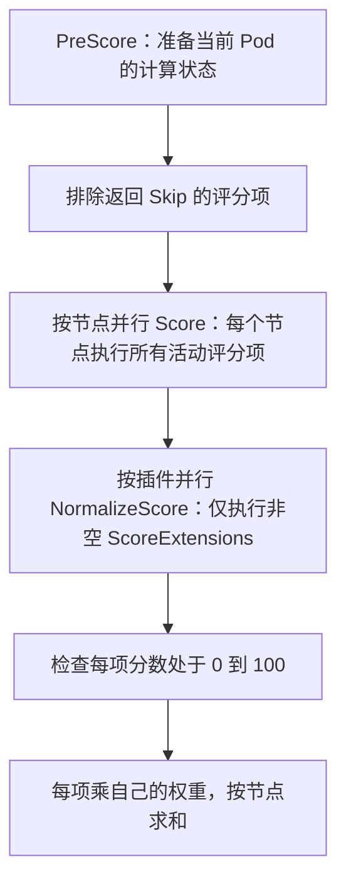

> 归档快照（2026-11-05）。本文保留原有阶段、基线和历史结论；其中的“当前”“完成”仅适用于原文对象。最终设计入口及证据边界见[归档说明](../../../../README.md)。本次仅迁移链接并添加此提示，未重新执行文中的命令。

# Volcano 上游主线：沿着三个 Pod 的打分过程读源码

本文用同一个 Job 的三个 Pod，串起配置、插件注册、节点过滤、评分、归一化、权重合并、预分配与 gang 提交。随后加入 `network-topology-aware`，分别追踪 hard、soft 配置下的 HyperNode 分层试排和评分。读完后，应当能区分“给 Pod 选择节点”和“给整个 SubJob 选择拓扑域”两种打分，以及它们怎样组成一次调度决定。

## 1. 源码基线与适用范围

| 项目 | 本文基线 |
| --- | --- |
| 上游仓库 | [volcano-sh/volcano](https://github.com/volcano-sh/volcano) |
| 分支 | `upstream/master`：核实时上游没有 `main` 分支，默认主线为 `master` |
| 固定提交 | [`e0905bab6fe49b5df2948edb001703c523525784`](https://github.com/volcano-sh/volcano/commit/e0905bab6fe49b5df2948edb001703c523525784) |
| 提交时间 | 2026-09-30 09:20:36 +08:00 |
| 核实日期 | 2026-10-04，Asia/Shanghai |
| Go / Kubernetes 依赖 | Go `1.26.0` / `k8s.io/kubernetes v1.36.1`，见 [go.mod][go-mod] |
| 本文方法 | 阅读固定提交及其匹配依赖，逐项计算示例；没有运行实际集群工作负载 |

第 2～17 节 Volcano 源码链接固定到上述提交，Kubernetes 实现链接固定到 `v1.36.1`。第 18 节单独比较 PR #5349 的固定 head，并分析 NodeAffinity 分数能否影响 HyperNode 选择。当前工作区仍可停留在其他分支，阅读时不要用其他分支的同名文件替代这些链接。

相对于基于旧分支的讲解，这份源码有三个影响导读的差异：

- `nodeorder` 的 LeastRequested、MostRequested、BalancedResource、NodeAffinity 已进入批量评分路径；单节点评分容器中只放 ImageLocality。
- Kubernetes 1.36.1 的 BalancedResource 使用加入 Pod 前后的均衡改善量。直接把“加入后均衡度”当作最终分数，会算错本例。
- 用户配置的 soft 拓扑会在 Session 初始化时转换为带最高层级的内部 hard 表达，复用 HyperNode 分层试排。不能把此版本的 soft 一概解释为“在全部节点上逐 Pod 加一点亲和分”。

第 2～11 节先讲没有拓扑策略的基础路径；第 12～14 节增加 HyperNode，给出 hard 同层选域与 soft 向上扩域的独立算例。各算例都从各自声明的初始状态开始，默认没有提名节点、调度分片干扰、抢占、资源释放等待或调度门控；Job 已通过入队检查，队列资源额度足够。

## 2. 固定一组可逐步复算的输入

### 2.1 Job、Pod 与节点

一个 Volcano Job 有 `p1、p2、p3` 三个 Pod，最低可运行数量为 3：Job 层通常表述为 `minAvailable=3`，调度器关联的 PodGroup 使用 `spec.minMember=3`。

每个 Pod 请求：

```yaml
resources:
  requests:
    cpu: "2"
    memory: 4Gi
```

本例假设任务队列依次弹出 `p1 → p2 → p3`。这不是承诺按 Pod 名称排序；实际顺序由任务比较函数决定。三个 Pod 没有亲和性、拓扑分布约束、PVC、DRA ResourceClaim、init container 或 Pod overhead；既有 Pod 也明确声明 CPU、内存 requests。

四个节点的 `Allocatable` 都是 **10 CPU、20 GiB**，初始资源账本如下：

| 节点 | 已占 CPU requests | 已占内存 requests | CPU / 内存占比 | 当前 Pod 不容忍的 `PreferNoSchedule` 污点数 |
| --- | ---: | ---: | --- | ---: |
| A | 6 CPU | 4 GiB | 60% / 20% | 1 |
| B | 6 CPU | 12 GiB | 60% / 60% | 0 |
| C | 1 CPU | 10 GiB | 10% / 50% | 2 |
| D | 9 CPU | 4 GiB | 90% / 20% | 0 |

节点都 Ready，Pod 数量额度和其他硬约束均满足。C 的两个软污点使用不同的 key；没有未容忍的 `NoSchedule` 或 `NoExecute` 污点。

这里的“占用”是 requests 和调度器预分配形成的账本，不是 CPU 使用率监控。资源分母使用 `Allocatable`，也不是机器的物理 `Capacity`。

### 2.2 教学用调度配置

以下是为逐分解释而设定的完整 scheduler 配置，不是上游默认配置。上游默认值可对照 [Helm scheduler 配置][helm-conf]。

```yaml
actions: "enqueue, allocate, backfill"
tiers:
- plugins:
  - name: priority
  - name: gang
- plugins:
  - name: drf
  - name: predicates
    enableNodeOrder: false
  - name: proportion
  - name: nodeorder
    arguments:
      leastrequested.weight: 1
      balancedresource.weight: 1
      tainttoleration.weight: 1
      mostrequested.weight: 0
      nodeaffinity.weight: 0
      podaffinity.weight: 0
      imagelocality.weight: 0
      podtopologyspread.weight: 0
  - name: binpack
    arguments:
      binpack.weight: 2
      binpack.cpu: 1
      binpack.memory: 1
  - name: network-topology-aware
    arguments:
      weight: 1
      hypernode.binpack.cpu: 1
      hypernode.binpack.memory: 1
      hypernode.binpack.normal-pod.enable: false
```

各插件在本例中的工作：

| 插件 | 主要职责 | 本例的节点分数贡献 |
| --- | --- | --- |
| `priority` | 参与 Job、Task 的优先级排序 | 无 |
| `gang` | 检查 Job/SubJob 的最低就绪数量，也参与排序等扩展点 | 无 |
| `drf` | 根据主导资源份额参与 Job 公平排序 | 无 |
| `proportion` | 队列排序、份额与资源可分配性检查 | 无 |
| `predicates` | 执行过滤，并维护 Kubernetes NodeInfo 等分配状态 | 本例显式禁用其评分扩展点 |
| `nodeorder` | 调用 Kubernetes 原生评分插件 | LeastRequested + BalancedResource + TaintToleration |
| `binpack` | 计算分配后的资源填充程度 | CPU/内存装箱分，整体权重为 2 |
| `network-topology-aware` | 生成 HyperNode 梯度、给拓扑域打分、给域内节点增加拓扑分 | 基础场景无拓扑策略且关闭普通 Pod 装箱，贡献为 0；第 12 节起展开 |

`hypernode.binpack.normal-pod.enable: false` 只关闭无拓扑策略 Pod 的多层装箱评分，不会关闭 hard/soft 拓扑 Pod 的节点亲和评分或 HyperNode 评分。这样第 2～11 节原有数字保持可独立复算。

不要把 `predicates` 理解为永远只能过滤：此上游版本也为它注册了 `BatchNodeOrderFn`，其中可以有 VolumeBinding、DynamicResources 评分。这里用 `enableNodeOrder: false` 明确排除这部分贡献；过滤与分配回调仍然保留。见 [predicates 的注册][predicates-open]、[评分插件初始化][predicates-init]。

同样，`nodeorder` 未写出的参数不等于 0。其默认权重依次包括 LeastRequested=1、MostRequested=0、BalancedResource=1、NodeAffinity=2、PodAffinity=2、TaintToleration=3、ImageLocality=1、PodTopologySpread=2。为了复算，本例明确写出所有八项。

## 3. 第一站：配置怎样变成可调用的函数

先读 [Scheduler.runOnce][run-once]，再读 [framework.OpenSession][open-session]：

```text
Scheduler.runOnce()
  → framework.OpenSession(cache, tiers, configurations, ...)
      → 从 cache 建立 Session
      → GenerateNodeMapAndSlice(ssn.Nodes)
      → 遍历配置中的插件
          → builder(plugin.Arguments)
          → plugin.OnSessionOpen(ssn)
  → 按顺序执行 enqueue、allocate、backfill
  → framework.CloseSession(ssn)
```

`OnSessionOpen` 是理解插件接入点的关键：插件把函数注册到 Session；action 通过 Session 调用它们。

| 注册方 | 注册动作 | 后续调用入口 |
| --- | --- | --- |
| `nodeorder.OnSessionOpen` | `AddNodeOrderFn` | `Session.NodeOrderMapFn` 中调用 |
| `nodeorder.OnSessionOpen` | `AddBatchNodeOrderFn` | `Session.BatchNodeOrderFn` 中调用 |
| `binpack.OnSessionOpen` | `AddNodeOrderFn` | `Session.NodeOrderMapFn` 中调用 |
| `predicates.OnSessionOpen` | Predicate、PrePredicate、事件回调和 BatchNodeOrder 等 | 本例调用过滤和事件回调，评分入口被配置关闭 |
| `network-topology-aware.OnSessionOpen` | BatchNodeOrder、HyperNodeOrder、Job/SubJob Gradient、分配事件回调 | 基础路径返回零拓扑贡献；拓扑路径见第 12～14 节 |

对应 [nodeorder 注册][nodeorder-open]、[binpack 注册][binpack-open]、[扩展点默认开关][defaults]。

这里存在两份相关节点视图：

- `ssn.Nodes`：Volcano 的 `api.NodeInfo`，包含 `Used`、`Idle`、`Allocatable` 等；binpack 直接读取它。
- `ssn.NodeMap`：Kubernetes `NodeInfo`，供 nodeorder 包装的 Kubernetes 插件使用。

后面预分配必须更新这两种视图，否则两个评分体系可能看到不一致的资源状态。

## 4. 第二站：先决定调度哪个 Pod，再决定给哪些节点打分

### 4.1 Queue、Job、Task 排序不是节点分数

入口为 [allocate.Execute / buildAllocateContext][allocate-entry]，普通 Job 随后进入 [allocateResourcesForQueues][allocate-queues] 和 [allocateResourcesForTasks][allocate-tasks]。

```text
buildAllocateContext
  Queue 优先队列：ssn.QueueOrderFn
  Job 优先队列：ssn.JobOrderFn
  Task 优先队列：ssn.TaskOrderFn

allocateResourcesForQueues
  取 Queue → 检查 Overused
  取 Job
  普通 Job → allocateResourcesForTasks
      取 Task → 检查 Allocatable(queue, task)
```

这层回答“谁先拿资源”。它没有把 priority、drf、proportion 转换成节点加分。

此版本会先处理带提名 HyperNode 的队列，再处理普通队列；本例只有普通路径。Queue/Job 比较函数通常按配置寻找第一个非零比较结果，而节点评分会累加启用插件的结果。不要把不同扩展点的 tier 语义混为一谈。见 [Job 比较][job-order]、[Queue 比较][queue-order]。

### 4.2 p1 先过滤掉 D

`allocateResourcesForTasks` 的核心顺序为：

```text
ssn.PrePredicateFn(task)
  → PredicateNodes(task, nodes, alloc.predicate, ...)
      → 资源检查：InitResreq <= node.FutureIdle()
      → ssn.PredicateForAllocateAction(task, node)
  → alloc.prioritizeNodes(ssn, task, predicateNodes)
```

`InitResreq` 用于可行性判断，需覆盖启动阶段资源需求；binpack 后面读取 `Resreq`。本例没有 init container 等差异，两者都是 2 CPU、4 GiB。

没有资源释放等待时，D 的可用 CPU 只有 `10 - 9 = 1`，小于 2，直接被资源检查过滤。A、B、C 都能容纳 p1。软污点只影响偏好，不在这里把 A、C 排除。源码位置：[资源检查][resource-predicate]。

### 4.3 通过过滤也未必被放到同一轮评分中

[prioritizeNodes][prioritize-nodes] 会依次尝试四个候选组：

1. 当前分片中，`Idle` 已足够的节点。
2. 其他分片中，`Idle` 已足够的节点，仅 soft sharding 有此组。
3. 当前分片中，只有 `FutureIdle` 足够的节点。
4. 其他分片中，只有 `FutureIdle` 足够的节点，仅 soft sharding 有此组。

前一组能选出节点，就不再比较后一组。本例 A、B、C 都在第一组。

每一组的处理也分三种：0 个候选继续；1 个候选直接选中；多于 1 个才调用 `PrioritizeNodes`。因此，“没有看到打分日志”不一定意味着插件失效。

大型集群还可能在找到足够多可行节点后停止过滤；“最高分”通常指本次进入评分的候选集合，而非穷举全体节点。见 [候选数量计算][feasible-count]。

## 5. 第三站：先看懂最终分数的三路合并

[util.PrioritizeNodes][prioritize-helper] 是贯穿本文的主入口。其逻辑可压缩为以下伪代码，省略错误处理、锁和指标：

```text
对候选节点并行执行：
    mapScores, orderScore = ssn.NodeOrderMapFn(task, node)
    pluginNodeScoreMap[plugin] 记录各插件的 map 分数列表
    nodeOrderScoreMap[node] = orderScore

reduceScores   = ssn.NodeOrderReduceFn(task, pluginNodeScoreMap)
batchNodeScore = ssn.BatchNodeOrderFn(task, candidateNodes)

对每个节点：
    finalScore = reduceScores[node]
               + nodeOrderScoreMap[node]
               + batchNodeScore[node]
    nodeScores[finalScore].append(node)
```

三个结果容器的含义：

| 容器 | 分数来源 | 本例内容 |
| --- | --- | --- |
| `nodeOrderScoreMap` | 所有启用的 `AddNodeOrderFn` 回调的和 | binpack；nodeorder 的直接分为 0 |
| `reduceScores` | `AddNodeMapFn` 产出，经 `AddNodeReduceFn` 处理后的和 | 没有这类贡献，为 0 |
| `batchNodeScore` | 所有启用的 `AddBatchNodeOrderFn` 回调的和 | 基础场景为 nodeorder 的三个子评分项，topology 贡献为 0 |

**`Session.NodeOrderMapFn` 并不只调用 `nodeMapFns`，它也会调用 `nodeOrderFns`。** 只根据名称寻找 `Session.NodeOrderFn`，容易错过 allocate 实际使用的调用链。见 [Session.NodeOrderMapFn][session-map]。

`NodeOrderReduceFn` 也不等于所有 Kubernetes 评分的 `NormalizeScore`。后者在 nodeorder 的批量路径内部完成，本例不经过 Volcano 的 map/reduce 扩展点。

框架没有在最后再乘一个统一的“插件权重”，也没有把最终总分再归一化到 100。各评分插件或评分适配器负责应用自己的权重。Map 插件输出会被 helper 转为取整后的整数列表；直接 NodeOrder 输出使用 `float64`，不能把两条路径的取整规则混用。

## 6. 第四站：binpack 给 p1 的每个候选节点多少分

打开 [BinPackingScore][binpack-score]，沿着这几个变量阅读：

```go
requested := task.Resreq
allocatable := node.Allocatable
used := node.Used
```

它遍历当前任务请求的资源，跳过请求为 0 或没有配置权重的资源，调用 `ResourceBinPackingScore`。可行时，每种资源的贡献为：

```text
resourceScore = (used + requested) × resourceWeight / allocatable
```

然后除以参与计算的资源权重总和，乘 `MaxNodeScore × binpack.weight`。在本版本 `MaxNodeScore=100`；源码附近仍有旧的“10(MaxPriority)”注释，读公式应以实际常量为准。

本例 CPU、内存内部权重都是 1。记加入当前 Pod 后的占比为 `c`、`m`：

```text
基础装箱分 = 100 × (c + m) / 2
最终 binpack 贡献 = 基础装箱分 × 2
```

| 节点 | 假设放入 p1 后 CPU | 假设放入 p1 后内存 | c / m | 基础分 | 最终贡献 |
| --- | --- | --- | --- | ---: | ---: |
| A | 8 / 10 CPU | 8 / 20 GiB | 0.8 / 0.4 | 60 | 120 |
| B | 8 / 10 CPU | 16 / 20 GiB | 0.8 / 0.8 | 80 | 160 |
| C | 3 / 10 CPU | 14 / 20 GiB | 0.3 / 0.7 | 50 | 100 |

此时没有向三个节点都添加 Pod；这是分别计算三种假设放置。只有最终选中的节点才会被预分配。

两层权重也不能混淆：`binpack.cpu`、`binpack.memory` 决定内部资源相对重要性；`binpack.weight` 放大最终贡献。默认 binpack 不会因为 Pod 请求了 GPU 就自动把 GPU 纳入评分，扩展资源还需配置到其资源权重表中。

## 7. 第五站：nodeorder 如何运行 Kubernetes 子插件

### 7.1 两个容器的内容以当前上游为准

读 [InitPlugin][nodeorder-init]，先确认评分项被放进哪个 map：

| 评分项 | 容器 / 执行路径 | 本例权重 |
| --- | --- | ---: |
| LeastRequested | `ScorePlugins` → `BatchNodeOrderFn` | 1 |
| MostRequested | 同上 | 0，未初始化 |
| BalancedResource | 同上 | 1 |
| NodeAffinity | 同上 | 0，未初始化 |
| InterPodAffinity | 同上 | 0，未初始化 |
| TaintToleration | 同上 | 1 |
| PodTopologySpread | 同上 | 0，未初始化 |
| ImageLocality | `NodeOrderScorePlugins` → `NodeOrderFn` | 0，未初始化 |

因此，本例 `nodeorder.NodeOrderFn` 返回 0。资源评分不是没执行，而是在稍后的批量阶段执行。这一点也被 [TestInitPlugin][nodeorder-tests-init] 明确验证。

### 7.2 BatchNodeOrderFn 传入的是实际候选节点的 NodeInfo

[BatchNodeOrderFn][nodeorder-batch] 先调用 `NodeInfosForCandidateNodes(nodes, nodeMap)`，从 Session 的 Kubernetes 节点视图中取出对应对象。

这里有两个边界：候选名称来自已过滤、已分组的节点集合；节点对象保留已有 Pod 和资源请求信息。代码不会为归一化重新扩大到整份集群快照，也不是临时构造只有 Node 标签、没有 Pod 资源信息的空 NodeInfo。

接下来把子插件转换成 `PreScorePluginEntry`、`ScorePluginEntry`，交给 [RunScorePlugins][run-score]。

### 7.3 RunScorePlugins 的五个阶段



按源码顺序逐步读：

1. `PreScore` 预计算当前 Pod 所需信息，例如资源请求、可容忍软污点。返回 `Skip` 时，按注册名跳过对应 Score；其他失败状态返回错误。
2. 构建 `activePlugins`，每项都有自己的节点分数数组。
3. 以节点为并行维度，最多 16 个 worker。每个 worker 对负责的节点执行所有活动子插件的 `Score`；这不是把三个待调度 Pod 同时放置。
4. 对有 `ScoreExtensions` 的子插件执行 `NormalizeScore`。归一化只处理该插件自己的整份候选分数列表，不会混入其他插件的分数。无扩展接口则直接保留 Score 结果。
5. 检查各项归一化后的分数范围，再乘权重、按节点累加。权重后可以大于 100。

批量阶段出现 PreScore、Score、NormalizeScore 失败或非法分数，会向上返回错误；本例假设全部成功。`nodeorder.ScorePlugins` 是 map，构造条目时的遍历顺序不保证固定，不应把日志行先后理解为评分项优先级。

## 8. 第六站：逐项计算 nodeorder 的分数

### 8.1 LeastRequested：比较加入 Pod 后剩余多少资源

Volcano 为 LeastRequested 创建 `NodeResourcesFit`，策略为 `LeastAllocated`，内部 CPU、内存权重都是 50。实际算法在 Kubernetes 的 [least_allocated.go][k8s-least]，资源输入在 [resource_allocation.go][k8s-resource]。

精确的整数计算为：

```text
cpuScore = floor(100 × (cpuAllocatable - cpuRequestedAfter) / cpuAllocatable)
memScore = floor(100 × (memAllocatable - memRequestedAfter) / memAllocatable)
L = floor((50 × cpuScore + 50 × memScore) / 100)
```

`requestedAfter` 已包含当前 Pod。忽略取整时，可写成 `100 × (1 - (c+m)/2)`。

| 节点 | CPU 剩余分 | 内存剩余分 | L | 外部权重后 |
| --- | ---: | ---: | ---: | ---: |
| A | 20 | 60 | 40 | 40 |
| B | 20 | 20 | 20 | 20 |
| C | 70 | 30 | 50 | 50 |

该项没有 NormalizeScore 扩展，不会因为 A、B、C 的相对最大值是 50 就把 C 再拉伸到 100。

在真实工作负载中，LeastRequested 使用的非零请求默认值，与 binpack 的 Volcano 资源账本可能有口径差异；本文通过所有 Pod 明确声明 requests 等前提，使这部分输入一致。

### 8.2 BalancedResource：此版本比较均衡改善量

这是最容易套用旧公式的地方。打开 Kubernetes 1.36.1 的 [balancedResourceScorer][k8s-balanced]，它分别计算加入 Pod 前、后的均衡度，再根据差值给分。

只有 CPU、内存参与时，定义中间值：

```text
H(c, m) = floor(100 × (1 - abs(c - m) / 2))

H_before = 加入 Pod 前的 H
H_after  = 加入 Pod 后的 H

R = 50 + floor((50 + H_after - H_before) / 2)
```

这对应源码中的 `scoreWithPod`、`scoreWithoutPod` 和最终整数运算。`H_after` 只是中间值，不能直接作为 `R`。

| 节点 | 加入前 c / m | H_before | 加入后 c / m | H_after | R |
| --- | --- | ---: | --- | ---: | ---: |
| A | 0.6 / 0.2 | 80 | 0.8 / 0.4 | 80 | **75** |
| B | 0.6 / 0.6 | 100 | 0.8 / 0.8 | 100 | **75** |
| C | 0.1 / 0.5 | 80 | 0.3 / 0.7 | 80 | **75** |

每个 Pod 增加 20 个百分点 CPU 和 20 个百分点内存占比，三个节点的均衡度都没有改善或恶化，所以都得到 75。B 的绝对均衡度更高，并不使它在这个版本的该评分项中额外领先。

用独立数值理解改善量：若 `H_before=80、H_after=100`，则 `R=85`；若 `H_before=80、H_after=70`，则 `R=70`。

Volcano 为此插件配置了 CPU、内存和 `nvidia.com/gpu` 三种资源。本例不请求 GPU，Kubernetes 资源计算会跳过该扩展资源，因此上面的二资源公式适用。多资源、资源缺失或不同请求口径应继续阅读依赖实现。

### 8.3 TaintToleration：原始计数先反向归一化

源码顺序是 [TaintToleration.Score / NormalizeScore][k8s-taint] → [DefaultNormalizeScore][k8s-normalize]。

`Score` 统计当前 Pod 不容忍的 `PreferNoSchedule` 污点数；原始值越小越好，不能直接当作高分优先的分数相加。

本次候选节点计数为 A=1、B=0、C=2，最大值为 2：

```text
T(node) = 100 - floor(100 × count(node) / maxCount)
```

| 节点 | 原始 count | 归一化后 T | 外部权重后 |
| --- | ---: | ---: | ---: |
| A | 1 | 50 | 50 |
| B | 0 | 100 | 100 |
| C | 2 | 0 | 0 |

如果所有候选节点的 count 都是 0，归一化结果全部为 100。本次最大值只从实际候选集合中求；被过滤或未进入当前候选组的节点不参与。

关闭 `nodeorder` 中的 `tainttoleration.weight` 只会关闭软偏好评分，不会关闭 `predicates` 对硬污点的过滤。

### 8.4 本例 nodeorder 批量返回值

三个评分项的外部权重都是 1：

```text
nodeorderBatch[A] = 40 + 75 +  50 = 165
nodeorderBatch[B] = 20 + 75 + 100 = 195
nodeorderBatch[C] = 50 + 75 +   0 = 125
```

`nodeorder.NodeOrderFn=0`，`nodeorder.BatchNodeOrderFn` 则返回这些非零值。两者都会进入最终评分，但不会对同一子评分项重复计算。

## 9. 第七站：合并 p1 总分，选中 B

把第 5 节的三个容器填满：

| 节点 | nodeOrderScoreMap：binpack | reduceScores | batchNodeScore：nodeorder | 最终分数 |
| --- | ---: | ---: | ---: | ---: |
| A | 120 | 0 | 165 | **285** |
| B | 160 | 0 | 195 | **355** |
| C | 100 | 0 | 125 | **225** |
| D | — | — | — | 被过滤，不参与 |

等价地：

```text
Final = LeastRequested × 1
      + BalancedResource × 1
      + TaintToleration × 1
      + Binpack基础分 × 2
```

`PrioritizeNodes` 的返回类型不是普通的“节点 → 分数”，而是 `map[float64][]*api.NodeInfo`，以分数为 key，把同分节点放在一起。本例逻辑内容为：

```text
285 → [A]
355 → [B]
225 → [C]
```

随后先调用 [Session.BestNodeFn][best-node]，给注册了该扩展点的插件选择机会。若没有插件返回节点，才调用 [SelectBestNodeAndScore][select-best]，选最高分；同分时在最高分节点列表中随机选择。

本例没有自定义 BestNode 回调，因此 **p1 选择 B，分数 355**。C 的 LeastRequested 最高，但不能抵消 B 的 binpack 和软污点优势。

## 10. 第八站：预分配怎样改变 p2、p3 的分数

### 10.1 p1 尚未运行，B 的资源账本已经变化

[allocateResourcesForTask][allocate-one] 调用 [Statement.Allocate][statement-allocate]：

```text
更新 task 的节点和 Allocated 状态
  → Volcano NodeInfo.AddTask：更新 Used / Idle 等资源状态
  → 调用 AllocateFunc 事件回调
      → predicates 更新 PodLister
      → Kubernetes NodeInfo.AddPodInfo
  → 把 Allocate 操作加入 Statement
```

因此 binpack 下一次读取 `ssn.Nodes[B]`，nodeorder 下一次读取 `ssn.NodeMap[B]`，都能看到 p1 的请求。回调位置见 [predicates.OnSessionOpen][predicates-open]。

只有评分结束、选中 B 后才执行这些操作。对一个 Pod 的候选节点并行打分，不等于同时把该 Pod 预分配到所有候选节点。

### 10.2 p2：B 的总分上升到 375

预分配 p1 后，B 占用 `8 CPU、16 GiB`；再放入 p2，恰好达到 `10 CPU、20 GiB`。

| 候选节点 | 放入 p2 后 c / m | Least | Balanced | Taint | Binpack × 2 | 总分 |
| --- | --- | ---: | ---: | ---: | ---: | ---: |
| A | 0.8 / 0.4 | 40 | 75 | 50 | 120 | **285** |
| B | 1.0 / 1.0 | 0 | 75 | 100 | 200 | **375** |
| C | 0.3 / 0.7 | 50 | 75 | 0 | 100 | **225** |

B 的均衡度从 100 到 100，没有改善量，Balanced 仍为 75。Least 从 20 降到 0，binpack 加权贡献从 160 增到 200，两者合计增加 20。**p2 继续选择 B。**

### 10.3 p3：B 先被过滤，A 胜出

预分配 p2 后，B 已无空闲 CPU、内存；p3 的 2 CPU、4 GiB 无法放入。D 仍只有 1 CPU 空闲。

本次只对 A、C 打分。其软污点最大计数仍是 C 的 2，所以 TaintToleration 分数不变：

| 候选节点 | Least | Balanced | Taint | Binpack × 2 | 总分 |
| --- | ---: | ---: | ---: | ---: | ---: |
| A | 40 | 75 | 50 | 120 | **285** |
| C | 50 | 75 | 0 | 100 | **225** |

**p3 选择 A。** 这不是 B 被打成低分，而是 B 已经失去本轮评分资格。

最终预分配：

```text
p1 → B
p2 → B
p3 → A

A：8 CPU、8 GiB
B：10 CPU、20 GiB
C：1 CPU、10 GiB
D：9 CPU、4 GiB
```

## 11. 第九站：gang 如何决定提交或回滚

普通 Job 也有默认 SubJob。没有显式 SubJob 策略时，[getOrCreateDefaultSubJob][default-subjob] 将 Job 的最低数量用于默认 SubJob 的大小，因此本例默认 SubJob 的最低数量也是 3。

`allocateResourcesForTasks` 每次预分配后检查 `ssn.SubJobReady(job, subJob)`。三次都成功后，返回 Statement；外层 `allocateResourcesForQueues` 再检查 `ssn.JobReady(job)`，通过后调用 `stmt.Commit()`。gang 的检查实现见 [gang.OnSessionOpen][gang-ready]。

[Statement.Commit][statement-commit] 遍历操作，对 Allocate 调用内部的 `allocate`；后者创建绑定上下文并交给 `cache.AddBindTask`，把任务状态推进到 Binding。**这是提交调度决定并进入绑定队列，不是保证三个容器同时启动。**

若最低数量无法满足：

- 能满足 `SubJobPipelined` 的等待条件时可以保留流水线安排，但外层只有 `JobReady` 才提交绑定。
- 本例没有释放中的资源，若第三个 Pod 无处可放而最低数量不足，会走 `Statement.Discard`，回滚该次尝试中的预分配。

这解释了 gang 与打分的分工：打分选取每个 Pod 的节点；gang 检查这一组是否达到了提交门槛。普通路径没有枚举三 Pod 的所有节点组合来求全局最优解。

## 12. 加入 topo-aware：先分清三种决策和两种评分

### 12.1 同一棵树，显式保留虚拟顶层

下文的 topo-aware 指 `network-topology-aware`。延用 A、B、C、D 四个 Kubernetes 节点，建立以下真实 HyperNode 树；各数值算例只调整资源账本，不调整这棵树：

```text
<cluster-top-hypernode>                 tier 4，Session 自动添加
└─ root                                tier 3，真实 HyperNode
   ├─ pair-a                           tier 2
   │  ├─ ha                            tier 1 → Kubernetes Node A
   │  └─ hb                            tier 1 → Kubernetes Node B
   └─ pair-b                           tier 2
      ├─ hc                            tier 1 → Kubernetes Node C
      └─ hd                            tier 1 → Kubernetes Node D
```

每个 tier 1 HyperNode 的成员是一个 Node；tier 2、tier 3 的成员是下一层 HyperNode。调度器通过 `RealNodesList/RealNodesSet` 解析其叶子节点，例如 `RealNodesList[pair-a]=[A,B]`。不需要把上层 HyperNode 的成员扁平化成 Node。

真实 `OpenSession` 会先执行 [addClusterTopHyperNode][topo-virtual-root]，把虚拟顶层加入 `HyperNodesSetByTier`，再排序生成 `HyperNodesTiers`。因此本例插件读到的是 **minTier=1、maxTier=4**。maxTier 不是最高真实层 3，也不是某个 Job 的 `highestTierAllowed=2`。忽略这一点会把节点 LCA 分数算错。

### 12.2 OnSessionOpen 注册了三个不同层面的决策

读 [network-topology-aware.OnSessionOpen][topo-open]：

| 层面 | 注册的扩展点 | 回答的问题 | 输出去向 |
| --- | --- | --- | --- |
| 候选域生成 | `AddHyperNodeGradientForJobFn`、`AddHyperNodeGradientForSubJobFn` | 允许在哪些域里尝试，按什么层级顺序尝试？ | 二维 HyperNode 梯度，不是数值分数 |
| Pod 节点评分 | `AddBatchNodeOrderFn` | 当前域内，当前 Pod 更接近已分配的同组 Pod 吗？ | 加到前文的 `batchNodeScore[node]` |
| SubJob 拓扑域评分 | `AddHyperNodeOrderFn` | 已经试排成功的候选域，哪个更适合整组 Pod？ | `PrioritizeHyperNodes`，独立于节点总分 |

源码中的开关也不同：节点批量评分受 `enableNodeOrder` 控制；拓扑域评分受 `enabledHyperNodeOrder` 控制；梯度受 `enabledHyperNodeGradient` 控制，后两项 YAML 名称确实带 `enabled`。本例沿用默认开启值。

梯度扩展点采用第一个启用且注册的回调结果；HyperNodeOrder 则会累计各个启用插件的域分数。不要把 tier 的统一配置格式理解成所有扩展点都有同样的组合语义。见 [梯度派发][topo-session-gradient]、[HyperNodeOrder 派发][topo-session-order]。

### 12.3 两种用户配置，在上游汇入同一条分层试排路径

PodGroup 的字段形态如下；示例显式写出 `minResources`，使 Job 级资源预筛选也按 6 CPU、12 GiB 计算：

```yaml
# hard 算例的 PodGroup.spec 片段
minMember: 3
minResources:
  cpu: "6"
  memory: 12Gi
networkTopology:
  mode: hard
  highestTierAllowed: 2
```

```yaml
# soft 算例的 PodGroup.spec 片段
minMember: 3
minResources:
  cpu: "6"
  memory: 12Gi
networkTopology:
  mode: soft
```

两者在真实 Session 中的入口为：

```text
openSession
  → addClusterTopHyperNode：本例得到 tier 4 虚拟顶层
  → adjustNetworkTopologySpec
      hard：保留用户的最高层级
      soft：转换调度器内部副本，最高层级改为允许扩展的上限
  → 插件 OnSessionOpen
  → allocateResourcesForQueues
      ContainsHardTopology() || ContainsSubJobPolicy()
        → allocateForJob
            → Job HyperNode 梯度
            → 在每个 Job 域中 allocateForSubJob
                → SubJob HyperNode 梯度
                → 在各域中逐 Pod 试排
                → HyperNodeOrder 选择成功的域
            → 汇总 SubJob 的域分数，选择 Job 域
```

转换发生在插件初始化前，修改的是调度器内部的拓扑副本，不是把用户 API 对象中的 soft 永久改写为 hard。普通 Job 的默认 SubJob 继承 Job 的拓扑配置，因此没有显式 subgroup 策略，也会走这条路径。见 [adjustNetworkTopologySpec / convertSoftToHardTopology][topo-convert]。

### 12.4 域内节点分：LCA 层级偏好加到已有节点总分上

[batchNodeOrderFnForNetworkAwarePods][topo-node-score] 读取 `task.JobAllocatedHyperNode`。这个字段由 action 在当前试排中填写，代表此前已选节点累积出的拓扑锚点。

首次试排时锚点为空，返回空分数表，即本插件的节点贡献为 0。已有锚点后，对候选 Node 找到其最低层 HyperNode，再计算与锚点的最近公共祖先 LCA：

```text
若候选叶 HyperNode == 已分配锚点：T_base = 1
否则：T_base = (maxTier - tier(LCA)) / (maxTier - minTier)

节点拓扑贡献 = 100 × weight × (T_base + 可选的同分补分)
节点最终总分 = 前文的节点总分 + 节点拓扑贡献
```

空锚点、找不到有效 LCA 返回 0；minTier=maxTier 时走单层特殊处理。见 [networkTopologyAwareScore / scoreHyperNodeWithTier][topo-lca-score]。

本例锚点为 `hb` 时：

| 候选 Node | 叶 HyperNode | 与 hb 的 LCA | T_base | weight=1 时的拓扑贡献 |
| --- | --- | --- | ---: | ---: |
| B | hb | hb，直接相同 | 1 | 100 |
| A | ha | pair-a，tier 2 | (4-2)/(4-1) | 66.6667 |
| C / D | hc / hd | root，tier 3 | (4-3)/(4-1) | 33.3333 |

只有 **T_base 最高的候选节点不止一个** 时，插件才对这些并列最高候选增加：`对应叶 HyperNode 内该 SubJob 的 task 数 / len(subJob.Tasks)`。计数根据 Task.NodeName 是否落在该域内，分母是整个 SubJob 的任务数；不是只对当前 Pending Pod 计数，也不是对所有候选普遍加分。

例如一个独立的四任务状态：已有 1 个任务在 A、2 个在 B，锚点为 pair-a，当前 A、B、C 都可行。A、B 的基础分同为 2/3，因此分别加 1/4、2/4；weight=1 时 A 得 91.6667，B 得 116.6667，C 仍为 33.3333。拓扑分可以超过 100，因为这里直接走 Volcano 批量回调，不经过 nodeorder 的 `RunScorePlugins` 范围检查。

### 12.5 HyperNode 分：根据整组请求计算域级装箱

[HyperNodeOrderFn][topo-domain-score] 调用 `getSubJobHyperNodeBinPackingScore`，对 `subJob.Tasks` 的资源请求求和。当前算例所有任务都 Pending，总请求 Q 为 6 CPU、12 GiB。

对候选域 H，本例 CPU、内存权重均为 1：

```text
H_binpack = ((UsedCPU(H) + Q_cpu) / AllocatableCPU(H)
           + (UsedMem(H) + Q_mem) / AllocatableMem(H)) / 2

HyperNodeScore(H) = 100 × weight × (H_binpack + 可选的同分补分)
```

某资源 `used + request > allocatable` 时，该域装箱分返回 0。只有基础装箱分并列最高的多个域，才按“域内已放置的本 SubJob task 数 / len(subJob.Tasks)”补分。算例在试排撤销后评分，没有既有已放置任务，补分为 0。

注意三个输入范围：

- `getSubJobHyperNodeBinPackingScore` 遍历全部 `subJob.Tasks`，不是只遍历 Pending；存在既有运行任务时，要逐项核对其请求和域 Used 的实际口径，不能直接套用本例的“全新三任务”数字。
- SubJob 梯度预筛选的 `GetMinResources` 累加 Pending 任务的 `InitResreq`。
- Job 梯度预筛选的 `GetMinResources` 读取 PodGroup 的 `spec.minResources`；缺失时返回空资源，不会自动按 `minMember × 单 Pod 请求` 推导。

这些是不同层的资源计算。见 [Job 最小资源][topo-job-resources]、[SubJob 最小资源][topo-subjob-resources]。

## 13. hard 分支：域内先试排，成功域再打分

### 13.1 为比较两个成功域，独立重置资源输入

沿用第 2 节节点容量、Pod 请求、软污点和评分权重，只把 D 的初始已占 CPU 从 9 改为 **8**。这是独立场景，不接着前文已经完成的分配继续算。策略是 `hard + highestTierAllowed=2`。

| 域 | 叶节点 | 聚合容量 CPU / 内存 | 初始 Used | 初始 Idle | 能否通过 6 CPU、12 GiB 的聚合预筛选 |
| --- | --- | --- | --- | --- | --- |
| ha / hb | 分别 A / B | 各 10 CPU / 20 GiB | 沿用节点值 | CPU 各剩 4 | 否，CPU 不足 |
| hc | C | 10 CPU / 20 GiB | 1 CPU / 10 GiB | 9 CPU / 10 GiB | 否，内存不足 |
| hd | D | 10 CPU / 20 GiB | 8 CPU / 4 GiB | 2 CPU / 16 GiB | 否，CPU 不足 |
| pair-a | A、B | 20 CPU / 40 GiB | 12 CPU / 16 GiB | 8 CPU / 24 GiB | 是 |
| pair-b | C、D | 20 CPU / 40 GiB | 9 CPU / 14 GiB | 11 CPU / 26 GiB | 是 |
| root / 虚拟顶层 | 全部节点 | 40 CPU / 80 GiB | — | — | 层级超过 2，不允许 |

[hyperNodeGradientFn][topo-gradient] 从允许搜索的根开始 BFS，经 `isEligibleHyperNode` 检查最高层级和域资源，再按 tier 升序组织梯度。本例返回的唯一有效层为：

```text
[[pair-a, pair-b]]       # 同层内部的枚举先后不保证固定
```

已有部分分配时，还会通过 `getSearchRoot` 将调用方允许的域与已分配锚点允许的最高祖先域求交；并非每次都重新无约束扫描整棵树。

### 13.2 allocateForJob 和 allocateForSubJob 的两层试排

读 [allocateForJob][topo-allocate-job] 和 [allocateForSubJob][topo-allocate-subjob]，不要跳过中间的 Statement 生命周期：

```text
对一个 Job 梯度中的每个候选域 H：
  复制任务工作表、清理试排相关 fit error
  对各 SubJob：
    生成限制在 H 子树内的 SubJob 梯度
    对同层候选子域 h：
      allocateResourcesForTasks(..., h)
      成功时 SaveOperations 保存方案
      Discard 撤销试排资源占用
    对成功子域执行 HyperNodeOrder，选中后 RecoverOperations
    返回子域方案和 HyperNode 分数
  汇总 SubJob 域分数并备份成功 Job 方案
  恢复 SubJob 状态，撤销该 Job 候选域的试排占用
在本层成功 Job 方案中选分数最高者，再 RecoverOperations
```

这里枚举的是拓扑域，并在域内沿用逐 Pod 的节点选择；没有枚举域内所有 Pod→Node 组合。第一次找到有成功方案的梯度后就选域返回，不会把低层与高层域分数放在一起做全局比较。

### 13.3 pair-a 内的节点选择

在 pair-a 中，候选范围仅为 A、B。TaintToleration 的候选最大计数从前文全局的 2 变成 1，因此 A 的软污点评分变成 0；B 仍为 100。

| Pod | 候选 | 原有四项总分 | topo-aware 节点贡献 | 最终节点分 / 行为 |
| --- | --- | ---: | ---: | --- |
| p1 | A / B | 235 / 355 | 0 / 0，锚点为空 | 235 / 355，选 B |
| p2 | A / B | 235 / 375 | 66.6667 / 100，锚点 hb | 301.6667 / 475，选 B |
| p3 | 仅 A | 不调用评分 | 不调用评分 | B 已满，单候选直接选 A |

成功方案为 `[B, B, A]`。本次循环中的锚点沿 `空 → hb → hb → pair-a` 更新。

这张表同时说明：拓扑域限制会间接改变其他插件的归一化输入；不能把第 9 节全局候选下 A 的 285 分直接搬进 pair-a。

### 13.4 pair-b 内的节点选择

pair-b 中只有 C、D：

| Pod | 候选 | 原有四项总分 | topo-aware 节点贡献 | 最终节点分 / 行为 |
| --- | --- | ---: | ---: | --- |
| p1 | C / D | 225 / 345 | 0 / 0 | 225 / 345，选 D |
| p2 | 仅 C | 不调用评分 | 不调用评分 | D CPU 已满，选 C |
| p3 | 仅 C | 不调用评分 | 不调用评分 | C 仍可容纳，选 C |

成功方案为 `[D, C, C]`，锚点沿 `空 → hd → pair-b → pair-b` 更新。两个域都完成三任务试排，因此都有资格产生域评分。

### 13.5 为什么最后是 pair-a 的 80 分胜出

调用链为：

```text
selectBestHyperNodeForSubJob
  → util.PrioritizeHyperNodes
    → Session.HyperNodeOrderMapFn
      → network-topology-aware.HyperNodeOrderFn
  → SelectBestHyperNodeAndScore

allocateForJob
  subJobsAllocationScore += 各 SubJob 返回的 HyperNode 分数
  → selectBestHyperNodeForJob
```

见 [子组选域][topo-select-subjob]、[域分数合并][topo-prioritize] 和 [Job 选域][topo-select-job]。

评分发生在该次 SubJob 试排撤销之后，域 Used 已回到试排前，再加入整组请求一次：

| Job 候选域 | 本例默认 SubJob 的成功域 | CPU 加入后占比 | 内存加入后占比 | HyperNode 分数 | Job 汇总分 |
| --- | --- | ---: | ---: | ---: | ---: |
| pair-a | pair-a | (12+6)/20 = 0.90 | (16+12)/40 = 0.70 | **80** | **80** |
| pair-b | pair-b | (9+6)/20 = 0.75 | (14+12)/40 = 0.65 | **70** | **70** |

本例外层每个 Job 候选域中，只有一个成功的 SubJob 候选域；内层分别返回 80 和 70，外层比较这两个汇总分。若一个外层域内存在多个成功的 SubJob 候选域，则先在内层比较它们的 HyperNode 分数。

**这里比较的是 80 与 70，不是把 B 的 355、475 等节点分累加成域分。** `allocateResourcesForTasks` 对节点最高分使用的是 `bestNode, _`；真正向外返回的 `allocationScore` 来自 HyperNodeOrder。

外层选 pair-a，恢复 `[B,B,A]`，满足 JobReady 后提交。节点分决定域内如何放；HyperNode 分决定采用哪份成功域方案。多个 SubJob 时 Job 层累计的是各 SubJob 返回的域分；本版本外层同分选择依赖 map 遍历且没有额外同分规则，不能承诺固定结果。

### 13.6 聚合资源通过，不等于域内一定可放下

把 D 改回第 2 节的 9 CPU 已占量，pair-b 聚合 Idle 仍有 10 CPU、26 GiB，通过 6 CPU、12 GiB 的预筛选。但 D 只剩 1 CPU，任何一个 Pod 都放不下；C 的 10 GiB 空闲内存只能放两个 4 GiB Pod。

pair-b 会试排失败并回滚，不能进入成功域评分集合。这是 `hyperNodeGradientFn` 资源预筛选与 `allocateResourcesForTasks` 真实逐 Pod 可行性检查的区别；提高该域评分权重不能弥补资源碎片。

## 14. soft 分支：允许扩大搜索上限，低层无解时向上扩域

### 14.1 soft 的内部转换规则

[convertSoftToHardTopology][topo-convert-soft] 的规则是：

- Job 级 `mode: soft`：内部改为 hard，最高允许层设为虚拟顶层，本例为 4。
- SubJob 级 soft：使用 Job 的有效最高层；若没有 Job 层级约束，则使用虚拟顶层。
- Job 已是 hard tier 2、SubJob 为 soft 时，SubJob 内部最高层仍是 2，不能借 soft 越过父 Job 的硬限制。

因此 soft 与 hard 的分支差异主要是**可扩展的最高层级**，后续都调用域梯度、逐域试排、HyperNodeOrder。Job 级 soft 也不会因为用户额外写了较低 highestTierAllowed 就把它保留为硬上限；本版本转换会用虚拟顶层重设该值。

默认策略仍先找最低的可成功梯度，不是把整个集群所有节点同时交给分数竞争。节点层的拓扑权重可以与 nodeorder、binpack 竞争，但不能推翻梯度层已经做出的搜索范围选择。

### 14.2 独立场景：只有跨 pair 才能放齐三个 Pod

仍使用相同的三 Pod 请求、四节点容量、污点和 HyperNode 树，资源状态重新设为：

| Node | 初始 Used | 初始 Idle | 能容纳几个本例 Pod |
| --- | --- | --- | ---: |
| A | 8 CPU / 16 GiB | 2 CPU / 4 GiB | 1 |
| B | 8 CPU / 16 GiB | 2 CPU / 4 GiB | 1 |
| C | 8 CPU / 16 GiB | 2 CPU / 4 GiB | 1 |
| D | 8 CPU / 17 GiB | 2 CPU / 3 GiB | 0 |

Job 的 minResources 仍为 6 CPU、12 GiB。tier 1 每域都不足；pair-a 只有 4 CPU、8 GiB 空闲，pair-b 只有 4 CPU、7 GiB 空闲，也都不足。root 和虚拟顶层各能看到全体节点的 8 CPU、15 GiB 空闲资源。

```text
hard + highestTierAllowed=2：没有合格梯度 → 本轮无法安排
soft → 内部最高层 4：[[root(tier 3)], [虚拟顶层(tier 4)]]
```

“向上扩域”可能在资源预筛选阶段就跳过低层，也可能是低层聚合通过但逐 Pod 试排失败后，才继续下一梯度。本例是前一种。若第 13 节的 tier 2 已有成功方案，soft 也会在 tier 2 停止，不会为了更高域分继续尝试 root。

### 14.3 root 域内的完整三轮选择

root 允许同时使用 A、B、C、D。D 因内存不足被过滤。

| Pod | 候选节点 | 原有四项总分 | topo-aware 节点贡献 | 结果 |
| --- | --- | --- | --- | --- |
| p1 | A / B / C | 325 / 375 / 275 | 0 / 0 / 0 | B 得 375，选 B |
| p2 | A / C | 325 / 275 | 66.6667 / 33.3333 | A 得 391.6667，高于 C 的 308.3333，选 A |
| p3 | 仅 C | 跳过评分 | 跳过评分 | 直接选 C |

p1 的基础分中 Least=0、Balanced=75、Binpack=200，Taint 分别为 50、100、0。p2 时 B 已满，锚点为 hb；A 与 hb 在 pair-a 汇合，C 与 hb 在 root 汇合，所以得到不同的 LCA 分。p3 时 pair-a 已无可行节点，soft 允许使用同一 root 中的 C。

锚点变化为 `空 → hb → pair-a → root`，最终方案 `[B,A,C]` 跨越两个 pair，但仍在一个 tier 3 root 下。

### 14.4 root 也有 HyperNode 分，但不会与已排除的低层域竞争

试排撤销后，root 初始 Used 为 32 CPU、65 GiB，容量为 40 CPU、80 GiB：

```text
CPU 装箱比 = (32+6)/40 = 0.95
内存装箱比 = (65+12)/80 = 0.9625
HyperNodeScore(root) = 100 × (0.95+0.9625)/2 = 95.625
```

默认 SubJob 返回 root 的 95.625 分，Job 层据此保留 root 方案，恢复操作并提交。由于 tier 3 已成功，tier 4 虚拟顶层不会再被试排或与 root 比分。

同一输入若使用 hard tier 2，不能因为 root 能拿 95.625 分就跨越硬约束。候选资格和成功试排在域评分之前。

### 14.5 试排回滚还要恢复 HyperNode 资源状态

`initHyperNodeResourceCache` 从各域的真实叶节点汇总容量、Used、Idle、FutureIdle。分配/撤销回调会对包含当前 Node 的所有 HyperNode 更新缓存中的 **Used**；例如分配到 B，要更新 hb、pair-a、root 和虚拟顶层。

因此每次 `Discard` 后再给域打分，不能把试排中临时加入的三 Pod 请求再重复计入 Used。后续 `RecoverOperations` 又会重放分配回调。SubJob 的 AllocatedHyperNode 另由 [Recorder][topo-recorder] 的快照恢复和最终决定记录管理。

这里不要误读成所有缓存字段都随事件重算：这些回调只增减缓存 Used；缓存 Idle/FutureIdle 是 Session 初始化时收集的预筛选数据。真正放置仍依赖实时更新的节点账本和 predicates。

### 14.6 不带 networkTopology 的 Pod 是第三条路径

插件还支持普通 Pod 的 HyperNode 多层装箱，由 `hypernode.binpack.normal-pod.enable` 控制，默认值为 true。本文显式设为 false，所以无拓扑策略的基础例子不增加这部分分数。

若开启，且正常关联到无拓扑策略的 SubJob，[batchNodeOrderFnForNormalPods][topo-normal-pod] 会对每个候选 Node 的各层所属域，按加入当前单个 Pod 后的域装箱比打分，再用层级衰减加权平均：

```text
tierWeight(t) = fading^(t-1)，默认 fading=0.8
普通 Pod 拓扑贡献 = 100 × weight × Σ(tierWeight × 该层域装箱比) / Σ(tierWeight)
```

本例真实 Session 的层级包含虚拟顶层，所以开启这条路径时要把 tier 4 也纳入。它不是“soft 策略的另一种写法”：无拓扑策略时不会因此触发整组 Pod 的 HyperNode 梯度搜索；它只改变普通节点选择的分数。

三条路径可对照为：

| 用户意图 | 内部安排路径 | 拓扑节点分 | 独立 HyperNode 分 |
| --- | --- | --- | --- |
| 无 networkTopology | 普通逐 Pod allocate | 可选的多层域装箱，本例关闭 | 通常不走 |
| hard | 最高层受限的分层域试排 | 域内 LCA 偏好及并列补分 | 对成功 SubJob 域评分 |
| soft | 内部转换后，允许扩到有效上限的分层域试排 | 同样是域内 LCA 偏好及并列补分 | 同样对成功 SubJob 域评分 |

## 15. 怎样对照日志检查每一层

以下是按源码与算例推导的预期值，不是实际采集的集群日志。第一张表对应第 2～11 节无拓扑策略的基础场景。日志中的节点列表和插件行顺序可能变化，浮点结果也可能带有尾数。

| 日志文本特征 | 级别 | p1 的预期含义 |
| --- | --- | --- |
| `Binpack score for Task ...` | V(4) | A=120，B=160，C=100，已经包含 binpack.weight |
| `Nodeorder Total Score ...` | V(4) | 本例各节点为 0，只是直接 NodeOrder 路径的小计 |
| `NodeResourcesFit_LeastAllocated Score ...` | V(4) | A=40，B=20，C=50 |
| `NodeResourcesBalancedAllocation Score ...` | V(4) | A=B=C=75 |
| `TaintToleration Score ...` | V(4) | A=50，B=100，C=0 |
| `Batch Total Score ...` | V(4) | nodeorder 批量小计 A=165，B=195，C=125 |
| `Prioritize nodeScoreMap ...` | V(5) | 最终总分 A=285，B=355，C=225 |
| `After allocated Task ...` | V(3) | Session 内预分配后的资源账本 |
| `Committing operations ...` | V(3) | Statement 开始提交 |

`RunScorePlugins` 输出的插件分数列表已经乘过权重；复算时不要再次乘。若其他插件也启用批量评分，要继续加上它们的贡献，不能把 nodeorder 的 `Batch Total Score` 当成框架最终总分。

`allocateResourcesForTask` 中的 `Binding Task ...` 日志出现在 `Statement.Allocate` 前，不能只凭这一行认定 API 绑定已经完成。

排查顺序建议是：确认实际配置与候选集合 → 看各项加权分 → 看批量小计和最终总分 → 看预分配后资源变化 → 看 gang 与提交。缺少最终评分日志时，先检查是否只剩一个候选、命中提名路径或尚未进入评分。

开启拓扑策略后，还要区分以下日志：

| 日志文本特征 | 级别 | 对应哪一层 |
| --- | --- | --- |
| `Converting job-level soft topology to hard mode` | V(3) | Session 转换，检查实际 maxTier |
| `Try to allocate resource for job in hyperNode` | V(3) | Job 候选域开始试排 |
| `Try to allocate resource for tasks in subJob` | V(3) | SubJob 候选域开始逐 Pod 试排 |
| `networkTopologyAware node score is` | V(4) | 本插件对候选 Node 的贡献，已经乘 100 和 weight |
| `networkTopologyAware hyperNode score is` | V(4) | 本插件对候选 HyperNode 的域分数 |
| `Prioritize hyperNode score map for subJob` | V(5) | 多个 HyperNodeOrder 插件合并后的域分数 |
| `Discarding operations ...` | V(3) | 可能是正常结束候选域试排，不必然意味着最终调度失败 |
| `Allocate subJob to hyperNode success` | V(3) | 子组选域决定及域分；外层仍可能继续试排其他 Job 域 |
| `Allocate job to hyperNode success` | V(3) | 外层 Job 选择完成，仍需经过 JobReady 与 Commit |

第 13 节应追踪两个候选域分别返回的 **80、70**；第 14 节应追踪转换后的最高层 4、root 的 **95.625** 以及 `[B,A,C]`。不要把这些值与节点 355、475、391.6667 等总分直接相加，也不要把试排期间的一次 `Allocate` 当作最终绑定。

## 16. 继续阅读时最有价值的几个问题

### 16.1 启用 NodeAffinity 后，Pod 里的 weight 在哪里用？

此上游版本 NodeAffinity 位于批量评分路径，会执行其 NormalizeScore。Pod 的 preferred terms 权重先影响原始匹配分，再按候选最大分归一化，最后乘 scheduler 配置中的 `nodeaffinity.weight`，这两种权重作用位置不同。见 [NodeAffinity][k8s-node-affinity]。

例如原始分 `[20, 10, 0]` 经此插件归一化得到 `[100, 50, 0]`，配置权重为 2 时贡献 `[200, 100, 0]`。候选集合改变也可能改变归一化结果。

### 16.2 LeastRequested 与 Binpack 会不会互相抵消？

当两者计算口径相同，CPU/内存内部等权，Pod 两种资源请求都非零，且两项外部权重均为 1 时，忽略取整有：

```text
Least = 100 × (1 - (c+m)/2)
Binpack = 100 × (c+m)/2
两者之和 = 100
```

因此把两个方向相反的偏好同时开启，不一定增强资源偏好。本例给 binpack 权重 2，合计才偏向填充程度更高的节点。真实工作负载要额外检查非零默认请求、扩展资源、init container 等口径差异。

### 16.3 “100 分”究竟在哪一层成立？

`RunScorePlugins` 检查每个子插件归一化后的整数分处于 0～100；乘权重后、多个评分项合并后可以超过 100。Volcano 的直接 NodeOrder 路径本身也不能被理解为统一受这个检查约束。binpack 直接返回的是包含其整体权重的浮点分数。

### 16.4 所有插件都能通过调权重影响节点选择吗？

不能。先确认它注册了什么扩展点。Job/Queue 比较、硬过滤、gang 就绪检查和 NodeOrder 是不同机制；硬过滤失败不能靠其他评分的高分弥补。节点计分扩展点的 tier 遍历累加，也不意味着所有扩展点都采用累加语义。

### 16.5 soft 是否意味着“拓扑只占最终节点总分的一项”？

在此上游版本不完整。soft 先转换为允许扩展上限的内部约束，再按梯度找域内可行方案；低层梯度已有成功解时，高层不会参加比分。节点 LCA 分只是这个流程中“域内放置”的一部分，HyperNodeOrder 还会在成功域之间单独做选择。

## 17. 源码阅读路线与本地定位

建议按以下顺序打开源码，始终带着 p1 的 A=285、B=355、C=225 三个结果往回核对：

| 顺序 | 文件 / 函数 | 要回答的问题 |
| --- | --- | --- |
| 1 | [scheduler.go / runOnce][run-once] | 一个 Session 在哪里开始，action 按什么顺序执行？ |
| 2 | [framework.go / OpenSession][open-session] | 插件何时构造、何时注册回调？ |
| 3 | [allocate.go / allocateResourcesForTasks][allocate-tasks] | 当前 Pod 从哪里取出，候选节点怎样产生？ |
| 4 | [allocate.go / prioritizeNodes][prioritize-nodes] | 哪些节点真的进入本次评分？ |
| 5 | [scheduler_helper.go / PrioritizeNodes][prioritize-helper] | 三路分数怎样合并？ |
| 6 | [session_plugins.go / NodeOrderMapFn][session-map] | NodeOrder 与 NodeMap 回调如何派发？ |
| 7 | [binpack.go / BinPackingScore][binpack-score] | 资源权重与插件权重在哪一层应用？ |
| 8 | [nodeorder.go / InitPlugin、BatchNodeOrderFn][nodeorder-init] | 各 Kubernetes 评分项走哪条路径？ |
| 9 | [score_helper.go / RunScorePlugins][run-score] | PreScore、Skip、Normalize、范围检查、加权的先后关系？ |
| 10 | [Kubernetes balanced_allocation.go][k8s-balanced] | 为什么本例 Balanced 都是 75？ |
| 11 | [statement.go / Allocate][statement-allocate] | 为什么 p2 已经看到 p1 的占用？ |
| 12 | [statement.go / Commit][statement-commit] | 何时进入绑定队列？ |
| 13 | [session.go / addClusterTopHyperNode][topo-virtual-root] | 虚拟顶层怎样影响 maxTier 与 LCA 分母？ |
| 14 | [session.go / adjustNetworkTopologySpec][topo-convert] | soft 配置怎样转成内部最高层约束？ |
| 15 | [network_topology_aware.go / OnSessionOpen][topo-open] | 节点分、域分、梯度分别注册到哪里？ |
| 16 | [hyperNodeGradientFn][topo-gradient] | 哪些域有资格被试排，层级顺序怎样确定？ |
| 17 | [allocateForJob / allocateForSubJob][topo-allocate-job] | 域试排何时备份、回滚、恢复？ |
| 18 | [batchNodeOrderFnForNetworkAwarePods][topo-node-score] | LCA 和已分配任务数如何贡献节点分？ |
| 19 | [HyperNodeOrderFn][topo-domain-score] | 整组资源请求怎样产生 80、70、95.625？ |
| 20 | [selectBestHyperNodeForSubJob][topo-select-subjob] | 域分怎样进入 Job 级汇总，而不是节点分累加？ |

不切换当前分支，也可以直接读取固定提交。以下命令从本工作区的 Volcano 仓库执行：

```bash
cd /Users/vanderchen/workspace/dev/volcano-workspace/volcano
git show e0905bab6fe49b5df2948edb001703c523525784:pkg/scheduler/plugins/nodeorder/nodeorder.go
git show e0905bab6fe49b5df2948edb001703c523525784:pkg/scheduler/plugins/util/nodescore/score_helper.go
git show e0905bab6fe49b5df2948edb001703c523525784:pkg/scheduler/actions/allocate/allocate.go
git show e0905bab6fe49b5df2948edb001703c523525784:pkg/scheduler/framework/session.go
git show e0905bab6fe49b5df2948edb001703c523525784:pkg/scheduler/plugins/network-topology-aware/network_topology_aware.go
```

配套测试适合继续阅读，但本文没有声称执行过这些包测试：

| 测试 | 导读用途 |
| --- | --- |
| [nodeorder.TestInitPlugin][nodeorder-tests-init] | 确认子插件进入直接评分还是批量评分容器 |
| [nodeorder.TestNodeOrderPlugin][nodeorder-tests] | 查看资源、亲和性等不同评分配置下的调度用例 |
| [nodescore.TestRunScorePlugins][score-tests] | 查看归一化、权重、Skip、错误和分数范围的验证 |
| [binpack.TestNode][binpack-tests] | 查看资源配置与 binpack 分数的测试数据 |
| [util.TestSelectBestNode][best-tests] | 查看最高分及同分节点选择的测试 |
| [framework.TestConvertSoftToHardTopology][topo-test-convert] | 查看 Job soft、SubJob soft 与父 Job hard 上限的组合 |
| [framework.TestAdjustNetworkTopologySpec_DoesNotMutatePodGroupSpec][topo-test-copy] | 确认转换针对内部副本 |
| [network-topology-aware.TestNetworkTopologyAwareNodeScore_Hard][topo-test-hard] | 查看空锚点、LCA、并列任务数和权重对节点分的影响 |
| [network-topology-aware.TestNetworkTopologyAwareNodeScore_Soft][topo-test-soft] | 查看底层拓扑节点计分；仍需结合真实 Session 转换理解入口 |
| [network-topology-aware.TestHyperNodeOrderFn][topo-test-domain] | 查看域级装箱与加权分数 |
| [network-topology-aware.TestHyperNodeGradientPreFiltering][topo-test-gradient] | 查看允许层级与聚合资源预筛选 |
| [allocate.TestHyperNodeBinpackWithNetWorkTopologies][topo-test-allocate] | 查看 action 域试排与 HyperNode 装箱的组合 |

第 2～17 节完成的核验范围是：固定上游提交及依赖版本；逐个检查调用入口和链接行号；按匹配版本公式复算基础三轮分数、hard 两域试排及 80/70 分、soft 扩域及 95.625 分，并检查单候选跳过评分和资源碎片反例。没有修改调度器实现，没有把教学分数当作实测日志，也没有进行镜像构建或 Kind 验证。

## 18. PR #5349：新增域级反亲和评分，以及 NodeAffinity 与选域的关系

### 18.1 比较的是哪两个版本

本节针对 [PR #5349：feat(scheduler): support PodGroup topology anti-affinity][pr5349]，按 **2026-10-05** 核实时的版本分析：

| 项目 | 固定版本 / 状态 |
| --- | --- |
| PR 基线 | `e0905bab6fe49b5df2948edb001703c523525784`，正好是前文的 upstream/master 基线 |
| PR head | [`3e46f519b3dcc97574ced41d43ddb6ef3052ecba`][pr5349-head]，来自 `wangyang0616/volcano:feature_podgroup_antiaffinity` |
| 核实时状态 | Open，尚未合并；本节新增能力不能视为已经进入前文主线 |
| 已实现范围 | 多插件 HyperNode 梯度组合；PodGroup required/preferred 反亲和；资源预筛选、放置状态和诊断的配套调整 |
| 范围边界 | 新插件需要显式启用；SubGroup 亲和/反亲和仍属后续设计；backfill 放置 BestEffort Pod 不执行这里的组拓扑过滤与评分 |

本节源码链接固定到 PR head。前面第 2～17 节继续解释基线实现，不用 PR 的新行为覆盖旧版本结论。

先给出与本次问题直接相关的结论：**PR 新增了可以直接改变 HyperNode 选择的 PodGroup 反亲和分，但没有把 NodeAffinity 等节点分数汇总为 HyperNode 分数。** 节点选择、可行性和资源状态与域选择存在联系；“节点方案有多符合偏好”这项数值仍没有向域评分传递。

### 18.2 沿评分流程看变化：哪些改了，哪些保持原样

| 环节 | 基线实现 | PR #5349 head | 对本文算例的影响 |
| --- | --- | --- | --- |
| 是否进入域级 allocate | hard 拓扑或 SubJob policy | `RequiresHyperNodeAllocate` 还包含 required/preferred PodGroup 反亲和 | 只有 preferred 反亲和，也能进入选域 |
| Job/SubJob 梯度派发 | 首个启用且已注册插件决定结果 | 所有启用的梯度回调参与，受约束结果按域名求交集 | networkTopology 与组反亲和共同限制候选 |
| 无约束结果 | 没有显式三态契约 | 区分 Unconstrained、候选集合、拒绝 | preferred-only 不应误把候选集清空 |
| allocate 最小资源检查 | topo-aware 使用 Session 初始缓存的 Idle/FutureIdle | 梯度求交后，由 allocate 汇总当前节点 Idle/FutureIdle | 资源检查与拓扑约束解耦，能看到之前试排保留的资源变化 |
| SubJob 最小资源 | 累加全部 Pending 的 InitResreq | 按距离 MinAvailable 还差的任务数，计算各资源维度的保守下界 | 本例三任务全部必需，仍是 6 CPU、12 GiB |
| topo-aware 节点 LCA 分、域装箱分 | 第 12 节公式 | 公式保持不变 | 不加新反亲和规则时，本例域分仍为 80 / 70 |
| HyperNode 评分来源 | 本例只有 network-topology-aware | 可再叠加 group-topology-affinity | 新反亲和分可以反转两个成功域的排名 |
| NodeAffinity → HyperNode 分数传递 | 没有直接传递 | 仍没有 | 单纯提高 nodeaffinity.weight 不会给域加分 |

入口见 [RequiresHyperNodeAllocate][pr5349-entry]；评分插件的注册见 [group-topology-affinity.OnSessionOpen][pr5349-register]。新插件注册的是域梯度、提名候选校验和 HyperNodeOrder，**没有注册 NodeOrder 或 BatchNodeOrder**。

### 18.3 打分之前：梯度先组合，再检查资源

第 12.2 节的“首个回调生效”在 PR 中被替换。新的 [HyperNodeGradientResult][pr5349-gradient-type] 有明确的三种结果：

| 插件返回 | 含义 | Framework 处理 |
| --- | --- | --- |
| `Unconstrained: true`，Gradients 为空 | 不进一步限制输入子树 | 不参与交集 |
| `Unconstrained: false`，有候选 | 只允许这些 HyperNode | 与其他受约束插件的候选按名字求交 |
| 零值或空候选，Unconstrained 为 false | 没有合法候选 | 拒绝，不能当成“插件不管” |

所有已注册回调都返回 Unconstrained 时，Framework 才展开输入子树并按 tier 重建梯度，让 preferred-only 规则有候选可评分；完全没有启用的已注册梯度回调时，保留只返回输入 root 的兼容行为。若同时返回 Unconstrained 和非空候选，按契约错误处理为拒绝。见 [resolveHyperNodeGradients / intersectHyperNodeGradients][pr5349-gradients]。

仍以 hard tier 2 为例，若有一个匹配的既有 PodGroup 占据 pair-a，新增 required 反亲和要求在 tier 2 隔离：

```text
network-topology-aware 允许：
  tier 1: ha, hb, hc, hd
  tier 2: pair-a, pair-b

group-topology-affinity 允许：
  tier 1: hc, hd
  tier 2: pair-b

按 HyperNode 名字求交：
  [[hc, hd], [pair-b]]

allocate 再检查 6 CPU、12 GiB 最小资源：
  hc / hd 各自不足 → [[pair-b]]

pair-b 域内逐 Pod 试排成功后，才调用 HyperNodeOrder
```

required 规则检查的是候选域在指定 tier 的自身或祖先。找不到该层祖先，或祖先属于匹配 peer 的占用域，就拒绝该候选。候选被剔除后，分数再高也不会把它带回来。见 [satisfiesAntiAffinity][pr5349-required]。

资源预筛选搬到了 [allocate.FilterGradientsByMinResource][pr5349-resources]：按 `RealNodesSet[H]` 汇总当前 `node.Idle` 和 `node.FutureIdle()`，任一资源向量足够即可保留。已有分配锚点时跳过该预筛选；节点成员数据不可用时也保守保留，最终仍由逐 Pod 试排判断。topo-aware 不再缓存 Idle/FutureIdle；其 Used 缓存继续服务装箱评分。`PurposeEvict` 仍保留总 Allocatable 检查，这与 allocate 的空闲资源判断不同。

另外，[SubJob.GetMinResources][pr5349-minresources] 现在按尚需任务数计算下界。例如 MinAvailable=1，两个 Pending 任务分别请求 `1 CPU / 8 GiB`、`8 CPU / 1 GiB`，预筛选下界为 `1 CPU / 1 GiB`。这个向量不对应任何一个真实任务，因此只能用于提前排除，不能证明可放置。**此修改没有同步把 HyperNode 装箱公式改成只计算这部分任务；装箱评分仍遍历全部 subJob.Tasks。**

### 18.4 新增的 HyperNode 反亲和分怎样计算

[constraintsFor][pr5349-constraints] 先根据 PodGroup 标签和 namespace 条件找到其他匹配 Job，排除自己，再计算它们在规则 tier 上的实际占用域。未指定 namespaceSelector 时匹配当前 namespace；`namespaceSelector: {}` 表示所有 namespace。

对某候选 HyperNode H，令：

- `Wg` 为新插件配置中的 `arguments.weight`，默认 1。
- `wt` 为 preferred 规则自身的 weight，合法值为 1～100。
- `It(H)` 表示 H 在规则 t 指定层的祖先是否落入该规则匹配 peer 的占用集合；冲突取 1，否则取 0。

[hyperNodeOrderFn][pr5349-score] 的实际公式为：

```text
G(H) = 100 × Wg × max(0, 1 - Σt(It(H) × wt / 100))

SubJob 域总分(H) =
    network-topology-aware 的装箱与补分
  + group-topology-affinity 的 G(H)
  + 其他已启用 HyperNodeOrder 插件的域贡献
```

它不是“冲突 Pod 数越多扣得越多”：**同一条规则只判断占用集合是否命中，命中一次扣一次规则权重**。两条冲突规则权重为 80、60 时，先得到 1−0.8−0.6，再截断为 0，不返回负分。

几个影响复算的细节：

- 没有 preferred 规则时，新插件返回 nil 分数表，贡献为 0；不是给所有域统一加 100。
- 有 preferred 规则但没有冲突时，该候选得 `100 × Wg`。
- 当前实现找不到候选在规则 tier 的祖先时，preferred 不扣分；required 则拒绝。因此不能把 preferred 解释成对更粗域的所有后代做冲突惩罚。
- 不存在的 topologyTierName 会使规则编译报错；数字 tier 不存在时可能体现为“找不到祖先”，遵循上一条。
- 这里没有类似 NodeAffinity 的候选最大值归一化。插件自己乘 100 和 Wg，Framework 直接累加。

域贡献经过 [Session.HyperNodeOrderMapFn][pr5349-domain-dispatch] 和前文的 [PrioritizeHyperNodes][topo-prioritize] 合并。后者没有改成收集节点分数。

### 18.5 用原来的 80 / 70 算例，观察 PR 怎样反转选域结果

从第 13 节的初始状态重新开始，保持 hard tier 2、三个 Pod 各请求 2 CPU / 4 GiB，以及两个域都可成功试排的条件。

新增一个与当前 Job 同 namespace 的 peer PodGroup，带标签 `workload-class: latency-sensitive`，其已放置任务位于 A，故在 tier 2 占据 pair-a。**该 peer 的资源已包含在第 13 节 A 的初始 Used 中，不额外增加资源占用。**

在第 2.2 节 scheduler 配置的同一插件层中追加：

```yaml
- name: group-topology-affinity
  arguments:
    weight: 1
```

在当前 Job 关联 PodGroup 的 spec 中，保留原有 minMember、minResources 和 networkTopology，新增：

```yaml
topologyAffinity:
  podGroupAntiAffinity:
    preferred:
    - topologyTier: 2
      weight: 30
      podGroupSelector:
        matchLabels:
          workload-class: latency-sensitive
```

两条域内试排依然得到 `pair-a → [B,B,A]`、`pair-b → [D,C,C]`；变化出现在成功域的评分：

| 候选域 | topo-aware 域装箱分 | 是否命中该 preferred 规则 | 新插件域分 | SubJob / 本例 Job 总分 |
| --- | ---: | --- | ---: | ---: |
| pair-a | 80 | 是 | 100 × (1−30/100) = 70 | **150** |
| pair-b | 70 | 否 | 100 | **170** |

所以这次选择 **pair-b，恢复 [D,C,C] 并提交**。不带这条 preferred 规则时，新插件贡献为 0，仍比较 80 / 70 并选择 pair-a。

这里变化的是 HyperNode 的专用评分。三次节点选择中没有新增 group-topology-affinity 节点分。

如果规则 weight 改为 10，两域均为 170，外层 Job 同分选择不能保证固定结果；如果改为 required，并去掉 weight 字段，pair-a 会直接被过滤，不再参与评分。不要用 preferred 权重模拟必须满足的约束。

这个结果也能用分差复核：在两个插件整体权重均为 1 时，pair-a 的装箱优势为 10，新规则使它相对 pair-b 少得 30，最终落后 20。提高新插件 arguments.weight 会放大这个域级分差，和调整 nodeorder 的 nodeaffinity.weight 是两回事。

### 18.6 回到核心问题：节点分有没有传给 HyperNode 分？

**在本文基线与该 PR head 的常规 allocate 试排路径中，都没有把 NodeAffinity 等节点评分汇总到 HyperNode 评分。**

第一处证据在 [allocateResourcesForTasks][pr5349-node-discard]：

```go
bestNode, _ := alloc.prioritizeNodes(ssn, task, predicateNodes)
```

`prioritizeNodes` 返回选中的 Node 和节点分，调用方只使用 Node。保存的 Statement 记录分配、Pipeline 等操作，也不保存节点评分质量。

第二处证据在 [selectBestHyperNodeForSubJob][pr5349-select-subjob]：它从成功 Statement 的 map key 取出候选域，构造 `HyperNode → 域内 NodeInfo 列表`，然后调用 `PrioritizeHyperNodes`。输入没有“本次试排每个任务选择了哪个节点、该节点各插件得了几分”的评分记录。

第三处证据是两个域评分插件的具体内容：

| 域评分插件 | 读取的评分依据 | 是否读取 NodeAffinity 分 |
| --- | --- | --- |
| network-topology-aware | 域 Used / Allocatable、SubJob 全部请求、同分时已放置任务比例 | 否 |
| group-topology-affinity | preferred 规则、规则权重、匹配 peer 在比较 tier 的占用域 | 否 |

随后 `allocateForSubJob` 返回的是这些域插件合成的 `bestScore`；`allocateForJob` 累加各 SubJob 的 allocationScore。见 [Job 汇总位置][pr5349-job-sum]。其关系可以画成：

```text
NodeAffinity + LeastRequested + Balanced + Binpack + topo 节点分
  → 本次 Pod 的 bestNode
  → 更新分配状态、继续试排
  → 判断这个候选域是否能形成成功方案
                 │
                 └─ 没有传递 nodeScore 的数值
                     ↓
topo-aware 域装箱分 + group-topology-affinity 域反亲和分
  → SubJob 的 bestHyperNode / bestScore
  → Job 累加各 SubJob 域分后选域
```

因此，`HyperNodeOrder` 接口虽然能拿到域内节点对象，自定义插件也可以自行读取标签计算策略，但**现有这些插件不会自动复用 nodeorder 的 NodeAffinity 分数**。

### 18.7 NodeAffinity 反例：整个组都偏好 pair-b，仍选 pair-a

重新使用第 13 节 hard 算例，不叠加第 18.5 节的组反亲和规则。基线和 PR head 都可以用于这个反例。

给 C、D 添加节点标签 `example.com/storage: fast`，A、B 不带该标签；把 scheduler 的 `nodeaffinity.weight` 从 0 改为 1。三个 Pod 都增加：

```yaml
affinity:
  nodeAffinity:
    preferredDuringSchedulingIgnoredDuringExecution:
    - weight: 100
      preference:
        matchExpressions:
        - key: example.com/storage
          operator: In
          values: ["fast"]
```

这是一条软偏好，因此 A、B 仍能通过 NodeAffinity 的硬过滤。C、D 的原始匹配分都是 100，A、B 都是 0。经过各域当前候选集合内的 NormalizeScore，p1 的 NodeAffinity 贡献如下：

| p1 试排域 | 候选节点 | 原有节点总分 | 新增 NodeAffinity 分 | 新节点总分 | 本次选点 |
| --- | --- | --- | --- | --- | --- |
| pair-a | A / B | 235 / 355 | 0 / 0 | 235 / 355 | B |
| pair-b | C / D | 225 / 345 | 100 / 100 | 325 / 445 | D |

后续还是分别得到 `[B,B,A]` 和 `[D,C,C]`。单候选轮次仍跳过评分；下表的“匹配数量”是按最终方案检查标签得到的，并非调度器实际累计的 NodeAffinity 分：

| 候选方案 | 匹配 fast 偏好的 Pod 数 | HyperNode 分 | 实际外层选择 |
| --- | ---: | ---: | --- |
| pair-a 的 [B,B,A] | 0 / 3 | **80** | **选中** |
| pair-b 的 [D,C,C] | 3 / 3 | 70 | 未选中 |

这正是所担心的情况：**nodeorder 已正确计算 NodeAffinity，但这份偏好只参与域内选点，没有参与成功域之间的质量比较。** 本例中，即使把 nodeaffinity.weight 大幅提高，pair-b 内所有节点同加一份分，域内方案保持不变；域评分仍是 80 / 70，最终仍选择 pair-a。

若同时使用第 18.5 节的组反亲和规则，pair-b 会以 170 对 150 胜出，但原因是新增域反亲和分，不能据此认为 NodeAffinity 已联动到域评分。

### 18.8 “数值没有联动”不等于“两个层面完全独立”

需要区分直接评分与以下间接影响：

| 机制 | 能怎样影响 HyperNode 选择 |
| --- | --- |
| required NodeAffinity / nodeSelector | 不满足的节点被过滤；若域内无法放齐任务，该域试排失败，不能进入成功域评分集合 |
| preferred NodeAffinity 改变域内贪心放置 | 可能改变后续任务的剩余资源和可行节点，进而影响该域是否试排成功 |
| 已选节点形成拓扑锚点 | 影响后续 Pod 的 LCA 分，以及后续重试允许的域范围 |
| PR 的 peer 占用跟踪 | 实际 NodeName 会影响其他 Job 在规则 tier 看到的占用域，进而改变反亲和约束或评分 |

PR 的 [OccupiedHyperNodes][pr5349-occupancy] 从当前任务放置解析 peer 占用；[constraintsFor][pr5349-constraints] 缓存的是规则和 peer 选择，不把占用集合长期固定在首次评估结果。配合 [试排放置状态恢复][pr5349-placement]，后续评估能看到保留的临时放置，失败试排也不应残留锚点。

但在第 18.7 节“两域都成功、请求相同、没有额外域策略”的前提下，这些间接机制不会把 0/3 与 3/3 的 NodeAffinity 偏好差异变成域分差。这属于跨域优化目标缺失，而不是 NodeAffinity 的节点 Score 没有执行；preferred 本身也不保证最终必须满足。

### 18.9 如果要让节点偏好影响选域，需要补哪一层

以下是基于代码的设计分析，不是 PR #5349 已实现的功能，也没有在本文中修改调度器代码。

一个可讨论的目标是，在**同一成功梯度、满足所有硬约束**的候选方案间比较：

```text
候选方案总分(H) =
    α × 现有 HyperNode 插件域分
  + β × 本次试排方案的节点偏好质量
```

重点不只是把 `bestNode, _` 改成接收变量，还要定义和保存可比较的方案质量：

1. **保存什么。** 在试排时记录每个已选任务/节点的分项评分，连同候选方案保留；不能等 Discard 后再从已回滚的任务状态推断本次方案。只想联动 NodeAffinity 时，可以只记录这一项，避免把资源装箱在节点和域两个层面重复计权。
2. **如何聚合。** Pod 分数求和、平均值或最差 Pod 分数表达不同目标。MinAvailable 小于总任务数时，不同方案可能放置不同任务集合，不能用更多 Pod 自然带来的高总分掩盖质量差异。
3. **统一比较尺度。** NodeAffinity 当前在每次传入的候选节点集合内归一化。若域 X 的原始分为 [10,20]、域 Y 为 [50,100]，两边归一化都得到 [50,100]；直接比较各域最佳节点的 100 分会丢失绝对匹配差别。需明确统一参照集合或使用有定义的原始分尺度。
4. **覆盖没有节点分的路径。** 单候选直接选点、BestNodeFn 直接选点，以及提名恢复路径，不一定产生可用的最高节点分。不能把默认 0 当成“偏好很差”。
5. **保留层级语义。** 只在当前成功梯度内比较，仍保持低层优先；若想用节点偏好换取更高层的域，则还需要改变跨梯度搜索目标。仅加域分权重不会触发对已跳过高层域的比较。

若需求只是“某类节点标签应当影响域选择”，也可以设计专门的 HyperNodeOrder 插件，为域计算标签偏好。但“域里存在一个好节点”不代表整组三个 Pod 都能落到好节点上；基于真实试排方案评分更能表达整组最终得到的偏好满足程度。

因此，对当前实现的准确判断是：**已有分层可行性和状态联动，尚无通用的 NodeScore → HyperNodeScore 质量汇总；PR #5349 增加了一种原生域评分，没有补上这条通路。**

### 18.10 新章节的源码阅读顺序与核验边界

| 顺序 | PR head 源码 / 测试 | 对应问题 |
| --- | --- | --- |
| 1 | [JobInfo.RequiresHyperNodeAllocate][pr5349-entry] | 为什么 preferred-only 也进入域级 allocate？ |
| 2 | [HyperNodeGradientResult][pr5349-gradient-type]、[梯度组合][pr5349-gradients] | 多插件怎样共同限定候选，空结果是什么意思？ |
| 3 | [FilterGradientsByMinResource][pr5349-resources]、[SubJob.GetMinResources][pr5349-minresources] | 最小资源检查移到了哪里，资源下界如何变化？ |
| 4 | [新插件 OnSessionOpen][pr5349-register]、[required 检查][pr5349-required] | 哪些约束过滤域，哪些扩展点贡献分数？ |
| 5 | [preferred 域评分][pr5349-score]、[实时 peer 占用][pr5349-occupancy] | 30 分惩罚来自哪里，冲突数如何计数？ |
| 6 | [bestNode 分数被忽略的位置][pr5349-node-discard]、[SubJob 选域][pr5349-select-subjob] | 节点质量在哪个边界没有继续传递？ |
| 7 | [TestHyperNodeGradientThreeStates][pr5349-test-states] | 无约束、受约束与拒绝的组合 |
| 8 | [TestHyperNodeOrderFn][pr5349-test-score]、[TestPreferredOnlyUsesFrameworkCandidates][pr5349-test-preferred] | 新插件分数及 preferred-only 候选生成 |
| 9 | [TestCompiledTermsObserveLivePlacement][pr5349-test-live]、[试排恢复测试][pr5349-test-rollback] | peer 占用是否随试排变化，候选间状态是否隔离 |

核验方法：读取 PR 元数据、完整变更列表和固定 head 源码，与本文基线作比较；确认 NodeOrder、HyperNodeOrder 的调用和分数返回路径；复算 150/170、170/170 及 NodeAffinity 反例；核对新增固定提交链接。以上是源码导读与公式推演，没有执行这些 Go 测试或实际 Kind 工作负载。

[go-mod]: https://github.com/volcano-sh/volcano/blob/e0905bab6fe49b5df2948edb001703c523525784/go.mod#L3
[helm-conf]: https://github.com/volcano-sh/volcano/blob/e0905bab6fe49b5df2948edb001703c523525784/installer/helm/chart/volcano/config/volcano-scheduler.conf#L1
[run-once]: https://github.com/volcano-sh/volcano/blob/e0905bab6fe49b5df2948edb001703c523525784/pkg/scheduler/scheduler.go#L138
[open-session]: https://github.com/volcano-sh/volcano/blob/e0905bab6fe49b5df2948edb001703c523525784/pkg/scheduler/framework/framework.go#L59
[defaults]: https://github.com/volcano-sh/volcano/blob/e0905bab6fe49b5df2948edb001703c523525784/pkg/scheduler/plugins/defaults.go#L29
[nodeorder-open]: https://github.com/volcano-sh/volcano/blob/e0905bab6fe49b5df2948edb001703c523525784/pkg/scheduler/plugins/nodeorder/nodeorder.go#L180
[nodeorder-init]: https://github.com/volcano-sh/volcano/blob/e0905bab6fe49b5df2948edb001703c523525784/pkg/scheduler/plugins/nodeorder/nodeorder.go#L202
[nodeorder-batch]: https://github.com/volcano-sh/volcano/blob/e0905bab6fe49b5df2948edb001703c523525784/pkg/scheduler/plugins/nodeorder/nodeorder.go#L364
[binpack-open]: https://github.com/volcano-sh/volcano/blob/e0905bab6fe49b5df2948edb001703c523525784/pkg/scheduler/plugins/binpack/binpack.go#L164
[binpack-score]: https://github.com/volcano-sh/volcano/blob/e0905bab6fe49b5df2948edb001703c523525784/pkg/scheduler/plugins/binpack/binpack.go#L206
[predicates-open]: https://github.com/volcano-sh/volcano/blob/e0905bab6fe49b5df2948edb001703c523525784/pkg/scheduler/plugins/predicates/predicates.go#L195
[predicates-init]: https://github.com/volcano-sh/volcano/blob/e0905bab6fe49b5df2948edb001703c523525784/pkg/scheduler/plugins/predicates/predicates.go#L631
[allocate-entry]: https://github.com/volcano-sh/volcano/blob/e0905bab6fe49b5df2948edb001703c523525784/pkg/scheduler/actions/allocate/allocate.go#L138
[allocate-queues]: https://github.com/volcano-sh/volcano/blob/e0905bab6fe49b5df2948edb001703c523525784/pkg/scheduler/actions/allocate/allocate.go#L354
[allocate-tasks]: https://github.com/volcano-sh/volcano/blob/e0905bab6fe49b5df2948edb001703c523525784/pkg/scheduler/actions/allocate/allocate.go#L864
[prioritize-nodes]: https://github.com/volcano-sh/volcano/blob/e0905bab6fe49b5df2948edb001703c523525784/pkg/scheduler/actions/allocate/allocate.go#L1039
[allocate-one]: https://github.com/volcano-sh/volcano/blob/e0905bab6fe49b5df2948edb001703c523525784/pkg/scheduler/actions/allocate/allocate.go#L1110
[resource-predicate]: https://github.com/volcano-sh/volcano/blob/e0905bab6fe49b5df2948edb001703c523525784/pkg/scheduler/actions/allocate/allocate.go#L1142
[feasible-count]: https://github.com/volcano-sh/volcano/blob/e0905bab6fe49b5df2948edb001703c523525784/pkg/scheduler/util/scheduler_helper.go#L56
[prioritize-helper]: https://github.com/volcano-sh/volcano/blob/e0905bab6fe49b5df2948edb001703c523525784/pkg/scheduler/util/scheduler_helper.go#L78
[select-best]: https://github.com/volcano-sh/volcano/blob/e0905bab6fe49b5df2948edb001703c523525784/pkg/scheduler/util/scheduler_helper.go#L195
[session-map]: https://github.com/volcano-sh/volcano/blob/e0905bab6fe49b5df2948edb001703c523525784/pkg/scheduler/framework/session_plugins.go#L1059
[best-node]: https://github.com/volcano-sh/volcano/blob/e0905bab6fe49b5df2948edb001703c523525784/pkg/scheduler/framework/session_plugins.go#L989
[job-order]: https://github.com/volcano-sh/volcano/blob/e0905bab6fe49b5df2948edb001703c523525784/pkg/scheduler/framework/session_plugins.go#L729
[queue-order]: https://github.com/volcano-sh/volcano/blob/e0905bab6fe49b5df2948edb001703c523525784/pkg/scheduler/framework/session_plugins.go#L787
[run-score]: https://github.com/volcano-sh/volcano/blob/e0905bab6fe49b5df2948edb001703c523525784/pkg/scheduler/plugins/util/nodescore/score_helper.go#L68
[statement-allocate]: https://github.com/volcano-sh/volcano/blob/e0905bab6fe49b5df2948edb001703c523525784/pkg/scheduler/framework/statement.go#L256
[statement-commit]: https://github.com/volcano-sh/volcano/blob/e0905bab6fe49b5df2948edb001703c523525784/pkg/scheduler/framework/statement.go#L402
[default-subjob]: https://github.com/volcano-sh/volcano/blob/e0905bab6fe49b5df2948edb001703c523525784/pkg/scheduler/api/job_info.go#L1374
[gang-ready]: https://github.com/volcano-sh/volcano/blob/e0905bab6fe49b5df2948edb001703c523525784/pkg/scheduler/plugins/gang/gang.go#L191
[nodeorder-tests-init]: https://github.com/volcano-sh/volcano/blob/e0905bab6fe49b5df2948edb001703c523525784/pkg/scheduler/plugins/nodeorder/nodeorder_test.go#L376
[nodeorder-tests]: https://github.com/volcano-sh/volcano/blob/e0905bab6fe49b5df2948edb001703c523525784/pkg/scheduler/plugins/nodeorder/nodeorder_test.go#L66
[score-tests]: https://github.com/volcano-sh/volcano/blob/e0905bab6fe49b5df2948edb001703c523525784/pkg/scheduler/plugins/util/nodescore/score_helper_test.go#L111
[binpack-tests]: https://github.com/volcano-sh/volcano/blob/e0905bab6fe49b5df2948edb001703c523525784/pkg/scheduler/plugins/binpack/binpack_test.go#L101
[best-tests]: https://github.com/volcano-sh/volcano/blob/e0905bab6fe49b5df2948edb001703c523525784/pkg/scheduler/util/scheduler_helper_test.go#L34
[k8s-least]: https://github.com/kubernetes/kubernetes/blob/v1.36.1/pkg/scheduler/framework/plugins/noderesources/least_allocated.go#L31
[k8s-balanced]: https://github.com/kubernetes/kubernetes/blob/v1.36.1/pkg/scheduler/framework/plugins/noderesources/balanced_allocation.go#L204
[k8s-resource]: https://github.com/kubernetes/kubernetes/blob/v1.36.1/pkg/scheduler/framework/plugins/noderesources/resource_allocation.go#L167
[k8s-taint]: https://github.com/kubernetes/kubernetes/blob/v1.36.1/pkg/scheduler/framework/plugins/tainttoleration/taint_toleration.go#L195
[k8s-normalize]: https://github.com/kubernetes/kubernetes/blob/v1.36.1/pkg/scheduler/framework/plugins/helper/normalize_score.go#L27
[k8s-node-affinity]: https://github.com/kubernetes/kubernetes/blob/v1.36.1/pkg/scheduler/framework/plugins/nodeaffinity/node_affinity.go#L253
[topo-virtual-root]: https://github.com/volcano-sh/volcano/blob/e0905bab6fe49b5df2948edb001703c523525784/pkg/scheduler/framework/session.go#L318
[topo-convert]: https://github.com/volcano-sh/volcano/blob/e0905bab6fe49b5df2948edb001703c523525784/pkg/scheduler/framework/session.go#L1077
[topo-convert-soft]: https://github.com/volcano-sh/volcano/blob/e0905bab6fe49b5df2948edb001703c523525784/pkg/scheduler/framework/session.go#L1132
[topo-open]: https://github.com/volcano-sh/volcano/blob/e0905bab6fe49b5df2948edb001703c523525784/pkg/scheduler/plugins/network-topology-aware/network_topology_aware.go#L277
[topo-session-gradient]: https://github.com/volcano-sh/volcano/blob/e0905bab6fe49b5df2948edb001703c523525784/pkg/scheduler/framework/session_plugins.go#L1135
[topo-session-order]: https://github.com/volcano-sh/volcano/blob/e0905bab6fe49b5df2948edb001703c523525784/pkg/scheduler/framework/session_plugins.go#L1087
[topo-node-score]: https://github.com/volcano-sh/volcano/blob/e0905bab6fe49b5df2948edb001703c523525784/pkg/scheduler/plugins/network-topology-aware/network_topology_aware.go#L559
[topo-lca-score]: https://github.com/volcano-sh/volcano/blob/e0905bab6fe49b5df2948edb001703c523525784/pkg/scheduler/plugins/network-topology-aware/network_topology_aware.go#L760
[topo-domain-score]: https://github.com/volcano-sh/volcano/blob/e0905bab6fe49b5df2948edb001703c523525784/pkg/scheduler/plugins/network-topology-aware/network_topology_aware.go#L359
[topo-job-resources]: https://github.com/volcano-sh/volcano/blob/e0905bab6fe49b5df2948edb001703c523525784/pkg/scheduler/api/job_info.go#L667
[topo-subjob-resources]: https://github.com/volcano-sh/volcano/blob/e0905bab6fe49b5df2948edb001703c523525784/pkg/scheduler/api/sub_job_info.go#L292
[topo-gradient]: https://github.com/volcano-sh/volcano/blob/e0905bab6fe49b5df2948edb001703c523525784/pkg/scheduler/plugins/network-topology-aware/network_topology_aware.go#L602
[topo-allocate-job]: https://github.com/volcano-sh/volcano/blob/e0905bab6fe49b5df2948edb001703c523525784/pkg/scheduler/actions/allocate/allocate.go#L445
[topo-allocate-subjob]: https://github.com/volcano-sh/volcano/blob/e0905bab6fe49b5df2948edb001703c523525784/pkg/scheduler/actions/allocate/allocate.go#L559
[topo-select-subjob]: https://github.com/volcano-sh/volcano/blob/e0905bab6fe49b5df2948edb001703c523525784/pkg/scheduler/actions/allocate/allocate.go#L707
[topo-select-job]: https://github.com/volcano-sh/volcano/blob/e0905bab6fe49b5df2948edb001703c523525784/pkg/scheduler/actions/allocate/allocate.go#L688
[topo-prioritize]: https://github.com/volcano-sh/volcano/blob/e0905bab6fe49b5df2948edb001703c523525784/pkg/scheduler/util/scheduler_helper.go#L145
[topo-recorder]: https://github.com/volcano-sh/volcano/blob/e0905bab6fe49b5df2948edb001703c523525784/pkg/scheduler/actions/allocate/recorder.go#L58
[topo-normal-pod]: https://github.com/volcano-sh/volcano/blob/e0905bab6fe49b5df2948edb001703c523525784/pkg/scheduler/plugins/network-topology-aware/network_topology_aware.go#L479
[topo-test-convert]: https://github.com/volcano-sh/volcano/blob/e0905bab6fe49b5df2948edb001703c523525784/pkg/scheduler/framework/session_test.go#L312
[topo-test-copy]: https://github.com/volcano-sh/volcano/blob/e0905bab6fe49b5df2948edb001703c523525784/pkg/scheduler/framework/session_test.go#L259
[topo-test-hard]: https://github.com/volcano-sh/volcano/blob/e0905bab6fe49b5df2948edb001703c523525784/pkg/scheduler/plugins/network-topology-aware/network_topology_aware_test.go#L171
[topo-test-soft]: https://github.com/volcano-sh/volcano/blob/e0905bab6fe49b5df2948edb001703c523525784/pkg/scheduler/plugins/network-topology-aware/network_topology_aware_test.go#L1092
[topo-test-domain]: https://github.com/volcano-sh/volcano/blob/e0905bab6fe49b5df2948edb001703c523525784/pkg/scheduler/plugins/network-topology-aware/network_topology_aware_test.go#L2787
[topo-test-gradient]: https://github.com/volcano-sh/volcano/blob/e0905bab6fe49b5df2948edb001703c523525784/pkg/scheduler/plugins/network-topology-aware/network_topology_aware_test.go#L3409
[topo-test-allocate]: https://github.com/volcano-sh/volcano/blob/e0905bab6fe49b5df2948edb001703c523525784/pkg/scheduler/actions/allocate/allocate_test.go#L2307
[pr5349]: https://github.com/volcano-sh/volcano/pull/5349
[pr5349-head]: https://github.com/wangyang0616/volcano/commit/3e46f519b3dcc97574ced41d43ddb6ef3052ecba
[pr5349-entry]: https://github.com/wangyang0616/volcano/blob/3e46f519b3dcc97574ced41d43ddb6ef3052ecba/pkg/scheduler/api/job_info.go#L1516
[pr5349-register]: https://github.com/wangyang0616/volcano/blob/3e46f519b3dcc97574ced41d43ddb6ef3052ecba/pkg/scheduler/plugins/group-topology-affinity/group_topology_affinity.go#L65
[pr5349-gradient-type]: https://github.com/wangyang0616/volcano/blob/3e46f519b3dcc97574ced41d43ddb6ef3052ecba/pkg/scheduler/api/types.go#L432
[pr5349-gradients]: https://github.com/wangyang0616/volcano/blob/3e46f519b3dcc97574ced41d43ddb6ef3052ecba/pkg/scheduler/framework/session_plugins.go#L1178
[pr5349-required]: https://github.com/wangyang0616/volcano/blob/3e46f519b3dcc97574ced41d43ddb6ef3052ecba/pkg/scheduler/plugins/group-topology-affinity/group_topology_affinity.go#L262
[pr5349-resources]: https://github.com/wangyang0616/volcano/blob/3e46f519b3dcc97574ced41d43ddb6ef3052ecba/pkg/scheduler/actions/allocate/allocate.go#L1284
[pr5349-minresources]: https://github.com/wangyang0616/volcano/blob/3e46f519b3dcc97574ced41d43ddb6ef3052ecba/pkg/scheduler/api/sub_job_info.go#L294
[pr5349-constraints]: https://github.com/wangyang0616/volcano/blob/3e46f519b3dcc97574ced41d43ddb6ef3052ecba/pkg/scheduler/plugins/group-topology-affinity/constraints.go#L56
[pr5349-score]: https://github.com/wangyang0616/volcano/blob/3e46f519b3dcc97574ced41d43ddb6ef3052ecba/pkg/scheduler/plugins/group-topology-affinity/group_topology_affinity.go#L274
[pr5349-domain-dispatch]: https://github.com/wangyang0616/volcano/blob/3e46f519b3dcc97574ced41d43ddb6ef3052ecba/pkg/scheduler/framework/session_plugins.go#L1088
[pr5349-node-discard]: https://github.com/wangyang0616/volcano/blob/3e46f519b3dcc97574ced41d43ddb6ef3052ecba/pkg/scheduler/actions/allocate/allocate.go#L1054
[pr5349-select-subjob]: https://github.com/wangyang0616/volcano/blob/3e46f519b3dcc97574ced41d43ddb6ef3052ecba/pkg/scheduler/actions/allocate/allocate.go#L739
[pr5349-job-sum]: https://github.com/wangyang0616/volcano/blob/3e46f519b3dcc97574ced41d43ddb6ef3052ecba/pkg/scheduler/actions/allocate/allocate.go#L495
[pr5349-occupancy]: https://github.com/wangyang0616/volcano/blob/3e46f519b3dcc97574ced41d43ddb6ef3052ecba/pkg/scheduler/api/hyper_node_index.go#L183
[pr5349-placement]: https://github.com/wangyang0616/volcano/blob/3e46f519b3dcc97574ced41d43ddb6ef3052ecba/pkg/scheduler/actions/allocate/allocate.go#L1111
[pr5349-test-states]: https://github.com/wangyang0616/volcano/blob/3e46f519b3dcc97574ced41d43ddb6ef3052ecba/pkg/scheduler/framework/session_plugins_test.go#L561
[pr5349-test-score]: https://github.com/wangyang0616/volcano/blob/3e46f519b3dcc97574ced41d43ddb6ef3052ecba/pkg/scheduler/plugins/group-topology-affinity/group_topology_affinity_test.go#L408
[pr5349-test-preferred]: https://github.com/wangyang0616/volcano/blob/3e46f519b3dcc97574ced41d43ddb6ef3052ecba/pkg/scheduler/plugins/group-topology-affinity/group_topology_affinity_test.go#L358
[pr5349-test-live]: https://github.com/wangyang0616/volcano/blob/3e46f519b3dcc97574ced41d43ddb6ef3052ecba/pkg/scheduler/plugins/group-topology-affinity/constraints_test.go#L37
[pr5349-test-rollback]: https://github.com/wangyang0616/volcano/blob/3e46f519b3dcc97574ced41d43ddb6ef3052ecba/pkg/scheduler/actions/allocate/dry_run_placement_test.go#L224
