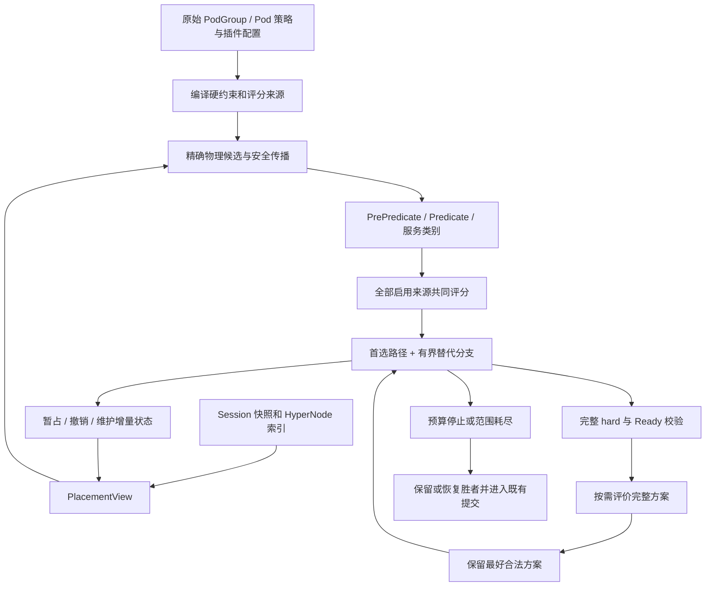

> 归档快照（2026-11-05）。本文保留原有阶段、基线和历史结论；其中的“当前”“完成”仅适用于原文对象。最终设计入口及证据边界见[归档说明](../../../../README.md)。本次仅迁移链接并添加此提示，未重新执行文中的命令。

# Volcano 上游拓扑调度重构方案：统一约束、节点评分与联合放置

分析日期：2026-10-05。文档状态：独立设计与源码分析，尚未实施。

## 1. 基线与结论

用户指定的 `upstream/main` 在本次远端核对中不存在。`upstream` 的默认分支是 **`master`**，本文使用其固定提交 **`e0905bab6fe49b5df2948edb001703c523525784`**，提交日期为 2026-09-30。下文“当前上游”均指这个提交，不指本地 `dev-1.14`。依赖版本为 Go 1.26.0、Kubernetes 1.36.1。[上游提交](https://github.com/volcano-sh/volcano/commit/e0905bab6fe49b5df2948edb001703c523525784)、[go.mod](https://github.com/volcano-sh/volcano/blob/e0905bab6fe49b5df2948edb001703c523525784/go.mod#L1)。

**建议保留之前“统一物理节点放置”的方向，但按上游重新定义评分适配、拓扑策略输入、事务边界和验收条件。最终取消 allocate 内由软拓扑梯度支配的容器选择，将拓扑变成约束与收益来源。**

这能够解决“两个 HyperNode 都满足硬拓扑要求，但 preferred NodeAffinity 无法影响跨域选择”的架构问题。解决成立需要三个条件同时满足：

1. 同一资源与分片类别中的所有合法候选，共同接收节点和拓扑评分；preferred 拓扑不得先排除另一域。
2. 后续 Task 或 SubGroup 的需求可以触发回退，重新考虑前面的选择。
3. 比较两份成功布局时，完整目标包含全部启用来源，不能最后再只按 HyperNodeOrder 选胜者。

“所有评分都有影响”不等于“NodeAffinity 总能胜出”，也不等于“有限预算必得全局最优”。权重、硬约束、准入等级和搜索覆盖范围仍决定结果。

本文是对整个重构的重新设计：包括 hard/soft、多 SubGroup、普通评分、NTA、未来 GTA、性能和状态管理。NodeAffinity 隔离是其中一个必须通过的验收场景。

### 1.1 与已有材料的关系

| 材料 | 本文如何使用 |
| --- | --- |
| [原打分代码导读](VOLCANO_UPSTREAM_SCORING_CODE_WALKTHROUGH_CN.md) | 当前调度与 PR 打分算例；保持原文不变 |
| [015 完整设计](TOPOLOGY_PLANNING_FRAMEWORK.md) | 延续统一约束、联合收益、有界搜索的目标；其 dev-1.14 源码结论不能直接当成上游事实 |
| [015 用户需求](REQUIREMENTS_2026-09-11.md) | 保留通用性、全部评分、多 SubGroup、性能与严格边界等要求 |
| [015 交付核对](DESIGN_COMPLETION_AUDIT.md) | 区分旧模型验证、历史原型和未完成的目标实现 |
| [Bug 023](../../bugs/023-topology-nodeaffinity-preferred-score-isolation-OPEN/DESCRIPTION.md) | 关联问题记录；其个别历史表述须按本文当前源码纠正 |
| [PR #5349](https://github.com/volcano-sh/volcano/pull/5349) | 未合并的独立比较对象，不混入主线基线 |

历史原型 `feat/015-unified-topology-placement@c4c6c3643` 与本设计不同：它仍可能让 soft domain rank 先于普通总分，并在首个成功方案处停止。不能用该原型或它的历史 Kind 记录，证明本文三项条件已经实现。

## 2. 当前上游的实际决策链

### 2.1 先试放，再比较域；断点在比较依据

对于进入拓扑分支的 Job，主干可以概括为：

```text
Session 构建拓扑、调整网络策略
  → Job HyperNode gradients
    → 在同一 gradient 的每个 HyperNode 中试放
      → 逐个 SubJob，生成其 HyperNode gradients
        → 逐域执行 Predicate、NodeOrder、Statement 暂占
        → 保存成功方案，撤销试放
        → 只按 HyperNodeOrder 选择 SubJob 方案并恢复
      → 累加 SubJob 返回的域评分
    → 选择该 gradient 中域评分最高的 Job 方案并恢复
  → 第一个存在成功方案的 gradient 即返回
```

因此，“先完全选定 HyperNode，然后才第一次执行 NodeAffinity”并不精确。**当前会在多个域的试放中执行节点评分，但这些评分没有进入最终跨域方案比较。** 另外，域内只剩一个候选时，节点评分还会被直接跳过。

源码中的断点很直接：

| 位置 | 当前行为 | 对重构的要求 |
| --- | --- | --- |
| [allocateResourcesForTasks](https://github.com/volcano-sh/volcano/blob/e0905bab6fe49b5df2948edb001703c523525784/pkg/scheduler/actions/allocate/allocate.go#L992) | `bestNode, _ := alloc.prioritizeNodes(...)` 丢弃节点分 | 不再让最终评价看不到普通评分 |
| [selectBestHyperNodeForSubJob](https://github.com/volcano-sh/volcano/blob/e0905bab6fe49b5df2948edb001703c523525784/pkg/scheduler/actions/allocate/allocate.go#L707) | 只调用 `PrioritizeHyperNodes` | 由完整放置评价替代跨域最终选择 |
| [allocateForJob](https://github.com/volcano-sh/volcano/blob/e0905bab6fe49b5df2948edb001703c523525784/pkg/scheduler/actions/allocate/allocate.go#L445) | 外层累加 SubJob allocationScore，第一成功梯度终止 | 跨 SubGroup 联合搜索，软层级不再是提前终止依据 |
| [selectBestHyperNodeForJob](https://github.com/volcano-sh/volcano/blob/e0905bab6fe49b5df2948edb001703c523525784/pkg/scheduler/actions/allocate/allocate.go#L688) | 只比较前述域分累计值 | 不得在统一节点排序后重新引入域分覆盖 |
| [prioritizeNodes](https://github.com/volcano-sh/volcano/blob/e0905bab6fe49b5df2948edb001703c523525784/pkg/scheduler/actions/allocate/allocate.go#L1039) | 按资源/分片类别选择；单节点直达 | 保留服务类别，补齐单节点方案的评价能力 |

required NodeAffinity 仍属于 Predicate，会影响域内试放能否成功。这里讨论的是 **preferred 的分数隔离**，不是 required 没有检查。

### 2.2 hard 与 soft 当前共用梯度机制

当前 Session 将 Job 的 soft network topology 转成内部 hard 模式，其允许上界设为 Session 最大 tier；SubJob 的转换还受 Job 上界约束。这是当前算法使用的内部表示，不能解释为用户把 soft 改成了 required。[convertSoftToHardTopology](https://github.com/volcano-sh/volcano/blob/e0905bab6fe49b5df2948edb001703c523525784/pkg/scheduler/framework/session.go#L1132)。

NTA 随后按 tier 升序生成候选梯度。allocate 在较低 tier 找到可行方案就不再比较更高 tier 的方案。于是 soft 的“更紧凑”具有结构性的优先级，普通 NodeAffinity、Binpack 等分数无法与这个优先级直接权衡。[hyperNodeGradientFn](https://github.com/volcano-sh/volcano/blob/e0905bab6fe49b5df2948edb001703c523525784/pkg/scheduler/plugins/network-topology-aware/network_topology_aware.go#L602)。

对于用户真正配置的 hard tier，必须保留允许范围与同域关系。对于 soft，目标设计应保留合法候选，用有限收益表达偏好。两者不能继续依靠同一种梯度顺序隐式区分。

### 2.3 节点评分已有公共汇合入口

[PrioritizeNodes](https://github.com/volcano-sh/volcano/blob/e0905bab6fe49b5df2948edb001703c523525784/pkg/scheduler/util/scheduler_helper.go#L78) 汇合逐节点、map/reduce、batch 三类分数。这个汇合能力可以复用，不必为每个普通插件重写评分公式。

但“能返回总分”还不是完整方案评价接口。该函数当前没有向调用者返回完整的错误状态；部分 map 错误会记录日志并跳过结果，reduce/batch 错误会返回空评分。新规划器必须能区分：合法零分、插件 Skip、插件失败与候选不存在，不能把缺失评分当成零分后宣称综合收益改善。

## 3. 相对旧设计，哪些事实已经改变

| 主题 | 当前上游事实 | 本次调整 |
| --- | --- | --- |
| GTA 是否已有 | 固定基线没有 `group-topology-affinity` 插件及该 PR 的 PodGroup topologyAffinity API | NTA 主线重构与 GTA 扩展分开交付；不要求先移植本地 GTA |
| 多梯度插件组合 | 主线返回第一个启用且注册的 gradient callback 的结果 | typed hard 组合是新能力，不能写成主线已有多插件求交 |
| NodeAffinity 评分 | nodeorder 已走批量 PreScore、Score、NormalizeScore，再加权 | 删除旧文“当前逐节点 raw Score 不归一化”的判断 |
| NodeOrder 组成 | Least/Most/Balanced、NodeAffinity、InterPodAffinity、TaintToleration、PodTopologySpread 等进入批量评分 | 保留每个子 scorer 的身份与生命周期，不能仅接入 NodeAffinity |
| Kubernetes BalancedAllocation | 1.36.1 根据加入 Pod 前后的平衡改善计分 | 不能用单一终态平衡率直接替代并宣称等价 |
| predicates 也会评分 | VolumeBinding、DynamicResources 可注册批量评分，受启用配置控制 | 全部来源清单必须包含 predicates 的评分入口 |
| 事务失败处理 | Allocate/Pipeline 已有失败后的撤销 | 不再把“增加基本 defer 回滚”列作核心新功能；重点验证分支级可恢复性 |
| 提名路径 | 已有 NominatedHyperNode/NodeName 快速恢复与验证 | 统一框架必须接住提名；不能无说明地改成普通高分选择 |
| 失败诊断 | 已有试放 rejection 隔离和 unschedulable-job cache | 搜索中临时失败不得污染最终拒绝原因和跨轮缓存 |
| 候选采样 | PredicateHelper 有全局轮转位置、并行检查与可行节点数量截断 | 搜索覆盖和规范重放需有可重复的候选合同 |

对应源码：[gradient dispatch](https://github.com/volcano-sh/volcano/blob/e0905bab6fe49b5df2948edb001703c523525784/pkg/scheduler/framework/session_plugins.go#L1135)、[NodeOrder 初始化](https://github.com/volcano-sh/volcano/blob/e0905bab6fe49b5df2948edb001703c523525784/pkg/scheduler/plugins/nodeorder/nodeorder.go#L202)、[公共评分辅助](https://github.com/volcano-sh/volcano/blob/e0905bab6fe49b5df2948edb001703c523525784/pkg/scheduler/plugins/util/nodescore/score_helper.go#L68)、[predicates 注册评分](https://github.com/volcano-sh/volcano/blob/e0905bab6fe49b5df2948edb001703c523525784/pkg/scheduler/plugins/predicates/predicates.go#L335)、[提名快速路径](https://github.com/volcano-sh/volcano/blob/e0905bab6fe49b5df2948edb001703c523525784/pkg/scheduler/actions/allocate/allocate.go#L740)、[rejection scope](https://github.com/volcano-sh/volcano/blob/e0905bab6fe49b5df2948edb001703c523525784/pkg/scheduler/framework/session_rejections.go#L208)、[PredicateHelper](https://github.com/volcano-sh/volcano/blob/e0905bab6fe49b5df2948edb001703c523525784/pkg/scheduler/util/predicate_helper.go#L45)。

## 4. 目标模型：优化的是放置，不是容器

### 4.1 固定比较范围

一次规划固定：

- `S0`：本次规划开始时的节点、既有 Pod、资源和拓扑状态。
- `T`：按既有 Job/SubJob/Task 优先级和准入要求确定的待放置工作集。
- `π`：评价使用的固定 Task 顺序。
- `C`：适用的资源/分片服务类别、提名合同、评分来源与权重。

`x(t)=n` 表示 Task t 放到物理节点 n。已有 Running Task 留在 S0，不搬迁，但参与网络范围和亲和关系计算。

```text
F = 满足资源、required topology、Predicate、准入和过程合同的放置集合
U(x) = Σ_s w_s · V_s(x; S0, T, π, C)
J(x) = (既有准入/服务等级, U(x))
```

先遵守既有准入/服务等级，再在同等级内比较收益。不能用高 NodeAffinity 分数换取违反 required，或随意用 futureIdle 方案覆盖可用的 idle 方案。

如果自定义 Ready callback 使 T 无法事先静态确定，首个合法准入结果可以固定本次质量比较的 T；之后只在相同 T 上比较。此时不宣称已经优化全部可能的任务子集。弹性扩容应作为新的准入目标，不能通过少放 Pod 抬高平均分。

### 4.2 拓扑树、约束关系与搜索树分开

HyperNode 仍保留成员、祖先、LCA、tier 等索引价值；它不再承担“必须先选定一个容器才能调用节点评分”的职责。

```text
物理拓扑：哪些 Node 属于哪些网络域？
约束/收益关系：哪些 Task、SubGroup、Job 互相影响？
放置搜索树：当前前缀之后，可把下一个 Task 放到哪些 Node？
```

允许域 B+C 时，候选是 `leaves(B) ∪ leaves(C)`。即使其 LCA 包含 A，也不能将 A 加入候选。不同 provider 的硬范围在精确物理 NodeSet 上求交，重复 membership 不得重复计算资源。

**NodeSet 本身不足以表达所有 hard 关系。** “这一组必须处于同一个 tier2 域”还需要保留组内共同域的约束。第一个 Task 的选择可收紧后续 Task 的候选；回退该 Task 时相应收紧必须撤销。不得把所有可用域的并集当成每个 Task 永久独立的允许集合。

### 4.3 优化范围与不变合同

本轮针对一个 Job 的准入工作集进行联合放置，允许跨 SubGroup 回退。跨 Job 的队列公平性和顺序、外部 Running Pod 的迁移、跨 Job 联合 preempt/reclaim 优化不属于第一阶段。

保留上游当前的四类候选优先级：本分片 idle、其他分片 idle、本分片 futureIdle、其他分片 futureIdle；其他分片只在 soft sharding 合同允许时出现。可探索的低优先级类别沿用准入语义，不能简单把四类混成一个 soft 总分池。[资源/分片类别](https://github.com/volcano-sh/volcano/blob/e0905bab6fe49b5df2948edb001703c523525784/pkg/scheduler/actions/allocate/allocate.go#L1039)。

对完整方案采用固定 Task 顺序下的服务类别向量及 Ready/Pipelined 状态比较，具体优先关系须由现有准入合同明确验证。改变合法布局选择是重构的预期效果；不承诺历史选择顺序、随机平局结果逐项不变。

## 5. 目标架构与代码边界



### 5.1 五个核心组件

| 组件（拟议名称） | 职责 | 不应承担的职责 |
| --- | --- | --- |
| `PolicyCompiler` | 从原始策略产生 HardConstraint、ScoreSource 及依赖元数据 | 按 NTA/GTA 组合选择 allocator 路线 |
| `TopologyView / PlacementView` | 提供精确 membership、资源、主体占用和前缀版本 | 把 preferred 域私自缩成 allowed scope |
| `CandidateEngine` | 合并 hard、执行 Predicate、按服务类别产生候选 | 宣称采样外节点不存在或不可行 |
| `ScoreCollector / PlanEvaluator` | 统一候选贡献与完整方案收益，管理权重、归一化和来源覆盖 | 仅凭节点分求和猜测所有插件的终态语义 |
| `PlacementPlanner / TransactionJournal` | 联合搜索、预算、最好方案和状态恢复 | 另写每种策略组合的专用补救流程 |

### 5.2 最小合同

以下是设计接口，不是当前已有 Go API：

```text
HardConstraint:
  Restrict(prefix, task) -> Unconstrained | Allowed(NodeSet) | Rejected(reason)
  Validate(completePlacement) -> pass | reject

ScoreSource:
  ScoreCandidates(prefix, task, cohort) -> contributions | Skip | Error
  Describe() -> sourceID, weightOwner, scale, dependencies, evaluatorCapability

PlanEvaluator:
  Evaluate(S0, T, π, placement) -> perSourceUtility | Error | Unsupported

UtilityBound（可选）:
  Upper(prefix) -> optimisticBound | Unknown

TransactionJournal:
  Mark / Apply / UndoTo / RestoreWinner -> explicit success or failure
```

必须区别“此 provider 没有限制”“允许集合为空”“关系暂未确定”。未决关系不能被误判为无约束；应保留在状态中，传播时使用必要条件，完整方案再验收。

所有对象关联 Session/plan/prefix 版本。编译策略时读取原始 soft/hard 意图，不能读取已经 soft→hard 转换的内部对象后再猜测。迁移期间可以维护不可变原始策略视图与现有 action 的兼容视图；不能先全局删除转换而让 preempt/reclaim 的现有调用失去前提。

## 6. 统一评分：候选层与完整方案层

### 6.1 候选层使用同一批节点

对同一 Task、同一前缀、同一服务类别的候选 cohort：

```text
Order(t,n | prefix) = Σ_s weightedContribution_s(t,n | prefix, cohort)
```

cohort 可横跨多个 HyperNode，前提是都满足 hard 与 Predicate。所有来源看到的物理候选范围一致，不能 NTA 先按 preferred 域裁切，再让 NodeAffinity 给剩下的节点评分。

沿用上游子 scorer 的正常 PreScore → Score → NormalizeScore → Weight 生命周期。上游公共 helper 已执行 Skip、归一化、0–100 范围检查和加权；collector 应复用、扩展它提供分项和错误，不再外乘一次插件权重。[RunScorePlugins](https://github.com/volcano-sh/volcano/blob/e0905bab6fe49b5df2948edb001703c523525784/pkg/scheduler/plugins/util/nodescore/score_helper.go#L68)。

对单一候选，首选节点的决定可以不调用排序。但一旦比较完整方案，不能把“没执行过评分”解释为零分。PlanEvaluator 必须补算同一合同下的贡献。

### 6.2 本轮必须覆盖的评分来源

| 来源 | 候选评分接入 | 第一阶段完整评价建议 |
| --- | --- | --- |
| NodeOrder / NodeAffinity | 保留上游批量归一化 | 规范重放；固定标尺原生评价作为后续明确版本 |
| NodeOrder / LeastAllocated、MostAllocated | 上游资源 scorer | 规范重放，保留取整和资源计算合同 |
| NodeOrder / BalancedAllocation | 上游 1.36.1 改善量公式 | 规范重放；不以终态平衡率冒充等价公式 |
| NodeOrder / InterPodAffinity、PodTopologySpread | 同一前缀的快照、PreScore 和 batch | 规范重放，含自定义配置与规范候选规则 |
| NodeOrder / TaintToleration | 同一候选 cohort 的 batch/normalize | 规范重放 |
| NodeOrder / ImageLocality | 现有逐节点评分 | 规范重放，后续可提供已证明等价的原生评价 |
| 独立 Binpack | 现有 NodeOrder 贡献及自身资源权重 | 规范重放；终态 binpack 是另一个明确的目标版本 |
| predicates / VolumeBinding、DynamicResources | 在配置启用评分时接入其 BatchNodeOrder | 必须满足状态重放合同；不支持时显式限制质量能力 |
| NTA 网络任务 | 用原生拓扑因子替代分离的 HyperNode/Node 决策权 | 第7节定义新目标版本 |
| NTA 普通 Pod 域 binpack | 尊重 normal-pod 配置，不对所有任务强行启用 | 规范重放，保留多层资源评分语义 |
| 其他启用的 NodeOrder、map/reduce、batch 插件 | 统一 collector 枚举注册项 | 原生或规范重放，逐项声明能力 |
| PR #5349 GTA | 主线尚不存在；扩展时接 provider | 第12节单独约定，不能算作当前主线覆盖项 |

来源清单按实际注册及启用配置生成，而不是写死 `nodeorder + binpack + nta` 三个插件名。独立 Binpack 与 MostAllocated 同时启用可能是用户的有意配置，不能擅自去重。应消除的是同一个来源同时经旧、新入口被加了两次。

源码：[nodeorder batch](https://github.com/volcano-sh/volcano/blob/e0905bab6fe49b5df2948edb001703c523525784/pkg/scheduler/plugins/nodeorder/nodeorder.go#L364)、[BinPackingScore](https://github.com/volcano-sh/volcano/blob/e0905bab6fe49b5df2948edb001703c523525784/pkg/scheduler/plugins/binpack/binpack.go#L206)、[predicates 评分](https://github.com/volcano-sh/volcano/blob/e0905bab6fe49b5df2948edb001703c523525784/pkg/scheduler/plugins/predicates/predicates.go#L806)、[NTA 普通 Pod](https://github.com/volcano-sh/volcano/blob/e0905bab6fe49b5df2948edb001703c523525784/pkg/scheduler/plugins/network-topology-aware/network_topology_aware.go#L479)。

### 6.3 完整收益不能直接使用试放时的历史总分

候选分回答“下一步优先试哪一个节点”；完整收益回答“哪份成功布局更好”。后者必须是固定输入下确定的函数。

推荐上游第一阶段使用两类 evaluator：

1. **原生放置因子**：从 S0 与最终布局计算 NTA 等明确的拓扑目标。
2. **规范重放**：对已有 scorer，按固定 π 重建前缀，执行该来源正常生命周期，记录布局所选节点的贡献。

对 Task 级来源，建议定义：

```text
V_s(x) = (1 / |T|) · Σ_{t∈T} score_s(t, x(t) | prefix_π(x), R(t,prefix))
```

空工作集无需进入质量搜索。Skip 在该轮固定的 T 聚合中贡献零，不动态修改分母。Job/SubGroup 来源按固定主体聚合，不能把一个 Job 奖励无意乘上所有 replica 数量。每项权重的归属和聚合分母都进入评价版本。

上式保留了“顺序性评分”的定义，不宣称是与 π 无关的终态物理指标。不同任务顺序会改变资源利用、亲和快照和归一化环境；π 在一次比较内必须固定。

首次找到合法方案且直接结束时，可省略额外完整评价，记录 `utility=not-evaluated`。若要继续比较质量，必须先求齐 incumbent 的所有启用来源，再以同一来源集合评价挑战方案。预算不够一次完整评价及恢复时，交付首解，不报告虚构的收益提升。

来源不能稳定重放、也没有原生 evaluator 时：仍可参与候选排序，但该组合暂不具备完整质量比较能力。应显示具体缺失 source，并保留寻找可行方案的能力；不能只计算其余来源就宣称“全部评分联合优化”。

### 6.4 规范候选与归一化

NodeAffinity 的原始值是匹配 preferred term 的权重和，随后使用候选列表归一化到最高 100。[Kubernetes NodeAffinity](https://github.com/kubernetes/kubernetes/blob/v1.36.1/pkg/scheduler/framework/plugins/nodeaffinity/node_affinity.go#L270)。

因此，A 域 raw=10、B 域 raw=100，如果分别只对各自一个节点归一化，都可能得到 100。将两个局部 100 相加到 HyperNode 分上并没有建立统一标尺。这也是“把 bestNode 分传回去”不能作为最终方案的原因之一。

建议明确两种参考合同：

| 合同 | 定义 | 可作出的结论 |
| --- | --- | --- |
| 完整参考 | 在该规范前缀下，对当前服务类别内所有 hard/Predicate 可行节点评分 | 完整 cohort 下的过程收益；后续前缀仍可能收紧候选 |
| 有界参考 | 使用固定快照、种子和稳定顺序得到确定样本，并确保被评价的目标节点在集合中 | 该采样规则下的过程收益；不是全体节点的绝对偏好 |

所有并行返回结果先按稳定身份整理，不能拿线程先完成的集合当成规范评价输入。相同布局的重复求值应相同。候选参考仍可能随前缀和目标节点变化，这种依赖是明确的函数定义，不应隐藏。

第一阶段以完整参考作为小集群正确性 oracle；大规模有界参考必须标注覆盖范围。将 NodeAffinity 原生评价改成“相对于固定全域 raw 上限”可以消除部分前缀参照影响，但会改变当前评分语义，应作为单独版本审查，不在适配器里悄悄修改。

### 6.5 BalancedAllocation 与数值范围

Kubernetes 1.36.1 的 BalancedAllocation 比较加入 Pod 前后的 balance，再做整数运算；即使终态相同，也不能未经证明就将规范重放收益替换成简单最终均衡率。[balancedResourceScorer](https://github.com/kubernetes/kubernetes/blob/v1.36.1/pkg/scheduler/framework/plugins/noderesources/balanced_allocation.go#L204)。

Kubernetes helper 的 0–100 约束适用于相应子 scorer 的归一化输出。Volcano 的旧自定义分数不能全部据此裁剪：例如当前 NTA 在最大值平局时叠加 task-count 比例，随后再乘 100 与权重，不能笼统假设其最终贡献永不超过 `100×weight`。[NTA HyperNodeOrder](https://github.com/volcano-sh/volcano/blob/e0905bab6fe49b5df2948edb001703c523525784/pkg/scheduler/plugins/network-topology-aware/network_topology_aware.go#L359)。

新 collector 使用浮点贡献时必须拒绝 NaN/Inf，稳定记录 source 和舍入规则。已加权旧回调直接收集；拟议原生 source 的权重由统一层施加一次。不能通过除以权重来恢复 raw 值，零权重和分项聚合都会使这种做法不可靠。

## 7. NTA：硬约束保留，软偏好重新定义

### 7.1 hard provider

读取用户原始 Job/SubGroup networkTopology，完成 tier 名称解析、成员索引和已有运行位置解析。hard 规则表达的是“同一主体的已有与新增成员必须存在符合上界的共同网络域”等关系，具体以当前 API 语义为准。

增量状态维护可行域集合与已选节点；每次选择后，收紧仍能容纳该主体的域及后续 NodeSet。父 Job 与 SubGroup 的硬约束同时成立，不能用子组较宽的规则放松父组限制。

资源预过滤只能使用安全下界。对已经固定的 T，可聚合实际剩余需求；对于尚未确定的弹性准入子集，不能把全部 Pending 请求当作必需量。聚合够用也不证明逐节点可放，仍须 Predicate 和实际暂占。

上游当前 SubJob `GetMinResources` 汇总 Pending 请求；PR #5349 提出了更保守的准入下界。重构应按所处阶段明确定义需求，而不是机械复用名字相同的函数。[主线 GetMinResources](https://github.com/volcano-sh/volcano/blob/e0905bab6fe49b5df2948edb001703c523525784/pkg/scheduler/api/sub_job_info.go#L292)。

### 7.2 soft provider 与新的整体指标

建议将网络任务 NTA 的收益分成两个有定义的因素：

- `L(x)`：固定 Job/SubGroup 在 S0 与新增布局中的网络紧凑程度。
- `B(x)`：该主体实际占用范围内、使用一致资源口径计算的域利用率。

一个可实施的第一版合同是：

```text
L(x) = 100 × (r_max - rank(LCA(existing ∪ placed))) / (r_max - r_min)
B(x) = 100 × 对启用资源的最终 used/allocatable 加权平均
V_NTA(x) = 对固定主体平均 [(α × L(x) + β × B(x)) / (α + β)]
```

这里的 `rank` 是本次拓扑视图中有序 tier 的秩，虚拟根的处理写入版本；只有一个可区分层级时取固定中性 locality，避免零分母。网络层级只表达相对紧凑程度，不冒充实际时延或带宽。`α,β≥0` 且总和非零；建议初始各为 1，**这是待校准的新设计默认，不是上游已有配置项**。

`B` 的域取主体实际共同覆盖域；资源以物理 membership 去重，从 S0 加入本次实际放置一次。已有 Running 请求已经在 S0 中，不再重复相加。CPU、内存及扩展资源的可用量、InitResreq/Resreq、idle/future 口径必须跟随现有资源合同，不得为了评分另造一种可用量。软范围横跨真实根时，以明确的虚拟根处理；不把虚拟根当作真实网络设备。

Job 与继承而来的默认 SubJob 如代表同一条策略，按策略来源身份避免双计；显式的 Job 与 SubGroup 规则分别作为固定主体，聚合规则需可见。

这项定义同时替代旧 NTA 网络任务的 HyperNode 与 Node 层软决策。**它是目标语义变化，不能声称与旧 HN binpack、LCA anchor、task-count 平局奖励完全等价。** 原有资源权重与外层 NTA weight 可复用；新内部比例、主体和 tier 标尺应经过负载回放校准。普通 Pod 的多层域 binpack 仍由其独立启用配置控制。

候选排序可用加入该 Task 后的原生因子变化量或明确的局部投影，并与普通节点分共同汇总。它是启发式，不能据此断言最终最优。没有已有锚点的第一个 Pod，也必须能收到候选域资源贡献；不可保留“anchor 为空就让整个拓扑来源失去解释”的隐式行为。

### 7.3 不再保留 soft domain rank 的绝对优先级

如果先按 soft domain rank 分桶，只在同桶内比较 NodeAffinity，那么隔离问题只是换了名称。目标框架不保留这类 soft 字典序优先级。

不同 tier 的合法布局也可参加收益竞争。如果业务要求绝对不跨某个网络层级，应使用 hard 上界；不能用 hidden first-success gradient 达成。迁移时必须说明这一布局变化，而不是称其“完全无行为变化”。

## 8. 联合搜索：既解决放不下，也改善已经能放的方案

### 8.1 为什么统一节点排序还不够

同一组的第一个 Pod 可能偏好 A，剩余 Pod 总体明显偏好 B。即使全局节点排序没有隔离，单次贪心仍可能选 A，随后 hard 同域约束将其他 Pod 锁在 A。

多个 SubGroup 也有同样问题：前一组占用了后一组唯一可行的资源。需要允许回退到前一组，而不是只在失败组内部换节点。一次早期选择变化可能自然改变多个后续 Pod，无须规定成“两 Pod 交换”或固定角色修复。

### 8.2 推荐算法

采用首选路径优先的有界搜索，按偏离首选的次数逐层探索替代路径。算法思想参考 [Limited Discrepancy Search](https://www.ijcai.org/Proceedings/95-1/Papers/080.pdf) 与 [Improved Limited Discrepancy Search](https://cdn.aaai.org/AAAI/1996/AAAI96-043.pdf)。这里只借用访问顺序思想，不借用论文中的性能结果作为 Volcano 性能承诺。

在一个分叉处，选择综合评分第一名计 0 次偏离，选择任一其他候选计 1 次。依次探索恰好 0、1、2……次偏离的完整路径；有限候选集合中同层替代节点按稳定分数与身份排列。对多分支的这一约定要写进实现和成本模型，不能混用“候选名次就是偏离次数”的另一种定义。

```text
freeze S0, working set/admission rule, task order, score contract and budgets
compile constraints; build source capability manifest
best = none

for discrepancyLimit = 0, 1, ... while budget allows:
    explore from root with the same PlacementView and choice stack:
        propagate only safe hard restrictions
        if complete:
            if usedDiscrepancies != discrepancyLimit: skip this leaf
            validate all hard rules and existing Ready/Pipelined contract
            if first success and no quality budget:
                transfer live valid statement to caller; return
            evaluate all enabled sources under the frozen contract
            update best only when the complete comparison key improves
            continue exploring

        if best has complete utility and a safe bound proves no improvement:
            prune
        generate physical candidates by permitted service class
        run PrePredicate/Predicate and unified candidate scoring
        choose first/alternative permitted by the discrepancy layer
        mark transaction; apply; recurse; undo to mark

on stop:
    if best exists: retain or restore best; revalidate; hand off statement
    else: restore root; report the search scope and stop reason
```

伪代码中的“完整”是本次明确准入目标的完整，不强制将整个 Job 的所有 Pending Task 一次调完。首解确定 T 的情形，后续质量树固定这个 T。

### 8.3 首解路径应当足够便宜

默认先在线性扫描中选最高分；只有需要替代分支时，才排序或构建候选迭代器。单一合法节点可以跳过候选排序。没有已评价的最好方案时，不计算仅用于收益剪枝的昂贵上界。

首个合法方案可以作为当前活动 Statement 直接交付，避免无意义的“保存、全部撤销、完整恢复”。如果继续寻找更好方案，再付完整评价和替代探索成本。这是同一算法的预算控制，不是给不同策略组合增加不同路线。

### 8.4 为什么选择这类算法

| 方法 | 取舍 |
| --- | --- |
| 单次贪心 | 成本低，但不能纠正前序选择，也不比较成功布局 |
| 仅失败时回退 | 改善可行性；第9.2节的低质量成功方案仍不会改善 |
| 固定两点交换 | 适用范围窄，无法自然覆盖多 SubGroup 连锁变化 |
| 有界 beam | 可并行保留多前缀，但增加状态副本，且被丢弃前缀难以继续覆盖 |
| 本文的首选优先有界搜索 | 复用一份活动状态，预算增加时逐步探索替代；仍可能重访前缀 |
| 通用整数/约束求解器 | 适合作为小规模 oracle；黑盒 Predicate、Score 与外部状态难以直接编码，不作为第一阶段运行时依赖 |

这不是对所有工作负载的最优算法结论。最终要用上游插件成本和负载分布测量首解延迟、改善收益、P99 与恢复成本。

## 9. 两个能直接回答 NodeAffinity 问题的例子

以下为新框架的独立推导算例，不冒充已经运行的 Volcano 日志。两例均使用两个同 tier 域 A/B，各有一个足够大的物理 Node；hard 要求组内同域，两个域都合法；关闭其他有区分度的评分或令其对 A/B 完全相同，`nodeaffinity.weight=1`，完整参考模式、固定 Task 顺序。

### 9.1 所有 Pod 都偏好 B

三个 Pod 的 NodeAffinity raw 都为 A=0、B=100。

| 步骤 | 当前容器模式 | 目标框架 |
| --- | --- | --- |
| 第一个 Pod | 分别在 A、B 内试放；单节点还可能跳过评分 | A、B 同 cohort，分数 0/100，优先 B |
| 后续 Pod | 各自在被试放的域内继续 | hard 同域限制到 B，继续放置 |
| 成功方案比较 | NodeAffinity 不进入域分；即使 B 全部匹配也不能据此胜出 | B 的该来源平均收益为 100，A 为 0；其他贡献相等时 B 胜出 |

若 NTA 的已定义完整收益更偏好 A，两来源按各自权重竞争。NodeAffinity 现在有影响；是否足以改变结果由分差决定。

### 9.2 首个 Pod 偏好 A，整个组更适合 B

两个 Pod 的 raw 权重如下，可以由不同节点标签的 preferred terms 构造：

| Task | A | B |
| --- | ---: | ---: |
| p1 | 100 | 90 |
| p2 | 0 | 100 |

固定顺序 `p1 → p2`，hard 仍要求两者同域：

1. 首选路径：p1 在共同 cohort 中选 A，p2 被约束到 A。合法布局 `AA`，完整 NodeAffinity 平均收益 `(100+0)/2=50`。
2. 该布局已经成功。若算法仅失败回退，就会返回 AA。
3. 允许一次偏离：p1 改选 B，p2 随之进入 B。合法布局 `BB`，规范重放收益 `(90+100)/2=95`。
4. 同一准入等级、其他来源相同时，BB 替换 AA。

p2 在 A 的 raw 为 0，归一化仍为 0；在 B 的 raw 为 100，单节点规范评价为 100。没有把候选选择时跳过评分当成零分。

该例区分了两种完成标准：**统一节点排序解决可见性，完整方案搜索解决前序选择造成的整体质量损失。** 少量预算能够解这个例子，不证明所有复杂实例也只需一次偏离。

### 9.3 “有效”应如何验收

在其他分项固定的受控测试中，提高 B 的 NodeAffinity 收益，必须反映到候选分与完整 U。覆盖到 A/B 两份合法布局后，应按 U 选择更优者。

在真实多来源负载中，不要求“只要 B 有 affinity 就一定选 B”。应输出分项，让人看出 B 输给了哪个明确偏好、哪项硬约束，或者是否因预算/采样根本没比较到 B。这比只观察最终节点更能证明隔离被消除。

## 10. 状态与事务：上游已有基础，仍需加强搜索合同

### 10.1 可以复用的部分

当前 [Statement.Allocate](https://github.com/volcano-sh/volcano/blob/e0905bab6fe49b5df2948edb001703c523525784/pkg/scheduler/framework/statement.go#L256) 和 [Pipeline](https://github.com/volcano-sh/volcano/blob/e0905bab6fe49b5df2948edb001703c523525784/pkg/scheduler/framework/statement.go#L150) 都会在失败时执行撤销；[Discard](https://github.com/volcano-sh/volcano/blob/e0905bab6fe49b5df2948edb001703c523525784/pkg/scheduler/framework/statement.go#L375) 按逆序撤销操作。[predicates 的 Reserve/Unreserve](https://github.com/volcano-sh/volcano/blob/e0905bab6fe49b5df2948edb001703c523525784/pkg/scheduler/plugins/predicates/predicates.go#L838) 也已参与这一生命周期。

因此不应另造一套绕开插件事件的“只扣 Node CPU”的模拟分配。资源、PodLister、Kubernetes NodeInfo、NTA 使用量、设备/存储声明都可能依赖现有回调。

### 10.2 必须新增或核实的合同

| 项目 | 需要的保证 |
| --- | --- |
| 局部撤销 | `UndoTo(mark)` 只撤销当前分支，恢复相关 Task、SubJob、Node、拓扑计数和 worksheet/frontier |
| 部分失败 | 已成功的前序回调及部分资源修改得到正确补偿，不留下失败操作的残余 |
| CycleState | 与对应 Task、前缀和 Reserve 生命周期匹配；不能使用另一个分支留下的 PreFilter/PreScore/Reserve 状态 |
| 保存胜者 | 保存紧凑选择序列和必要元数据，不为每个域保留全 Session 副本 |
| 恢复胜者 | 任一步失败时撤销已恢复前缀；不能返回 nil 却留下半份方案 |
| 副作用能力 | 声明哪些插件可重复暂占/撤销，哪些只能在最终提交阶段执行 |
| 提交边界 | 规划阶段不 Bind；沿用最终提交。跨多个 Pod 的 Kubernetes Bind 不承诺原子性 |

当前 [SaveOperations/RecoverOperations](https://github.com/volcano-sh/volcano/blob/e0905bab6fe49b5df2948edb001703c523525784/pkg/scheduler/framework/statement.go#L440) 保存任务操作并逐项恢复；Recover 中途返回错误本身不提供调用方整体回滚保证，Discard 也以日志处理一些错误。目标规划器需要显式处理恢复失败，而不能仅因为有 Statement 就声称任意回退安全。

predicates 的设备 Allocate/Release 路径还会使用 Kubernetes client，不能一概视为纯内存模拟。[设备与事件维护](https://github.com/volcano-sh/volcano/blob/e0905bab6fe49b5df2948edb001703c523525784/pkg/scheduler/plugins/predicates/predicates.go#L215)。不能稳定撤销的插件，必须先改造成可安全预留/释放的合同，或明确限制此配置的额外探索能力；不得绕过它的 required 检查。

### 10.3 一份活动视图，受控重放

建议维护一份活动 Session 视图、一条选择栈和一份最好方案。原生 evaluator 只读。规范重放需要时，由框架撤销到根、按 π 评价并重放待评布局，再恢复搜索位置。

如果当前搜索前缀顺序恰好就是 π，且 cohort、状态版本及所有贡献都满足规范合同，可以复用已记账结果，避免重复回放；必须有可检查的充分条件。不能在没有证明时沿用历史分数。

一旦撤销失败导致视图可信性丧失，应终止本次规划并按框架错误流程处置，不能继续比较或提交“最好方案”。所谓可恢复性，是插件和 journal 必须通过测试的合同，不是无条件事实。

## 11. 候选、缓存、提名与诊断

### 11.1 采样必须与质量结论一起出现

全量 Predicate/Score 在大量节点上昂贵，保留采样能力是合理的；但必须记录：总允许范围、实际检查数、评分候选数、是否截断、种子与版本。

采样没见到 B，就不能宣称“NodeAffinity 比较后认为 A 更优”。搜索预算增加也未必自动扩大候选集合；两类覆盖要分别管理。完整 oracle 模式与生产有界模式共用模型，不意味着拥有相同最优性保证。

### 11.2 缓存区分静态事实和前缀事实

上游 PredicateHelper 有按 Job/TaskRole 与 Node 记录失败的路径。新搜索会多次改变暂占前缀，容量不足、Pod 亲和冲突等失败可能随后消失。[PredicateHelper](https://github.com/volcano-sh/volcano/blob/e0905bab6fe49b5df2948edb001703c523525784/pkg/scheduler/util/predicate_helper.go#L45)。

建议缓存键至少区分任务约束身份、Session 版本与依赖的前缀版本；能证明与暂占无关的失败才允许跨分支复用。只靠“同 TaskRole”不足以证明所有自定义 Predicate 都等价。评分缓存也必须包含 cohort/归一化合同，不能只按 Task+Node 缓存最终分。

需要求值时再刷新受影响的因子，不因每次分支变化就重算全拓扑。依赖版本改变是失效标记，不等于立即执行全量计算。

### 11.3 提名和 BestNodeFn

上游提名是预抢占结果与 allocate 的衔接机制，不是普通软分。保留提名叶集合、资源、PrePredicate/Predicate 的验证；提名失效时清理并进入同一 planner。[validateNomination](https://github.com/volcano-sh/volcano/blob/e0905bab6fe49b5df2948edb001703c523525784/pkg/scheduler/actions/allocate/allocate.go#L804)。

兼容阶段将合法提名视为明确的服务合同/预选计划，并标注 `selection=nominated`，不能同时宣称已自由比较所有高分节点。若未来允许质量搜索推翻有效提名，需要单独定义与 preempt/reclaim 的关系。

BestNodeFn 可继续提供候选中的首选建议；必须确认返回节点属于当前合法 cohort。它不是自动获得无限优先级的评分来源。若插件要影响完整质量比较，需提供相应 source/evaluator；只有 opaque 选择回调时，不能声称 U 表达了该插件全部偏好。

### 11.4 搜索失败不等于 Job 永久不可调度

复用 `CollectJobRejections` 的隔离机制，但作用域细化到分支。撤销分支时丢弃只因该前缀产生的拒绝；最终保留可解释且仍适用的原因。

至少区分以下结果：

| 结果 | 含义 |
| --- | --- |
| `feasible / utility-not-evaluated` | 找到可提交方案，未进行完整质量比较 |
| `feasible / improved` | 在声明范围内，用全部来源证明新方案收益更高 |
| `feasible / scope-optimal` | 当前声明搜索空间已穷尽或有有效界证明最优 |
| `no-solution-in-scope` | 已穷尽声明范围，未找到可行方案 |
| `budget-exhausted / candidate-truncated` | 搜索尚未完成，不能推断全局无解 |
| `plugin-error / restore-failed` | 计算或状态失败，不能包装成正常不可调度 |

预算耗尽是计算状态，不是节点资源事件。不得将其写成等待某个外部资源变化才唤醒的稳定 rejection，否则可能抑制下一轮有机会成功的 Job。需结合上游 unschedulable-job cache 的唤醒合同设计重试。

## 12. PR #5349 的定位：有用的策略增量，尚未打通节点收益

### 12.1 本次核对状态

2026-10-05 核对时，PR [#5349](https://github.com/volcano-sh/volcano/pull/5349) 仍为 open，尚未合并；base 是本文基线，head 为 `3e46f519b3dcc97574ced41d43ddb6ef3052ecba`。本节只分析这个 head，不推断未来合并结果。

| PR 的变化 | 解决什么 | 未解决什么 |
| --- | --- | --- |
| 多插件 gradient 交集及统计 | 从“第一个 callback 决定”发展到多个插件共同限制 | 仍以 HyperNode 名称和梯度为核心；不是统一物理放置搜索 |
| 区分未约束与拒绝 | 防止没有适用规则被解释为拒绝 | 仍需与未来 hard/soft typed 合同衔接 |
| Pending 准入资源保守下界 | 减少异构任务、部分就绪情况下过度预过滤 | 下界不证明真实任务组合可行，仍需实际分配 |
| GTA PodGroup required anti-affinity | 增加另一类硬拓扑限制 | 不等于主线已经支持所有 SubGroup affinity/anti-affinity |
| GTA PodGroup preferred anti-affinity | 在 HyperNodeOrder 中增加偏好分 | 普通 NodeAffinity 仍没有进入跨域最终比较 |

来源：[PR gradient 合并](https://github.com/wangyang0616/volcano/blob/3e46f519b3dcc97574ced41d43ddb6ef3052ecba/pkg/scheduler/framework/session_plugins.go#L1133)、[PR 资源下界](https://github.com/wangyang0616/volcano/blob/3e46f519b3dcc97574ced41d43ddb6ef3052ecba/pkg/scheduler/api/sub_job_info.go#L289)、[PR API](https://github.com/wangyang0616/volcano/blob/3e46f519b3dcc97574ced41d43ddb6ef3052ecba/staging/src/volcano.sh/apis/pkg/apis/scheduling/types.go#L282)。

### 12.2 PR 的域评分变化

PR 的 GTA preferred 评分可以写成：

```text
GTA(H) = pluginWeight × 100 × max(0, 1 - Σ_在H对应祖先域触发的term(termWeight/100))
```

它检查候选 HyperNode 在 term 指定 tier 的祖先是否属于 peer 占用集合。它不是“按碰撞 Pod 数”评分，也不是旧本地 GTA 的全部 SubGroup 策略。[PR hyperNodeOrderFn](https://github.com/wangyang0616/volcano/blob/3e46f519b3dcc97574ced41d43ddb6ef3052ecba/pkg/scheduler/plugins/group-topology-affinity/group_topology_affinity.go#L274)。

沿用原打分导读的独立域分示例：NTA 给 A/B 80/70，GTA 外层 weight=1，只有 A 触发 weight=30 的 preferred term，则 GTA 为 70/100，总域分变成 150/170，B 胜出。term weight=10 时为 170/170，并不能推出确定选哪一域。

这证明 PR 增加了 **拓扑来源之间** 的竞争。NodeAffinity 没有因这项修改进入总域分，所以 PR 本身没有解决本次隔离问题。

### 12.3 与目标重构如何合流

主线阶段先完成现有 networkTopology hard/soft、普通节点来源与统一 planner，不以 PR 合并为前提，也不直接引入本地 dev-1.14 才有的全部 API。

若 PR 后续合并或选择基于它实施：

1. 复用其 selector、namespace、peer 占用及 tier 解析语义。
2. required anti-affinity 编译成 hard provider，结果下沉到精确 NodeSet 与关系约束。
3. preferred anti-affinity 编译成同时具有候选贡献与完整评价的 score source。
4. 复用保守资源下界思想；对已固定工作集使用实际剩余需求。
5. 迁移完成后不同时运行旧 GTA HyperNodeOrder 和新 source，防止双计。

对于跨域放置的 Job，GTA 完整收益需要明确“任一实际占用域触发 term 就扣一次”还是其他规则。建议以每个 term 的违反指示量定义第一版，保持 term 权重与 clipping 的含义；这是将 PR 的单候选域语义推广到完整布局，必须新增用例，不能声称 PR 已经定义好。

未来若增加 SubGroup 主体计数、count-aware anti-affinity 或 affinity，应独立定义主体身份、方向、去重和计数函数。不能把 PR 中的二值占用判断直接替换成碰撞对数，再当成无行为变化的移植。相关 API/CRD 和代码生成属于该扩展阶段。

## 13. 可证明性质、上界与不能保证的内容

### 13.1 hard 安全

若 Restrict 只移除不可能扩展成合法方案的候选，完整 Validate 与既有 Predicate/Ready 合同也通过，则返回方案满足所声明的 hard 规则。实现必须检验这两个前提。

资源、required NodeAffinity 等许多条件适合前缀检查；“将来尚未放置的 peer 会不会满足 affinity”不能仅因当前看不到 peer 就永久拒绝。新原生约束可保留未决状态，但不能为追求模型完备性而擅自绕过现有 Kubernetes Predicate。相应的可达范围受既有过程语义限制。

### 13.2 条件完备性与质量单调性

在固定有限 T、完整候选、稳定 callback、正确撤销、无预算截断且穷尽全部替代分支时，可以覆盖该过程合同下的全部合法放置。使用采样、固定偏离上限或超时后，不能再声称全局完备。

已完整评价的 incumbent 只在比较键改善时替换，因此同一搜索轨迹中的最好结果不下降。两次运行换了采样集合、种子、工作集或超时发生点，就不能仅凭预算数字更大，断言结果必然不差。

### 13.3 安全收益界

可选上界满足：对当前前缀的所有合法补全 x，`UB(prefix) ≥ U(x)`。同服务等级内，`UB ≤ U(best)` 时才可剪枝。跨服务等级还必须证明分支不能获得更高等级。

最简单的界是每个 source 的已证明最大贡献之和。若 source 范围未知，返回 Unknown/正无穷，不剪枝。不能将现有 NTA 一律当成 0–100 而产生过低上界。

更紧的界可利用同域容量、主体计数或小规模资源状态 DP，但必须是放宽问题得到的乐观界，并计入自己的时间和内存成本。独立来源分别取最大通常安全但较松；它忽略“一个来源的最好布局会损害另一个来源”的冲突。

若整个未探索空间都有有效上界，可报告 `gap = globalUB - U(best)`；只有覆盖声明范围且 gap 为零或搜索穷尽时，才可报告该范围最优。没有有效界时只报告已发现收益和覆盖，不猜剩余最优值。

### 13.4 问题不会因为 HyperNode 是树就变简单

即使没有复杂亲和，任意大小的任务放入容量受限节点也包含装箱式组合选择；加入跨主体关系与黑盒插件后，更不能据物理树结构承诺多项式全局最优。

共享祖先索引能降低关系查询成本，增量传播能减少无效搜索；它们不消除一般放置问题的组合规模。小规模穷举 oracle 用来验证模型和实现，不作为大集群默认运行方式。

## 14. 性能：分别计算首解、质量探索与退出成本

### 14.1 成本模型

设 T 个任务、N 个节点、H 个拓扑对象；在访问的前缀 p 中，检查 `n_p` 个节点，保留 `k_p` 个评分候选。单节点检查成本为 `c_pred(p)`，各评分来源总成本为 `c_score(p,k_p)`，暂占/撤销成本为 `c_tx(p)`。

```text
C_total = C_compile/index
        + Σ_访问前缀p [n_p × c_pred(p) + c_score(p,k_p) + c_tx(p)]
        + C_complete_validation + C_plan_evaluation
        + C_restore/exit
```

并行可以缩短部分墙钟延迟，不等于工作量下降。InterPodAffinity、PodTopologySpread、Volume/DRA 或设备回调的成本不能统一当常数。

首条无回退路径只访问约 T 个决策前缀，但每个前缀可能检查很多节点。对任意黑盒节点分数，如果必须保证从全部 N 个节点找到最好者，最坏情况下至少需要查看 N 个值；“有拓扑索引”不能普遍跳过这项成本。

### 14.2 搜索规模与内存

在深度 T、每步最多 b 个候选的理想满树中，按“任一非首选计一次”定义，恰好 k 次偏离的叶数为：

```text
L_k = C(T,k) × (b-1)^k
L_≤d = Σ_{k=0..min(d,T)} C(T,k) × (b-1)^k
L_all = b^T
```

这只是叶数，不是实际 Predicate/Score 次数；逐层搜索会重访前缀。具体前缀工作必须实测计数，不能拿叶数乘一个不变常数代替昂贵插件工作。

状态应限制在共享拓扑/节点索引、一条选择栈、活动插件状态和紧凑 incumbent。完整 NodeSet 矩阵、每层候选缓存可能达到 `O(TN)`；重叠 HyperNode 的物化 membership 也有独立空间开销。必须对候选缓存与因子缓存设额度，按需重算，不能将它们都隐藏为 `O(T)`。

### 14.3 什么时候可能更快，什么时候可能更慢

旧算法在同一梯度内对多个域分别完整试放，再保存、撤销、恢复，存在重复工作。新算法的首选路径可以减少这些动作，尤其是已有评分足以指向一个合适布局时。

但旧域很小而新 cohort 扩到全局后，单次 Predicate/Score 可能明显变贵。只需一次很短试放的旧负载，也未必能从新架构获得速度收益。原生 evaluator 和增量索引能降低后续成本，但不能预先给出加速比例。

```text
相对耗时 = (新首解 + 额外质量搜索 + 最终恢复) / 旧路径耗时
```

必须分别测这三项，不能只报告“新首解更快”，同时隐藏质量重放成本。本文没有目标 Go 实现的时间测量，也不沿用旧原型的速度作为结论。

### 14.4 预算包含退出本身

预算至少覆盖节点检查数、评分工作、分支扩展、事务操作、完整评价、缓存内存和墙钟时间。开始额外探索前，预留撤销及恢复 incumbent 的额度。

对耗时不透明的 callback，不能仅靠调用次数保证严格毫秒上限。同步插件不支持取消时，deadline 只能在调用边界生效，可能超出一个或多个在途调用的耗时；需要记录超时来源，不能声称硬实时。

预算不足以安全启动下一轮评价时停止。来源副作用无法保证恢复时，不进入额外探索。这样保证的是停止行为有清晰合同，而不是任意插件下都能强制准时退出。

## 15. 分阶段落地与上游代码改动范围

### 15.1 实施顺序

| 阶段 | 交付 | 完成标志 |
| --- | --- | --- |
| A：固定合同与基线 | 当前源码复现、来源清单、准入/候选/提名合同、验证 YAML | 能稳定复现节点分隔离，明确哪些布局变化是预期 |
| B：状态与统一评分基础 | 分项 collector、错误/Skip、prefix 版本、journal 恢复测试 | 所有启用普通来源进入同一 cohort；分支撤销无泄漏 |
| C：NTA 原生 provider | 原始 hard/soft 编译、精确 NodeSet、完整评价 | hard 安全，soft 不裁剪，单节点/多域评价正确 |
| D：统一 planner | 首选路径、跨 SubGroup 替代、完整 U、预算与诊断 | 同时通过可行性修复和成功方案质量改善用例 |
| E：兼容和规模验证 | 提名、分片、缓存、普通任务退化路径、性能对照 | Go、Kind 与性能门槛通过，才能替换旧 allocate 决策权 |
| F：GTA 扩展 | 若基于合并后的 #5349，按其最终 API 编译 provider | 独立验证 peer 语义、硬组合、软权重及生成文件 |

阶段化交付不表示终态保留多套按插件组合选择的 allocator。可以使用一个明确的迁移开关做新旧对照和回滚；开关及名字尚未实现。终态由同一 planner 处理有无拓扑策略的任务，无拓扑只是约束集合退化，普通单 Pod 保留便宜的首选路径。

### 15.2 文件区域与必要改动

| 上游区域 | 改动意图 |
| --- | --- |
| `pkg/scheduler/actions/allocate/allocate.go` | 替换嵌套 Job/SubJob 域试放与最终域评分选择，接入统一规划结果；保留队列、准入和提交边界 |
| `pkg/scheduler/framework/session.go` | 原始策略与内部兼容视图、拓扑初始化、计划版本；谨慎迁移 soft 转换 |
| `pkg/scheduler/framework/session_plugins.go` | provider 注册、评分来源信息与能力；不再用第一个 gradient 作为新 planner 的策略组合机制 |
| `pkg/scheduler/framework/statement.go` | 标记/局部撤销、错误传播、恢复失败清理和状态所有权 |
| `pkg/scheduler/util/scheduler_helper.go` | 保留已有评分汇合，增加可检查的来源结果与错误合同 |
| `pkg/scheduler/plugins/util/nodescore/score_helper.go` | 复用批量生命周期；扩展分项、版本和诊断能力 |
| `pkg/scheduler/plugins/nodeorder/`、`binpack/` | 适配来源与 evaluator；不随意更改上游评分公式 |
| `pkg/scheduler/plugins/network-topology-aware/` | 编译 hard/soft 与原生完整目标，迁移重复入口 |
| `pkg/scheduler/plugins/predicates/` | CycleState、Reserve/Unreserve、Volume/DRA/设备状态验证，保留全部硬检查 |
| `pkg/scheduler/util/predicate_helper.go`、framework rejection/cache | 候选稳定性、缓存版本、分支拒绝和预算重试语义 |
| planner/provider 新文件或子包 | 放置模型、搜索、预算与 evaluator；具体目录在实施 proposal 中冻结 |

仅重构现有 NTA 不要求新增 Kubernetes API/CRD。新增 scheduler 参数需要配置、默认值和文档测试；引入 GTA API 或修改 API 类型时，遵守工作区代码生成流程。不能写成“整个重构绝对不涉及 API”，因为扩展阶段另有条件。

### 15.3 迁移时需要明确接受的变化

- NodeAffinity 与其他普通偏好现在能够改变跨域布局，这是修复目标。
- soft 的首个可行 tier 不再拥有绝对优先级，紧凑程度改成可权衡收益。
- NTA 原生整体目标有版本，旧分数无法普遍无损换算到新权重。
- tie 的稳定规则/种子可能改变历史随机布局；同分快速路径要可解释。
- 完整质量能力受第三方 evaluator 和事务能力约束；缺失时显式报告。

这些差异通过迁移报告和基线负载回放验收，不通过强行保留旧 soft rank 来隐藏。

## 16. 实施前的验证计划

本节是后续实施的建议验收矩阵，**不是已执行或已获批的用例结果**。正式进入实现前，应将具体 fixtures、命令和通过门槛写入 015 的 `PROPOSAL_COMMIT.md` 并按工作区规则确认。旧测试通过不自动构成新方案通过。

### 16.1 正确性和行为矩阵

| ID | 用例与设置 | 必须观察到的结果 | 验证层 |
| --- | --- | --- | --- |
| U01 | 同 tier A/B 都可行，仅 B 匹配三个 Pod 的 preferred NodeAffinity | B 参与首个共同 cohort，完整收益包含该偏好并选择 B | Go + Kind |
| U02 | 第9.2节 p1/p2 偏好冲突，hard 同域，两个方案都成功 | 质量预算覆盖一次偏离时由 AA=50 改善为 BB=95 | Go + Kind |
| U03 | 调整 NTA/NodeAffinity 权重，其余固定 | 胜者随已定义总收益变化；不存在 soft rank 的绝对覆盖 | Go + Kind |
| U04 | B preferred 很高，但违反 required NodeAffinity 或 hard tier | 仍拒绝 B，soft 不能补偿 hard | Go + Kind |
| U05 | 每个旧域仅一个 Node | 完整评价不因为旧单节点跳过评分而丢失贡献 | Go + Kind |
| U06 | hard allowed=B+C，LCA 还包含 A | A 始终不可选；容量不重复统计 | Go，含 provider fixture |
| U07 | Job hard + SubGroup soft，已有 Running 锚点 | 子组偏好不能突破 Job hard；已有请求只记一次 | Go + Kind |
| U08 | 前一 SubGroup 占用后一组唯一可行资源 | 回退可跨组；找到合法联合放置，撤销后状态一致 | Go + Kind |
| U09 | Least/Most/Balanced、Binpack、Taint、Image 与 affinity 分别及组合启用 | 候选与完整评价清单齐全，权重一次，符合1.36.1公式 | Go |
| U10 | InterPodAffinity、PodTopologySpread 随暂占变化 | 不使用另一分支的 CycleState/Pod 快照；重放确定 | Go + 适用 Kind |
| U11 | VolumeBinding/DRA 评分和 Reserve，注入第 j 步失败 | 对应释放执行，完整恢复失败不留已恢复前缀；能力不足明确报告 | Go；相应设施的 Kind |
| U12 | 启用可分配设备的事件处理，注入 Allocate/Release 失败 | 无资源/注解泄漏；不把不可逆副作用当纯内存回退 | Go；具备设备模拟条件的 Kind |
| U13 | PreScore Skip、Score/Normalize Error、NaN/Inf、零权重 | 状态区分正确；不会用缺失评分替代完整 U | Go |
| U14 | 同布局多次重放、不同并行完成顺序 | 固定合同下分项与总收益相同；候选样本稳定 | Go |
| U15 | 同 role 的资源失败随撤销消失 | 错误缓存和 rejection 不跨前缀污染；下轮可重试 | Go + Kind |
| U16 | 有效/失效 nomination，包含域外 nominated node | 保留提名合同；失效时正确清理并进入普通规划 | Go + Kind |
| U17 | idle/futureIdle、hard/soft sharding | 不因 soft 总分改写原有服务类别规则 | Go + Kind |
| U18 | 很小预算、无 incumbent、已有 incumbent、退出恢复中失败 | 停止原因准确、资源无泄漏，不将预算耗尽缓存成稳定无解 | Go + Kind |
| U19 | 无拓扑普通 Pod、默认 SubJob、部分就绪/弹性 MinAvailable | 准入不回退，工作集比较一致，普通路径成本可控 | Go + Kind |
| U20 | 小规模随机拓扑/资源/约束，多种顺序，与全枚举比较 | 完整模式与 oracle 的可行性/最大 U 相符；每次剪枝界安全 | Go/独立模型，不替代 Kind |
| G01 | #5349 required + NTA hard、无约束/空允许集合 | typed hard 组合语义正确，不受插件顺序决定 | GTA 阶段 Go + Kind |
| G02 | #5349 preferred 与 NodeAffinity 权重竞争 | 两者均进入候选和完整 U；peer 主体与 term 语义符合版本 | GTA 阶段 Go + Kind |

性能与正确性分别判定。通过 U01 不能替代 U02；成功修复一次无法放置，也不能替代成功布局质量比较。

### 16.2 Go 验证入口

以下为后续代码落地后的运行入口，从 `volcano/` 执行；新 planner 包确定后应加入其直接测试。具体测试函数名和 fixtures 尚未创建，本轮不声称已运行：

```bash
go test ./pkg/scheduler/actions/allocate ./pkg/scheduler/framework ./pkg/scheduler/util
go test ./pkg/scheduler/plugins/nodeorder ./pkg/scheduler/plugins/binpack
go test ./pkg/scheduler/plugins/network-topology-aware ./pkg/scheduler/plugins/predicates
go test ./pkg/scheduler/plugins/util/nodescore
./hack/update-gofmt.sh
make unit-test
make verify
```

使用项目声明的宿主 Go 工具链和缓存。并发状态测试应补充 `-race` 的适用范围；不把 race 全库运行当作所有环境都无成本的默认。

### 16.3 Kind 验证环境

建议一个控制平面加四个 worker，共 **5 个可见 Kubernetes Node**，符合最多 8 节点限制。将四个 worker 作为工作负载候选，控制平面不参与放置。每个 worker 对应一个 tier1 HyperNode；两个 tier2 域各含两个 tier1；一个 tier3 根含两个 tier2。保留树形成员，不能将高层直接摊平为 Node。

准备阶段固定节点可用资源、标签、Pod 请求、PodGroup、scheduler tiers/weights 和特性开关。创建 PodGroup 后再创建其 Deployment/Job；避免 Pod 在对应组存在前生成。每个用例保存调度前后节点资源、Pod 分布、事件、分项评分、搜索状态与恢复记录。

实际验证前先冻结各用例 YAML 与 Kind 配置，再执行以下流程；占位路径在实施 proposal 中替换为已保存的 fixture 路径，不把此处模板当成已存在文件：

```bash
kind create cluster --name volcano-dev-015-upstream --config <approved-kind-config.yaml>
TAG=dev-015-upstream BUILDX_OUTPUT_TYPE=docker make images
kind load docker-image volcanosh/vc-scheduler:dev-015-upstream --name volcano-dev-015-upstream
kind load docker-image volcanosh/vc-controller-manager:dev-015-upstream --name volcano-dev-015-upstream
kind load docker-image volcanosh/vc-webhook-manager:dev-015-upstream --name volcano-dev-015-upstream
helm upgrade --install volcano installer/helm/chart/volcano \
  --namespace volcano-system --create-namespace \
  --set basic.image_tag_version=dev-015-upstream \
  --set basic.image_pull_policy=IfNotPresent \
  -f <approved-scheduler-values.yaml>
kubectl get nodes -o wide
kubectl apply -f <case-podgroup.yaml>
kubectl apply -f <case-workload.yaml>
kubectl get pods -A -o wide
```

所有额外组件及 workload 镜像也必须按实际场景在宿主构建/拉取并载入 Kind；不能默认节点自行拉取。DRA、Volume、设备用例需要各自前置设施，普通 CPU/内存集群上的通过不能替代它们。完成后保存证据并删除该任务集群。

### 16.4 性能门槛如何定义

在实现前约定可接受的首解 P50/P95/P99 变化、最大内存、质量预算和调度成功率门槛。现阶段没有数据支持具体百分比，不预填虚假的达标值。

对照至少包含：原域很小/全域很大、多个候选域重复试放、全体可行、后序资源冲突、无解、高成本 Pod affinity/Volume、软偏好对立。分别报告首解时间、完整评价时间、额外搜索时间、退出恢复时间、Predicate/Score/tx 次数和 U 改善。

1,000/10,000 节点规模使用离线 scheduler benchmark 或模拟快照，不在 Kind 中建立超限节点数。小集群 Kind 验证真实生命周期，大规模 benchmark 验证成本与尾延迟，二者不能相互替代。

## 17. 本次分析的核验范围与后续决策

本次完成的是上游源码核对与新的重构设计。已固定远端默认分支和提交，对照 allocate、NTA、评分 helper、NodeOrder、Predicate、Statement、提名和失败缓存，并单独核对 PR #5349 head。没有修改 Volcano 实现、切换当前开发分支、运行目标 Go/Kind 验收，也没有把 015/023 标为完成。

文中的数值例子用于验证评分合同、权重竞争及一次偏离的作用；文末核验记录说明其范围。它们不证明真实插件撤销、设备回收或调度吞吐。

下一次实施评审应围绕这些具体决策：

1. 接受“软域梯度 → 可加权收益”的布局语义变化，并冻结 NTA 原生评价版本。
2. 冻结规范重放候选合同、服务类别/提名优先关系与 source 能力清单。
3. 用状态恢复测试先证明可以安全搜索，再接入跨 SubGroup 的联合质量改进。
4. 将第16节细化为可执行、获批的 fixtures 和门槛后，基于明确上游提交实施。

**本次 NodeAffinity 问题可由这套重构解决；验收点必须同时包括“候选分可见”和“成功布局可比较”。只增加节点分回传、保留 soft domain rank，或只在失败时回退，都达不到完整目标。**

## 附录 A. 推荐源码阅读顺序

| 顺序 | 固定版本代码 | 阅读目的 |
| --- | --- | --- |
| 1 | [allocateForJob](https://github.com/volcano-sh/volcano/blob/e0905bab6fe49b5df2948edb001703c523525784/pkg/scheduler/actions/allocate/allocate.go#L445) | 看清跨域 trial/save/discard/recover 与第一成功梯度 |
| 2 | [allocateForSubJob](https://github.com/volcano-sh/volcano/blob/e0905bab6fe49b5df2948edb001703c523525784/pkg/scheduler/actions/allocate/allocate.go#L559) | 看子组成功方案如何只按域分选择 |
| 3 | [allocateResourcesForTasks](https://github.com/volcano-sh/volcano/blob/e0905bab6fe49b5df2948edb001703c523525784/pkg/scheduler/actions/allocate/allocate.go#L864) | 看 Task 顺序、Predicate、节点评分与暂占 |
| 4 | [PrioritizeNodes](https://github.com/volcano-sh/volcano/blob/e0905bab6fe49b5df2948edb001703c523525784/pkg/scheduler/util/scheduler_helper.go#L78) | 看普通评分的汇合及错误传播限制 |
| 5 | [RunScorePlugins](https://github.com/volcano-sh/volcano/blob/e0905bab6fe49b5df2948edb001703c523525784/pkg/scheduler/plugins/util/nodescore/score_helper.go#L68) | 看 PreScore、Normalize、权重与范围合同 |
| 6 | [NTA 注册与事件](https://github.com/volcano-sh/volcano/blob/e0905bab6fe49b5df2948edb001703c523525784/pkg/scheduler/plugins/network-topology-aware/network_topology_aware.go#L277) | 对照 gradient、HN/Node score、资源状态的职责 |
| 7 | [Session 策略调整](https://github.com/volcano-sh/volcano/blob/e0905bab6fe49b5df2948edb001703c523525784/pkg/scheduler/framework/session.go#L1077) | 区分原始 soft 意图与当前内部转换 |
| 8 | [Statement 撤销与恢复](https://github.com/volcano-sh/volcano/blob/e0905bab6fe49b5df2948edb001703c523525784/pkg/scheduler/framework/statement.go#L375) | 确定搜索状态合同，不把保存操作误当成完整快照 |
| 9 | [PR #5349 GTA score](https://github.com/wangyang0616/volcano/blob/3e46f519b3dcc97574ced41d43ddb6ef3052ecba/pkg/scheduler/plugins/group-topology-affinity/group_topology_affinity.go#L274) | 区分域分新增来源与统一节点/方案目标 |

## 附录 B. 本文检查记录

核验日期：2026-10-05。

- 远端默认分支、本文固定提交及 PR 状态/首尾提交：已核对。
- 第9节 NodeAffinity 规范归一化与两种布局收益、第12节 GTA 权重算例：独立数值检查通过，分别得到 50/95、150/170 和 170/170。
- 第14节偏离叶数公式：对 T=1–7、b=1–4 的满树直接枚举，140 个分层计数与公式一致。该检查不包含 Volcano 插件调用。
- 47 处固定源码链接的文件与行号、5 处本地文档链接、30 个 Markdown 代码围栏：静态检查通过。
- Volcano 源码工作区：文档工作前后检查；本文未修改实现。
- 目标框架 Go、镜像、Kind、真实性能：未执行，仍属后续实施验收。
