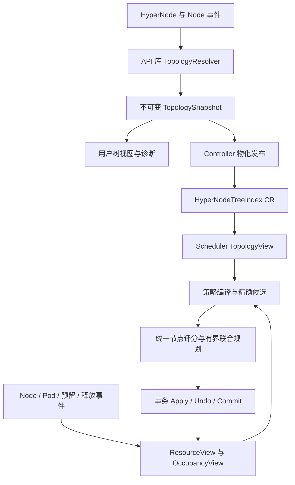

> 归档快照（2026-11-05）。本文保留原有阶段、基线和历史结论；其中的“当前”“完成”仅适用于原文对象。最终设计入口及证据边界见[归档说明](../../../../README.md)。本次仅迁移链接并添加此提示，未重新执行文中的命令。

# HyperNode 统一树视图、物化索引与增量调度设计

2026-10-23，待评审。所有新接口、CR 字段与配置名称均为拟议设计；不是已实现能力。

## 1. 结论和基线

建议采用用户提出的三个阶段，同时确定一个贯穿三阶段的边界：**共享库定义拓扑事实，controller 发布拓扑索引，scheduler 在索引上维护动态状态，并对物理节点放置进行联合规划。**

HyperNode 的树结构应帮助剪枝、聚合和解释，不再让软偏好通过“先选一个容器”获得无限优先级。保留 015 最新方案的精确 NodeSet、关系硬约束、统一评分、完整方案评价和有界回退；新增可复用的拓扑数据层及严格版本化的缓存。

按用户补充，目标 master 将包含 SubGroup 亲和/反亲和，因此本设计从一开始把 required/preferred affinity/anti-affinity 的组合纳入 P3 核心能力和验收。当前基线与未来目标分别说明；最终合入 API 的字段、peer 匹配和计分语义通过 provider 适配，不以“当前尚未合入”为由推迟关系状态和联合规划的设计。

上游默认分支为 `master`，本次已在线核实并拉取固定提交 [0854d3a4018c9304f8a25ded7a6f136c539f753c](https://github.com/volcano-sh/volcano/commit/0854d3a4018c9304f8a25ded7a6f136c539f753c)。下文源码路径、行号都指此提交，不是本地 `dev-1.14`。

### 1.1 先纠正已经变化的现状

| 主题 | 最新主线事实 | 新方案的实际增量 |
| --- | --- | --- |
| 树结构 | `HyperNodeInfo` 已有 Parent/Children，cache 已维护 RealNodesSet | 抽取公共语义和只读快照，统一展示与调度入口 |
| 反向索引 | 已有 scheduler 内部 `HyperNodeIndex`，包含祖先、按 tier 查询、LCA 和重叠 membership 兼容 | 下沉纯拓扑部分到 API 库；跨 Session 复用；发布 CR |
| 变化追踪 | 已有 topology generation、task placement generation、dirty 标记 | 扩展为 topology/resource/occupancy/policy 的依赖版本 |
| 资源缓存 | NTA 已有 Session 级 allocatable/used cache | 统一资源状态，补充 Idle/FutureIdle 和增量祖先更新 |
| GTA | 此固定基线已有 PodGroup required/preferred anti-affinity | 同时面向未来 master 的 SubGroup required/preferred affinity/anti-affinity 设计；分别适配现有和未来 API |
| 多插件 | 已有 typed gradient 结果及组合 | 从域名/梯度组合演进到精确 NodeSet + 关系约束 |
| 采样 | 已有物理 Node Predicate 采样 | 增加域级遍历预算、覆盖信息和可恢复扩展 |

证据：[HyperNodeInfo](https://github.com/volcano-sh/volcano/blob/0854d3a4018c9304f8a25ded7a6f136c539f753c/pkg/scheduler/api/hyper_node_info.go#L40)、[HyperNodeIndex](https://github.com/volcano-sh/volcano/blob/0854d3a4018c9304f8a25ded7a6f136c539f753c/pkg/scheduler/api/hyper_node_index.go#L21)、[Session 索引与 placement](https://github.com/volcano-sh/volcano/blob/0854d3a4018c9304f8a25ded7a6f136c539f753c/pkg/scheduler/framework/session.go#L352)、[NTA cache](https://github.com/volcano-sh/volcano/blob/0854d3a4018c9304f8a25ded7a6f136c539f753c/pkg/scheduler/plugins/network-topology-aware/network_topology_aware.go#L271)、[GTA](https://github.com/volcano-sh/volcano/blob/0854d3a4018c9304f8a25ded7a6f136c539f753c/pkg/scheduler/plugins/group-topology-affinity/group_topology_affinity.go#L65)。

因此，015 的 10 月 5 日文档中“GTA 未进主线”“没有组合回调”不再是本次事实。旧文作为历史保留，不在原文上悄悄替换基线。

## 2. 总体架构



三种结构分开：物理拓扑森林、工作负载之间的约束关系图、规划器的选择树。物理拓扑是树，不意味着任务关系图也是树。

实际集群可以是森林；显示用虚拟根不能自动成为真实网络域或 hard 同域证据。现有 Node selector 可使同一 Node 属于不相交的 HyperNode 子树，所以“HyperNode 单父树”也不保证“物理 Node 唯一归属”。新索引必须显式表达重叠，不能只用 Node→单个叶域替代全部 membership。

保留主线 runtime synthetic root 覆盖全部 Session Node 的能力，包括未归属任何真实 HyperNode 的节点、无 HyperNode 集群和 soft 跨根搜索。CR 中无需伪造这些节点的真实归属；runtime 在完整 Node 视图上补 synthetic root。它的 tier 高于真实最高层，仅服务兼容遍历，不能满足用户要求的真实 hard tier。

## 3. 第一阶段：API 库提供统一解析和用户视图

### 3.1 代码边界

建议在 `staging/src/volcano.sh/apis/pkg/topology/` 提供可独立导入的 Go SDK。路径为拟议名称。输入只依赖公共 HyperNode/Node 类型与纯数据；不导入 scheduler 的 JobInfo、Session 或 controller。API 库不能反向依赖主仓库。

从主仓库抽取 selector 解析和拓扑索引核心；现有 `pkg/util/hypernode`、scheduler API 保留兼容 wrapper，再逐步迁移消费者。当前已将 `GetMembers` 移到主仓库 util，这是抽取基础，但还不等于外部用户能从 API 模块使用完整树解析。[当前 resolver](https://github.com/volcano-sh/volcano/blob/0854d3a4018c9304f8a25ded7a6f136c539f753c/pkg/util/hypernode/member_selector.go#L31)。

拟议接口：

```text
ResolveTopology(HyperNodes, Nodes, ResolveOptions)
  -> immutable TopologySnapshot + Diagnostics
ValidateTopology(snapshot) -> diagnostics
BuildDetailedView(index, HyperNodeObjects, NodeObjects, ViewOptions)
  -> DetailedTopology + freshness/provenance
```

`Snapshot` 提供 roots、parent/children、tier、direct members、真实 Node membership、Node→全部包含域、ancestor/LCA、稳定遍历。纯库不自行连接集群，client/lister adapter 负责批量 List/Watch；“提供 API 方法”第一阶段指 SDK 方法，不必新增 HTTP 服务。

### 3.2 一份算法，两个显式视图

用户应能区分 declared、resolved、scheduler-adopted：

- declared：用户写了什么 selector、子 HyperNode 引用。
- resolved：公共 resolver 将当前输入解析成什么 membership。
- scheduler-adopted：scheduler 当前实际采用的 topology revision；第三阶段才能可靠展示。

第一阶段复用算法只能保证**相同输入得到相同语义**，不能声称不同 informer 时刻的结果完全相同。第三阶段返回 `topologyRevision`、scheduler 采用版本和动态状态时间，才可以解释“界面已显示新树、调度仍使用旧版本”。

示例输出（示意，不是实际集群状态）：

```text
topologyRevision: r42   schedulerAdoptedRevision: r42
cluster [virtual root]
└─ fabric-a tier3  childHyperNodes=2  uniquePhysicalNodes=4
   ├─ pair-a tier2
   │  ├─ leaf-1 tier1 → node-1
   │  └─ leaf-2 tier1 → node-2
   └─ pair-b tier2
      ├─ leaf-3 tier1 → node-3
      └─ leaf-4 tier1 → node-4
```

保留 `status.nodeCount` 原字段并标明来源。当前 controller 的 `actualNodeCnt` 对直接 member selector 结果计数，并不递归计算唯一物理节点数；tier3 有两个 HyperNode 子节点时不能把 `nodeCount=2` 当成异常。新增明确的 `childHyperNodeCount`、`directPhysicalNodeCount`、`uniqueDescendantNodeCount` 展示字段。[实际计数逻辑](https://github.com/volcano-sh/volcano/blob/0854d3a4018c9304f8a25ded7a6f136c539f753c/pkg/controllers/hypernode/hypernode_handler.go#L121)。

### 3.3 解析与诊断合同

- Node 的 exact/regex/label 与主线语义一致；regex 使用 Go RE2 语义。exact 引用不存在的 Node 时保留声明并标 unresolved，不能计入可分配资源。
- HyperNode 子成员按现有 exact 引用解析；未支持的 selector 明确诊断，不能用 Node 的 selector 算法猜测子域。
- 检测环、多父、缺失引用、tier/tierName 冲突、selector 错误、跨子树 Node 重叠。按对象 UID 和类型区分同名 Node/HyperNode。
- 重叠 membership 是主线已兼容的情况：默认不将它升级为禁止创建；标记 fast-path 不适用，精确集合去重处理。更严格拓扑策略需要独立版本和迁移审批。
- 区分结构无效、数据尚未收敛、有效但存在兼容警告。不可把非法域当空域后默默放宽 required。
- 输出顺序与哈希规范化，不能依赖 Go map 遍历顺序。深层结构采用可控栈深，诊断条数和样例有上限。

## 4. 第二阶段：Controller 生成 HyperNodeTreeIndex

### 4.1 保存索引，不复制整个详情树

建议 cluster-scoped `topology.volcano.sh/v1alpha1 HyperNodeTreeIndex`。逻辑上覆盖森林；按 root 读取只是视图投影。

```yaml
# 拟议 schema 示意，不能直接 apply
spec:
  topologyClass: default
status:
  formatVersion: v1
  activeRevision: <content-addressed revision>
  contentHash: <canonical topology hash>
  roots: [<HyperNode UID reference>]
  entries: # 小规模 inline 表示；大规模改引用不可变分片
    - ref: {name: pair-a, uid: <uid>}
      tier: 2
      children: [<HyperNode UID reference>]
      directNodes: []
      topologySpecHash: <hash>
  conditions: []
```

只持久化身份、边、直接 resolved Node membership、tier、版本、摘要与诊断。详情 HyperNode spec/status、Pod 列表、Node 动态资源不重复塞进 index。祖先表、Euler 编号、完整 descendant bitmap 可以在消费者内构建，避免在 CR 中重复保存每层叶集合。

`metadata.generation` 仅反映该 CR 的 spec，不代表源 HyperNode/Node 的变化；需要独立 activeRevision/contentHash。源对象的 resourceVersion 可用于诊断，但 opaque RV 不能跨资源类型比较大小，也不能每次 status 变化都触发结构版本。

### 4.2 什么事件更新索引

HyperNode spec/UID/删除、Node 新增删除、影响 membership 的标签变化触发 reconcile。纯 Pod churn、资源使用变化、无关标签和 HyperNode status 变化不应导致等价拓扑重写。按 resolved membership 和相关语义哈希判断有效变更；队列合并突发事件，不能无限 debounce 延迟拓扑修正。

所谓偏静态取决于这些事件的频率；使用高频变化标签做 membership 的集群，索引也会高频更新，不能仅因 CR 被叫作 index 就承诺静态。

### 4.3 发布与读取一致性

1. Controller 等 informer 同步，从一份本地输入快照计算新 revision，验证完整引用。
2. 内容无变化不写入。对于无效新拓扑，发布明确 condition；保留 last-known-good 供解释，不意味着 scheduler 可以忽略已知删除/冲突继续新调度。
3. 小拓扑可以原子更新单 CR；大拓扑发布同 revision 的不可变分片，全部写完才切换 manifest 的 activeRevision。
4. 读者只有在所有分片、哈希、UID 引用齐全后原子采用。Session 固定一个版本，不能混用新 parent 与旧 membership。
5. 旧分片保留有界宽限期后 GC；consumer 已持有内存快照可继续当前 Session。丢失 active 分片、版本不兼容或源拓扑发生冲突时，进入显式刷新/拒绝流程。

多资源 List/Watch 不提供跨类型全局事务；revision 表示 controller 已验证的组合快照，不声称 API server 全局同一时刻。bootstrap 和重连阶段必须检测输入未同步。

需要设置并实测单对象序列化大小门槛；达到门槛自动分片或拒绝发布并报 condition。不能在大规模阶段依赖“一个巨型 CR 总能装下整棵树”。第一版若只支持 inline，支持规模必须受明确字节限额约束，分片协议是扩展大规模的前置交付。

### 4.4 详情 API 避免 N+1 查询

先获取 index revision，再用 informer/lister 或批量 List 获取 HyperNodes/Nodes，然后在本地组装。不要遍历每个节点都发一次 REST GET。按 `root/depth/includeNodes/includeResources` 投影和分页；分页绑定 revision，保留 continuation 的一致性。

详情对象 UID/spec hash 与 index 不一致时标记 stale，允许重试/只显示 index 骨架；禁止新对象借旧 UID 位置静默替换。动态资源来自独立视图并标时间，不伪装成该静态 revision 的原子内容。用户无权读取某些 Pod 时，不能通过树详情绕过原 RBAC。

## 5. 第三阶段：调度器消费树和动态摘要

### 5.1 迁移的不是“从无树到有树”

当前 scheduler 已由 HyperNode 列表构造内部树、快照和 lazy index。目标是改为**消费公共物化拓扑快照，在版本不变时共享它**。bootstrap 可配置使用同一个公共 resolver 从列表重建；不能保留第二套独立算法。

先 shadow 比较两种输入得到的 roots、membership、tier 和诊断，再启用 index consumer。记录采用版本；索引缺失时是按配置本地重建还是暂缓拓扑任务，要明确。已知 stale/invalid 的索引不能作为绕过 required 的降级手段。

不要求立刻删除所有 HyperNode informer：兼容读取 metadata、检测变更失效与诊断仍可需要它。消除的是主调度路径重复构图和重复 deep copy。

### 5.2 静态快照、动态基线、试放增量三层

| 层 | 内容 | 生命周期 |
| --- | --- | --- |
| TopologySnapshot | 树边、成员、反向归属、祖先、LCA、revision | 拓扑版本间复用，只读 |
| Resource/Occupancy Base | NodeInfo 资源状态、各域聚合、实际任务/主体占用 | Cache 事件驱动；Session 取一致视图 |
| Placement Overlay | 当前规划的 Allocate/Pipeline/释放、组域选择、关系计数、版本 | 事务 journal 管理，Apply/Undo 成对 |

动态摘要至少区分 allocatable、idle、used、releasing/pipelined 语义及 Ready Node 数；FutureIdle 按现有 NodeInfo 合同计算，不能简单视为另一份可叠加资源。软分片的本分片/其他分片与 idle/futureIdle 服务类别继续保留。

拓扑和动态基线必须成对发布：新 revision 到达后，以新 membership 重建受影响聚合，并重放重建窗口内的资源/占用事件；完成后原子切换 `(TopologySnapshot, ResourceBase, OccupancyBase)`。Session 固定这个元组，Apply/Undo 不跨版本。提交前检查已观察到的 Node 删除、UID 变化和索引失效标志；仅在旧快照内重验不足以处理这些变化。资源最终提交仍遵守既有缓存、预留和 Bind 失败处理，不承诺跨 Pod 原子 Bind。

NTA 现在每个 Allocate/Deallocate 都扫描全部 H 个域再做 membership 判断；用 `Node→allContainingDomains` 找出受影响域。严格树上更新约 O(depth × resourceDimensions)，重叠时为 O(containingDomains × resourceDimensions)，不能承诺总是 O(depth)。同一物理 Node 对同一祖先只贡献一次；membership 变化要重新建立去重关系。

这个反向集合用于资源维护不等于自动改变 GTA 的占用语义。当前 GTA `OccupiedHyperNodes` 使用单一 `NodeToHyperNode` 后按 tier 求祖先，只有部分其他查询具有重叠退路。第一版 OccupancyView 保留该主线合同并做差分测试；若希望重叠 Node 的所有域都作为 peer occupied，必须以显式策略版本启用，并单独验收 required/preferred 变化。

当前 minResource 过滤仍对候选域逐个遍历 RealNodesSet 聚合 Idle/FutureIdle，是共享摘要的另一个直接入口。[NTA 更新](https://github.com/volcano-sh/volcano/blob/0854d3a4018c9304f8a25ded7a6f136c539f753c/pkg/scheduler/plugins/network-topology-aware/network_topology_aware.go#L354)、[资源过滤](https://github.com/volcano-sh/volcano/blob/0854d3a4018c9304f8a25ded7a6f136c539f753c/pkg/scheduler/actions/allocate/allocate.go#L1281)。

另外两个可测热点：NTA 节点评分仍扫描域寻找所属 HyperNode，tie-break 仍按任务×域节点列表计算任务数；可以复用索引和可撤销计数，但要保留“只查最低 tier”与重叠 selector 的旧行为，不能把语义不同的最细存在域查询机械替换进去。[当前查询](https://github.com/volcano-sh/volcano/blob/0854d3a4018c9304f8a25ded7a6f136c539f753c/pkg/scheduler/util/scheduler_helper.go#L366)。

### 5.3 聚合资源只能做安全必要条件

两个 Node 各有 4 GPU，域总量 8 GPU，不能容纳一个请求 8 GPU 的 Pod。可增加单节点最大可用资源、资源形状直方图、同构 task slot 上界改善剪枝，但不能取代叶节点 Predicate、设备/NUMA、VolumeBinding、DRA、亲和和 gang 校验。

若候选只是域的子集，整个域资源只可作乐观上界；不能据此判定子集可行。允许 B+C 时严格使用唯一节点并集，不用 LCA(A+B+C) 的资源总量替代。严格树上的 Euler 区间方便查询；重叠 membership 或任意 NodeSet 必须采用精确集合/稀疏 bitmap 退路。

## 6. SubGroup 结果缓存和继承

### 6.1 三类缓存，不混用有效性

1. **静态计算缓存**：selector、策略编译、NodeSet、路径；按 topology/policy/相关节点属性版本复用。
2. **分支内中间结果缓存**：Predicate、评分、资源可行性；依赖 resource、peer occupancy、prefix 以及评分 cohort/normalize 版本。
3. **placement 模板缓存**：Task→Node 选择序列、资源增量、涉及的域和依赖签名。只保存紧凑计划，不保存可再次提交的 Statement 或全 Session 副本。

以 Job UID、SubGroup 身份/任务模板/工作集、topology revision、hard scope、策略/配置、资源与占用依赖、评分版本构成检查依据。跨 Session 的 placement 默认是 warm start，必须重新 Predicate/Reserve/整体校验；资源版本未匹配不能直接扣减后 Bind。LRU 按字节和条目双限额，缓存 miss 或失效后走同一 planner。

SubGroup 关系也是缓存的直接依赖：记录 term 身份、peer 集合版本、各 tier 的 peer 占用版本及未决关系支持集合。一个 peer 改变位置，即使当前 SubGroup 的 Node 资源完全未变，required 可行性和 preferred 收益仍可能改变。按关系依赖图标记受影响缓存，在访问时重算；不能仅以 topology revision 或本组资源版本判断有效。

### 6.2 逐层回退时怎样继承

例：SubGroup s1 已在 pair-a 有合法方案，s2 在当前窄域失败，需要将 Job 搜索范围扩大到 fabric-a。

- 如果 s1 原节点仍在新的 hard scope 内，资源与关系依赖未变，它可以作为首选前缀继续使用，避免无条件从零试放。
- 若 s2 只能用 s1 占用的节点，必须允许撤销 s1 并试其替代；缓存不能使前组永久锁定。
- 子域内失败不能推出父域失败；父域多了资源和候选。
- 原先成功也不代表新前缀下仍成功：peer affinity、anti-affinity、可用资源、提名或 policy 变化都要重验。
- 原 scope 下的归一化总分不能继承为扩大 cohort 后的最终分。必要时复用原始贡献，重新归一化/完整评价。

事务同时恢复资源、组的占用计数、LCA/共同域状态、插件 CycleState、Reserve/Unreserve 及 rejection scope。某一步恢复失败应终止当前规划，不能留下半个缓存方案继续比较。

## 7. HyperNode 级选优比例与预算

只设置固定比例 p 仍有 O(pH) 随规模增长，无法保证恒定开销。采用 `比例 + 最少候选数 + 最大检查工作量 + 逐步扩展`，并把筛选成本本身记入预算。

拟议参数职责：`initialDomainRatio` 控制第一批覆盖，`minDomains` 避免小集群过度采样，`maxDomainVisits`、`maxNodePredicates`、`maxScoreCalls`、`maxBacktracks`、`maxPlanningTime` 控制工作。默认数值由基线实验决定，本文不编造最佳百分比。

第一批域来自 topology-aware frontier：尊重硬范围，跨合法根/子树分层覆盖，携带历史成功提示，并用稳定轮转打破长期偏置。拓扑距离与聚合资源可引导访问，但属于启发式的域分不能作为硬排除证明。不能先完整展开、排序所有域，再声称比例选优省掉了遍历成本。

没有方案时在剩余预算内扩大；找到了合法方案则按独立质量预算继续改善。全局只有一个合法域时，未采到不等于无解。用事件/轮转重试保证后续有扩大机会；预算耗尽不得写成等待外部资源变化的永久 unschedulable 原因。

普通 NodeAffinity 最优节点也可能未被采到。统一评分保证已纳入 cohort 的所有来源共同作用，不保证被裁掉的节点得到比较。结果需包含 visited/feasible/scored domain/node 数、截断原因、seed/cursor、预算状态。参考 Kubernetes 的可行节点截断思想，但域大小不同、gang 需要多个域，不能机械照搬 Pod 级比例。[Kubernetes 官方说明](https://kubernetes.io/docs/concepts/scheduling-eviction/scheduler-perf-tuning/)。

## 8. 逐层回退改为树引导的联合放置

### 8.1 延续 015 的核心合同

- hard 决定合法空间；soft 以有限权重进入共同评分，不通过 tier 顺序先淘汰其他域。
- hard 组合用精确物理 NodeSet；“组内必须同域”“不同组必须不同域”还需关系状态，不能只做静态集合求交。
- 保留所有已启用 NodeOrder/map/reduce/batch 的权重、归一化、Skip/Error 语义；单节点候选跳过排序不等于方案评价为零分。
- 一个 Job 的准入工作集固定后，允许跨 SubGroup 回退和质量改进；不移动已 Running 的外部任务，不改变跨 Job 队列公平性。
- 比较成功方案必须按同一工作集、服务类别、固定评价顺序和完整来源清单。不能把各次试放时的历史 Node 分直接相加当共同目标。

主线现有流程确实在多个域内执行试放，并非完全选完域才第一次调用 NodeOrder；问题在于普通节点分没有进入最终跨域方案比较、第一成功梯度截断后续选择。新 planner 应修复比较合同，而不是仅增加一次 HyperNode 分数缓存。

源码定位：`allocate.go:1054` 丢弃 `prioritizeNodes` 返回分；`:739` 开始的 SubJob 选优调用 HyperNodeOrder；`:720` 的 Job 选择只比较汇总域分。[分数丢弃](https://github.com/volcano-sh/volcano/blob/0854d3a4018c9304f8a25ded7a6f136c539f753c/pkg/scheduler/actions/allocate/allocate.go#L1054)、[跨域选择](https://github.com/volcano-sh/volcano/blob/0854d3a4018c9304f8a25ded7a6f136c539f753c/pkg/scheduler/actions/allocate/allocate.go#L720)。

### 8.2 主流程

```text
固定 topology revision、资源基线、准入工作集、策略和预算
  -> 编译 required 范围及关系约束
  -> 树摘要做必要条件剪枝，生成精确候选
  -> Predicate + 同 cohort 的统一评分
  -> 首选放置，Apply 增量并传播关系
  -> 后续失败：Undo 到选择点，继续替代节点/域
  -> 找到完整合法方案：保留 incumbent
  -> 有质量预算：探索替代并按共同目标比较
  -> 停止时恢复胜者，重新验证，进入既有提交
```

沿用 015 的首选优先有界搜索，可使用 limited discrepancy 顺序。一份活动状态、choice stack、紧凑最好方案；不为每个候选 HyperNode clone Session。兼容期保留有效 nomination 的优先合同；全局删除 soft→hard 转换前必须迁移 preempt/reclaim 等其他消费者。

这比“每层所有 HyperNode 都从零重试”更容易复用成功前缀。缓存改善常见成本，安全上界可剪枝，但一般多资源联合放置最坏仍是组合搜索；有限预算不承诺全局完备或最优。

### 8.3 亲和/反亲和如何进入模型

| 策略 | 实现合同 |
| --- | --- |
| network hard tier | 保留共同域变量及祖先范围；组内节点必须满足关系 |
| required NodeAffinity | 叶节点 Predicate 和可证明安全的属性过滤 |
| preferred NodeAffinity | 与拓扑收益共同计分，不能只在预选域内起作用 |
| PodGroup required anti-affinity | 按主线 namespace/selector/tier 规则，使用实际 peer 域占用排除 |
| PodGroup preferred anti-affinity | 保留主线 term 权重语义；若改 count-aware，单独版本化验收 |
| SubGroup required affinity | P3 核心：按 term 定义保留同域/域集合关系与未决支持；只有证明是同 tier 等价关系时才收缩组件，仍保留内部资源/Predicate |
| SubGroup required anti-affinity | P3 核心：指定 tier 的域排斥关系；随 peer 放置传播并在完整计划验证 |
| SubGroup preferred affinity/anti-affinity | P3 核心：原生收益因子，与 NTA/NodeAffinity/Binpack 共同评价；每项计数单位和饱和方式明确 |

本地 020 的计数感知评分和 024 的 required 语义作为目标方案的核心回归需求；不将它们描述成该固定主线提交已有行为。未来合入 API 的 peer 范围、计分公式与这些需求如有差异，需在适配合同和用例中明确，而非悄悄改变含义。软默认 tier 与收益模型也必须显式定义；不能通过“树近邻优先”悄悄恢复 soft 的无限优先级。

### 8.4 SubGroup 关系状态与联合规划

**拓扑森林与 SubGroup 关系图独立维护。** 静态 TreeIndex 不保存工作负载的亲和边；scheduler 在 policy compile 时生成关系项：`termID / ownerUID / peerUIDs / relationKind / required-or-preferred / tier / matchSemantics / weight / semanticVersion`。保留 selector 的方向及量词；不能把“任一 peer”改成“全部 peer”，也不能假定所有关系天然对称。

PlacementView 增加以下可回滚状态：

- `OccupiedDomains(subjectUID, tier)`：主体在该层实际占用的域集合。多 Pod、跨域 SubGroup 不能仅用一个 LCA 表示。
- `(subjectUID, tier, domain) -> placedTaskRefCount`：支撑域集合的增量加入/移除。对 count-aware preferred 计分，每个匹配 peer SubGroup 在一个域只计一次，不能因该组 Pod 更多就多罚；一个 peer 跨域则在各占用域分别出现。
- `SupportDomains(term, prefix)`：未放置 peer 仍可能共同满足关系的域或域集合；未知、空集合和不适用明确区分。
- 关系依赖版本与收益增量：Apply/Undo 同时恢复共同域、排斥域、peer 计数、支持集合和评分缓存。

同域/排斥的最终集合运算取决于 term 语义。对于各组在比较 tier 上只占一个域、且要求所有指定 peer 同域的受限场景，可维护共同域交集；一般多域 peer 或 existential matching 不可直接套这个公式。只有可证明安全的必要条件参与剪枝，完整放置逐项检查所有 required term。

尚未放置的 required-affinity peer 表示待联合求解，不能因当前占用为空立即拒绝，也不能当无约束忽略到最终提交。若依赖的是本轮工作集外的 peer，按 API 的等待/已有 peer 语义处理，不私自扩大 Job 的准入工作集。

需要直接支持的组合例子：

| 关系（同一对 SubGroup，各组在比较层单域） | 结果与算法要求 |
| --- | --- |
| tier2 required affinity + tier1 required anti-affinity | 可放同 pair 的两个叶域；不能把所有亲和关系压成一个无 tier 的域变量 |
| tier1 required affinity + tier2 required anti-affinity | 在严格嵌套树上矛盾；应给出冲突原因并撤销试放 |
| 仅正向 required affinity 构成环 | 环本身不等于无解；共同支持域足够时可联合放置 |
| required anti-affinity + preferred affinity | required 决定合法范围，preferred 只在合法方案间比较，不能推动放置到禁域 |
| preferred anti-affinity，peer 多于域 | 允许同域并按约定主体计数评分，不能退化成 hard 拒绝 |

例如 s1 可在 A/B、s2 只可在 A，二者在该 tier required anti-affinity：s1 的缓存首选 A 会阻塞 s2，planner 必须撤销 s1，尝试 s1→B、s2→A。对 affinity 则可能需要让多个未放置组共同迁入某个支持域。两者都进入同一选择栈，不新增按策略组合分支的 allocator。

域级采样要覆盖关系组件的联合可行性：每个 SubGroup 分别找到一个可行域不代表存在完整 assignment；采样删除唯一共同支持域时只能报告覆盖不足。可用匹配的必要条件加速单域反亲和组件，但不以局部匹配绕过跨 tier 关系、物理资源或插件校验。

关系图稠密时，单个组的移动可能影响 O(S) peers，全部关系可达 O(S²)，其中 S 为 SubGroup 数。沿拓扑祖先 O(depth) 的资源更新不能被表述为整个关系更新也只有 O(depth)。benchmark 必须区分拓扑维护、关系传播、缓存失效和实际搜索成本。

## 9. 网络流、匹配和树 DP 的借鉴边界

Quincy/Firmament 证明了聚合图、费用优化、增量求解值得借鉴；不证明全部 Volcano 语义都可直接转成普通最小费用流。Firmament 的规模实验和限制不能直接移植为本方案性能承诺。[Firmament 原论文](https://www.usenix.org/system/files/conference/osdi16/osdi16-gog.pdf)、[项目与实现](https://www.cl.cam.ac.uk/research/srg/netos/camsas/firmament/)。

其实现的 `AccumulateResourceStats` 聚合 available/reserved/min/max/count，`TaskFitCount` 计算同资源形状的 slots，值得用于设计 HyperNode 摘要；`AddTask` 明确假设一个 task equivalence class 的请求相同。这是适用边界，不是任意 Pod 都可压成同一条流边的许可。[聚合实现](https://github.com/camsas/firmament/blob/master/src/scheduling/flow/coco_cost_model.cc#L99)、[等价类假设](https://github.com/camsas/firmament/blob/master/src/scheduling/flow/coco_cost_model.cc#L834)。

### 9.1 适合精确 flow 的受限子问题

独立、同构 slot 任务，机器容量可化成 slot 数，代价对每个 Task→Node 可加，硬过滤已给出合法边：

```text
source -> task(capacity=1)
task -> eligible machine(cost=-utility, capacity=1)
machine -> sink(capacity=slotCount)
```

对等价任务/域可增加聚合点压缩边；所有共享该聚合点的任务必须有相同下游可达性和兼容费用结构，不能丢失 task-specific NodeAffinity。真正的网络拓扑可辅助构造局部性代价，但 flow 中的单位是任务 slot，不是自动代表真实链路带宽。

当 SubGroup 已抽象成相同大小的单域 placement，域容量与组间 required anti-affinity 只构成一对一限制时，可用二分匹配/费用匹配检查域分配。若存在跨 tier、异构资源或复杂 peer 关系，须退回一般 planner。

### 9.2 不能直接等价建模的情况

| 需求 | 普通单商品流的问题 |
| --- | --- |
| 多维 CPU/GPU/内存 | 一个标量边容量不同时表达任意多维向量；slot 只在形状同构时等价 |
| 一个 8 GPU Pod | 流守恒允许分流，必须以不可拆 task 单位建模，不能把 8 个 GPU unit 当该 Pod |
| gang 0 或 n 个 | 普通 max-flow 可只放一部分；下界 n 强制已选 gang 全放，不表达是否选择该 gang |
| 未定 peer 的 affinity/anti-affinity | 约束依赖两个决策，不能都化成预先固定的单任务边费用 |
| 归一化/资源状态相关评分 | 费用依赖候选 cohort 或前缀，不是固定可加常数 |
| DRA/存储等插件 | 具有状态和外部预留生命周期，不能只把流解当 Bind 指令 |

因此推荐主引擎为共享树索引 + 增量状态 + 有界联合搜索；局部 matching/flow 用于适合的子问题、可行性必要条件、初始方案或乐观界。flow relaxation 给出一个放宽问题的结果后，仍需映射回真实约束验证；只有证明界的方向正确才能剪枝。

树 DP 可用于层次化、局部可分解的需求摘要。例如同构任务每个子树可容纳 k 个的代价表；合并孩子时需要卷积。引入多资源容量、多个组、跨子树反亲和后状态维度会增大，不能笼统声称“树 DP 是线性”。先做受限 benchmark，再决定是否进入运行时。

## 10. 复杂度与性能目标

记 H 为 HyperNode 数，N 为物理 Node 数，E 为域边数，R 为 selector 数，M 为物化 membership 总条目数，d 为深度，a(v) 为包含 Node v 的不同域数，T 为待放任务数。

| 操作 | 当前机会 | 目标边界与条件 |
| --- | --- | --- |
| 初次解析 | selector 扫 Node、重复集合合并 | 朴素 selector 仍 O(RN)；图处理 O(H+E)，membership 成本显式计入 M，不宣称全程线性 |
| Session 静态数据 | HyperNodes/RealNodesSet deep copy，按需建 index | 相同 revision 复用只读快照；不消除其他 Node/Job snapshot 成本 |
| 分配/撤销域资源 | NTA 每次扫描 O(H) 个域 | 更新 O(a(v)×资源维度)；严格树才约 O(d×资源维度) |
| 候选域资源粗筛 | 每次遍历域叶节点求和 | 无条件域摘要 O(资源维度)；带 arbitrary scope 的筛选另外计费 |
| 回退 | 重复放置先前 SubGroup | 复用未失效计划，修改受影响后缀；最坏搜索仍组合级 |
| 域比例 | 固定比例仍随 H 线性增长 | 显式工作预算、惰性 frontier，记录质量/覆盖损失 |
| 存储 | 每域展开全部后代，约 O(Nd) 或重叠更大 | CR 直接边/成员；运行时按查询选稀疏集合，不全域分配 N 位 bitmap |

源码仍在 `BuildHyperNodeCache` 使用累计 `Set.Union`；宽树多子节点时复制可放大。新 resolver 应一次构建并去重、只在需要时物化 descendant 集合，同时量化 selector 扫描与输出本身的下界。[当前构建](https://github.com/volcano-sh/volcano/blob/0854d3a4018c9304f8a25ded7a6f136c539f753c/pkg/scheduler/api/hyper_node_info.go#L432)。

性能验收分两本账：同语义时减少的构图/聚合/重复试放成本；增加质量预算后获得的质量与延迟。禁止以旧原型 benchmark、模型操作数或 Firmament 数字冒充本实现加速比。

## 11. 交付顺序与评审点

1. **P1 共享解析库与展示**：抽取纯算法，输出稳定森林与诊断；scheduler 用 wrapper 保持语义。无需新 CR 即可交付 SDK。
2. **P2 Controller index**：CRD、generated clients、RBAC、单写者、版本发布、字节限额/分片、批量详情组装。复用现有 controller-manager/standalone 模式，不能启动两个竞争 writer。
3. **P3a Scheduler 数据层**：index shadow/adoption、跨 Session 只读复用、增量资源/占用，与旧路径差分对照。
4. **P3b Planner**：同时覆盖 PodGroup 反亲和与 SubGroup 四类亲和/反亲和；实现关系传播、共同评分、事务、SubGroup plan 继承、跨组回退、比例/预算及诊断。新语义 gated rollout，未来 API 合入后通过 provider 对齐；API 尚未合入时先用明确的内部模型验证，不能省略最终 Kind 验收。
5. **P3c 专用算法实验**：局部 matching/flow/tree DP，在受限模型证明等价或界安全后接入。

评审必须决定：重叠 membership 的兼容合同、无效/stale index 行为、分片第一版支持范围、软收益版本、未来 SubGroup API 的 term 适配合同、缓存依赖声明、默认预算和性能门槛。SubGroup 场景已纳入目标范围；可调数值在实施前的基线测量阶段冻结。

## 12. 与既有设计的衔接

- 继承 [015 最新上游设计](../015-unified-topology-planning-framework-IP/VOLCANO_UPSTREAM_TOPOLOGY_REFACTOR_DESIGN_CN.md) 的硬/软分离、共同 cohort、完整 evaluator、事务和有限搜索保证。
- 继承 [015 完整模型](../015-unified-topology-planning-framework-IP/TOPOLOGY_PLANNING_FRAMEWORK.md) 的预算计费与安全界要求；不能退回早期“第一个成功方案永远终止”的原型。
- 022 的 exact union/诊断有界经验应用于新 resolver/index；020/024 的 SubGroup 关系案例进入 P3 核心验收，不暗示该固定主线提交已支持相关 API。
- 本文及验证计划是新的待审批提案，不自动替换其他 issue 已获批准的验收用例。

本次交付只有源码审计与设计；没有执行新实现、Go 测试、镜像构建或 Kind 验证，尚无可报告的新实现性能数据。
